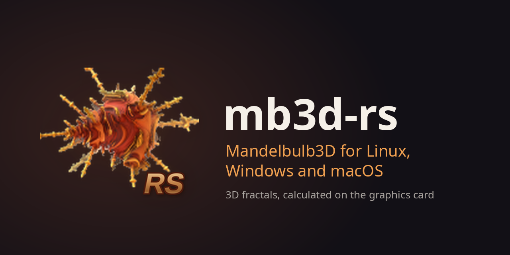

# mb3d-rs — Mandelbulb3D for Linux, Windows and macOS

mb3d-rs is [Mandelbulb3D](https://github.com/thargor6/mb3d) (MB3D), the
3D fractal program, rewritten so that it runs on today's computers: on
**Linux, Windows and macOS**, and with the picture calculated on the
**graphics card** where MB3D could only use the processor. It opens MB3D's
parameter files (`.m3p`, `.m3i`, text parameters from forums), uses MB3D's
formulas and maps, and makes the same pictures.

<a href="docs/img/main_window.jpg">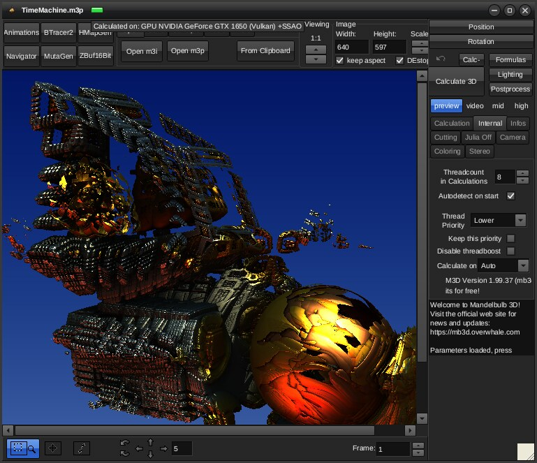</a>

It comes as two programs:

* **Mandelbulb3D** — the desktop program, with MB3D's own windows: the
  main window, Formulas, Lighting, Post processing, Navigator, Animation,
  Batch, Big renders, Monte Carlo, Voxel export, Bulb Tracer 2, MutaGen
  and the rest. If you know MB3D, you know this program; MB3D's tutorials
  apply.
* **mb3d** — a command line renderer for scripts and batch jobs: pictures,
  animations, batch lists, Monte Carlo renders, voxel and mesh exports,
  all without a window.

## Is it safe to run? Check it yourself

You do not have to take our word for it. [scanrepo.dev](https://www.scanrepo.dev)
is an independent service that examines a GitHub repository for the signs
of harmful software: code that starts other programs, connects to the
internet, hides what it does, or bypasses the safety checks of the
programming language. Anyone can run it on this repository at any time:

**[▶ Scan mb3d-rs on scanrepo.dev](https://www.scanrepo.dev/scan/github/thr32423/mb3d-rs)**
(click *Rescan* for a fresh result of the current code)

Version 0.2.45 was rated **safe: 6 out of 100, no findings**, as 0.2.44
before it ([the 0.2.44 result](docs/img/scan_0.2.44.png)). An earlier version was flagged,
and we changed the code in response ([issue #4](https://github.com/thr32423/mb3d-rs/issues/4));
it is now written to stay this way. The programs contain no code that
connects to the internet; the only other program they ask your system to
open is your file manager, when you click a button to open a folder.

A scan looks for known warning signs; it is not a guarantee. These let
you check further on your own:

* **All of the source code is here.** The downloads are built from it by
  GitHub's own build servers, by the steps you can read in
  [the release workflow](.github/workflows/release.yml), not on anyone's
  personal computer.
* **Every release lists checksums** (`SHA256SUMS`), so you can confirm
  that the file you downloaded is exactly the one that was published;
  the one-line install below does this for you. Releases from 0.2.45 on
  also carry GitHub's build attestations: `gh attestation verify
  FILE --repo thr32423/mb3d-rs` shows which commit a download was built
  from.

## What is new compared with Mandelbulb3D

* **The graphics card calculates the picture** — the image itself, the
  shadows, the ambient occlusion, the reflections and the Monte Carlo
  renders. On a typical computer this is several times faster than the
  processor alone; see [Speed](#speed) below.
* **Auto mode**: the graphics card and the processor work on every picture
  together, and nothing ever waits — if the card is not ready, the
  processor starts anyway and the card joins in.
* **An LED in the title bar** shows where the last picture was calculated.
* **Interface size** from 75 to 200 % for high resolution screens.
* **Eight looks** for the windows, all of them theme files you can copy and change: two reproduce MB3D's looks, six are new.
* **Linux, Windows and macOS** (Intel and Apple Silicon).
* **A command line program** for everything that needs no window.
* **16 bit pictures**: PNG files with 65,536 instead of 256 steps per
  colour, for editing without banding (see [16 bit](#16-bit-pictures)).
* **A noise filter** for Monte Carlo and all other pictures, the DCT
  denoising known from GIMP (see [Noise filter](#noise-filter)).
* **A new formula, SphereTree**: a tree of touching spheres that branch
  smaller and smaller, by Tom Lowe (see [SphereTree](#a-new-formula-spheretree)).
* **A new formula, UlamSpiral**: Ulam's spiral of prime numbers in 3D, as
  a city, a skyline, spheres or a block (see [UlamSpiral](#a-new-formula-ulamspiral)).
* **Transparent backgrounds** for pictures and animations (see
  [Transparent background](#transparent-background)).
* **Videos of animations**: an AVI file straight from the program, or
  the ffmpeg command for a small MP4 (see
  [Video of an animation](#video-of-an-animation)).
* **A preview of parameter files** in the Open dialog (see
  [Preview](#preview-when-opening-parameters)).
* **Very big pictures in one piece**: 15000 x 20000 pixels and more
  without running out of memory, and the depth of field uses all
  processor cores (11 times faster on 24 threads than before 0.2.45, with
  the same picture).

## Download

Ready-to-run programs for the latest release, no installation needed:

| System | Download |
|---|---|
| Windows (64 bit) | [mb3d-rs-windows-x64.zip](https://github.com/thr32423/mb3d-rs/releases/latest/download/mb3d-rs-windows-x64.zip) |
| Linux (64 bit) | [mb3d-rs-linux-x64.tar.gz](https://github.com/thr32423/mb3d-rs/releases/latest/download/mb3d-rs-linux-x64.tar.gz) |
| Debian, Ubuntu, Mint (installs like other programs) | [mb3d-rs-linux-x64.deb](https://github.com/thr32423/mb3d-rs/releases/latest/download/mb3d-rs-linux-x64.deb) |
| macOS, Apple silicon (M1 and later) | [mb3d-rs-macos-arm64.tar.gz](https://github.com/thr32423/mb3d-rs/releases/latest/download/mb3d-rs-macos-arm64.tar.gz) |
| macOS, Intel | [mb3d-rs-macos-x64.tar.gz](https://github.com/thr32423/mb3d-rs/releases/latest/download/mb3d-rs-macos-x64.tar.gz) |

Unpack it and start **Mandelbulb3D** (`Mandelbulb3D.exe` on Windows) in
the unpacked folder. The folder is laid out like an MB3D installation,
with MB3D's formulas, maps and 80 example parameter files.

* If Windows shows "Windows protected your PC", click *More info* ▸
  *Run anyway*.
* macOS blocks downloaded programs that are not signed: run
  `xattr -dr com.apple.quarantine .` in the unpacked folder once.

**Alternative for Linux and macOS:** instead of downloading by hand, this
one line fetches the latest release into `~/mb3d-rs` (run it again later
to update; the script [download.sh](download.sh) is also in the program's
folder):

```sh
curl -fsSL https://raw.githubusercontent.com/thr32423/mb3d-rs/master/download.sh | sh
```

It checks the download before unpacking it, puts **Mandelbulb3D** in
your application menu (Linux) and makes `Mandelbulb3D` and `mb3d`
commands you can type in any folder. `sh ~/mb3d-rs/download.sh
--uninstall` takes the menu entry and the commands away again; your files
stay.

The Linux programs run on distributions from about 2018 on (Ubuntu 18.04,
Debian 10, Rocky/RHEL 8 and newer).

**Installed like other programs:** on Debian, Ubuntu and Mint, open the
`.deb` file above (or `sudo apt install ./mb3d-rs-linux-x64.deb`).
Mandelbulb3D is then in the application menu and `mb3d` works in any
folder; your settings and History are kept in `~/.config/mb3d-rs` and
`~/.local/share/mb3d-rs`.

[Getting started](GETTING_STARTED.md) walks through the first steps; older
versions and the release notes are on the
[releases](https://github.com/thr32423/mb3d-rs/releases) page.

## How the rendering works

A fractal picture is calculated pixel by pixel: for every pixel a ray is
followed into the scene until it hits the fractal's surface, the formula
being evaluated dozens of times at every step. MB3D does this on the
processor, using all its cores. mb3d-rs can do the same, and it can also
hand the work to the **graphics card**, which has thousands of small
processors and is built for exactly this kind of job.

The **"Calculate on"** setting (Internal tab of the main window) chooses:

| | |
|---|---|
| **Auto** (default) | The card and the processor share the picture: the card takes rows from the top, the processor's threads from the bottom, until they meet. The card then does the shadows and the ambient occlusion. |
| **CPU** | The processor only, as in MB3D. |
| **Graphics card** | The card only (it waits until its program is ready). |

The first time a combination of formulas is used, the graphics driver
has to prepare a program for the card — the *shader* — which takes 10 to
15 seconds on the computer measured below. In Auto mode the processor
simply starts without it and the card joins when it is ready, so a small
picture never waits. The prepared shader is kept for the next time (by
the graphics driver, on Linux in the `ShaderCache` folder next to the
program), so the next picture with the same formulas starts on the card
at once.

The **LED** right of the window title tells where the last picture was
calculated: green on the graphics card, orange partly, red on the
processor. Pointing at it shows the details.

[How the rendering works](docs/RENDERING.md) tells the whole story with
pictures: what Auto does the first time, why the card is not always the
faster choice, and what the colours of the LED mean.

Not everything can go to the card: a few formulas cannot be translated for
it, scenes with volumetric light stay on the processor, and views zoomed
in very deeply are calculated in double precision (which only some cards
can do). The program decides all of this by itself; you only see it in the
LED.

## Speed

All measurements on one computer: an AMD Ryzen 9 3900X (12 cores, 24
threads) with an NVIDIA GeForce RTX 2060, on Linux. The original
**Mandelbulb3D 1.99sr37** was run on the same machine under Wine (its
Windows program runs there unchanged, at full speed, using all cores),
and timed from the click on *Calculate 3D* to the finished picture.
Each parameter file was rendered at the same image size by all three:
MB3D, mb3d-rs on the processor only (**CPU**) and mb3d-rs in **Auto**
mode (graphics card and processor together). The Auto times are those of
the second render of a file, with the card's shader already prepared; the
first render of a new formula combination adds the 10–15 s of shader
preparation on this card.

### MB3D's 80 example parameter files

The example files that come with MB3D (and in this program's
`M3Parameter` folder), each at its own image size.

MB3D could not calculate one of the files (*Test8*: it stops with a "Division by zero" error), so the comparisons count 79 files.

* **mb3d-rs on the processor alone is faster than MB3D** in 71 of the 79 files, a median **1.7 times**; all files together took MB3D 18 min 21 s and mb3d-rs on the processor 17 min 10 s.
* **Auto mode** is faster than MB3D in 77 of 79 files (median 2.1 times); all files together 8 min 17 s. In 30 of the files the processor finished alone, mostly because it needs only a few seconds, before the card gets a turn — there Auto is simply the processor plus a moment's overhead. The card joined in 49 files, the slower ones, where it made the picture a median 1.6 times faster than the processor (up to 13 times: *Insect Menger*, 4.7 s instead of 63.0 s).
* In 4 files Auto was noticeably slower than the processor alone (*Ellarien - Shrooms are coming*, *MengerTrees*, *toricaleggs*, *TreePlanet*): there the card is slower than the 24 processor threads for the scene.
* "Rows on the card" is the share of the picture the graphics card marched in Auto mode (– when the processor finished alone).

<details>
<summary>All 80 files (click to open)</summary>

| Parameter file | MB3D (Wine) | mb3d-rs CPU | mb3d-rs Auto | rows on the card | Auto vs MB3D |
|:--|--:|--:|--:|--:|--:|
| 0Encrypted0 - ABoxSOff4d example | 12.8 s | 7.4 s | 1.9 s | 80 % | 6.7× |
| 6 AM - Torii temple | 23.0 s | 20.4 s | 17.8 s | 60 % | 1.3× |
| Abominog-Ua - 12.06.2014 | 7.6 s | 8.0 s | 7.4 s | 50 % | 1.0× |
| ABoxPartlyJuliaRoff | 2.5 s | 1.4 s | 1.6 s | – | 1.6× |
| ABoxScale2Start | 1.0 s | 0.1 s | 0.3 s | – | 3.3× |
| ABoxScale3Start | 1.5 s | 0.1 s | 0.3 s | – | 5.0× |
| AboxShapes-Misty | 27.5 s | 25.6 s | 17.7 s | – | 1.6× |
| Aexion 10bulbs | 11.5 s | 9.8 s | 2.6 s | 73 % | 4.4× |
| AkuraPare - 463b | 4.0 s | 2.0 s | 0.7 s | 72 % | 5.7× |
| ApolloBalloons dIFS | 75.8 s | 73.2 s | 24.9 s | 57 % | 3.0× |
| AureliusCat - Bamboo | 2.0 s | 1.2 s | 0.7 s | 58 % | 2.9× |
| BatJorge - Pong 703 - Swirls | 4.0 s | 2.8 s | 3.1 s | – | 1.3× |
| Bill-Snowzell - Tweak - Canyon | 4.0 s | 1.6 s | 1.7 s | 44 % | 2.4× |
| Blood on the dancefloor | 7.6 s | 4.4 s | 3.2 s | – | 2.4× |
| BulboxCut | 4.0 s | 2.3 s | 2.3 s | – | 1.7× |
| Chrystal | 5.6 s | 5.2 s | 1.7 s | 79 % | 3.3× |
| cutted sphere over carpet | 7.1 s | 20.7 s | 4.5 s | 48 % | 1.6× |
| Dainbramage - Home of the Ancients | 3.0 s | 1.3 s | 1.2 s | 25 % | 2.5× |
| Dainbramage - Hydra | 3.5 s | 1.7 s | 1.6 s | 41 % | 2.2× |
| Dainbramage - Nothing left but bones | 4.0 s | 3.0 s | 2.4 s | 49 % | 1.7× |
| DEcomb1 | 83.9 s | 93.5 s | 80.3 s | 48 % | 1.0× |
| dIFS heart shrub | 2.5 s | 3.5 s | 3.0 s | – | 0.8× |
| dIFS heart shrub otrap | 5.1 s | 15.6 s | 3.6 s | 93 % | 1.4× |
| dIFS shrub | 4.0 s | 17.3 s | 3.6 s | 93 % | 1.1× |
| Dodeca Torus mix | 2.0 s | 0.5 s | 0.6 s | 14 % | 3.3× |
| DsyneGrafix - Getting Loopy | 2.0 s | 0.8 s | 0.8 s | 25 % | 2.5× |
| Ellarien - Embellished | 3.5 s | 1.1 s | 1.2 s | 49 % | 2.9× |
| Ellarien - Shrooms are coming | 8.1 s | 6.2 s | 6.8 s | – | 1.2× |
| ExcludeBulbMeng | 17.3 s | 12.9 s | 8.5 s | – | 2.0× |
| Fishbowl | 4.6 s | 3.5 s | 1.9 s | 49 % | 2.4× |
| Fractales75 - Kiosk | 3.0 s | 1.8 s | 1.9 s | 47 % | 1.6× |
| Genetic Menger | 1.5 s | 0.5 s | 0.6 s | 46 % | 2.5× |
| genQuat helix mix | 4.0 s | 3.3 s | 1.8 s | 61 % | 2.2× |
| HalTenny - Freak Of Nature | 2.5 s | 0.9 s | 1.2 s | – | 2.1× |
| Hal-Tenny-Resistance (slow) | 18.9 s | 20.3 s | 8.7 s | 78 % | 2.2× |
| Hyperben2 - Ozosphere tweak | 2.0 s | 0.8 s | 0.6 s | 56 % | 3.3× |
| ImpossibleWorld dIFS | 399.8 s | 367.5 s | 99.0 s | 71 % | 4.0× |
| InAndOutside box | 5.1 s | 2.7 s | 1.4 s | 68 % | 3.6× |
| Insect Menger | 4.0 s | 63.0 s | 4.7 s | 93 % | 0.9× |
| Jost1 - Tweak - New tiny temple | 3.5 s | 1.6 s | 1.0 s | 60 % | 3.5× |
| julia on box | 4.6 s | 4.0 s | 1.6 s | 73 % | 2.9× |
| JuliaSetSample | 3.0 s | 1.9 s | 2.2 s | – | 1.4× |
| KentPress - Parameter 3 tweak fogits | 4.0 s | 2.5 s | 3.0 s | – | 1.3× |
| KochSurf Sample 6 | 3.0 s | 1.4 s | 0.8 s | 75 % | 3.8× |
| Lenord - ASurf 2 | 5.1 s | 1.7 s | 1.9 s | 48 % | 2.7× |
| Lenord - Between Dark and Light | 5.6 s | 3.8 s | 2.1 s | 60 % | 2.7× |
| Lenord - The Beanstalk | 3.5 s | 1.8 s | 2.0 s | – | 1.8× |
| LightBulbMoon - A Fabulous Excuse | 3.5 s | 2.0 s | 1.6 s | – | 2.2× |
| LightBulbMoon - No, Never | 5.1 s | 4.0 s | 1.2 s | 82 % | 4.2× |
| Mandelwerk - Makin seashell | 12.0 s | 8.1 s | 8.1 s | 30 % | 1.5× |
| Mandelwerk - TgladTetra inner spirals | 8.6 s | 4.5 s | 1.1 s | 80 % | 7.8× |
| MarkJayBee - Curvichrome | 2.5 s | 1.3 s | 1.3 s | – | 1.9× |
| material colors | 3.0 s | 1.4 s | 1.9 s | – | 1.6× |
| Melting spot bloxx | 23.2 s | 20.4 s | 7.6 s | 73 % | 3.1× |
| Mengerplus for MC | 3.5 s | 2.2 s | 2.5 s | – | 1.4× |
| MengerTrees | 19.3 s | 15.4 s | 16.9 s | – | 1.1× |
| MutaGenD4B12E71C70D4FD00357_canary~ | 7.1 s | 3.7 s | 4.1 s | – | 1.7× |
| Oxnot - Flexing | 2.5 s | 0.7 s | 0.7 s | 59 % | 3.6× |
| Oxnot - Shells | 5.6 s | 3.3 s | 3.6 s | – | 1.6× |
| PaMonk - Ringlets | 5.1 s | 2.7 s | 2.8 s | – | 1.8× |
| QuatP4hybridJulia | 1.5 s | 0.2 s | 0.4 s | – | 3.8× |
| Rama - Elysium | 11.5 s | 10.6 s | 5.5 s | 74 % | 2.1× |
| Recycledrelatives - Fractal Fan | 2.0 s | 0.4 s | 0.6 s | 31 % | 3.3× |
| Recycledrelatives - Test for SurfMod | 4.6 s | 3.0 s | 3.1 s | – | 1.5× |
| Rowratty - Spirals | 4.0 s | 2.5 s | 1.0 s | 69 % | 4.0× |
| Sabine62 - Housing problem | 11.7 s | 10.5 s | 6.8 s | – | 1.7× |
| spineJulia | 91.9 s | 71.7 s | 50.7 s | 35 % | 1.8× |
| Surreal shell | 2.0 s | 0.6 s | 0.8 s | – | 2.5× |
| Test8 | error in MB3D | 0.1 s | 0.3 s |  | – |
| Theli-At - Black Mandelbulb | 1.0 s | 0.2 s | 0.5 s | 22 % | 2.0× |
| Theli-At - Bone Menger using MH | 2.0 s | 0.7 s | 1.1 s | – | 1.8× |
| Theli-At - MengerSpheres | 2.0 s | 0.6 s | 0.6 s | 50 % | 3.3× |
| ThePearl dIFS | 2.5 s | 1.4 s | 1.2 s | 25 % | 2.1× |
| TimeMachine | 1.0 s | 0.5 s | 0.7 s | – | 1.4× |
| toricaleggs | 8.6 s | 5.6 s | 6.6 s | 40 % | 1.3× |
| TreePlanet | 7.6 s | 6.6 s | 7.5 s | – | 1.0× |
| UndeadAcademy tweak - Peacock in blue | 7.6 s | 4.5 s | 1.2 s | 74 % | 6.3× |
| Virtual tubes world (UndeadAcademy style) | 9.1 s | 6.9 s | 4.3 s | 49 % | 2.1× |
| Wada basin - Reflect test | 6.6 s | 4.1 s | 4.6 s | 40 % | 1.4× |
| Waste-and-tragedy - Mandalex | 5.1 s | 3.4 s | 3.8 s | – | 1.3× |

</details>

The pictures are the same: mb3d-rs on the processor makes MB3D's picture
to within rounding, and the Auto pictures differ from the processor's by a
fraction of a percent of the colour range on average (fine detail may
sparkle in different pixels; the [technical notes](docs/TECHNICAL.md)
have the measurements).

## The windows

**Prefs ▸ Visual themes** offers eight looks, each a file in the `Themes`
folder: *Glossy* (the dark default) and *Windows* reproduce MB3D's own
two looks, the other six are new. Click a picture for its full size.

| | |
|---|---|
| <a href="docs/img/themes/Glossy.jpg"></a> | <a href="docs/img/themes/Windows.jpg">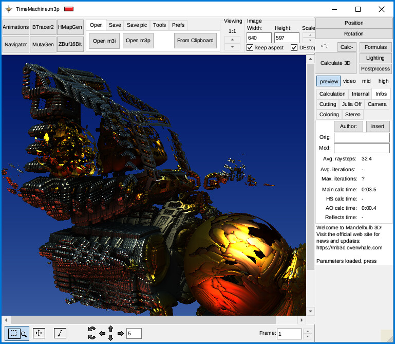</a> |
| **Glossy**: MB3D's default | **Windows**: MB3D's "Themes off" |
| <a href="docs/img/themes/Graphite.jpg">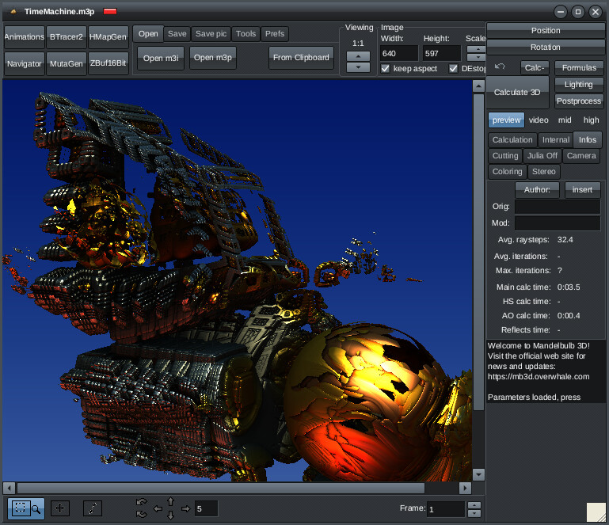</a> | <a href="docs/img/themes/Daylight.jpg">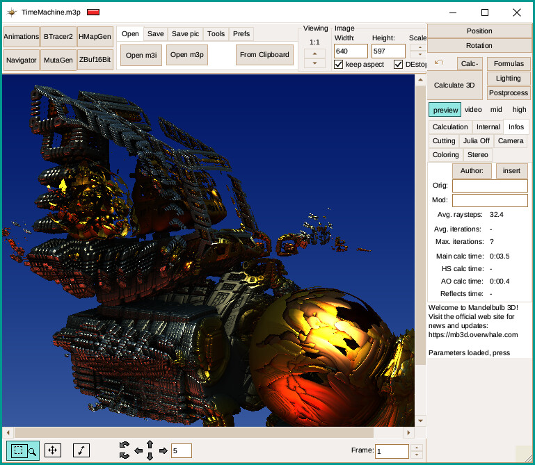</a> |
| **Graphite**: lighter neutral grey, steel-blue accents | **Daylight**: warm light grey, teal accents |
| <a href="docs/img/themes/Midnight.jpg">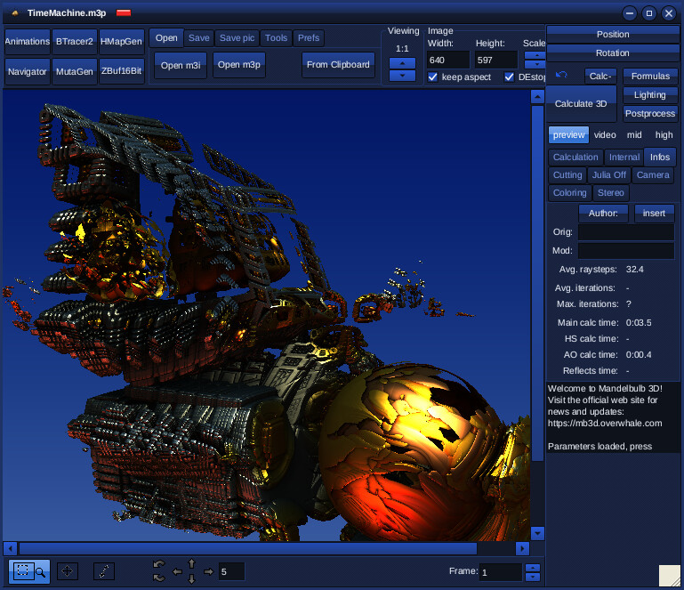</a> | <a href="docs/img/themes/Ember.jpg">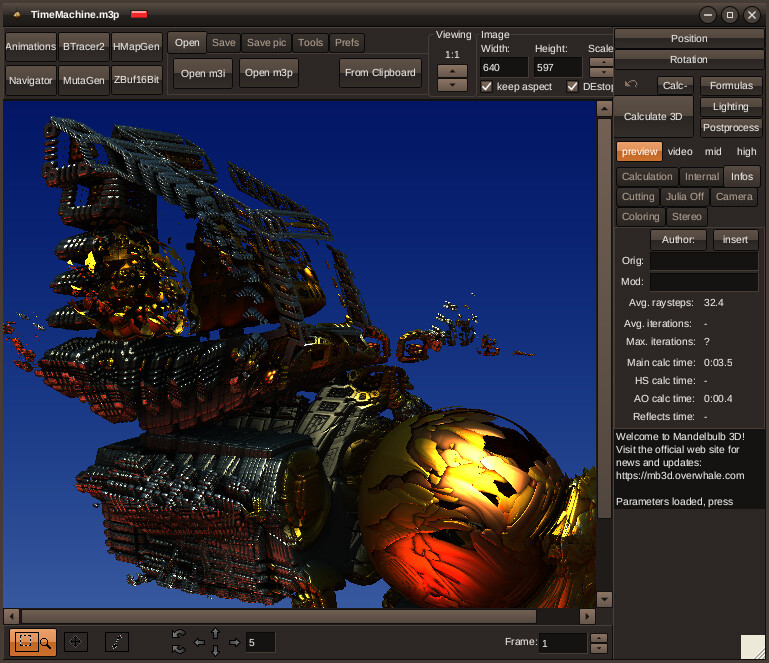</a> |
| **Midnight**: deep navy, blue accents | **Ember**: warm charcoal, orange accents |
| <a href="docs/img/themes/Forest.jpg">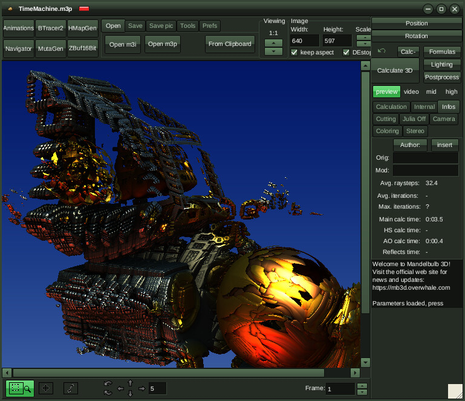</a> | <a href="docs/img/themes/Highcontrast.jpg">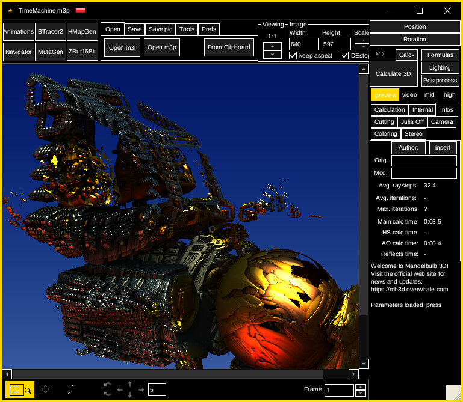</a> |
| **Forest**: dark green-grey, green accents | **High contrast**: black, white text, yellow highlights |

A theme is a small text file in the `Themes` folder next to the program;
copy one, change its colours, and it appears in the list at the next
start.

**Prefs ▸ Visual themes ▸ Interface size** makes all windows and their
text larger or smaller (75 to 200 %), for high resolution screens; the
layouts stay exactly as in MB3D.

| 100 % | 150 % |
|---|---|
| 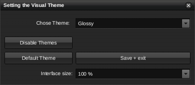 |  |

The windows are MB3D's own — made from MB3D's original window
definitions, so every button, slider and hint is where it is in MB3D:

* **Main window:** open and save parameters (`.m3p`, `.m3i`, text, the
  clipboard), save pictures (PNG, JPEG, BMP, 16 bit Z-buffer), the mouse
  modes, the rotation buttons, image size, the quality presets, undo,
  *Calculate 3D* with the growing picture and the statistics, and all
  the pages (Calculation, Internal, Infos, Cutting, Julia, Camera,
  Coloring, Stereo).
* **Formulas:** the six formula slots, MB3D's formula lists and options,
  hybrid types, favourites, and the JIT formula editor.
* **Lighting:** lights 1–6, presets, the palette, the Object, Ambient,
  d.Fog and Back pic pages; changes repaint the picture at once, without a
  new calculation.
* **Post processing:** normals on the z-buffer, hard and ambient shadows,
  reflections and transparency, depth of field.
* **Navigator:** walk and look around with keys and mouse, then *View to
  main*.
* **Animation maker, Batch processing, Big renders, Monte Carlo, Voxel
  export, Bulb Tracer 2** (meshes) with the mesh preview, the **HeightMap
  generator, MutaGen, ZBuf16Bit, Map sequences, Ini dirs** — all as in
  MB3D.

### 16 bit pictures

MB3D saves 8 bit pictures: 256 steps per colour. That is plenty to look
at, but when a picture is edited afterwards — brightness, contrast,
curves — smooth areas such as the background or fog break into visible
bands. **Save pic ▸ PNG** offers a second file type, **PNG 16 bit
colour**: the colours as the program calculated them, before they are
rounded to 256 steps, with all shadows, reflections and depth of field.
The file looks the same, and stays smooth when it is edited.

<a href="docs/img/png16_compare.png">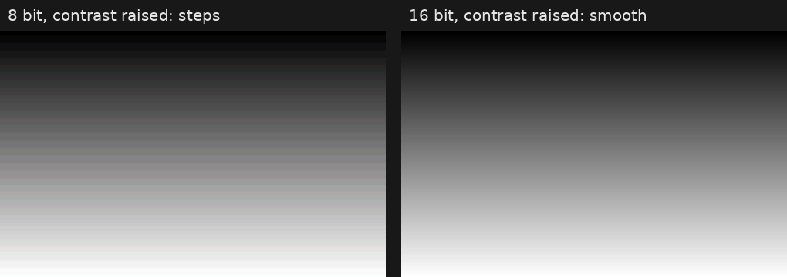</a>

<a href="docs/img/save_png16.png">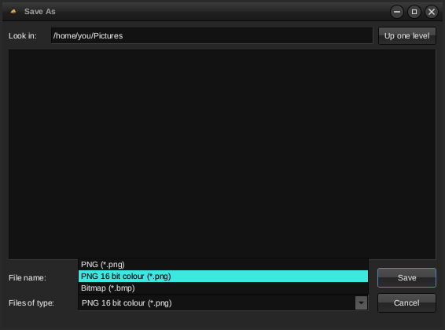</a>

### Preview when opening parameters

**Open ▸ Open m3p** and **Open m3i** show a small picture of the
clicked parameter file, with its size and formulas, before it is
opened; the arrow keys move through the list with the preview. The
picture is calculated in the background on the processor, so the
dialog stays responsive, and each file's preview is kept while the
program runs.

<a href="docs/img/open_preview.png">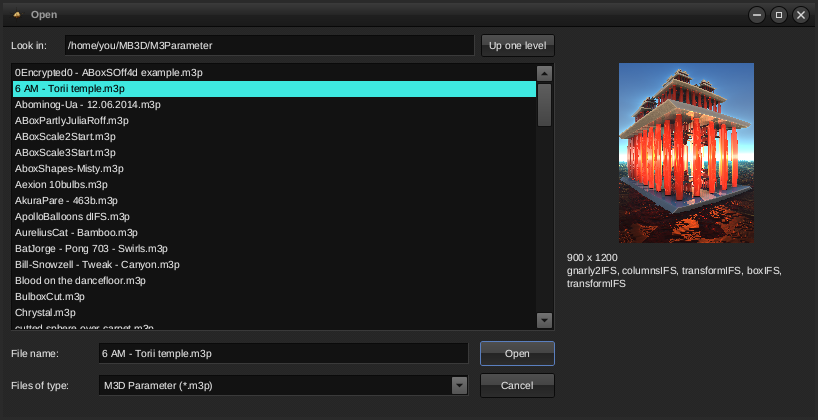</a>

### Transparent background

Pictures and animation frames can be saved with a **transparent
background**, to put the fractal onto another picture or into a video
editor: **Save pic ▸ PNG ▸ PNG transparent background**, and in the
Animation maker **Transparent background** (PNG frames). With anti-aliasing (a
viewing scale of 1:2 or more, or `--aa`) the edges are soft, and they
carry no fringe of the old background colour. Depth pictures for
compositing were already there (*Save Z buffer too*, `--depth`).

<a href="docs/img/transparent.png">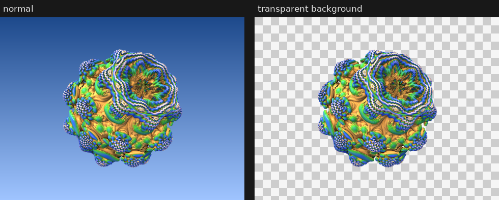</a>

### Video of an animation

In the Animation maker, **Also make a video (AVI)** joins the frames into
a video when they are rendered, at the **Frames per second** you set:
`<project name>.avi` in the output folder, next to the frames, which are
kept. It plays in VLC and mpv and opens in video editors (Kdenlive,
Shotcut, DaVinci Resolve). Each frame is stored as a whole picture, so the
files are big: good for editing and keeping, less for sharing.

For a small video to share, **FFmpeg command** puts the command for an MP4
(or, with a transparent background, a WebM) on the clipboard and in the
messages. Install [ffmpeg](https://ffmpeg.org), paste the command into a
terminal when the frames are done, and it makes the video; this program
starts no other programs itself.

<a href="docs/img/anim_video.png">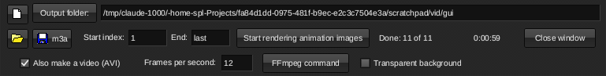</a>

### Navigator: exact values and Reset view

* **Click a value** in the Navigator's panels — Julia values, formula
  values, 4D rotation, the Misc values — and type the exact number, as in
  MB3D (angles in degrees). The slider then continues from that value.
* **Click the zoom** and type it, when the zoom steps are too coarse (a
  wish from MB3D's issue list); a typed zoom stays (*Fixed zoom*).
* **Reset view** goes back to the position, direction and zoom the
  Navigator took from the main window; the adjusted values stay.

<a href="docs/img/navigator_values.png">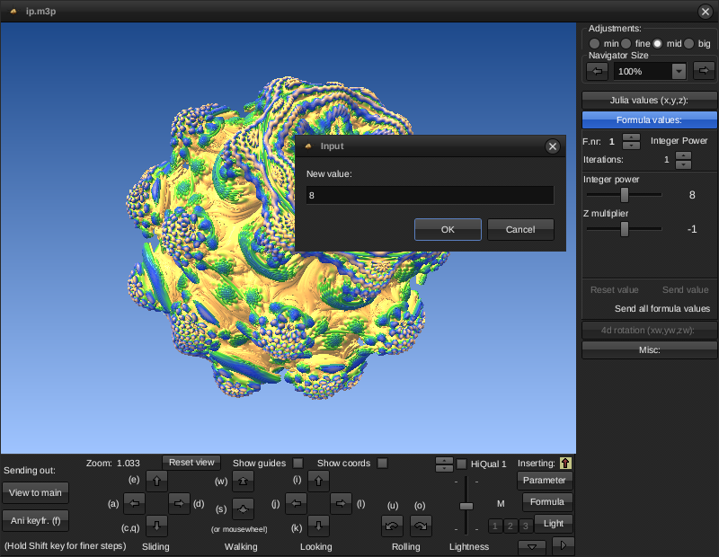</a>

### Noise filter

A **noise filter** removes grain from the pictures: the **DCT denoising**
of GIMP's *Filters ▸ Enhance ▸ Noise Reduction ▸ Denoise DCT*, which of
GIMP's filters suited these pictures best (see the credits below).

* **Monte Carlo window ▸ -noise** (a button MB3D had hidden): filters the
  shown picture, and the saved one, with a strength that follows the rays
  per pixel. The rendering itself goes on unfiltered, and its next update
  shows it unfiltered again.
* **Post processing ▸ Noise Filter**: *Filter now* filters the picture of
  the main window; *Filter new pictures automatically* filters every new
  one. *Strength* is the strength of the noise to remove (4 is light;
  higher removes more grain and more fine detail).

Monte Carlo pictures have the most grain. Against pictures rendered with
512 rays per pixel, the filtered pictures were closer than the unfiltered
ones in all 13 tests (four scenes, 4 to 32 rays): by up to 23 % at 4 rays,
5 to 10 % at 8 rays, 1 to 3 % at 32 rays, where little grain is left.

<a href="docs/img/mc_noise.png">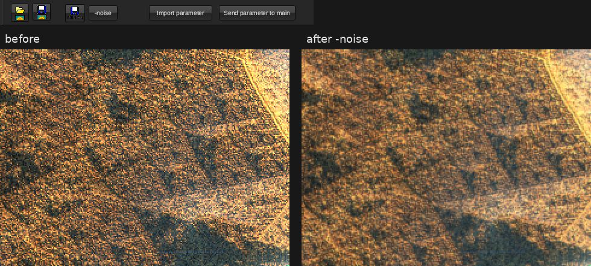</a>

<a href="docs/img/postpro_noise.png">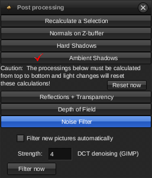</a>

### A new formula: SphereTree

**SphereTree** is a formula Mandelbulb3D does not have: a tree of spheres
that touch each other and branch into smaller and smaller spheres, like
foam or coral. Tom Lowe, who invented the Mandelbox, published it in 2020
(see the credits below). It is in the formula list with the dIFS formulas
and has four settings:

* **PackRatio** (0 to 1.22): the size of the spheres; at 1 they just
  touch, above 1 the outer ones break off.
* **Levels**: how deep the tree goes (6 is plenty for most pictures).
* **Rotated**: 1 turns every level a twelfth of a turn, and the tree
  becomes a round ball of sphere clusters.
* **Colour scale**: every branch of the tree has its own colour. Choose
  *2nd choice* (the orbit trap) in the colour settings of the Lighting to
  see them; this setting spreads them over the colour gradient.

It works alone and after dIFS transforms (the third picture repeats it
with *tilingbrickIFS*), and it is calculated on the graphics card as well
as on the processor. Set the iterations to 1: the formula calculates the
whole tree at once. Parameters with SphereTree open only in this program,
not in Mandelbulb3D.

<a href="docs/img/spheretree_ball.jpg">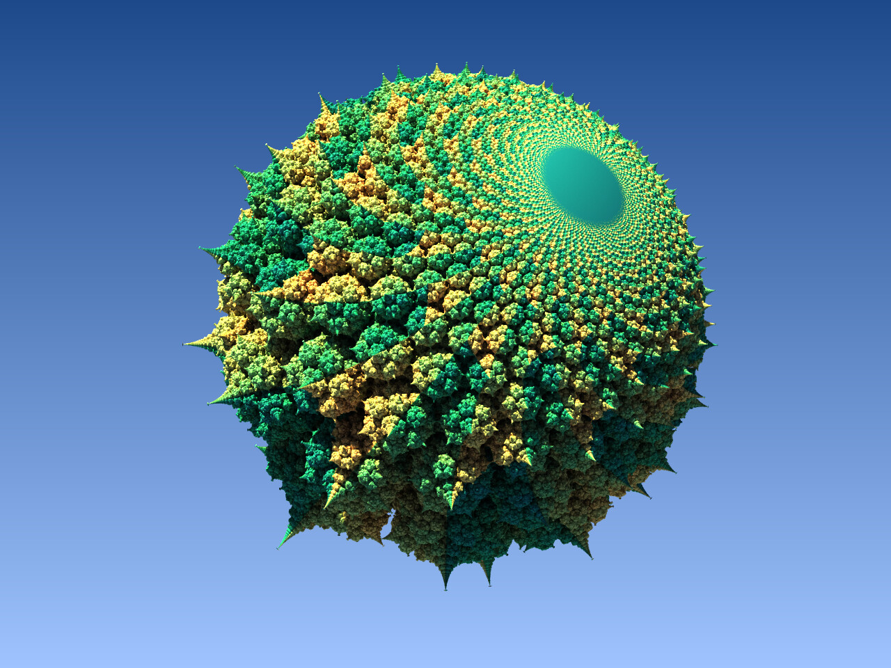</a>

| <a href="docs/img/spheretree_close.jpg">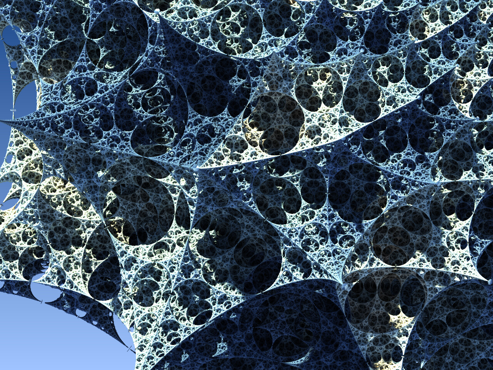</a> | <a href="docs/img/spheretree_swarm.jpg">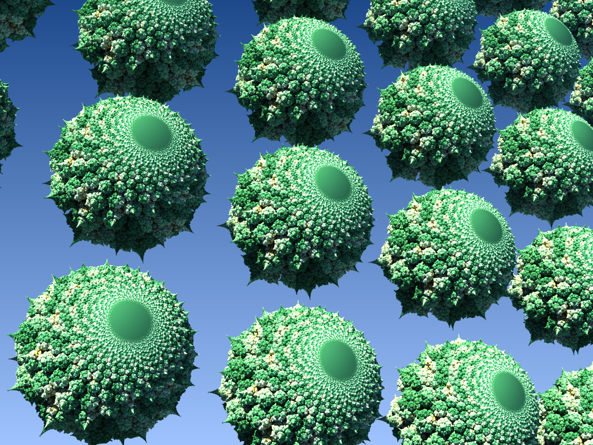</a> |
|:---:|:---:|

### A new formula: UlamSpiral

In 1963 the mathematician Stanisław Ulam wrote the numbers 1, 2, 3, …
on a square spiral and marked the prime numbers: they line up on
diagonal lines, which nobody has fully explained to this day.
**UlamSpiral** builds that spiral in 3D, one shape per number, in four
forms (*Mode*):

* **0, prime towers**: a plate for every number and a tower on each
  prime. The diagonal lines of primes become rows of towers.
* **1, divisor skyline**: a column for every number, the higher the more
  divisors it has; the primes are the low streets between them.
* **2, divisor spheres**: a sphere for every number, the larger the more
  divisors it has (the primes are the small ones).
* **3, a block of primes**: the numbers wound around cube shells instead
  of a square, a cube on each prime.

*Rings* sets the size of the spiral (60 rings are the numbers up to
14,641), *Height* the height of the towers or columns, *Gap* the space
between them. With *2nd choice* (the orbit trap) in the colour settings
the colour follows the number of divisors, so the primes have a colour
of their own. Like SphereTree it runs on the graphics card and the
processor, works after dIFS transforms, needs only 1 iteration, and
parameters with it open only in this program.

<a href="docs/img/ulam_city.jpg">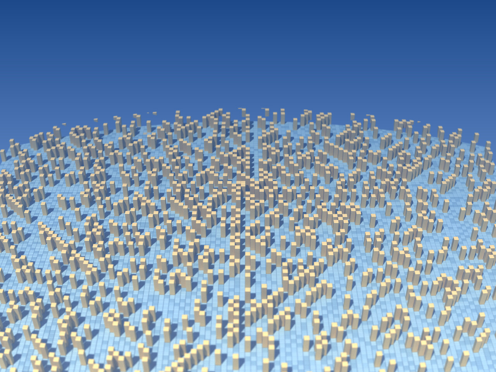</a>

| <a href="docs/img/ulam_skyline.jpg">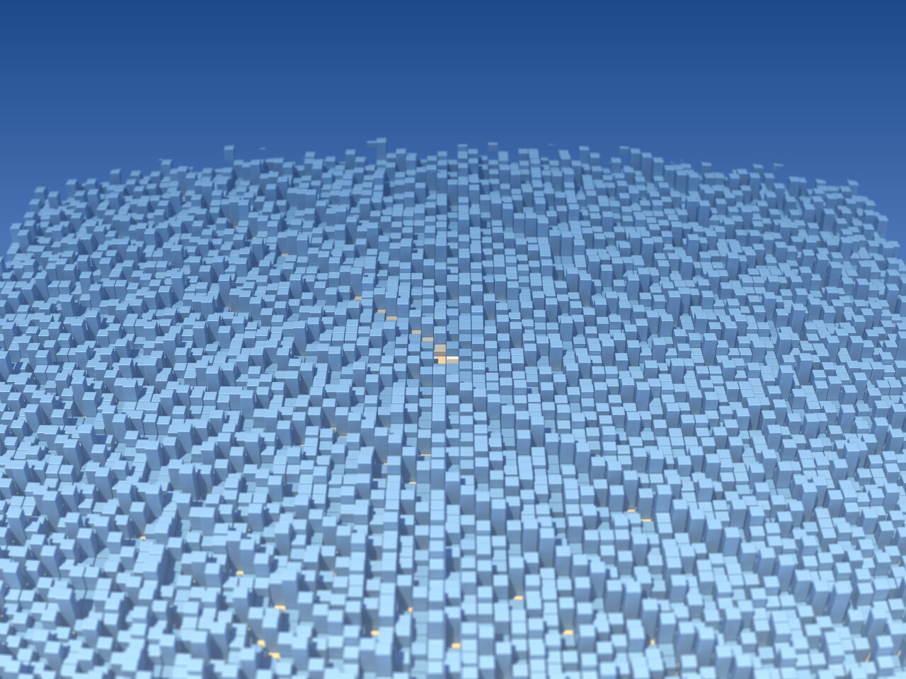</a> | <a href="docs/img/ulam_spheres.jpg">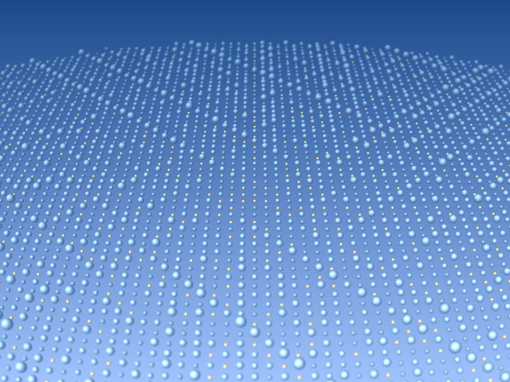</a> | <a href="docs/img/ulam_block.jpg">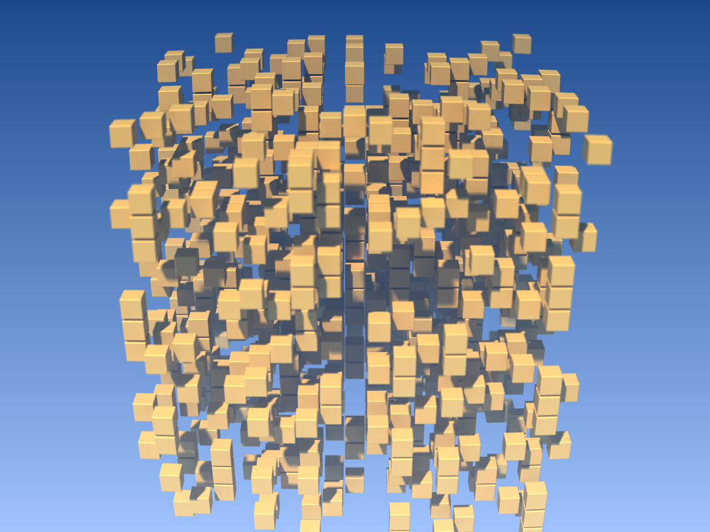</a> |
|:---:|:---:|:---:|

## Restored Mandelbulb3D functionality

Things Mandelbulb3D has that earlier versions of this port were missing.
They work as in MB3D.

### Animated GIF of the preview

When the **Preview** of the Animation maker has rendered all its frames,
the **AniGif** button saves them as an animated GIF that plays in a loop
at the preview's frames per second, with the frame numbers if *Show frame
nr* is ticked. That's handy for showing a flight on a forum or in a chat.

<a href="docs/img/anigif.png">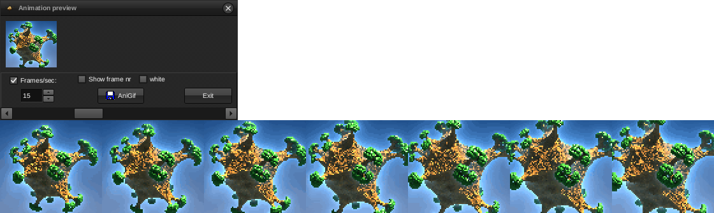</a>

### Paint colours on the image

In the colour window (**Lighting** → **Object** tab → click the colours),
click a colour on the colour bar and tick **Paint on image**. A round brush then follows the mouse over
the picture: click or drag to paint that colour on the object. Only the
surface at about the depth of the brush's middle is painted, so a brush
over a branch does not colour the ground behind it. Turn the mouse wheel
for a bigger or smaller brush, and right-click it to switch between a
disc and a square. The painting lives in the calculated image (save it as
`.m3i` to keep it); a new calculation starts from fresh colours.

<a href="docs/img/paint_on_image.png">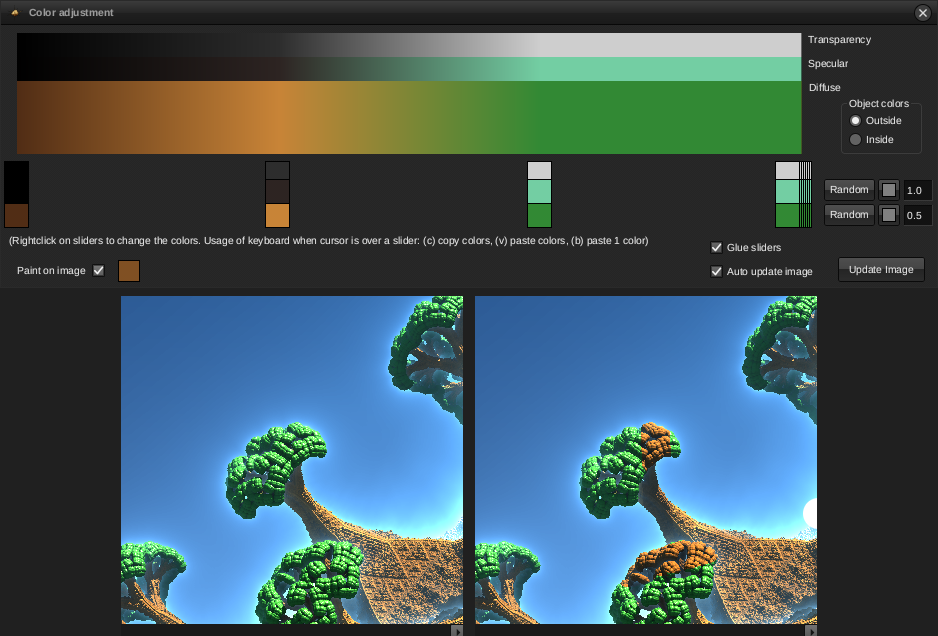</a>

### Calc-: a quick rough picture

**Calc-** (next to *Calculate 3D*) calculates one pixel in every 8×8
block of the full picture and fills the block with it: a rough view of
the whole picture in a fraction of a second, to check the framing and the
colours before the real calculation. TreePlanet at 1600×1450 takes 0.13
seconds this way, against 7.7 seconds for the full picture on the
processor. Shadows and ambient occlusion are left out.

<a href="docs/img/calc_rough.png">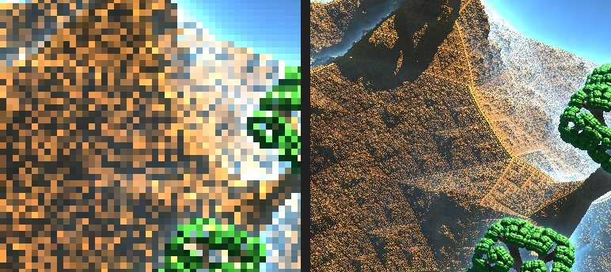</a>

### Windows that stick to the main window

The **Formulas**, **Lighting** and **Post processing** windows open
right beside the main window and follow it when you move or resize it.
Right-click their buttons to stick a window to the left side instead, or
to let it move freely. The choice is kept for the next start. A free
window opens where it was last closed.

<a href="docs/img/sticky_menu.png">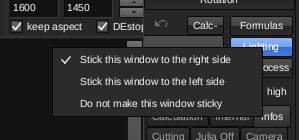</a>

### Parameters from before Mandelbulb3D 1.6

Parameter files, `.m3i` images and text parameters saved by the early
Mandelbulb3D versions (before 1.6) open again. They are
brought up to date the way Mandelbulb3D does it: the formula and the old
"alt. hybrid" become today's formula tabs, the old colours and lights
become today's lighting, and an old `.m3i` image shows its picture without
a new calculation.

### Old animation projects

Animation projects (`.m3a`) saved by the early Mandelbulb3D versions open
in the Animation maker and with `mb3d animate`, with their keyframes,
sub-frame counts and preview pictures. Their keyframes are brought up to
date like old parameter files.

### Reflections and recalculation in a selection

In **Post processing**, *Calculate only a selection in the image* lets you
drag a rectangle on the picture; **Calculate now** then calculates the
reflections only there, which takes a fraction of the time for the whole
picture (a second instead of ten in the example below). **Recalculate a
selection** marches only the rectangle again, with its shadows if they are
ticked, and repaints its rows; the rest of the picture stays as it was.
**Stop** ends every post processing step at once.

<a href="docs/img/reflect_selection.jpg">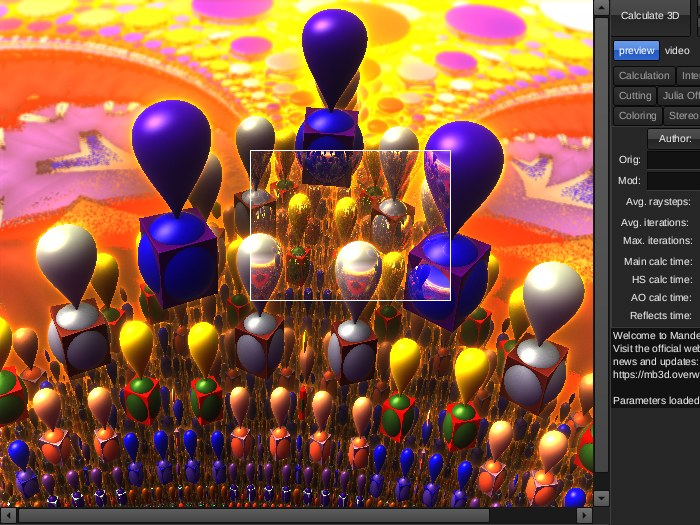</a>

### Smaller things

* **Save dialogs:** choosing another file type changes the extension of
  the file name, and a name typed without one gets the chosen type's.

## The command line

`mb3d` renders without a window. Open a terminal in the program's folder
(on Windows a command prompt in the unpacked folder, and type `mb3d`
instead of `./mb3d`). After the one-line install on Linux or macOS, `mb3d`
works in any folder, `man mb3d` shows its manual, and the Tab key
completes its options in bash, zsh and fish:

```sh
./mb3d "M3Parameter/6 AM - Torii temple.m3p" -o torii.png      # full size
./mb3d "M3Parameter/6 AM - Torii temple.m3p" --scale 0.25 -o small.png
./mb3d pasted.txt -o pasted.png        # parameters copied from a forum post
./mb3d City.m3p --tiles 4x4 -o city.png    # a big picture in tiles
./mb3d --cpu City.m3p -o city.png          # processor only
./mb3d --card City.m3p -o city.png         # graphics card only
./mb3d City.m3p --bits 16 -o city16.png    # 16 bit colour
./mb3d City.m3p --denoise 4 -o city.png    # with the noise filter
./mb3d City.m3p --aa 2 --transparent -o city.png   # transparent background
./mb3d City.m3p -o - | display -          # the picture into another program
./mb3d --help                              # all options
```

Everything else has a sub-command with its own `--help`:

```sh
./mb3d batch M3Parameter --scale 0.2 -o previews        # a whole folder
./mb3d animate start.m3p middle.m3p end.m3p --frames 60 -o frames
./mb3d animate project.m3a -o frames                     # MB3D animations
./mb3d animate project.m3a -o frames --transparent      # ... see-through
./mb3d animate project.m3a -o frames --video flight.avi  # ... and a video
./mb3d montecarlo scene.m3p --rays 64 -o mc.png
./mb3d montecarlo scene.m3p --rays 8 --denoise -o mc.png # ... with the noise filter
./mb3d voxel scene.m3p -o voxels --slices 256            # for 3D printing
./mb3d mesh scene.m3p -o object.stl                      # Bulb Tracer 2
./mb3d mutagen scene.m3p -o muta                         # 15 variations
```

The formulas and maps are found next to the program; those of another
MB3D installation can be given with `--formulas` and `--maps`.
Animations are MB3D's: keyframes with MB3D's interpolation, `.m3a`
projects opened and saved, frames written like MB3D so that an
interrupted animation continues and several computers can share one.

## Good to know

* **Same pictures, not bit-identical.** MB3D calculated in the 80-bit
  precision of old x87 arithmetic; this program uses today's 64-bit. The
  pictures match in every structure, but single pixels can differ in the
  last digit of their colour. Monte Carlo renders and MutaGen use their
  own random numbers, so their results are not MB3D's.
* **The graphics card's pictures** differ slightly from the processor's
  (single precision); in very fine detail the sparkle can fall on other
  pixels. Deep zooms switch to double precision by themselves.
* **Speed on the processor** is close to MB3D's: the formulas' machine
  code from MB3D's `.m3f` files was translated so that it runs on any
  processor (also Apple Silicon), at a small cost; the ray marching
  itself is faster. See the tables above.
* **Big pictures** can be rendered in one piece (a 15000 x 20000 picture
  needs about 15 GB of memory; with depth of field it takes hours) or in
  tiles, also on several computers (`--tiles`, and the Big renders
  window), which needs less memory.
* **Newer or your own formulas, maps and themes** go into
  `~/.local/share/mb3d-rs/M3Formulas`, `.../M3Maps` and `.../Themes`
  (any way of installing; on Windows `%APPDATA%\mb3d-rs\...`). They
  are used in addition to the ones that
  come with the program, and replace a shipped file of the same name, so
  an updated formula from the forums takes effect without touching the
  program's folder.

## Updates

Every release, newest first, with the time it was published and the
changes (commits) it brought. Each commit links to its full description
and code on GitHub; the downloads of a release are on its page. Times are
in UTC.

<!-- updates:start -->
### [v0.2.47](https://github.com/thr32423/mb3d-rs/releases/tag/v0.2.47) · 16 Oct 2026, 19:16 UTC

| Commit | What it does |
|---|---|
| [`1b630d9`](https://github.com/thr32423/mb3d-rs/commit/1b630d93e5dcdcf18e479386cd0868336d13a86b) | Version number and release notes of this release |
| [`3d0cd99`](https://github.com/thr32423/mb3d-rs/commit/3d0cd998bbde720c4836d8c6b0554fc8305ccdc0) | New formula SphereTree (TGlad's sphere tree), on the CPU and the GPU |
| [`fb5f6af`](https://github.com/thr32423/mb3d-rs/commit/fb5f6af7e5de89f49362c7aded629b42fb6a1fdc) | README: banner with the RS icon |
| [`18877c8`](https://github.com/thr32423/mb3d-rs/commit/18877c893ea8007fbc4dfe3e2a525a0f697d75c6) | download.sh: say which version it installs |
| [`a87d266`](https://github.com/thr32423/mb3d-rs/commit/a87d2669ccf57c837495175b359c2eceeb7ae79e) | README: Updates for v0.2.46 |

### [v0.2.46](https://github.com/thr32423/mb3d-rs/releases/tag/v0.2.46) · 16 Oct 2026, 14:45 UTC

| Commit | What it does |
|---|---|
| [`f66b666`](https://github.com/thr32423/mb3d-rs/commit/f66b666ac1cce03672beae431c6d33cbf4610b32) | Version number and release notes of this release |
| [`fec44aa`](https://github.com/thr32423/mb3d-rs/commit/fec44aa5dce22e743bc2eb4b61f1033db4033c91) | Videos of animations without other programs: AVI, ffmpeg command |
| [`1d40e75`](https://github.com/thr32423/mb3d-rs/commit/1d40e750149a0354811ac8ee3508347c63eec0a4) | Post processing: selections as in MB3D, Stop ends every step |
| [`517f8ac`](https://github.com/thr32423/mb3d-rs/commit/517f8ac7ce0e0c9f668060210d51cbbd801d1404) | Icon: capital RS in all desktop sizes, window matched to its menu entry |
| [`cd76d6e`](https://github.com/thr32423/mb3d-rs/commit/cd76d6ebef893b293e21b64b8ad1de1c8f42cc01) | README: 0.2.45 (scan result, big pictures) |
| [`8cd70cd`](https://github.com/thr32423/mb3d-rs/commit/8cd70cd39d9353f0609a42b49b871a26337866b5) | Remove the Flatpak files |
| [`57e5baf`](https://github.com/thr32423/mb3d-rs/commit/57e5baf8356448d9eef568c5e7569c5e636dd8c6) | README: Updates for v0.2.45 |

### [v0.2.45](https://github.com/thr32423/mb3d-rs/releases/tag/v0.2.45) · 16 Oct 2026, 11:42 UTC

| Commit | What it does |
|---|---|
| [`d9c30ac`](https://github.com/thr32423/mb3d-rs/commit/d9c30ac0094c791bfb1fdbf1780e4a9625b067f7) | Version number and release notes of this release |
| [`aacab39`](https://github.com/thr32423/mb3d-rs/commit/aacab397208d60146b8b784f2b7172dbd850728f) | README and docs: checking safety, .deb, own formulas, packaging |
| [`b033779`](https://github.com/thr32423/mb3d-rs/commit/b033779f54da83e3414b15438186152096dff3d8) | Flatpak: manifest and metainfo (io.github.thr32423.mb3d-rs) |
| [`32863f4`](https://github.com/thr32423/mb3d-rs/commit/32863f4daa564c6c2bc5f2a9a4471da121f5b157) | Linux: glibc 2.28, checked download.sh, .deb, checksums, attestations |
| [`d4bf73d`](https://github.com/thr32423/mb3d-rs/commit/d4bf73d7f37d701bb5a4d5424b3e976aac4f2d11) | New icon: MB3D's icon, transparent, with "rs" |
| [`596f309`](https://github.com/thr32423/mb3d-rs/commit/596f309400d140f0f15dfe3ae3f79d69141d6715) | Standard folders for an installed program; own formulas, maps, themes |
| [`a480ad1`](https://github.com/thr32423/mb3d-rs/commit/a480ad145f0f7f81672bc5f1927dd0bed1f63d20) | mb3d: exit status, progress on a terminal only, output to a pipe |
| [`eb5f701`](https://github.com/thr32423/mb3d-rs/commit/eb5f70187e03327e02ca4cc20e111782fa9009d8) | Big pictures: reflections in bands, depth of field on all cores |
| [`3021a67`](https://github.com/thr32423/mb3d-rs/commit/3021a67924f3ca8ad9d25730b60bbd4d04a5ea89) | Infos: Avg. and Max. iterations as in MB3D |
| [`9d0b022`](https://github.com/thr32423/mb3d-rs/commit/9d0b0221c147e1133aa71230c1a48271a7653eba) | docs: scanrepo.dev result for 0.2.44 (issue #4) |
| [`2535b72`](https://github.com/thr32423/mb3d-rs/commit/2535b7225d04492e132eb21665b3108d0f8e591c) | README: Updates for v0.2.44 |

### [v0.2.44](https://github.com/thr32423/mb3d-rs/releases/tag/v0.2.44) · 15 Oct 2026, 23:01 UTC

| Commit | What it does |
|---|---|
| [`114dbb3`](https://github.com/thr32423/mb3d-rs/commit/114dbb30a067627ace13be2443aefa8a7b5de790) | Version number and release notes of this release |
| [`b0f94e1`](https://github.com/thr32423/mb3d-rs/commit/b0f94e13c4da29f0a8b742bed48f2b45a8b8191b) | Formula translation modules in src/x86/ (no #[path]) |
| [`f64b8f4`](https://github.com/thr32423/mb3d-rs/commit/f64b8f4d98abe8f7038a40e21f6cd8e43e754fe1) | No unsafe code and no started programs left (issue #4) |
| [`705b80b`](https://github.com/thr32423/mb3d-rs/commit/705b80ba3c2f8f50cae59413a8fe37f314e0e0cf) | Card: no skipped items when the CPU shares a batch |
| [`4906b50`](https://github.com/thr32423/mb3d-rs/commit/4906b5050481442116283bb61ca6c9634fa58f4c) | Monte Carlo window: Statistics and Reflections open again |
| [`1c4e174`](https://github.com/thr32423/mb3d-rs/commit/1c4e17421f9f0dc94f8d9a9351410ddcc2ea8880) | Cargo.toml: drop the removed pcsample example |
| [`f6a1a4c`](https://github.com/thr32423/mb3d-rs/commit/f6a1a4cf2a0a10f0c2a5e698f3c548ee7b0695ec) | README: Updates for v0.2.43 |

### [v0.2.43](https://github.com/thr32423/mb3d-rs/releases/tag/v0.2.43) · 15 Oct 2026, 21:36 UTC

| Commit | What it does |
|---|---|
| [`0515c31`](https://github.com/thr32423/mb3d-rs/commit/0515c313fc4a265a7b683fcc1259e9d1787ff69a) | Version number and release notes of this release |
| [`dd3c946`](https://github.com/thr32423/mb3d-rs/commit/dd3c94621f6088240b8dd10c71bfc9f3f7c9b6db) | Fewer patterns that code scanners flag (issue #4) |
| [`3658ae8`](https://github.com/thr32423/mb3d-rs/commit/3658ae8a79c30dfdec49fd2f4b0264d4238acd40) | Start-up lighting as in MB3D |
| [`2aa1bdc`](https://github.com/thr32423/mb3d-rs/commit/2aa1bdc4f5a76983085447e9a53b8c4584ca6631) | README: Updates for v0.2.42 |

<details><summary>Older releases (v0.1.0 to v0.2.42)</summary>

### [v0.2.42](https://github.com/thr32423/mb3d-rs/releases/tag/v0.2.42) · 15 Oct 2026, 19:26 UTC

| Commit | What it does |
|---|---|
| [`ec17f4c`](https://github.com/thr32423/mb3d-rs/commit/ec17f4ce447e26b52f4d0fedc20375fe4c2a4547) | Version number and release notes of this release |
| [`6b324dc`](https://github.com/thr32423/mb3d-rs/commit/6b324dcc00f57af7c81591bfd44db652fa836ede) | .m3a animation files before version 5, old keyframe formula blocks |
| [`d1fec6f`](https://github.com/thr32423/mb3d-rs/commit/d1fec6f741f4fa90ca947204729a67aa5f9ddc88) | Parameters from before MB3D 1.6 (MandId < 20) |
| [`ca87e14`](https://github.com/thr32423/mb3d-rs/commit/ca87e14aee86ac0452378a0e3b85407eec501e85) | Post processing: shown while it runs and can be stopped (issue #2) |
| [`8487744`](https://github.com/thr32423/mb3d-rs/commit/84877445d274e24d41baf536172ecdc5198ef129) | Recalculate a selection: the selection can be marked on the image (issue #3) |
| [`a87225a`](https://github.com/thr32423/mb3d-rs/commit/a87225a6ba006e4cc826f6ab34adb4578c4347dd) | Sticky windows again: Formulas, Lighting and Post processing |
| [`e9b2def`](https://github.com/thr32423/mb3d-rs/commit/e9b2def0b52641e5086591c4f7b1b81da0f9015b) | Calc-: the rough 8x8 block picture of MB3D |
| [`7939a08`](https://github.com/thr32423/mb3d-rs/commit/7939a0867c174be783330f12192c57b2009c5f1b) | Save dialogs: the file type sets the name's extension |
| [`0e742a5`](https://github.com/thr32423/mb3d-rs/commit/0e742a5de281cde31777ae49d3f97b95c7f3d59b) | README: "Restored Mandelbulb3D functionality" section |
| [`7f62d0f`](https://github.com/thr32423/mb3d-rs/commit/7f62d0fa33cfe5b0eca00b6adae4370e07dbfa7c) | AniGif: save the animation preview as an animated GIF |
| [`95c0c58`](https://github.com/thr32423/mb3d-rs/commit/95c0c586fb6653b457096e42fc0861291ca6ffa8) | Paint on image: paint palette colours on the calculated picture |
| [`9b29d56`](https://github.com/thr32423/mb3d-rs/commit/9b29d56f796855c5cda5366df3d6b64e685b7562) | docs: before/after picture of the panorama seam (issue #1) |
| [`ad5550b`](https://github.com/thr32423/mb3d-rs/commit/ad5550bdd0081003f68a0fc0601f997a27fc2961) | README: Updates for v0.2.41 |

### [v0.2.41](https://github.com/thr32423/mb3d-rs/releases/tag/v0.2.41) · 15 Oct 2026, 13:11 UTC

| Commit | What it does |
|---|---|
| [`7a134a2`](https://github.com/thr32423/mb3d-rs/commit/7a134a25a9e8efd52a7fb0e878cfe05b4ddb6c14) | Version number and release notes of this release |
| [`3435f9d`](https://github.com/thr32423/mb3d-rs/commit/3435f9dd8af04b7d2b1f1ca1d0a1ac9fbba87dec) | Workflows: a GitHub token for curl on Windows (the DXC download) |
| [`a81f74c`](https://github.com/thr32423/mb3d-rs/commit/a81f74c8f6bfb5571016b182b3023380b70da73f) | Panoramas: no seam where the left and right edges meet |

### [v0.2.40](https://github.com/thr32423/mb3d-rs/releases/tag/v0.2.40) · 15 Oct 2026, 12:36 UTC

| Commit | What it does |
|---|---|
| [`3297426`](https://github.com/thr32423/mb3d-rs/commit/3297426c1d8556fde1577062b04aa21fb58447ea) | Version number and release notes of this release |
| [`a3c158a`](https://github.com/thr32423/mb3d-rs/commit/a3c158a2e9ec95b5932c39ba8947d491d86fa9a8) | Map formulas run as translated native code |
| [`5e05b21`](https://github.com/thr32423/mb3d-rs/commit/5e05b2157aa593aa62b76d50b0e7e40233633164) | README: Updates for v0.2.39 |

### [v0.2.39](https://github.com/thr32423/mb3d-rs/releases/tag/v0.2.39) · 15 Oct 2026, 10:59 UTC

| Commit | What it does |
|---|---|
| [`e0be9b5`](https://github.com/thr32423/mb3d-rs/commit/e0be9b5e8be9e10c4d7baf0194fc17c108f9b301) | Version number and release notes of this release |
| [`714d9e8`](https://github.com/thr32423/mb3d-rs/commit/714d9e83599442e7f719d224dbdf50b8cb217b3d) | Open dialog: a preview of parameter files |
| [`d9e33ca`](https://github.com/thr32423/mb3d-rs/commit/d9e33ca2efe2c33c71ed82eef0a815f5d77ae924) | README: Updates for v0.2.38 |

### [v0.2.38](https://github.com/thr32423/mb3d-rs/releases/tag/v0.2.38) · 15 Oct 2026, 10:26 UTC

| Commit | What it does |
|---|---|
| [`0c9986e`](https://github.com/thr32423/mb3d-rs/commit/0c9986eb9a12113a636984fdbb2d6b773cf9b85c) | Version number and release notes of this release |
| [`4099048`](https://github.com/thr32423/mb3d-rs/commit/40990480f9f0f720e9c5e991792e76e219be5086) | Tiles come out exactly as the whole picture |
| [`9ebe8b9`](https://github.com/thr32423/mb3d-rs/commit/9ebe8b9d527af2d94cf57a22f008359c9a866bf4) | Navigator: the bottom panel no longer moves the arrows away |
| [`98c2ed6`](https://github.com/thr32423/mb3d-rs/commit/98c2ed67622ea9d92cab8cf11e602fad31c5a9f6) | Formulas' map lookups without locks: Insect Menger 63.8 -> 3.6 s |
| [`7a4a6d6`](https://github.com/thr32423/mb3d-rs/commit/7a4a6d6165b81eb5a9982d8ab861881970859fb2) | Transparent background for pictures and animations |
| [`4ab267e`](https://github.com/thr32423/mb3d-rs/commit/4ab267e9a96a9b197c7ca4c295f97f05e7c9d4c0) | Navigator: type exact values and the zoom; Reset view |
| [`97ac2c7`](https://github.com/thr32423/mb3d-rs/commit/97ac2c7ef4911fc97f868b1862f99266d27d9a66) | README: Updates for v0.2.37 |

### [v0.2.37](https://github.com/thr32423/mb3d-rs/releases/tag/v0.2.37) · 15 Oct 2026, 06:49 UTC

| Commit | What it does |
|---|---|
| [`76b6da1`](https://github.com/thr32423/mb3d-rs/commit/76b6da12f5e386adcca6a06d2dd620e8bf9da12e) | Version number and release notes of this release |
| [`42e52a8`](https://github.com/thr32423/mb3d-rs/commit/42e52a8722c335746202dc86d99474d7fb958548) | Noise filter for all pictures: DCT denoising as GIMP's Denoise DCT |
| [`a1a8637`](https://github.com/thr32423/mb3d-rs/commit/a1a863742a4f4bfab3fbf33c4c75535851c751ad) | mb3d montecarlo: a continued .m3c that has its rays already writes its picture |
| [`9a8279c`](https://github.com/thr32423/mb3d-rs/commit/9a8279c417b49114e2c653eb4daa443cf042fe7e) | Monte Carlo: the -noise button works (MB3D's filter, hidden in MB3D) |
| [`a66857d`](https://github.com/thr32423/mb3d-rs/commit/a66857db9b3737d22c3f0f8cd6cd2f411542b0ea) | 16 bit colour pictures: mb3d --bits 16 and "PNG 16 bit colour" |
| [`953e65c`](https://github.com/thr32423/mb3d-rs/commit/953e65ce23be74e635390d0a8d4a8c122b1f68a2) | Animations: also a video (MP4 or WebM) of the frames |
| [`1b9752f`](https://github.com/thr32423/mb3d-rs/commit/1b9752f8ab16f5a69484c71bf90af2807adf3bbc) | Auto: the card helps in double precision where single is too coarse |
| [`0730a59`](https://github.com/thr32423/mb3d-rs/commit/0730a59f83f831b74ccd7d15871892733bfda113) | Drop-down lists stay inside their window and scroll |
| [`477ae4a`](https://github.com/thr32423/mb3d-rs/commit/477ae4a94189a2b4d6d74ef842c754023d403919) | Infos tab: the hard shadow, occlusion and reflection times each on their own |
| [`f177710`](https://github.com/thr32423/mb3d-rs/commit/f1777108a1fa37610698ca2f147b2a2ed719f5f6) | README: Updates for v0.2.36 |

### [v0.2.36](https://github.com/thr32423/mb3d-rs/releases/tag/v0.2.36) · 14 Oct 2026, 17:35 UTC

| Commit | What it does |
|---|---|
| [`28c8984`](https://github.com/thr32423/mb3d-rs/commit/28c8984298778887840ed7f1c9c5ffde5ba88614) | Version number and release notes of this release |
| [`e21e881`](https://github.com/thr32423/mb3d-rs/commit/e21e8815c3ec7851ec496f07a4162f5a3722abc4) | Keep the image's aspect ratio when the Scale buttons halve and double it |
| [`3aad0f0`](https://github.com/thr32423/mb3d-rs/commit/3aad0f0ac89c69614e25ef190208886a23875ba9) | tools/check.sh: the CI build and test steps locally, optionally as a pre-push hook |
| [`c1ebf8a`](https://github.com/thr32423/mb3d-rs/commit/c1ebf8aeb50121463a6c7c3177cd2243e1408543) | Build without the gpu feature again: the cfg back on march_mixed |
| [`1de0747`](https://github.com/thr32423/mb3d-rs/commit/1de0747571f3986bf05893df7d569d44388bf89e) | README: updates section with v0.2.35 |

### [v0.2.35](https://github.com/thr32423/mb3d-rs/releases/tag/v0.2.35) · 14 Oct 2026, 08:23 UTC

| Commit | What it does |
|---|---|
| [`023218c`](https://github.com/thr32423/mb3d-rs/commit/023218c80d0bd947da7896b475de9261cc522311) | Version number and release notes of this release |
| [`b282bd9`](https://github.com/thr32423/mb3d-rs/commit/b282bd9c0019d449c105a3c71a789b94995693a3) | README: the speed tables measured again (80 example files) |
| [`82d79b1`](https://github.com/thr32423/mb3d-rs/commit/82d79b17dd42170b7d822e0f56a28f6da627b975) | Build: align functions and jump targets; the sine cache per thread |
| [`bcf5aa3`](https://github.com/thr32423/mb3d-rs/commit/bcf5aa32a2018e4186cd4a5c58ed09e759699f76) | README: updates section refreshed |
| [`0de3ae6`](https://github.com/thr32423/mb3d-rs/commit/0de3ae6eedecbfc5050f55269ed1bcdca38356e9) | Translated formulas: exact shortcuts for the symmetry IFS angle and its sine |
| [`f8975ce`](https://github.com/thr32423/mb3d-rs/commit/f8975ce691e512006df39140c6d903413ecfe49f) | Auto: shadows and DE occlusion on the card only when it marched clearly faster |
| [`9f1ae05`](https://github.com/thr32423/mb3d-rs/commit/9f1ae05c9f48670684bd5580af781b2b3d4f670c) | README: an Updates section with every release, its time and its commits |
| [`57a1d1f`](https://github.com/thr32423/mb3d-rs/commit/57a1d1f2be0d6ac16efb2e5520efb5e3725d615d) | SSAO24 on the card: the random mode's seed jumps ahead instead of stepping |
| [`1c0cf6d`](https://github.com/thr32423/mb3d-rs/commit/1c0cf6d85d5df7e9425522e874ea0570a6f5f47c) | SSAO24 on the CPU about 2.7 times faster, same pixels |
| [`9afa081`](https://github.com/thr32423/mb3d-rs/commit/9afa08154ff254ee7c838199e8b59675076a2267) | mb3d: the preset render without arguments again; formulas found next to the parameter file and in ~/mb3d-rs |
| [`7f2e6fb`](https://github.com/thr32423/mb3d-rs/commit/7f2e6fb113699dc7e3e6f396a3986df27dac27fe) | README: download table first, the download.sh one-liner as the alternative |

### [v0.2.34](https://github.com/thr32423/mb3d-rs/releases/tag/v0.2.34) · 13 Oct 2026, 19:52 UTC

| Commit | What it does |
|---|---|
| [`1448c01`](https://github.com/thr32423/mb3d-rs/commit/1448c01b83aada508c5b5e63a8a8fba3052a660d) | Version number and release notes of this release |
| [`bae03aa`](https://github.com/thr32423/mb3d-rs/commit/bae03aae799df679ca9d2705064194a238266161) | README for users; the technical notes in docs/TECHNICAL.md; MB3D compared |
| [`4cf6967`](https://github.com/thr32423/mb3d-rs/commit/4cf6967271b8677051aa24715442417a433a89d3) | Auto: double precision scenes stay on the CPU; mb3d waits for compiles; --card |
| [`ed68b01`](https://github.com/thr32423/mb3d-rs/commit/ed68b017e823484fe3e2799234d0270331188f4a) | Card: the formulas' control flow structured in the shaders |

### [v0.2.33](https://github.com/thr32423/mb3d-rs/releases/tag/v0.2.33) · 13 Oct 2026, 13:00 UTC

| Commit | What it does |
|---|---|
| [`e584134`](https://github.com/thr32423/mb3d-rs/commit/e584134f99c7efddb6789515b6e92dfa46f2c04c) | Version number and release notes of this release |
| [`20e9edc`](https://github.com/thr32423/mb3d-rs/commit/20e9edcf5d23d0d5d5c71fda98274fcd1b0472b1) | profile: reflections and depth of field apart; paintbench; mb3d-wine finds the window |
| [`967fe36`](https://github.com/thr32423/mb3d-rs/commit/967fe3683f0da0ead618a8f46de19a076e5e7056) | Card: the compiled shaders kept in ShaderCache between runs |
| [`496901b`](https://github.com/thr32423/mb3d-rs/commit/496901b9fce7dc1e195c4d728e1dc86373a3b047) | tools/mb3d-wine: render and save a G-buffer in MB3D under Wine |
| [`e71a78b`](https://github.com/thr32423/mb3d-rs/commit/e71a78b425e8a3e00652a656f8f63b99f6b9492f) | Painting with internal gamma 2 as MB3D does: 180430 matches |

### [v0.2.32](https://github.com/thr32423/mb3d-rs/releases/tag/v0.2.32) · 13 Oct 2026, 11:16 UTC

| Commit | What it does |
|---|---|
| [`4e39d49`](https://github.com/thr32423/mb3d-rs/commit/4e39d49a85a5a8cccd4ec8ab5a43365f9229be88) | Version number and release notes of this release |
| [`7ec1842`](https://github.com/thr32423/mb3d-rs/commit/7ec1842175e8fa89591c63163221f6af3d844116) | Windows under Wine: no resize loop; windows paint again |
| [`e489830`](https://github.com/thr32423/mb3d-rs/commit/e489830140a7b6909ebc31da8616390b821be743) | README, Getting started: install with the download.sh one-liner |

### [v0.2.31](https://github.com/thr32423/mb3d-rs/releases/tag/v0.2.31) · 13 Oct 2026, 09:38 UTC

| Commit | What it does |
|---|---|
| [`337cdab`](https://github.com/thr32423/mb3d-rs/commit/337cdabc47d74db100dbff92cd57af85645b182e) | Version number and release notes of this release |
| [`b5757cb`](https://github.com/thr32423/mb3d-rs/commit/b5757cbc5bdcc71603cbac88a53414d0dbda30be) | Card shaders compiled when a scene is opened or a formula changes |
| [`0edb088`](https://github.com/thr32423/mb3d-rs/commit/0edb0888f67fb36dbed5b01ae81b6c1b530d943b) | download.sh: the one-line install as a script, also in the release folder |
| [`a94c6ed`](https://github.com/thr32423/mb3d-rs/commit/a94c6ed4afa3854959769a832c788f198c78e070) | README, Getting started: commands for the release folder, building from source at the end |
| [`b9fe839`](https://github.com/thr32423/mb3d-rs/commit/b9fe8399c720e4dd19df56fdd2dc57703bde4d98) | Card: no OpenGL by default; a software renderer for tests; window trace |
| [`c706ad3`](https://github.com/thr32423/mb3d-rs/commit/c706ad3d3cce7867764f34dbd3261d37090ac314) | gbcompare: our G-buffer against MB3D's (from an .m3i it saved) |
| [`050311d`](https://github.com/thr32423/mb3d-rs/commit/050311ddae778bc897fb610bc05c4fe557bad94e) | Tools: time formulas against MB3D's machine code |
| [`3bd8f27`](https://github.com/thr32423/mb3d-rs/commit/3bd8f27edd7e257a93effb50ae7614c34e951821) | Test: the Monte Carlo task's view vector is loaded per task |
| [`7e69757`](https://github.com/thr32423/mb3d-rs/commit/7e6975768aa601c8dd7cb344e9e35686fc502666) | Monte Carlo with volumetric light on the card; smaller Auto bands |
| [`27b1d2f`](https://github.com/thr32423/mb3d-rs/commit/27b1d2f4fe5386d780285413bf2df44066025094) | Card: volumetric light in the reflection pass |
| [`535d92a`](https://github.com/thr32423/mb3d-rs/commit/535d92a735e369a61acdb83afbefe865f9998b83) | Card: the volumetric light's map, shared with the CPU |
| [`c0350b8`](https://github.com/thr32423/mb3d-rs/commit/c0350b804201fab63c7f81ed65c96a343d610de6) | Card: volumetric light in the main calculation, shadows of positional lights |
| [`19073d6`](https://github.com/thr32423/mb3d-rs/commit/19073d6d993f4a44bff187f2adfe9df57ff4ac1e) | MB3D_GPU_TIMING: the volumetric light map and the CPU's hard shadows |
| [`ddc4851`](https://github.com/thr32423/mb3d-rs/commit/ddc48514207660f8ddb495c8c7dc5a01b74545a9) | Hard shadows of positional lights |
| [`062580e`](https://github.com/thr32423/mb3d-rs/commit/062580e2cf815aa3203f93ad41427774f863d1ae) | Reflections: the card's share from the measured rates |
| [`7dbf870`](https://github.com/thr32423/mb3d-rs/commit/7dbf87068ee30a19b2c6d9ce3327c16b16d7700b) | Auto: the precision probe before the card joins |
| [`5ec3d95`](https://github.com/thr32423/mb3d-rs/commit/5ec3d95579c850b2d2c621a6c0be24dace82ec0e) | Themes: all themes are files in the Themes folder |
| [`6277242`](https://github.com/thr32423/mb3d-rs/commit/6277242dc937fc2731ada694c0b797dd9bb8bdb7) | Card: map formulas in double precision shaders |
| [`78529a6`](https://github.com/thr32423/mb3d-rs/commit/78529a6a8b2bf10e054fcf93c703c578c9846b5c) | profile: print the formula error count with MAIN_ONLY |
| [`3756b00`](https://github.com/thr32423/mb3d-rs/commit/3756b00a2000f00ccf3f6d1b9ae5d855418b4bc2) | README: full-size theme screenshots, opened by a click |

### [v0.2.30](https://github.com/thr32423/mb3d-rs/releases/tag/v0.2.30) · 12 Oct 2026, 18:52 UTC

| Commit | What it does |
|---|---|
| [`35c7a5c`](https://github.com/thr32423/mb3d-rs/commit/35c7a5c1215a3f2e0af5fad82841bdbd8abcc6a9) | Version number and release notes of this release |
| [`c133917`](https://github.com/thr32423/mb3d-rs/commit/c133917ba7f19f9a1fe804adb2cb63daeeb197aa) | Auto: every image shared between card and CPU, post passes on the card |
| [`69f679b`](https://github.com/thr32423/mb3d-rs/commit/69f679b20f75904953fc1a045689b0b6e9aa2a7b) | Themes as XML files; six new themes |

### [v0.2.29](https://github.com/thr32423/mb3d-rs/releases/tag/v0.2.29) · 12 Oct 2026, 17:10 UTC

| Commit | What it does |
|---|---|
| [`2042c55`](https://github.com/thr32423/mb3d-rs/commit/2042c55ca2fad3f2285f1ca512536707a43d396d) | Version number and release notes of this release |
| [`447e764`](https://github.com/thr32423/mb3d-rs/commit/447e764920f7f194698fa1817de96ce6c71aa1a6) | Card: no runaway submissions; a lost card falls back to the CPU |
| [`5d4676b`](https://github.com/thr32423/mb3d-rs/commit/5d4676b5905a41c680ae2ea0926b5d72862fbe8b) | README: "New compared with Mandelbulb3D" section, Linux one-liner |
| [`e5dc427`](https://github.com/thr32423/mb3d-rs/commit/e5dc427edc0ab173571e3cc45f4ed7b99915a552) | Card: double precision where a probe finds single too coarse |
| [`db44845`](https://github.com/thr32423/mb3d-rs/commit/db4484548f33582cb50c45fb78a128104ac0d20d) | README: the CPU formula translator's state |
| [`f986d84`](https://github.com/thr32423/mb3d-rs/commit/f986d845910ce10af21fa6bd60eabb2774deb139) | lift_emit: tests of the structured layout |
| [`1ad89ef`](https://github.com/thr32423/mb3d-rs/commit/1ad89efe6ac7b09a6aea332f6884c30ce7a5b423) | README: planned work (XML themes, CPU formulas, double precision, ...) |
| [`9d84fc9`](https://github.com/thr32423/mb3d-rs/commit/9d84fc9eb80abaae38cde4a1b63a13dec1249760) | Translated formulas: structured control flow, direct dIFS calls |
| [`8128318`](https://github.com/thr32423/mb3d-rs/commit/81283188dd9c67cfe27d9c637f40fce0244bc0b2) | Profiling tools: real rows, main-only timing, width limits |
| [`87e05e5`](https://github.com/thr32423/mb3d-rs/commit/87e05e5984978cda1c36123aed57e661ef5536b6) | Thread priority applied, first-run note, steady LED |
| [`e6a9a38`](https://github.com/thr32423/mb3d-rs/commit/e6a9a387e954e71301910721fd72eb86f0afee23) | README: a readable CPU / card comparison table |

### [v0.2.28](https://github.com/thr32423/mb3d-rs/releases/tag/v0.2.28) · 12 Oct 2026, 11:39 UTC

| Commit | What it does |
|---|---|
| [`32735dd`](https://github.com/thr32423/mb3d-rs/commit/32735dd0d395c2c6ea1df2549047da9508723aed) | Version number and release notes of this release |
| [`914ca83`](https://github.com/thr32423/mb3d-rs/commit/914ca8381452d0a36d6ac9f44ebca306dde70916) | docs: the screenshots of RENDERING.md |
| [`9446a48`](https://github.com/thr32423/mb3d-rs/commit/9446a48c065db42bf1ca214d7eabdd426b5c5666) | CPU, mixed and card compared on all 80 examples; rendering explained |
| [`9a321b5`](https://github.com/thr32423/mb3d-rs/commit/9a321b5d43f1dc50430299951cd4d75bacdcf71e) | "Calculate on: Auto": the CPU starts while the card's shaders compile |
| [`4b317eb`](https://github.com/thr32423/mb3d-rs/commit/4b317eb04f24b3c9a096777434e0192863c0ba48) | mb3d: print the help when run without arguments |
| [`0e8f6a4`](https://github.com/thr32423/mb3d-rs/commit/0e8f6a4fcc56af9bddd7ed94e3db7f275b2bb7a5) | Monte Carlo: the card on its own thread, the next batch shared at once |
| [`bb5ec9c`](https://github.com/thr32423/mb3d-rs/commit/bb5ec9c86a44e1a5d4a4d1767da1bb979d6ce8c6) | Monte Carlo: card and CPU overlap; LED hint; "Calculate on" setting |

### [v0.2.27](https://github.com/thr32423/mb3d-rs/releases/tag/v0.2.27) · 12 Oct 2026, 07:44 UTC

| Commit | What it does |
|---|---|
| [`564ea17`](https://github.com/thr32423/mb3d-rs/commit/564ea176dd876e36dce2ba44cc034cd4b51dd8a1) | Version number and release notes of this release |
| [`f74e0a4`](https://github.com/thr32423/mb3d-rs/commit/f74e0a4cfdfa53218031369aac780e809992d241) | Monte Carlo marches on the GPU |

### [v0.2.26](https://github.com/thr32423/mb3d-rs/releases/tag/v0.2.26) · 12 Oct 2026, 02:27 UTC

| Commit | What it does |
|---|---|
| [`af93900`](https://github.com/thr32423/mb3d-rs/commit/af93900401b0a564d40cf776f56313857d31c266) | Version number and release notes of this release |
| [`3d5a53d`](https://github.com/thr32423/mb3d-rs/commit/3d5a53d4f8f5d1055f63033bb0a0f0859197c877) | Reflections on the GPU with transparency, cutting planes and doubles |
| [`805a226`](https://github.com/thr32423/mb3d-rs/commit/805a2263eb71b13ecb8e72e79162c55bc4ca0ad7) | SSAO15: per-level sample tables, twice as fast |
| [`07f82d7`](https://github.com/thr32423/mb3d-rs/commit/07f82d76ee9b6fac90982c5b818fa490896906a9) | Custom formulas called directly with the iteration state |
| [`b1ffc60`](https://github.com/thr32423/mb3d-rs/commit/b1ffc60e5ffc077cdbbfb5e260aca6f1e27a5583) | Custom formulas copy only the record fields they use |
| [`f37382c`](https://github.com/thr32423/mb3d-rs/commit/f37382c05993aaa482a699d4d686e11ecfa6b1e9) | Buttons light up blue under the mouse, as in MB3D's Glossy style |

### [v0.2.25](https://github.com/thr32423/mb3d-rs/releases/tag/v0.2.25) · 11 Oct 2026, 18:06 UTC

| Commit | What it does |
|---|---|
| [`aed2a31`](https://github.com/thr32423/mb3d-rs/commit/aed2a317ad055229c7830596ee9f62b05460e995) | Old parameter files as MB3D reads them; faster GPU pacing; version 0.2.25 |

### [v0.2.24](https://github.com/thr32423/mb3d-rs/releases/tag/v0.2.24) · 11 Oct 2026, 17:07 UTC

| Commit | What it does |
|---|---|
| [`44877a2`](https://github.com/thr32423/mb3d-rs/commit/44877a28151ae5294e96ac031f6297b71c0ad54c) | GPU: more formulas translated; version 0.2.24 |

### [v0.2.23](https://github.com/thr32423/mb3d-rs/releases/tag/v0.2.23) · 11 Oct 2026, 15:24 UTC

| Commit | What it does |
|---|---|
| [`f134fb4`](https://github.com/thr32423/mb3d-rs/commit/f134fb43437242c6fb76337863902b3287f6f923) | GPU: double precision for deep zooms; version 0.2.23 |

### [v0.2.22](https://github.com/thr32423/mb3d-rs/releases/tag/v0.2.22) · 11 Oct 2026, 13:52 UTC

| Commit | What it does |
|---|---|
| [`cd376c8`](https://github.com/thr32423/mb3d-rs/commit/cd376c88f2372988c7c814000b8c0121536124ad) | GPU: faster reflections; interface fixes; version 0.2.22 |
| [`4e5e70c`](https://github.com/thr32423/mb3d-rs/commit/4e5e70c56eb43e1495c5fadd73240dd62706b993) | Formulas: map functions compiled and on the graphics card |

### [v0.2.21](https://github.com/thr32423/mb3d-rs/releases/tag/v0.2.21) · 11 Oct 2026, 11:21 UTC

| Commit | What it does |
|---|---|
| [`b27b0e8`](https://github.com/thr32423/mb3d-rs/commit/b27b0e83c14d163b3908c562a5430a513cf369e5) | Version number and release notes of this release |
| [`bdb3e91`](https://github.com/thr32423/mb3d-rs/commit/bdb3e91caa1f678b2a9059c2c759c898feea8319) | GPU: cutting planes, inside rendering and colour on iteration on the graphics card |

### [v0.2.20](https://github.com/thr32423/mb3d-rs/releases/tag/v0.2.20) · 11 Oct 2026, 09:36 UTC

| Commit | What it does |
|---|---|
| [`d927069`](https://github.com/thr32423/mb3d-rs/commit/d9270691557d851876727c71921fd259962207da) | GPU: 4D and interpolation hybrids on the graphics card; version 0.2.20 |

### [v0.2.19](https://github.com/thr32423/mb3d-rs/releases/tag/v0.2.19) · 11 Oct 2026, 09:13 UTC

| Commit | What it does |
|---|---|
| [`57f42f2`](https://github.com/thr32423/mb3d-rs/commit/57f42f2d0aa02008d347ae27699f595cc17e1430) | Interface: the window stays responsive while a picture is calculated; version 0.2.19 |

### [v0.2.18](https://github.com/thr32423/mb3d-rs/releases/tag/v0.2.18) · 11 Oct 2026, 08:14 UTC

| Commit | What it does |
|---|---|
| [`daed4b6`](https://github.com/thr32423/mb3d-rs/commit/daed4b6663ad9a12a69b2d593b4a124b5ccec0ce) | GPU: resumable marching keeps the desktop responsive; version 0.2.18 |

### [v0.2.17](https://github.com/thr32423/mb3d-rs/releases/tag/v0.2.17) · 11 Oct 2026, 04:33 UTC

| Commit | What it does |
|---|---|
| [`6e07c4b`](https://github.com/thr32423/mb3d-rs/commit/6e07c4b884635b1675d36fe8249987470ba6df5e) | GPU: more formulas on the graphics card; version 0.2.17 |
| [`a1dd058`](https://github.com/thr32423/mb3d-rs/commit/a1dd05870ed4ff290d68a80d91faf052a1a10fca) | Interface: user interface scale (Prefs > Visual themes > Interface size, --scale, MB3D_UI_SCALE) |

### [v0.2.16](https://github.com/thr32423/mb3d-rs/releases/tag/v0.2.16) · 11 Oct 2026, 03:12 UTC

| Commit | What it does |
|---|---|
| [`080432c`](https://github.com/thr32423/mb3d-rs/commit/080432c1ceb5bf772f9ae40b7c7c0fa0ca48be43) | GPU: reflections on the graphics card; version 0.2.16 |

### [v0.2.15](https://github.com/thr32423/mb3d-rs/releases/tag/v0.2.15) · 11 Oct 2026, 02:58 UTC

| Commit | What it does |
|---|---|
| [`a072d7a`](https://github.com/thr32423/mb3d-rs/commit/a072d7a511c82e3d31307c6c725e7de3a2cb8d9c) | Interface: button alignment, glyph layout, memo word wrap, MutaGen tiles; version 0.2.15 |

### [v0.2.14](https://github.com/thr32423/mb3d-rs/releases/tag/v0.2.14) · 11 Oct 2026, 01:41 UTC

| Commit | What it does |
|---|---|
| [`2cc440d`](https://github.com/thr32423/mb3d-rs/commit/2cc440d4665e3482c9f8bc164d885ef2a020029d) | GPU: zoom limit by DE kind (analytic / dIFS scenes go much deeper); version 0.2.14 |

### [v0.2.13](https://github.com/thr32423/mb3d-rs/releases/tag/v0.2.13) · 11 Oct 2026, 01:20 UTC

| Commit | What it does |
|---|---|
| [`cf96c92`](https://github.com/thr32423/mb3d-rs/commit/cf96c9263a39f4c917875f337e1f86238a636366) | GPU: dIFS hybrids and DE combinations on the graphics card; version 0.2.13 |

### [v0.2.12](https://github.com/thr32423/mb3d-rs/releases/tag/v0.2.12) · 10 Oct 2026, 18:29 UTC

| Commit | What it does |
|---|---|
| [`a3e7377`](https://github.com/thr32423/mb3d-rs/commit/a3e73773604aa754bc239561fde8d7836aea84f7) | GPU: screen space ambient occlusion on the graphics card; version 0.2.12 |

### [v0.2.11](https://github.com/thr32423/mb3d-rs/releases/tag/v0.2.11) · 10 Oct 2026, 17:58 UTC

| Commit | What it does |
|---|---|
| [`d4aff31`](https://github.com/thr32423/mb3d-rs/commit/d4aff31e73928b52ad180bd7b2a1dd8a2a3c7eab) | GPU: hard shadows and DE ambient occlusion on the graphics card; version 0.2.11 |

### [v0.2.10](https://github.com/thr32423/mb3d-rs/releases/tag/v0.2.10) · 10 Oct 2026, 17:10 UTC

| Commit | What it does |
|---|---|
| [`d2c9731`](https://github.com/thr32423/mb3d-rs/commit/d2c9731dfcf8476660ee338e7b002618e92d5ca5) | GPU status LED, preset images, no sticky windows, png par; version 0.2.10 |

### [v0.2.9](https://github.com/thr32423/mb3d-rs/releases/tag/v0.2.9) · 10 Oct 2026, 15:47 UTC

| Commit | What it does |
|---|---|
| [`abb142d`](https://github.com/thr32423/mb3d-rs/commit/abb142dc83fadd7d60a836029b1f40c9cb38ca9a) | GPU: .m3f formulas on the graphics card through the lifter; version 0.2.9 |

### [v0.2.8](https://github.com/thr32423/mb3d-rs/releases/tag/v0.2.8) · 10 Oct 2026, 13:08 UTC

| Commit | What it does |
|---|---|
| [`cedc9d5`](https://github.com/thr32423/mb3d-rs/commit/cedc9d5b536a0619b6cfb04b08ee78ec83f23d18) | Formula lifter: memory accesses resolved, translated formulas with local memory; version 0.2.8 |

### [v0.2.7](https://github.com/thr32423/mb3d-rs/releases/tag/v0.2.7) · 10 Oct 2026, 11:38 UTC

| Commit | What it does |
|---|---|
| [`7e8d014`](https://github.com/thr32423/mb3d-rs/commit/7e8d0149d1eb75984d830466761d50f08cf16de9) | Translated formulas keep registers and flags in locals; version 0.2.7 |

### [v0.2.6](https://github.com/thr32423/mb3d-rs/releases/tag/v0.2.6) · 10 Oct 2026, 09:49 UTC

| Commit | What it does |
|---|---|
| [`cba2883`](https://github.com/thr32423/mb3d-rs/commit/cba28832b6431b32bac11028323111f026b43334) | Faster renders: dIFS step limit as in MB3D, faster translated formulas; version 0.2.6 |

### [v0.2.5](https://github.com/thr32423/mb3d-rs/releases/tag/v0.2.5) · 10 Oct 2026, 06:28 UTC

| Commit | What it does |
|---|---|
| [`ed94ea2`](https://github.com/thr32423/mb3d-rs/commit/ed94ea27a6be7c2b07199bb844ffd2f704828377) | Scroll bars keep their range; Navigator panel next to the image; mb3d is the command line renderer only; version 0.2.5 |

### [v0.2.4](https://github.com/thr32423/mb3d-rs/releases/tag/v0.2.4) · 10 Oct 2026, 06:00 UTC

| Commit | What it does |
|---|---|
| [`ebc72aa`](https://github.com/thr32423/mb3d-rs/commit/ebc72aad572b531e8d32cfadc82aeb8e64ef15de) | GPU on by default with a GPU box in the main window; Monte Carlo shows the lines as they are calculated |
| [`3d2e046`](https://github.com/thr32423/mb3d-rs/commit/3d2e0465fc950f67b3cc5700d80a954346297d7e) | GPU: errors fall back to the CPU instead of ending the program; DXC on Windows; no software renderers; version 0.2.4 |

### [v0.2.3](https://github.com/thr32423/mb3d-rs/releases/tag/v0.2.3) · 10 Oct 2026, 05:15 UTC

| Commit | What it does |
|---|---|
| [`7946d81`](https://github.com/thr32423/mb3d-rs/commit/7946d8150c31091c5b3a6646bff2c45d38fc3134) | GPU prototype: Mandelbulb ray marching on the graphics card (wgpu); version 0.2.3 |

### [v0.2.2](https://github.com/thr32423/mb3d-rs/releases/tag/v0.2.2) · 10 Oct 2026, 04:09 UTC

| Commit | What it does |
|---|---|
| [`5942fd9`](https://github.com/thr32423/mb3d-rs/commit/5942fd952b564f2189d5cb6561504c11726e1cda) | Release archives packed once, with fixed names; README links to the downloads; version 0.2.2 |

### [v0.2.1](https://github.com/thr32423/mb3d-rs/releases/tag/v0.2.1) · 10 Oct 2026, 03:58 UTC

| Commit | What it does |
|---|---|
| [`12ec446`](https://github.com/thr32423/mb3d-rs/commit/12ec446c69ce292bc0203dd9d4b0b9b472b5404b) | Sticky formula, lighting and post processing windows as in MB3D; plain mb3d opens the windows; version 0.2.1 |

### [v0.2.0](https://github.com/thr32423/mb3d-rs/releases/tag/v0.2.0) · 10 Oct 2026, 03:18 UTC

| Commit | What it does |
|---|---|
| [`9ffe24c`](https://github.com/thr32423/mb3d-rs/commit/9ffe24c3169b4837683b1fe9ebbf498212e0bea8) | Replace the web editor with a native Mandelbulb3D desktop program; version 0.2.0 |

### [v0.1.9](https://github.com/thr32423/mb3d-rs/releases/tag/v0.1.9) · 9 Oct 2026, 17:33 UTC

| Commit | What it does |
|---|---|
| [`e9c98a8`](https://github.com/thr32423/mb3d-rs/commit/e9c98a86554cb56f8179ecb131ce5a7978284112) | Fix the editor page (syntax error in the start message of 0.1.8); CI checks the page script; version 0.1.9 |

### [v0.1.8](https://github.com/thr32423/mb3d-rs/releases/tag/v0.1.8) · 9 Oct 2026, 17:20 UTC

| Commit | What it does |
|---|---|
| [`aa5dece`](https://github.com/thr32423/mb3d-rs/commit/aa5deceb82610b026d1a9ab36de5d5a9f7cb4424) | Editor: no stale editor or Navigator window size from older versions; version 0.1.8 |

### [v0.1.7](https://github.com/thr32423/mb3d-rs/releases/tag/v0.1.7) · 9 Oct 2026, 17:04 UTC

| Commit | What it does |
|---|---|
| [`dfee6cb`](https://github.com/thr32423/mb3d-rs/commit/dfee6cb6363a5bac69ed335a37118c5f37994bd1) | Navigator in its own window with its own parameters and preview, as in MB3D |

### [v0.1.6](https://github.com/thr32423/mb3d-rs/releases/tag/v0.1.6) · 9 Oct 2026, 16:25 UTC

| Commit | What it does |
|---|---|
| [`16a6309`](https://github.com/thr32423/mb3d-rs/commit/16a6309fb4d303956f27543194447392dc4d33ff) | Windows release archive contains run_gui.cmd (starts the editor and opens the browser); version 0.1.6 |

### [v0.1.5](https://github.com/thr32423/mb3d-rs/releases/tag/v0.1.5) · 9 Oct 2026, 16:20 UTC

| Commit | What it does |
|---|---|
| [`acbe17c`](https://github.com/thr32423/mb3d-rs/commit/acbe17c4028b825f455538d3b63263c1e995b92f) | Release archives contain run_gui.sh (uses the mb3d next to it); version 0.1.5 |
| [`5225cc8`](https://github.com/thr32423/mb3d-rs/commit/5225cc8b79613f61b808d8ba87c3f3048026307e) | Editor: run_gui.sh starts the editor and opens it in the browser |
| [`1464316`](https://github.com/thr32423/mb3d-rs/commit/1464316fbbb09590c06a0999971a41b543cb830f) | Version number and release notes of this release |
| [`c8b7824`](https://github.com/thr32423/mb3d-rs/commit/c8b78246f73fb33663f597948a8a837a4bde0b1a) | Editor: pop out windows into their own browser windows |

### [v0.1.4](https://github.com/thr32423/mb3d-rs/releases/tag/v0.1.4) · 9 Oct 2026, 15:57 UTC

| Commit | What it does |
|---|---|
| [`9e306c2`](https://github.com/thr32423/mb3d-rs/commit/9e306c2ecce32596569ea41d83538521679a0a90) | CI: actions on Node.js 24 (checkout v7, upload-artifact v7, download-artifact v8, rust-cache 2.9.2); version 0.1.4 |

### [v0.1.3](https://github.com/thr32423/mb3d-rs/releases/tag/v0.1.3) · 9 Oct 2026, 15:50 UTC

| Commit | What it does |
|---|---|
| [`c20b0ad`](https://github.com/thr32423/mb3d-rs/commit/c20b0ad9700afaf53a3fb11844c60ad90b5f6a9e) | Release folder laid out like a Mandelbulb3D installation; History, Meshes, BigRenders |

### v0.1.2 · 9 Oct 2026, 15:06 UTC (tag only, no GitHub release)

| Commit | What it does |
|---|---|
| [`ecd47c5`](https://github.com/thr32423/mb3d-rs/commit/ecd47c529308498d5b917d931d72f605291de1aa) | Release archives contain the original Mandelbulb3D folder |
| [`a825590`](https://github.com/thr32423/mb3d-rs/commit/a82559026feb9e78c307795a00cc14e015e43fae) | Version number and release notes of this release |
| [`5170ca6`](https://github.com/thr32423/mb3d-rs/commit/5170ca6a970ecc8069f2d103d36d03ae9810440d) | Editor: pop out windows into their own browser windows |

### v0.1.1 · 9 Oct 2026, 14:41 UTC (tag only, no GitHub release)

| Commit | What it does |
|---|---|
| [`1464316`](https://github.com/thr32423/mb3d-rs/commit/1464316fbbb09590c06a0999971a41b543cb830f) | Version number and release notes of this release |
| [`c8b7824`](https://github.com/thr32423/mb3d-rs/commit/c8b78246f73fb33663f597948a8a837a4bde0b1a) | Editor: pop out windows into their own browser windows |

### v0.1.0 · 9 Oct 2026, 13:47 UTC (tag only, no GitHub release)

| Commit | What it does |
|---|---|
| [`44cac48`](https://github.com/thr32423/mb3d-rs/commit/44cac4800279eb15dbc1107febfdb08b4b971a46) | README: the editor in MB3D's layout, phase 10 |
| [`a8cd49f`](https://github.com/thr32423/mb3d-rs/commit/a8cd49f816d89cb816a26e8c240ce9af580b893c) | Speed: translate the remaining common x87 ops (fst, fsin/fcos/fsincos, fpatan, fyl2x, f2xm1, fscale, frndint) |
| [`c1fce9f`](https://github.com/thr32423/mb3d-rs/commit/c1fce9f29a1bcda93be452367d04acb61952af55) | Speed: translate SSE2 double ops of custom formulas to native code |
| [`531a5af`](https://github.com/thr32423/mb3d-rs/commit/531a5af5267ce27da61a69c5d9b8806324a61125) | CI (Linux, Windows, macOS, MB3D data), release builds, getting-started guide |
| [`c01ed71`](https://github.com/thr32423/mb3d-rs/commit/c01ed71cc6ac220ca00cb0ddde529b2da36347e4) | Recalculate a selection, double image size, JIT formula editor, map sequences |
| [`07f6a2d`](https://github.com/thr32423/mb3d-rs/commit/07f6a2d41cfcd03653575843380f217604260822) | Editor: MB3D's main window layout and menu structure |
| [`73d76f1`](https://github.com/thr32423/mb3d-rs/commit/73d76f178b5494512e9d5f90963064e75a9c40f9) | Editor server: keep the G-buffer for repainting, MB3D mouse modes, Euler angles, picking, m3i export, ini dirs |
| [`6bd808b`](https://github.com/thr32423/mb3d-rs/commit/6bd808b9d320d6693159e8f673244d94c6a44b31) | Phase 9: README, reflection keys in the editor's Render tab |
| [`a85abe7`](https://github.com/thr32423/mb3d-rs/commit/a85abe79cf5453b47700f069fc9fd95a67c8cb29) | Phase 9: reflections and transparency in normal renders, normals on Z |
| [`6f0fb30`](https://github.com/thr32423/mb3d-rs/commit/6f0fb300c9f0dcb2211ac6f2b262e4162594ecda) | Editor: Monte Carlo tab |
| [`4f7f0ac`](https://github.com/thr32423/mb3d-rs/commit/4f7f0ac1237b8e9b0d7dcc96c04ac246d717e753) | Phase 9: Monte Carlo renderer |
| [`8ab8576`](https://github.com/thr32423/mb3d-rs/commit/8ab8576f1a36216bbd890be10ea5912156c0ef71) | Fix mirrored spherical map lookups; palette alpha |
| [`b0bb8ba`](https://github.com/thr32423/mb3d-rs/commit/b0bb8ba2f1651c5dcd0f5b030f4f34bc7e9d324d) | Phase 9: stereo images |
| [`8a57b86`](https://github.com/thr32423/mb3d-rs/commit/8a57b86daa7e542e127283d6ed0e71ecd312dcf7) | Phase 9: interpolation hybrids, 2D slices, colour on iteration, 4D analytic DE |
| [`72de294`](https://github.com/thr32423/mb3d-rs/commit/72de294745869a9535f348c818b1088dd314f568) | Phase 9: JIT formulas ([SOURCE] Pascal) |
| [`bb62130`](https://github.com/thr32423/mb3d-rs/commit/bb621300b583bdabcc20a2d0da259f40c9f864ef) | Phase 8: README for voxel and mesh export, Aexion C and MutaGen |
| [`571f73f`](https://github.com/thr32423/mb3d-rs/commit/571f73f24db50127b4d6f7a24d12c28b34b7edb5) | Editor: MutaGen and Export tabs |
| [`aacc112`](https://github.com/thr32423/mb3d-rs/commit/aacc1123355751531e9af2d6f10d31626ecce660) | MutaGen: random variations of a parameter set |
| [`d5296f6`](https://github.com/thr32423/mb3d-rs/commit/d5296f6ecbdd18812e9ff7d3e9a5e47bebb93738) | Aexion C, the internal formula #9 |
| [`ce7b171`](https://github.com/thr32423/mb3d-rs/commit/ce7b171aaf848429aac12417200f298da1021b1b) | Phase 8: voxel and mesh export |
| [`90e1d19`](https://github.com/thr32423/mb3d-rs/commit/90e1d19d9efb777f3b3fc089e5c93436073e93e3) | Phase 7: README for animation and batch rendering |
| [`3ca3e59`](https://github.com/thr32423/mb3d-rs/commit/3ca3e59480647998b6f79cb46987e9bc8a33c357) | Phase 7: animation tab in the browser editor |
| [`2ca420b`](https://github.com/thr32423/mb3d-rs/commit/2ca420ba7905cb809a37b2b640aea5dff64c4e23) | Phase 7: mb3d batch - batch rendering of parameter files |
| [`8ebaa7c`](https://github.com/thr32423/mb3d-rs/commit/8ebaa7c6327aaf9a77a38e47d056b31c1dbe39cb) | Phase 7: mb3d animate - render animation frames |
| [`92356e5`](https://github.com/thr32423/mb3d-rs/commit/92356e554c2974d3ab3b38d58e9d7c1ae652216a) | Phase 7: animation files (.m3a read/write, .m3k text format) |
| [`52ee74d`](https://github.com/thr32423/mb3d-rs/commit/52ee74d9a9ba9f46814a01c5a98d7f702bfd856b) | Phase 7: interpolate the light values of animation frames |
| [`b45e1d7`](https://github.com/thr32423/mb3d-rs/commit/b45e1d7886b336e80e44009c69d0e84fbeb1e6ff) | Phase 7: keyframe interpolation (Interpolate2frames, Interpolate3framesBezier) |
| [`e0cddb3`](https://github.com/thr32423/mb3d-rs/commit/e0cddb38ff23d19e6602f0390e57ec3d75be0d47) | Phase 1-6 baseline (imported from mb3d-rs-phase6.tar.gz) |

</details>
<!-- updates:end -->

## For developers

The [technical notes](docs/TECHNICAL.md) describe how the graphics card
is used, what was ported from MB3D's Delphi sources and how, the three
ways MB3D's formula machine code is run, the scene file format and its
keys, the checks against MB3D, and building from source:

```sh
git clone https://github.com/thr32423/mb3d-rs
cd mb3d-rs
cargo build --release      # target/release/Mandelbulb3D and target/release/mb3d
```

## License

MB3D is licensed under the LGPL 2.1. This port is a derivative work and uses
the same license.

## Credits

* **Mandelbulb3D (MB3D)** and its authors: this program is a port of it.
* **The SphereTree formula** is by Tom Lowe (TGlad): recursive Eisenstein
  Ford sphere packings on a Riemann sphere projection, published on
  [fractalforums.org](https://fractalforums.org/fractal-mathematics-and-new-theories/28/new-sphere-tree/3557)
  in June 2020 with a Fragmentarium file
  ([TGlad/FragmentariumExamples](https://github.com/TGlad/FragmentariumExamples)).
  This program's version is written in Rust and WGSL from that
  algorithm; the colouring per branch was added.
* **The icon** is Mandelbulb3D's own icon (`m3d128.ico` from
  [thargor6/mb3d](https://github.com/thargor6/mb3d), LGPL 2.1), with its
  background made transparent and the letters "RS" (for the Rust port)
  added; the letters are set in Liberation Sans Bold (SIL Open Font
  License).
* **The noise filter** is the DCT image denoising algorithm of Guoshen Yu
  and Guillermo Sapiro: *DCT image denoising: a simple and effective image
  denoising algorithm*, Image Processing On Line 1 (2011),
  [doi:10.5201/ipol.2011.ys-dct](https://doi.org/10.5201/ipol.2011.ys-dct).
  It is the algorithm of **GIMP**'s *Denoise DCT* filter (from GIMP's
  image library [GEGL](https://gegl.org)); GIMP's filters were compared
  on Monte Carlo pictures, and this one came out best. This program has
  its own implementation of the algorithm, written from the paper; it
  contains no code of GIMP or GEGL (GEGL is under the LGPL 3, this
  program under the LGPL 2.1).
