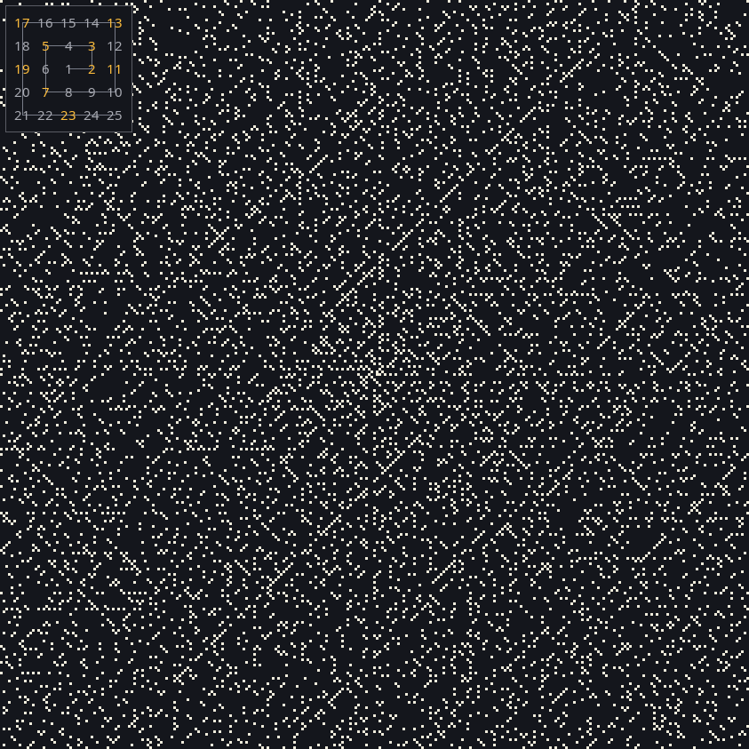
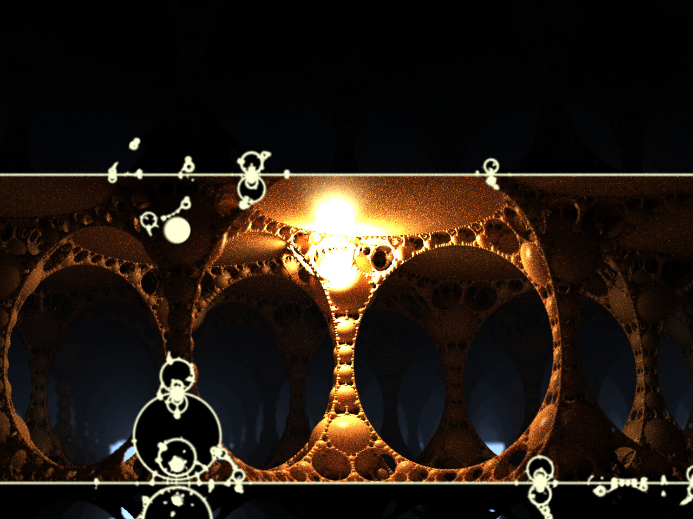
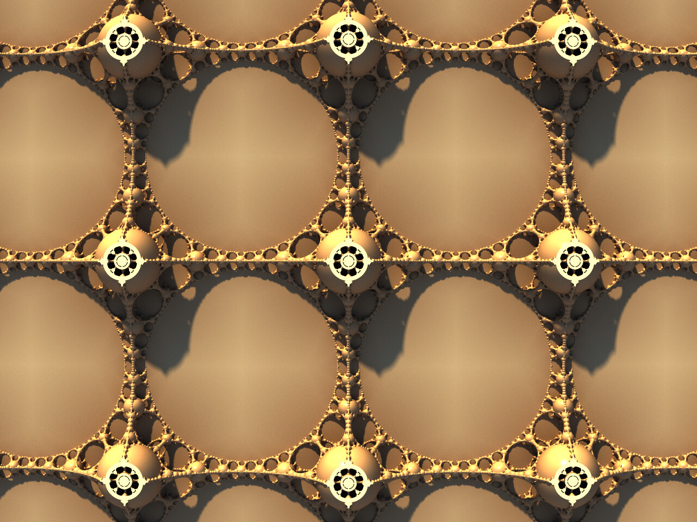
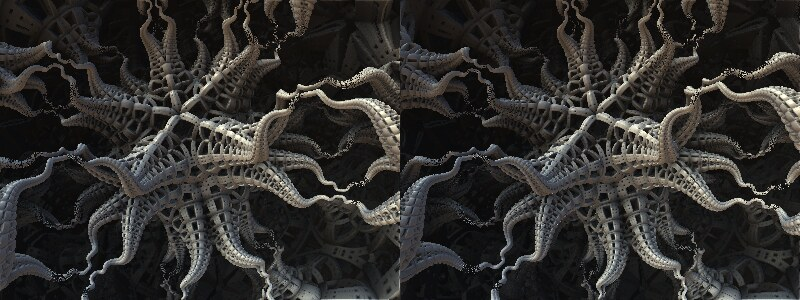
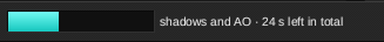
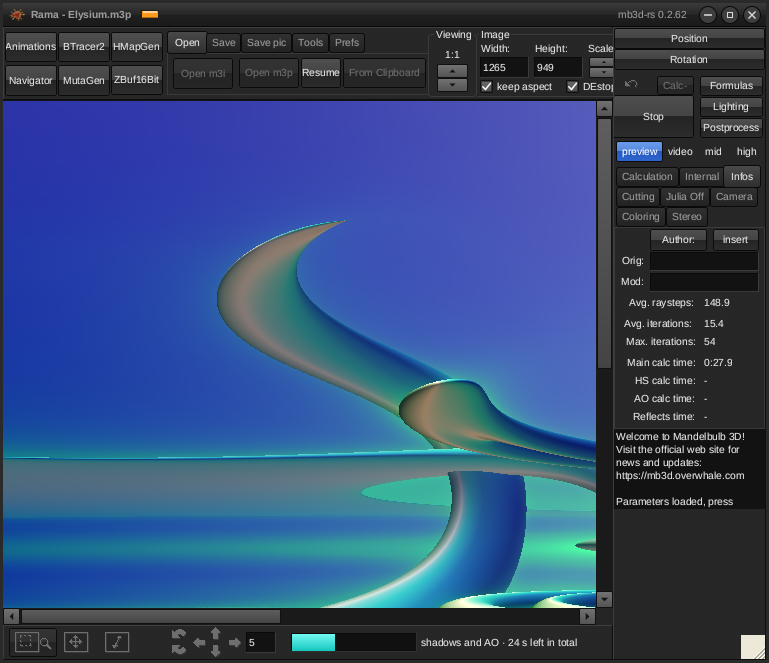
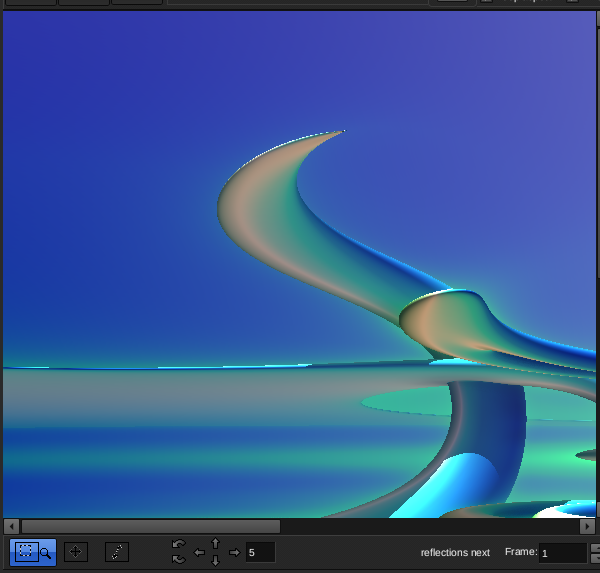
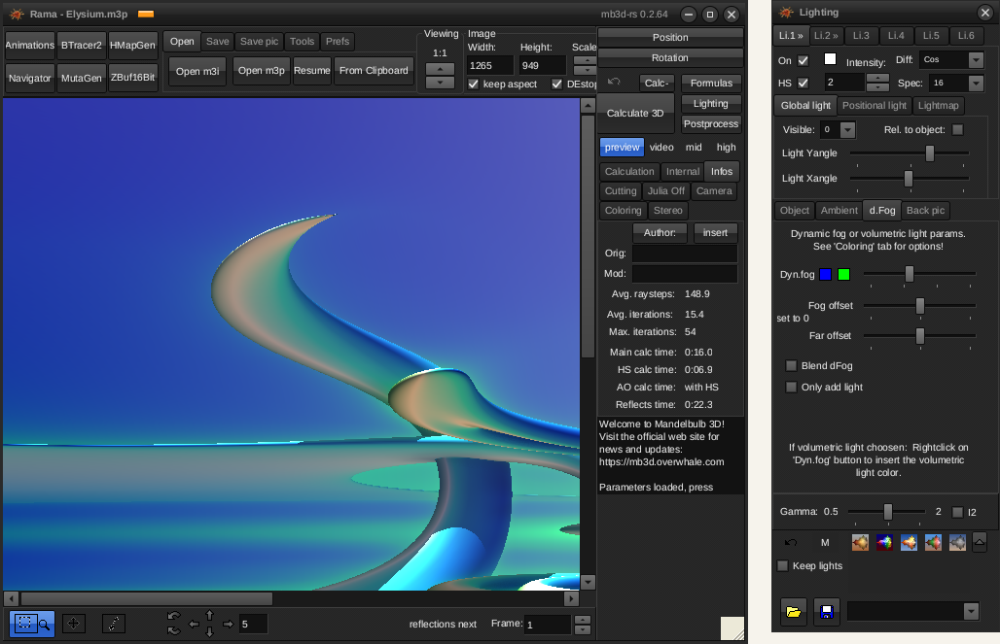
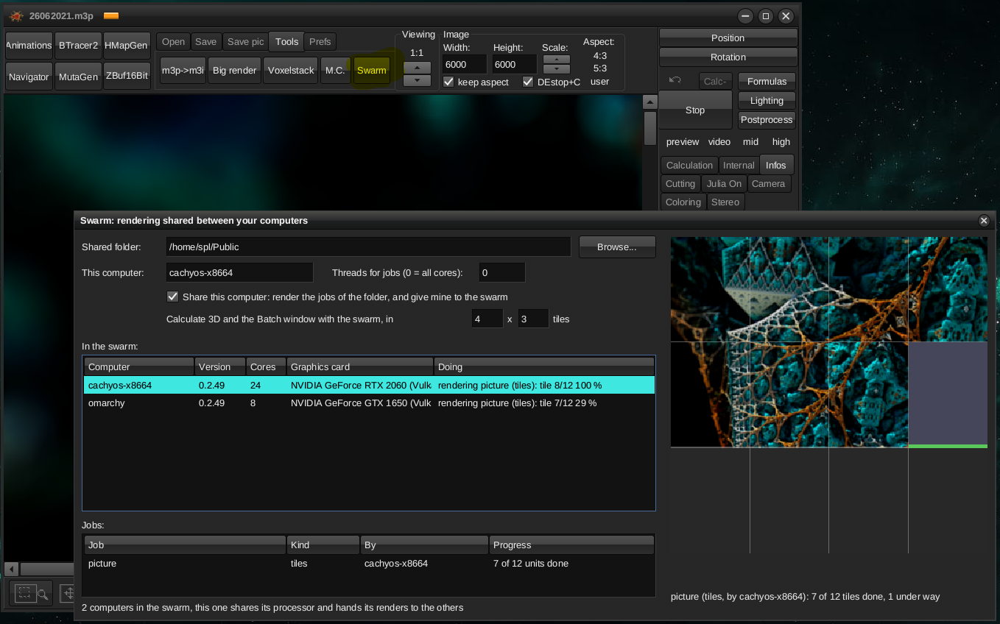

# mb3d-rs — Mandelbulb3D for Linux, Windows and macOS

<!-- latest:start -->
**Latest release: [v0.2.74](https://github.com/thr32423/mb3d-rs/releases/tag/v0.2.74)** (24 Oct 2026, 14:49 UTC) · [Download](#download) · [What's new](docs/UPDATES.md)
<!-- latest:end -->

mb3d-rs is [Mandelbulb3D](https://github.com/thargor6/mb3d) (MB3D), the
3D fractal program, rewritten so that it runs on today's computers: on
**Linux, Windows and macOS**, and with the picture calculated on the
**graphics card** where MB3D could only use the processor. It opens MB3D's
parameter files (`.m3p`, `.m3i`, text parameters from forums), uses MB3D's
formulas and maps, and makes the same pictures.

<a href="docs/img/main_window.jpg"></a>

It comes as two programs:

* **Mandelbulb3D** — the desktop program, with MB3D's own windows: the
  main window, Formulas, Lighting, Post processing, Navigator, Animation,
  Batch, Big renders, Monte Carlo, Voxel export, Bulb Tracer 2, MutaGen
  and the rest. If you know MB3D, you know this program; MB3D's tutorials
  apply.

  <details><summary>Read more</summary>

  The windows are MB3D's own — made from MB3D's original window
  definitions, so every button, slider and hint is where it is in MB3D:
  
  * **Main window:** open and save parameters (`.m3p`, `.m3i`, text, the
    clipboard), save pictures (PNG, JPEG, BMP, 16 bit Z-buffer), the mouse
    modes, the rotation buttons, image size, the quality presets, undo,
    *Calculate 3D* with the growing picture and the statistics, and all
    the pages (Calculation, Internal, Infos, Cutting, Julia, Camera,
    Coloring, Stereo).
  * **Formulas:** the six formula slots, MB3D's formula lists and options,
    hybrid types, favourites, and the JIT formula editor.
  * **Lighting:** lights 1–6, presets, the palette, the Object, Ambient,
    d.Fog and Back pic pages; changes repaint the picture at once, without a
    new calculation.
  * **Post processing:** normals on the z-buffer, hard and ambient shadows,
    reflections and transparency, depth of field.
  * **Navigator:** walk and look around with keys and mouse, then *View to
    main*.
  * **Animation maker, Batch processing, Big renders, Monte Carlo, Voxel
    export, Bulb Tracer 2** (meshes) with the mesh preview, the **HeightMap
    generator, MutaGen, ZBuf16Bit, Map sequences, Ini dirs** — all as in
    MB3D.
  * **Swarm** (new, on the Tools tab): your computers render together,
    see [Rendering on several computers](#rendering-on-several-computers-the-swarm).

  </details>
* **mb3d** — a command line renderer for scripts and batch jobs: pictures,
  animations, batch lists, Monte Carlo renders, voxel and mesh exports,
  all without a window.

## Is it safe to run? Check it yourself

You do not have to take our word for it. [scanrepo.dev](https://www.scanrepo.dev)
is an independent service that examines a GitHub repository for the signs
of harmful software: code that starts other programs, connects to the
internet, hides what it does, or bypasses the safety checks of the
programming language. Anyone can run it on this repository at any time:

**[▶ Scan mb3d-rs on scanrepo.dev](https://www.scanrepo.dev/scan/github/thr32423/mb3d-rs)**
(click *Rescan* for a fresh result of the current code)

Version 0.2.66 was rated **safe: 0 out of 100, no findings** (earlier:
[the 0.2.44 result](docs/img/scan_0.2.44.png)). An earlier version was flagged,
and we changed the code in response ([issue #4](https://github.com/thr32423/mb3d-rs/issues/4));
it is now written to stay this way. The programs contain no code that
connects to the internet; the only other program they ask your system to
open is your file manager, when you click a button to open a folder.

A scan looks for known warning signs; it is not a guarantee. These let
you check further on your own:

* **All of the source code is here.** The downloads are built from it by
  GitHub's own build servers, by the steps you can read in
  [the release workflow](.github/workflows/release.yml), not on anyone's
  personal computer.
* **Every release lists checksums** (`SHA256SUMS`), so you can confirm
  that the file you downloaded is exactly the one that was published;
  the one-line install below does this for you. Releases from 0.2.45 on
  also carry GitHub's build attestations: `gh attestation verify
  FILE --repo thr32423/mb3d-rs` shows which commit a download was built
  from.

## What is new compared with Mandelbulb3D

* **The graphics card calculates the picture** — the image itself, the
  shadows, the ambient occlusion, the reflections and the Monte Carlo
  renders. On a typical computer this is several times faster than the
  processor alone; see [Speed](#speed) below.
* **Auto mode**: the graphics card and the processor work on every picture
  together, and nothing ever waits — if the card is not ready, the
  processor starts anyway and the card joins in.
* **An LED in the title bar** shows where the last picture was calculated.
* **Interface size** from 75 to 200 % for high resolution screens.

  <a href="docs/img/themes_150.png"></a>

  <details><summary>Read more</summary>

  **Prefs ▸ Visual themes ▸ Interface size** makes all windows and their
  text larger or smaller (75 to 200 %), for high resolution screens; the
  layouts stay exactly as in MB3D.
  
  | 100 % | 150 % |
  |---|---|
  |  |  |

  </details>
* **Eight looks** for the windows, all of them theme files you can copy and
  change: two reproduce MB3D's looks, six are new.

  <a href="docs/img/themes/Midnight.jpg"></a>

  <details><summary>Read more</summary>

  **Prefs ▸ Visual themes** offers eight looks, each a file in the `Themes`
  folder: *Glossy* (the dark default) and *Windows* reproduce MB3D's own
  two looks, the other six are new. Click a picture for its full size.
  
  | | |
  |---|---|
  | <a href="docs/img/themes/Glossy.jpg"></a> | <a href="docs/img/themes/Windows.jpg"></a> |
  | **Glossy**: MB3D's default | **Windows**: MB3D's "Themes off" |
  | <a href="docs/img/themes/Graphite.jpg"></a> | <a href="docs/img/themes/Daylight.jpg"></a> |
  | **Graphite**: lighter neutral grey, steel-blue accents | **Daylight**: warm light grey, teal accents |
  | <a href="docs/img/themes/Midnight.jpg"></a> | <a href="docs/img/themes/Ember.jpg"></a> |
  | **Midnight**: deep navy, blue accents | **Ember**: warm charcoal, orange accents |
  | <a href="docs/img/themes/Forest.jpg"></a> | <a href="docs/img/themes/Highcontrast.jpg"></a> |
  | **Forest**: dark green-grey, green accents | **High contrast**: black, white text, yellow highlights |
  
  A theme is a small text file in the `Themes` folder next to the program;
  copy one, change its colours, and it appears in the list at the next
  start.

  </details>
* **The interface in your language**: every text of the windows comes
  from a language file; eleven languages ship, and the program writes the
  file of a new language for you to translate.

  <details><summary>Read more</summary>

  The language badge at the right end of the main window's title bar
  shows the interface language (`EN`); a click opens the language window.
  A language is a text file in the `Languages` folder next to the program.
  Shipped: English, Deutsch, Français, Italiano, Nederlands, Polski,
  Kaszëbsczi, 日本語, 한국어, 简体中文 and 繁體中文 (each with its flag; the
  East Asian ones bring a subset of Noto Sans CJK for their characters).
  The translations were machine made and checked for structure, not by
  native speakers: corrections are welcome, each is one line of the file. To translate: type the name of your language and
  press *Create language file*; the program writes `Languages/<name>.lng`
  with every text in English, one per line (`Button2.Caption = Calculate
  3D`). Translate the texts right of the `=` with a text editor and press
  *Reload*: the windows follow at once, without a restart. A line left out
  keeps the English text. *Save + exit* keeps the language for the next
  start.

  </details>
* **Linux, Windows and macOS** (Intel and Apple Silicon).
* **A command line program** for everything that needs no window.
* **Very big pictures in one piece**: 15000 x 20000 pixels and more
  without running out of memory, and the depth of field uses all
  processor cores (11 times faster on 24 threads than before 0.2.45, with
  the same picture).
* **16 bit pictures:** PNG files with 65,536 instead of 256 steps per
  colour, for editing without banding.

  <a href="docs/img/png16_compare.png"></a>

  <details><summary>Read more</summary>

  MB3D saves 8 bit pictures: 256 steps per colour. That is plenty to look
  at, but when a picture is edited afterwards — brightness, contrast,
  curves — smooth areas such as the background or fog break into visible
  bands. **Save pic ▸ PNG** offers a second file type, **PNG 16 bit
  colour**: the colours as the program calculated them, before they are
  rounded to 256 steps, with all shadows, reflections and depth of field.
  The file looks the same, and stays smooth when it is edited.
  
  <a href="docs/img/png16_compare.png"></a>
  
  <a href="docs/img/save_png16.png"></a>

  </details>
* **A noise filter** for Monte Carlo and all other pictures, the DCT
  denoising known from GIMP.

  <a href="docs/img/mc_noise.png"></a>

  <details><summary>Read more</summary>

  A **noise filter** removes grain from the pictures: the **DCT denoising**
  of GIMP's *Filters ▸ Enhance ▸ Noise Reduction ▸ Denoise DCT*, which of
  GIMP's filters suited these pictures best (see the credits below).
  
  * **Monte Carlo window ▸ -noise** (a button MB3D had hidden): filters the
    shown picture, and the saved one, with a strength that follows the rays
    per pixel. The rendering itself goes on unfiltered, and its next update
    shows it unfiltered again.
  * **Post processing ▸ Noise Filter**: *Filter now* filters the picture of
    the main window; *Filter new pictures automatically* filters every new
    one. *Strength* is the strength of the noise to remove (4 is light;
    higher removes more grain and more fine detail).
  
  Monte Carlo pictures have the most grain. Against pictures rendered with
  512 rays per pixel, the filtered pictures were closer than the unfiltered
  ones in all 13 tests (four scenes, 4 to 32 rays): by up to 23 % at 4 rays,
  5 to 10 % at 8 rays, 1 to 3 % at 32 rays, where little grain is left.
  
  <a href="docs/img/mc_noise.png"></a>
  
  <a href="docs/img/postpro_noise.png"></a>

  </details>
* **Transparent backgrounds** for pictures and animations.

  <a href="docs/img/transparent.png"></a>

  <details><summary>Read more</summary>

  Pictures and animation frames can be saved with a **transparent
  background**, to put the fractal onto another picture or into a video
  editor: **Save pic ▸ PNG ▸ PNG transparent background**, and in the
  Animation maker **Transparent background** (PNG frames). With anti-aliasing (a
  viewing scale of 1:2 or more, or `--aa`) the edges are soft, and they
  carry no fringe of the old background colour. Depth pictures for
  compositing were already there (*Save Z buffer too*, `--depth`).
  
  <a href="docs/img/transparent.png"></a>

  </details>
* **Videos of animations:** an AVI file straight from the program, or
  the ffmpeg command for a small MP4.

  <a href="docs/img/anim_video.png"></a>

  <details><summary>Read more</summary>

  In the Animation maker, **Also make a video (AVI)** joins the frames into
  a video when they are rendered, at the **Frames per second** you set:
  `<project name>.avi` in the output folder, next to the frames, which are
  kept. It plays in VLC and mpv and opens in video editors (Kdenlive,
  Shotcut, DaVinci Resolve). Each frame is stored as a whole picture, so the
  files are big: good for editing and keeping, less for sharing.
  
  For a small video to share, **FFmpeg command** puts the command for an MP4
  (or, with a transparent background, a WebM) on the clipboard and in the
  messages. Install [ffmpeg](https://ffmpeg.org), paste the command into a
  terminal when the frames are done, and it makes the video; this program
  starts no other programs itself.
  
  <a href="docs/img/anim_video.png"></a>

  </details>
* **A preview of parameter files** in the Open dialog.

  <a href="docs/img/open_preview.png"></a>

  <details><summary>Read more</summary>

  **Open ▸ Open m3p** and **Open m3i** show a small picture of the
  clicked parameter file, with its size and formulas, before it is
  opened; the arrow keys move through the list with the preview. The
  picture is calculated in the background on the processor, so the
  dialog stays responsive, and each file's preview is kept while the
  program runs.
  
  <a href="docs/img/open_preview.png"></a>

  </details>
* **Navigator: exact values and Reset view.** Click a value and type it;
  go back to the view the Navigator started from.

  <a href="docs/img/navigator_values.png"></a>

  <details><summary>Read more</summary>

  * **Click a value** in the Navigator's panels — Julia values, formula
    values, 4D rotation, the Misc values — and type the exact number, as in
    MB3D (angles in degrees). The slider then continues from that value.
  * **Click the zoom** and type it, when the zoom steps are too coarse (a
    wish from MB3D's issue list); a typed zoom stays (*Fixed zoom*).
  * **Reset view** goes back to the position, direction and zoom the
    Navigator took from the main window; the adjusted values stay.
  
  <a href="docs/img/navigator_values.png"></a>

  </details>
* **A new formula, SphereTree:** a tree of touching spheres that branch
  smaller and smaller, by Tom Lowe.

  <a href="docs/img/spheretree_ball.jpg"></a>

  <details><summary>Read more</summary>

  **SphereTree** is a formula Mandelbulb3D does not have: a tree of spheres
  that touch each other and branch into smaller and smaller spheres, like
  foam or coral. Tom Lowe, who invented the Mandelbox, published it in 2020
  (see the credits below). It is in the formula list with the dIFS formulas
  and has four settings:
  
  * **PackRatio** (0 to 1.22): the size of the spheres; at 1 they just
    touch, above 1 the outer ones break off.
  * **Levels**: how deep the tree goes (6 is plenty for most pictures).
  * **Rotated**: 1 turns every level a twelfth of a turn, and the tree
    becomes a round ball of sphere clusters.
  * **Colour scale**: every branch of the tree has its own colour. Choose
    *2nd choice* (the orbit trap) in the colour settings of the Lighting to
    see them; this setting spreads them over the colour gradient.
  
  It works alone and after dIFS transforms (the third picture repeats it
  with *tilingbrickIFS*), and it is calculated on the graphics card as well
  as on the processor. Set the iterations to 1: the formula calculates the
  whole tree at once. Parameters with SphereTree open only in this program,
  not in Mandelbulb3D.
  
  <a href="docs/img/spheretree_ball.jpg"></a>
  
  | <a href="docs/img/spheretree_close.jpg"></a> | <a href="docs/img/spheretree_swarm.jpg"></a> |
  |:---:|:---:|

  </details>
* **A new formula, UlamSpiral:** Ulam's spiral of prime numbers in 3D, as
  a city, a skyline, spheres or a block.

  <a href="docs/img/ulam_2d.png"></a>

  <details><summary>Read more</summary>

  In 1963 the mathematician Stanisław Ulam sat through "a long and very
  boring paper" at a meeting and doodled on a sheet of squared paper. His
  first idea was to set up chess problems; instead he numbered the squares
  1, 2, 3, … in a spiral, 1 in the middle, and circled the prime numbers.
  The primes lined up on diagonal lines, as if they followed a pattern, and
  they still do when a computer draws millions of them (Ulam tried 100,000
  on the MANIAC II at Los Alamos; Martin Gardner put the picture on the
  cover of Scientific American in 1964). Nobody has fully explained it to
  this day.
  
  <a href="docs/img/ulam_2d.png"></a>
  
  **UlamSpiral** builds that spiral in 3D, one shape per number, in four
  forms (*Mode*):
  
  * **0, prime towers**: a plate for every number and a tower on each
    prime. The diagonal lines of primes become rows of towers.
  * **1, divisor skyline**: a column for every number, the higher the more
    divisors it has; the primes are the low streets between them.
  * **2, divisor spheres**: a sphere for every number, the larger the more
    divisors it has (the primes are the small ones).
  * **3, a block of primes**: the numbers wound around cube shells instead
    of a square, a cube on each prime.
  
  *Rings* sets the size of the spiral (60 rings are the numbers up to
  14,641), *Height* the height of the towers or columns, *Gap* the space
  between them. With *2nd choice* (the orbit trap) in the colour settings
  the colour follows the number of divisors, so the primes have a colour
  of their own. Like SphereTree it runs on the graphics card and the
  processor, works after dIFS transforms, needs only 1 iteration, and
  parameters with it open only in this program.
  
  <a href="docs/img/ulam_city.jpg"></a>
  
  | <a href="docs/img/ulam_skyline.jpg"></a> | <a href="docs/img/ulam_spheres.jpg"></a> | <a href="docs/img/ulam_block.jpg"></a> |
  |:---:|:---:|:---:|

  </details>
* **A stopped render continues where it was.** What a render calculated
  is kept when it is stopped, and also when the program is closed or
  crashes, or the computer goes off (it is saved to the disk every 5
  minutes): Calculate 3D, Monte Carlo (also in the middle of a pass), the
  frame of an animation or the picture of a batch under way, a voxel
  export, a Bulb Tracer mesh, Big render tiles, and a swarm render (Stop
  on the computer that made the job keeps every finished part, and each
  computer keeps the part it was at). Calculate 3D and Monte Carlo of the
  same parameters ask whether to continue, the others continue by
  themselves; the **Resume** button (Open tab) lists the unfinished
  renders, to continue or delete them. On the command line the same
  command continues by itself (also a picture in `--tiles`, `montecarlo`,
  `animate`, `batch`, `voxel` and `mesh`); `--fresh` starts again, `mb3d
  resume` lists them. A continued render is the same as one calculated in
  one go.
* **Rendering shared between your computers**, a "swarm": computers that
  see one shared folder render a picture, a Big render, a Monte Carlo
  picture or an animation together. See
  [Rendering on several computers](#rendering-on-several-computers-the-swarm).
* **A new formula, PseudoKleinian:** the "Kleinian architecture" of
  halls, arches and spheres as one formula with its own exact distance.

  <a href="docs/img/kleinian_hall.jpg"></a>

  <details><summary>Read more</summary>

  The halls, arches, pillars and nested spheres known as "Kleinian
  architecture" are among the best-loved 3D fractal pictures. In MB3D they
  can only be made as a hybrid of several formulas with carefully matched
  settings, the recipe Theli-at found in 2011; knighty then wrote the same
  thing as one formula with its own distance estimate, and that is
  **PseudoKleinian**. Each level folds the point into a box, inverts it in
  a sphere and adds an offset, and the distance is measured exactly to a
  floor plane after the folds, so the walls come out clean and the picture
  renders fast. The settings are knighty's: *Levels* (8), *Size* (the
  inversion sphere), *CSize X/Y/Z* (the box; his 0.924, 0.908, 0.924 give
  the classic halls, and small changes give new buildings), *Julia X/Y/Z*
  (an offset per level), *Shape* (0 the floor plane, 1 a cylinder-plane of
  *Thickness* through *Offset*, 2 a rounded box), *DE offset* (hollows the
  surface) and *Colour scale* (with *2nd choice*, the orbit trap: the
  smallest orbit radius, the classic Kleinian banding).
  
  The structure fills all of space, so you look at it from inside: start
  with the view centre near the origin and the camera a unit or two back,
  and move through the halls with the Navigator. In the Monte Carlo
  renderer an interior gets almost no sky light, so put a positional light
  into the hall (the first picture) or cut the structure open with a
  cutting plane and look in from above (the second). It runs on the graphics
  card and the processor, needs 1 iteration, works after dIFS transforms
  and in DE combinations like the other dIFS formulas (though inside a
  space-filling structure those change little), and parameters with it
  open only in this program.
  
  <a href="docs/img/kleinian_hall.jpg"></a>
  
  <a href="docs/img/kleinian_top.jpg"></a>

  </details>
* **Stereo pairs in one step**: both eye images rendered and shown side by
  side, for parallel or cross-eyed viewing. Contributed by Rathinagiri S
  ([SRathinaGiri](https://github.com/SRathinaGiri)).

  <a href="docs/img/stereo_pair.jpg"></a>

  <details><summary>Read more</summary>

  **Stereo ▸ Render stereo pair** renders the left and then the right eye
  image with the tab's stereo settings and shows them side by side in the
  main window. They are placed for parallel viewing (left image on the
  left); **Cross-eyed preview** swaps them for cross-eyed viewing. It is a
  preview: lighting and colours
  cannot be changed afterwards without rendering again, and it does not
  work with tiles. The buttons for the single eye images are still there.
  
  <a href="docs/img/stereo_pair.jpg"></a>

  </details>
* **Time left for the whole picture**: the bar under the picture fills once
  over the whole calculation, and beside it the time left until the picture
  is finished, shadows, occlusion and reflections included.

  <a href="docs/img/time_left.png"></a>

  <details><summary>Read more</summary>

  MB3D's bar starts again at every stage. Here it shows the whole
  calculation: the main rendering, then the hard shadows and ambient
  occlusion, the reflections and the depth of field. How long the stages
  after the main rendering take is estimated from what the scene asks for
  and how the main rendering went; the estimate was fitted on about 1400
  renders of 366 scenes. A picture calculated again expects the times it
  took the last time.
  
  The first picture with new formulas on the graphics card waits for its
  shaders to compile: the line then says *shaders compiling* with the time
  left, which takes the processor's pace and, when the shaders will be
  ready in time, the card joining in. Details in
  [TECHNICAL.md](docs/TECHNICAL.md#time-left-and-the-progress-bar).
  
  <a href="docs/img/time_left.png"></a>

  </details>
* **Lighting stays live** after hard shadows and reflections: move a light
  or change its colour and the picture changes at once; reflections and the
  shadows of a moved light follow by themselves a moment later.

  <a href="docs/img/lighting_live.png"></a>

  <details><summary>Read more</summary>

  Render plainly, then try out light positions and colours: each change in
  the Lighting window repaints at once with the shadows as they were
  calculated, as in Mandelbulb3D. Changing a light's colour or intensity
  never calculates the shadows again. When you leave the lighting alone for
  a second and a half, the reflections and the depth of field are added
  back, and the shadows of a light you moved are calculated again; the line
  beside the bar says what follows. A new change stops it.
  
  A calculation you stopped can also still be continued after you changed
  the lighting. A way of working with it: [Lighting workflow](https://github.com/thr32423/mb3d-rs/wiki/Lighting-workflow)
  in the wiki. Details in
  [TECHNICAL.md](docs/TECHNICAL.md#lights-volumetric-light-cutting-planes-depth-of-field).
  
  <a href="docs/img/lighting_live.png"></a>

  </details>

## Download

Ready-to-run programs for the latest release, no installation needed:

| System | Download |
|---|---|
| Windows (64 bit) | [mb3d-rs-windows-x64.zip](https://github.com/thr32423/mb3d-rs/releases/latest/download/mb3d-rs-windows-x64.zip) |
| Linux (64 bit) | [mb3d-rs-linux-x64.tar.gz](https://github.com/thr32423/mb3d-rs/releases/latest/download/mb3d-rs-linux-x64.tar.gz) |
| Debian, Ubuntu, Mint (installs like other programs) | [mb3d-rs-linux-x64.deb](https://github.com/thr32423/mb3d-rs/releases/latest/download/mb3d-rs-linux-x64.deb) |
| Fedora, RHEL, Rocky, openSUSE (installs like other programs) | [mb3d-rs-linux-x64.rpm](https://github.com/thr32423/mb3d-rs/releases/latest/download/mb3d-rs-linux-x64.rpm) |
| macOS, Apple silicon (M1 and later) | [mb3d-rs-macos-arm64.tar.gz](https://github.com/thr32423/mb3d-rs/releases/latest/download/mb3d-rs-macos-arm64.tar.gz) |
| macOS, Intel | [mb3d-rs-macos-x64.tar.gz](https://github.com/thr32423/mb3d-rs/releases/latest/download/mb3d-rs-macos-x64.tar.gz) |

Unpack it and start **Mandelbulb3D** (`Mandelbulb3D.exe` on Windows) in
the unpacked folder. The folder is laid out like an MB3D installation,
with MB3D's formulas, maps and 80 example parameter files.

* If Windows shows "Windows protected your PC", click *More info* ▸
  *Run anyway*.
* macOS blocks downloaded programs that are not signed: run
  `xattr -dr com.apple.quarantine .` in the unpacked folder once.

**Alternative for Linux and macOS:** instead of downloading by hand, this
one line fetches the latest release into `~/mb3d-rs` (run it again later
to update; the script [download.sh](download.sh) is also in the program's
folder):

```sh
curl -fsSL https://raw.githubusercontent.com/thr32423/mb3d-rs/master/download.sh | sh
```

It checks the download before unpacking it, puts **Mandelbulb3D** in
your application menu (Linux) and makes `Mandelbulb3D` and `mb3d`
commands you can type in any folder. `sh ~/mb3d-rs/download.sh
--uninstall` takes the menu entry and the commands away again; your files
stay.

The Linux programs run on distributions from about 2018 on (Ubuntu 18.04,
Debian 10, Rocky/RHEL 8 and newer).

**Installed like other programs:** on Debian, Ubuntu and Mint, open the
`.deb` file above (or `sudo apt install ./mb3d-rs-linux-x64.deb`); on
Fedora, RHEL and Rocky the `.rpm` file (`sudo dnf install
./mb3d-rs-linux-x64.rpm`, on openSUSE `sudo zypper install
./mb3d-rs-linux-x64.rpm`).
Mandelbulb3D is then in the application menu and `mb3d` works in any
folder; your settings and History are kept in `~/.config/mb3d-rs` and
`~/.local/share/mb3d-rs`.

[Getting started](GETTING_STARTED.md) walks through the first steps; older
versions and the release notes are on the
[releases](https://github.com/thr32423/mb3d-rs/releases) page.

## Guides and help

Step-by-step guides are in the [wiki](https://github.com/thr32423/mb3d-rs/wiki):

* [Installing](https://github.com/thr32423/mb3d-rs/wiki/Installing): Windows, macOS and Linux, updating, where your files are
* [Lighting workflow](https://github.com/thr32423/mb3d-rs/wiki/Lighting-workflow): render plainly, then try out lights, shadows and reflections
* [Swarm setup](https://github.com/thr32423/mb3d-rs/wiki/Swarm-setup): rendering on several computers through a shared folder
* [Troubleshooting and FAQ](https://github.com/thr32423/mb3d-rs/wiki/Troubleshooting-and-FAQ): when something does not work as expected

Every release with its changes: [the whole list](docs/UPDATES.md).

## Rendering on several computers (the swarm)

Computers that see one shared folder render together: a picture in
tiles, a Big render, a Monte Carlo picture, an animation or a batch. Each
computer takes the parts nobody else has, so a fast one takes more of
them, and the computer that started the render puts the results
together. The folder does the sharing: the program opens no network
connection and talks to nobody, so it is as safe as your file sharing.

<a href="docs/img/swarm_window.png"></a>

### Setting it up

Step by step with what to check: [Swarm setup](https://github.com/thr32423/mb3d-rs/wiki/Swarm-setup) in the wiki.

1. **A folder every computer can write to:** a share on a NAS, a Windows
   share, a Samba share or NFS. On Linux, mount it as a folder, for
   example
   `sudo mount -t cifs //192.168.0.10/Public /mnt/share -o username=me,uid=$(id -u),gid=$(id -g)`;
   a share only opened in the file manager (`smb://...`) is not a folder
   the program can use.
2. **The same version of mb3d-rs on every computer.** A computer with
   another version is listed but takes no part.
3. **In Mandelbulb3D:** the **Swarm** button on the Tools tab. Choose the
   shared folder (the same share on every computer; its path may differ),
   give the computer a name for the list, and tick **Share this
   computer**.

That is all. The status line says what happens, for example *Sharing
with omarchy: renders are split between the 2 computers*. Alone in the
swarm, everything renders on this computer as usual.

### What is shared

While *Share this computer* is ticked, the computer renders the parts
other computers put into the folder, and its own renders go to the swarm
whenever another computer is in it:

* **Calculate 3D** (and the Batch window) — the picture in N x M tiles
  (set in the Swarm window), put together here with everything the usual
  calculation gives: lighting changes, post processing, saving as m3i.
* **Big render** — the tiles are saved one by one as they arrive; the
  whole picture is never held in memory, so this is the way for pictures
  of 100000 x 100000 pixels and more.
* **Monte Carlo** — as on one computer: every computer adds passes to its
  own block until you press Stop, the picture cleans up with everyone's
  rays, and Stop averages the blocks. In the window's batch mode the
  blocks together stop at the batch's ray count.
* **The Animation maker** — the frames, one by one.

The window lists the computers with their cores, graphics card and what
each is doing, the jobs with their progress, and a preview of the newest
job: the tiles rendered, the ones under way with a progress bar, and the
ones still missing.

### On the command line

On every computer that should help, start a worker on the folder:

```sh
mb3d swarm worker /mnt/share/mb3d-swarm --name kitchen-pc
```

Then, on any computer, render with `--swarm` and the same folder:

```sh
mb3d big.m3p --tiles 4x3 --swarm /mnt/share/mb3d-swarm
mb3d animate flight.m3a --swarm /mnt/share/mb3d-swarm
mb3d batch *.m3p -o pictures --swarm /mnt/share/mb3d-swarm
mb3d montecarlo scene.m3p --rays 256 --swarm /mnt/share/mb3d-swarm
```

`mb3d swarm list FOLDER` shows who is in the swarm, what each computer is
doing and how far the jobs are. A Monte Carlo picture on the command line
is split into blocks with their own random rays: 4 blocks of 64 rays per
pixel give the 256 asked for with `--rays 256`.

### Good to know

* **If the other computers stay idle** and their job list is empty while
  this computer renders: the computer that serves the folder with Samba
  and uses it directly lets the others keep an old listing of it. Turn
  that caching off in `/etc/samba/smb.conf`: `smb3 directory leases = no`
  in `[global]`, and `oplocks = no` and `level2 oplocks = no` in the
  share's section, then `sudo systemctl restart smb` and mount the share
  again on the other computers.
* **Memory:** Calculate 3D does not start a picture that does not fit into
  the free memory (on Linux) and points to Big render; a computer leaves a
  tile too big for its memory to the others.
* **Safety:** a computer renders only what a job asks for and writes only
  into the job's folder; formula code from a job runs in the formula
  emulator like every formula.
* **Speed:** tiles travel as full image buffers, a few hundred megabytes
  for a very big picture, so a fast share pays off. A sync service that
  copies with a delay works too, but slower.
* **Computers that go away:** the part a computer was rendering is taken
  by another once it has not been heard of for half a minute. A job whose
  owner has gone for half an hour is removed by whoever sees it. A job
  that fails on a computer is noted in the window and left to the
  others.
* **Stopping:** unticking *Share this computer* lets the part under way
  finish first; closing the program gives it up, and another computer
  takes it.
* **Stopping the job** (Stop on the computer that made it, or closing
  it, or it crashes): every part already finished is kept on that
  computer, and each computer keeps the part it was rendering. Starting
  the same render again makes a job of only the missing parts, and a
  computer that gets back a part it had begun continues it. The same
  works on the command line: run the same command again. An open-ended
  Monte Carlo render (the window's) puts its blocks together when it is
  stopped, as before.

## How the rendering works

A fractal picture is calculated pixel by pixel: for every pixel a ray is
followed into the scene until it hits the fractal's surface, the formula
being evaluated dozens of times at every step. MB3D does this on the
processor, using all its cores. mb3d-rs can do the same, and it can also
hand the work to the **graphics card**, which has thousands of small
processors and is built for exactly this kind of job.

The **"Calculate on"** setting (Internal tab of the main window) chooses:

| | |
|---|---|
| **Auto** (default) | The card and the processor share the picture: the card takes rows from the top, the processor's threads from the bottom, until they meet. The shadows and the ambient occlusion are shared the same way, or done by the card alone when it is clearly the faster one. |
| **CPU** | The processor only, as in MB3D. |
| **Graphics card** | The card only (it waits until its program is ready). |

The first time a combination of formulas is used, the graphics driver
has to prepare a program for the card — the *shader* — which takes 10 to
15 seconds on the computer measured below. In Auto mode the processor
simply starts without it and the card joins when it is ready, so a small
picture never waits. The prepared shader is kept for the next time (by
the graphics driver, on Linux in the `ShaderCache` folder next to the
program), so the next picture with the same formulas starts on the card
at once.

The **LED** right of the window title tells where the last picture was
calculated: green on the graphics card, orange partly, red on the
processor. Pointing at it shows the details.

[How the rendering works](docs/RENDERING.md) tells the whole story with
pictures: what Auto does the first time, why the card is not always the
faster choice, and what the colours of the LED mean.

Not everything can go to the card: a few formulas cannot be translated for
it, scenes with volumetric light stay on the processor, and views zoomed
in very deeply are calculated in double precision (which only some cards
can do). The program decides all of this by itself; you only see it in the
LED.

## Speed

All measurements on one computer: an AMD Ryzen 9 3900X (12 cores, 24
threads) with an NVIDIA GeForce RTX 2060, on Linux. The original
**Mandelbulb3D 1.99sr37** was run on the same machine under Wine (its
Windows program runs there unchanged, at full speed, using all cores),
and timed from the click on *Calculate 3D* to the finished picture.
Each parameter file was rendered at the same image size by all three:
MB3D, mb3d-rs on the processor only (**CPU**) and mb3d-rs in **Auto**
mode (graphics card and processor together). The Auto times are those of
the second render of a file, with the card's shader already prepared; the
first render of a new formula combination adds the 10–15 s of shader
preparation on this card.

### MB3D's 80 example parameter files

The example files that come with MB3D (and in this program's
`M3Parameter` folder), each at its own image size.

MB3D could not calculate one of the files (*Test8*: it stops with a "Division by zero" error), so the comparisons count 79 files.

* **mb3d-rs on the processor alone is faster than MB3D** in 71 of the 79 files, a median **1.7 times**; all files together took MB3D 18 min 21 s and mb3d-rs on the processor 17 min 10 s.
* **Auto mode** is faster than MB3D in 77 of 79 files (median 2.1 times); all files together 8 min 17 s. In 30 of the files the processor finished alone, mostly because it needs only a few seconds, before the card gets a turn — there Auto is simply the processor plus a moment's overhead. The card joined in 49 files, the slower ones, where it made the picture a median 1.6 times faster than the processor (up to 13 times: *Insect Menger*, 4.7 s instead of 63.0 s).
* In 4 files Auto was noticeably slower than the processor alone (*Ellarien - Shrooms are coming*, *MengerTrees*, *toricaleggs*, *TreePlanet*): there the card is slower than the 24 processor threads for the scene.
* "Rows on the card" is the share of the picture the graphics card marched in Auto mode (– when the processor finished alone).

<details>
<summary>All 80 files (click to open)</summary>

| Parameter file | MB3D (Wine) | mb3d-rs CPU | mb3d-rs Auto | rows on the card | Auto vs MB3D |
|:--|--:|--:|--:|--:|--:|
| 0Encrypted0 - ABoxSOff4d example | 12.8 s | 7.4 s | 1.9 s | 80 % | 6.7× |
| 6 AM - Torii temple | 23.0 s | 20.4 s | 17.8 s | 60 % | 1.3× |
| Abominog-Ua - 12.06.2014 | 7.6 s | 8.0 s | 7.4 s | 50 % | 1.0× |
| ABoxPartlyJuliaRoff | 2.5 s | 1.4 s | 1.6 s | – | 1.6× |
| ABoxScale2Start | 1.0 s | 0.1 s | 0.3 s | – | 3.3× |
| ABoxScale3Start | 1.5 s | 0.1 s | 0.3 s | – | 5.0× |
| AboxShapes-Misty | 27.5 s | 25.6 s | 17.7 s | – | 1.6× |
| Aexion 10bulbs | 11.5 s | 9.8 s | 2.6 s | 73 % | 4.4× |
| AkuraPare - 463b | 4.0 s | 2.0 s | 0.7 s | 72 % | 5.7× |
| ApolloBalloons dIFS | 75.8 s | 73.2 s | 24.9 s | 57 % | 3.0× |
| AureliusCat - Bamboo | 2.0 s | 1.2 s | 0.7 s | 58 % | 2.9× |
| BatJorge - Pong 703 - Swirls | 4.0 s | 2.8 s | 3.1 s | – | 1.3× |
| Bill-Snowzell - Tweak - Canyon | 4.0 s | 1.6 s | 1.7 s | 44 % | 2.4× |
| Blood on the dancefloor | 7.6 s | 4.4 s | 3.2 s | – | 2.4× |
| BulboxCut | 4.0 s | 2.3 s | 2.3 s | – | 1.7× |
| Chrystal | 5.6 s | 5.2 s | 1.7 s | 79 % | 3.3× |
| cutted sphere over carpet | 7.1 s | 20.7 s | 4.5 s | 48 % | 1.6× |
| Dainbramage - Home of the Ancients | 3.0 s | 1.3 s | 1.2 s | 25 % | 2.5× |
| Dainbramage - Hydra | 3.5 s | 1.7 s | 1.6 s | 41 % | 2.2× |
| Dainbramage - Nothing left but bones | 4.0 s | 3.0 s | 2.4 s | 49 % | 1.7× |
| DEcomb1 | 83.9 s | 93.5 s | 80.3 s | 48 % | 1.0× |
| dIFS heart shrub | 2.5 s | 3.5 s | 3.0 s | – | 0.8× |
| dIFS heart shrub otrap | 5.1 s | 15.6 s | 3.6 s | 93 % | 1.4× |
| dIFS shrub | 4.0 s | 17.3 s | 3.6 s | 93 % | 1.1× |
| Dodeca Torus mix | 2.0 s | 0.5 s | 0.6 s | 14 % | 3.3× |
| DsyneGrafix - Getting Loopy | 2.0 s | 0.8 s | 0.8 s | 25 % | 2.5× |
| Ellarien - Embellished | 3.5 s | 1.1 s | 1.2 s | 49 % | 2.9× |
| Ellarien - Shrooms are coming | 8.1 s | 6.2 s | 6.8 s | – | 1.2× |
| ExcludeBulbMeng | 17.3 s | 12.9 s | 8.5 s | – | 2.0× |
| Fishbowl | 4.6 s | 3.5 s | 1.9 s | 49 % | 2.4× |
| Fractales75 - Kiosk | 3.0 s | 1.8 s | 1.9 s | 47 % | 1.6× |
| Genetic Menger | 1.5 s | 0.5 s | 0.6 s | 46 % | 2.5× |
| genQuat helix mix | 4.0 s | 3.3 s | 1.8 s | 61 % | 2.2× |
| HalTenny - Freak Of Nature | 2.5 s | 0.9 s | 1.2 s | – | 2.1× |
| Hal-Tenny-Resistance (slow) | 18.9 s | 20.3 s | 8.7 s | 78 % | 2.2× |
| Hyperben2 - Ozosphere tweak | 2.0 s | 0.8 s | 0.6 s | 56 % | 3.3× |
| ImpossibleWorld dIFS | 399.8 s | 367.5 s | 99.0 s | 71 % | 4.0× |
| InAndOutside box | 5.1 s | 2.7 s | 1.4 s | 68 % | 3.6× |
| Insect Menger | 4.0 s | 63.0 s | 4.7 s | 93 % | 0.9× |
| Jost1 - Tweak - New tiny temple | 3.5 s | 1.6 s | 1.0 s | 60 % | 3.5× |
| julia on box | 4.6 s | 4.0 s | 1.6 s | 73 % | 2.9× |
| JuliaSetSample | 3.0 s | 1.9 s | 2.2 s | – | 1.4× |
| KentPress - Parameter 3 tweak fogits | 4.0 s | 2.5 s | 3.0 s | – | 1.3× |
| KochSurf Sample 6 | 3.0 s | 1.4 s | 0.8 s | 75 % | 3.8× |
| Lenord - ASurf 2 | 5.1 s | 1.7 s | 1.9 s | 48 % | 2.7× |
| Lenord - Between Dark and Light | 5.6 s | 3.8 s | 2.1 s | 60 % | 2.7× |
| Lenord - The Beanstalk | 3.5 s | 1.8 s | 2.0 s | – | 1.8× |
| LightBulbMoon - A Fabulous Excuse | 3.5 s | 2.0 s | 1.6 s | – | 2.2× |
| LightBulbMoon - No, Never | 5.1 s | 4.0 s | 1.2 s | 82 % | 4.2× |
| Mandelwerk - Makin seashell | 12.0 s | 8.1 s | 8.1 s | 30 % | 1.5× |
| Mandelwerk - TgladTetra inner spirals | 8.6 s | 4.5 s | 1.1 s | 80 % | 7.8× |
| MarkJayBee - Curvichrome | 2.5 s | 1.3 s | 1.3 s | – | 1.9× |
| material colors | 3.0 s | 1.4 s | 1.9 s | – | 1.6× |
| Melting spot bloxx | 23.2 s | 20.4 s | 7.6 s | 73 % | 3.1× |
| Mengerplus for MC | 3.5 s | 2.2 s | 2.5 s | – | 1.4× |
| MengerTrees | 19.3 s | 15.4 s | 16.9 s | – | 1.1× |
| MutaGenD4B12E71C70D4FD00357_canary~ | 7.1 s | 3.7 s | 4.1 s | – | 1.7× |
| Oxnot - Flexing | 2.5 s | 0.7 s | 0.7 s | 59 % | 3.6× |
| Oxnot - Shells | 5.6 s | 3.3 s | 3.6 s | – | 1.6× |
| PaMonk - Ringlets | 5.1 s | 2.7 s | 2.8 s | – | 1.8× |
| QuatP4hybridJulia | 1.5 s | 0.2 s | 0.4 s | – | 3.8× |
| Rama - Elysium | 11.5 s | 10.6 s | 5.5 s | 74 % | 2.1× |
| Recycledrelatives - Fractal Fan | 2.0 s | 0.4 s | 0.6 s | 31 % | 3.3× |
| Recycledrelatives - Test for SurfMod | 4.6 s | 3.0 s | 3.1 s | – | 1.5× |
| Rowratty - Spirals | 4.0 s | 2.5 s | 1.0 s | 69 % | 4.0× |
| Sabine62 - Housing problem | 11.7 s | 10.5 s | 6.8 s | – | 1.7× |
| spineJulia | 91.9 s | 71.7 s | 50.7 s | 35 % | 1.8× |
| Surreal shell | 2.0 s | 0.6 s | 0.8 s | – | 2.5× |
| Test8 | error in MB3D | 0.1 s | 0.3 s |  | – |
| Theli-At - Black Mandelbulb | 1.0 s | 0.2 s | 0.5 s | 22 % | 2.0× |
| Theli-At - Bone Menger using MH | 2.0 s | 0.7 s | 1.1 s | – | 1.8× |
| Theli-At - MengerSpheres | 2.0 s | 0.6 s | 0.6 s | 50 % | 3.3× |
| ThePearl dIFS | 2.5 s | 1.4 s | 1.2 s | 25 % | 2.1× |
| TimeMachine | 1.0 s | 0.5 s | 0.7 s | – | 1.4× |
| toricaleggs | 8.6 s | 5.6 s | 6.6 s | 40 % | 1.3× |
| TreePlanet | 7.6 s | 6.6 s | 7.5 s | – | 1.0× |
| UndeadAcademy tweak - Peacock in blue | 7.6 s | 4.5 s | 1.2 s | 74 % | 6.3× |
| Virtual tubes world (UndeadAcademy style) | 9.1 s | 6.9 s | 4.3 s | 49 % | 2.1× |
| Wada basin - Reflect test | 6.6 s | 4.1 s | 4.6 s | 40 % | 1.4× |
| Waste-and-tragedy - Mandalex | 5.1 s | 3.4 s | 3.8 s | – | 1.3× |

</details>

The pictures are the same: mb3d-rs on the processor makes MB3D's picture
to within rounding, and the Auto pictures differ from the processor's by a
fraction of a percent of the colour range on average (fine detail may
sparkle in different pixels; the [technical notes](docs/TECHNICAL.md)
have the measurements).

## The command line

`mb3d` renders without a window. Open a terminal in the program's folder
(on Windows a command prompt in the unpacked folder, and type `mb3d`
instead of `./mb3d`). After the one-line install on Linux or macOS, `mb3d`
works in any folder, `man mb3d` shows its manual, and the Tab key
completes its options in bash, zsh and fish:

```sh
./mb3d "M3Parameter/6 AM - Torii temple.m3p" -o torii.png      # full size
./mb3d "M3Parameter/6 AM - Torii temple.m3p" --scale 0.25 -o small.png
./mb3d pasted.txt -o pasted.png        # parameters copied from a forum post
./mb3d City.m3p --tiles 4x4 -o city.png    # a big picture in tiles
./mb3d resume                              # stopped renders: the same command continues
./mb3d --cpu City.m3p -o city.png          # processor only
./mb3d --card City.m3p -o city.png         # graphics card only
./mb3d City.m3p --bits 16 -o city16.png    # 16 bit colour
./mb3d City.m3p --denoise 4 -o city.png    # with the noise filter
./mb3d City.m3p --aa 2 --transparent -o city.png   # transparent background
./mb3d City.m3p -o - | display -          # the picture into another program
./mb3d --help                              # all options
```

Everything else has a sub-command with its own `--help`:

```sh
./mb3d batch M3Parameter --scale 0.2 -o previews        # a whole folder
./mb3d animate start.m3p middle.m3p end.m3p --frames 60 -o frames
./mb3d animate project.m3a -o frames                     # MB3D animations
./mb3d animate project.m3a -o frames --transparent      # ... see-through
./mb3d animate project.m3a -o frames --video flight.avi  # ... and a video
./mb3d montecarlo scene.m3p --rays 64 -o mc.png
./mb3d montecarlo scene.m3p --rays 8 --denoise -o mc.png # ... with the noise filter
./mb3d voxel scene.m3p -o voxels --slices 256            # for 3D printing
./mb3d mesh scene.m3p -o object.stl                      # Bulb Tracer 2
./mb3d mutagen scene.m3p -o muta                         # 15 variations
```

The formulas and maps are found next to the program; those of another
MB3D installation can be given with `--formulas` and `--maps`.
Animations are MB3D's: keyframes with MB3D's interpolation, `.m3a`
projects opened and saved, frames written like MB3D so that an
interrupted animation continues and several computers can share one.

## Good to know

* **Same pictures, not bit-identical.** MB3D calculated in the 80-bit
  precision of old x87 arithmetic; this program uses today's 64-bit. The
  pictures match in every structure, but single pixels can differ in the
  last digit of their colour. Monte Carlo renders and MutaGen use their
  own random numbers, so their results are not MB3D's.
* **The graphics card's pictures** differ slightly from the processor's
  (single precision); in very fine detail the sparkle can fall on other
  pixels. Deep zooms switch to double precision by themselves.
* **Speed on the processor** is close to MB3D's: the formulas' machine
  code from MB3D's `.m3f` files was translated so that it runs on any
  processor (also Apple Silicon), at a small cost; the ray marching
  itself is faster. See the tables above.
* **Big pictures** can be rendered in one piece (a 15000 x 20000 picture
  needs about 15 GB of memory; with depth of field it takes hours) or in
  tiles, also on several computers (`--tiles`, and the Big renders
  window), which needs less memory. Calculate 3D does not start a
  picture that does not fit into the free memory (on Linux, where the
  free memory can be told) and says so, and a computer of the swarm
  leaves a tile too big for its memory to the others.
* **Unfinished renders** are kept in the cache folder (`~/.cache/mb3d-rs/resume`,
  on Windows `%LOCALAPPDATA%\mb3d-rs\resume`, or next to the program):
  18 bytes per pixel for a picture (a 15360 x 15360 picture takes 4.2 GB),
  64 for a Monte Carlo render. What was calculated is written at once and
  flushed to the disk every 5 minutes. A render stopped within its first
  10 seconds keeps nothing; unfinished renders older than 30 days go, and the
  oldest ones when all of them take more than 50 GB. A render continues
  only with the same parameters and program version (and the same choice
  of card or processor; a Monte Carlo render's exposure and saturation
  may change). A Monte Carlo render stays unfinished until it reaches its
  rays (a batch, `--rays`, `--passes`) or is deleted in the Resume list.
* **Newer or your own formulas, maps, themes and languages** go into
  `~/.local/share/mb3d-rs/M3Formulas`, `.../M3Maps`, `.../Themes` and `.../Languages`
  (any way of installing; on Windows `%APPDATA%\mb3d-rs\...`). They
  are used in addition to the ones that
  come with the program, and replace a shipped file of the same name, so
  an updated formula from the forums takes effect without touching the
  program's folder.

## Updates

The newest releases with the time they were published and the changes
(commits) they brought; every release is in [the whole list](docs/UPDATES.md).
Each commit links to its full description and code on GitHub; the downloads
of a release are on its page. Times are in UTC.

<!-- updates:start -->
### [v0.2.74](https://github.com/thr32423/mb3d-rs/releases/tag/v0.2.74) · 24 Oct 2026, 14:49 UTC

| Commit | What it does |
|---|---|
| [`2536bca`](https://github.com/thr32423/mb3d-rs/commit/2536bcaeb6316a3249554bacebb2e18fd9438c28) | Version number and release notes of this release |
| [`4b8aff1`](https://github.com/thr32423/mb3d-rs/commit/4b8aff1f4412b4a96e3eb0bb781aa34ea531e654) | The language badge in the theme's title bar colours, its flag muted there |
| [`c89147c`](https://github.com/thr32423/mb3d-rs/commit/c89147c25a4247ef4be59ac7d73dc4b9bf026222) | README: Updates for v0.2.73 |

### [v0.2.73](https://github.com/thr32423/mb3d-rs/releases/tag/v0.2.73) · 24 Oct 2026, 14:21 UTC

| Commit | What it does |
|---|---|
| [`af4fb2f`](https://github.com/thr32423/mb3d-rs/commit/af4fb2fd78fd622eb18c3188e756362e501c4e6e) | Version number and release notes of this release |
| [`ffa15a2`](https://github.com/thr32423/mb3d-rs/commit/ffa15a2889a1beb0f2eb769e129d5d98712f5c08) | README: credits for the pull requests #13, #14, #17 and #19 and the report #20 |
| [`39705af`](https://github.com/thr32423/mb3d-rs/commit/39705afb42b0f891f7dcd5fdb3ac53b200b9eb69) | The language badge at the right end of the title bar, next to the version |
| [`a5a2b85`](https://github.com/thr32423/mb3d-rs/commit/a5a2b8522c163cf690c44c399f333ca98b50c24a) | Tab strips: translated tab names no longer wrap onto more rows than the English |
| [`42cc7c7`](https://github.com/thr32423/mb3d-rs/commit/42cc7c7df0419510fa4dc424100a4c139b4bf52d) | Languages: the 308 run-time texts in the ten translations, captions consistent |
| [`b37f960`](https://github.com/thr32423/mb3d-rs/commit/b37f960d1772f8fcb4cc508bd3f2f7aefa8c752b) | Run-time texts: the stage names in the status line translated, the batch window's time left kept as a value |
| [`f26f01e`](https://github.com/thr32423/mb3d-rs/commit/f26f01e69cb037a6f2706f0868323185c6c81d68) | Run-time texts translatable: src/app/main_form.rs |
| [`f3187bb`](https://github.com/thr32423/mb3d-rs/commit/f3187bbd42a66f37d61d562668e2914932679924) | Run-time texts translatable: anim_form, bulbtracer_form, voxel_form, meshview |
| [`ec3940c`](https://github.com/thr32423/mb3d-rs/commit/ec3940c4152dddf8c191794bec68e38c5d0a9c6c) | Run-time texts translatable: tools_forms, small_forms, unfinished_form, file_preview, util, dialogs (Confirm) |
| [`c685c58`](https://github.com/thr32423/mb3d-rs/commit/c685c58c50f13680a6fee2d724623111b59fdd3b) | Run-time texts translatable: mc_form, swarm_form, mutagen_form, engine |
| [`7319ac5`](https://github.com/thr32423/mb3d-rs/commit/7319ac531dc1e7a36911513396524b31045bdd02) | Run-time texts translatable: formula_form.rs, jit_form.rs, navi_form.rs |
| [`06fdd41`](https://github.com/thr32423/mb3d-rs/commit/06fdd41bd13165fe5112833f1f103bb3589f9347) | Run-time texts translatable: light_form, postpro_form, palette_form |
| [`b1f3842`](https://github.com/thr32423/mb3d-rs/commit/b1f3842bc0a1b0fff1e2ea4cbf643c7be410ac56) | README: Updates for v0.2.72 |

### [v0.2.72](https://github.com/thr32423/mb3d-rs/releases/tag/v0.2.72) · 24 Oct 2026, 12:52 UTC

| Commit | What it does |
|---|---|
| [`5235f79`](https://github.com/thr32423/mb3d-rs/commit/5235f798e2c94c3f4572b5575e15ef08ebf02000) | Version number and release notes of this release |
| [`cff2dd9`](https://github.com/thr32423/mb3d-rs/commit/cff2dd966c8414a92709507cfc623005b84bc301) | A smaller picture is no longer shown shifted out of view after scrolling a big one (#20) |
| [`4d5a194`](https://github.com/thr32423/mb3d-rs/commit/4d5a19492c448972c74432032aee43c15ed3f752) | File dialog table: a double click on a column header no longer opens the selected file; arrow keys fill the name; texts translated |
| [`668c6c2`](https://github.com/thr32423/mb3d-rs/commit/668c6c21cc5318d7a1d6e0efafa4abde79f6ebe8) | Embed icon in Windows executable |
| [`d00cf66`](https://github.com/thr32423/mb3d-rs/commit/d00cf662a327447ef03e6bc66b3db9c42f7ecf38) | README: Updates for v0.2.71 |
| [`9b62e28`](https://github.com/thr32423/mb3d-rs/commit/9b62e283c8d581e43d4b1db2f5bbf9d3144d532f) | Keep translated file dialog labels |
| [`70aa2ce`](https://github.com/thr32423/mb3d-rs/commit/70aa2ce3c58aaaf6a36993970481f938b4143724) | Use sortable columns in file dialogs |

All 85 releases, back to v0.1.0: [the whole list](docs/UPDATES.md).
<!-- updates:end -->

## For developers

The [technical notes](docs/TECHNICAL.md) describe how the graphics card
is used, what was ported from MB3D's Delphi sources and how, the three
ways MB3D's formula machine code is run, the scene file format and its
keys, the checks against MB3D, and building from source:

```sh
git clone https://github.com/thr32423/mb3d-rs
cd mb3d-rs
cargo build --release      # target/release/Mandelbulb3D and target/release/mb3d
```

## License

MB3D is licensed under the LGPL 2.1. This port is a derivative work and uses
the same license.

## Credits

Mandelbulb3D, which this program is a port of, was made by these people:

| Author | What they did |
|---|---|
| **Jesse** (fractalforums.com) | Wrote the original Mandelbulb3D (2010–2013, Delphi and 32-bit assembly): the distance estimation renderer, Navigator, formula and hybrid system, post processing (shadows, ambient occlusion, depth of field, reflections), Animation maker, Big renders, Monte Carlo renderer. Released it as freeware; his last release was 1.8.9 (April 2013) |
| **Andreas Maschke** (thargor6) | Maintainer since 2015: published Jesse's source code on GitHub, moved it to Delphi XE6, released 1.9.0 to 1.99.37 (2023). Added the JIT formula editor, MutaGen, BulbTracer and BulbTracer2 mesh export, the HeightMap generator, ZBuf16Bit, animated maps, the themed interface, point cloud export, Monte Carlo batch and network rendering. His code is under the LGPL 2.1 |
| **DarkBeam** (Luca GN) | By far the most formulas (credited in 210 of 464 `.m3f` files); the formula bundle of 1.8.2; the interim builds 1.8.9 x1 and x2 |
| **David Makin** | Helped Jesse implement the distance estimation; formulas (12 files) |
| **Tglad** (Tom Lowe) | Invented the Amazing Box (Mandelbox); formulas (13 files) |
| **Buddhi** | The fast distance estimation of the Amazing Box; formulas (6 files) |
| **Daniel White** | With Paul Nylander, the 2009 "triplex" Mandelbulb that MB3D's built-in bulb formula is based on; the fast integer power formulas Jesse used |
| **Paul Nylander** | With Daniel White, the Mandelbulb |
| **M. Benesi** | Formulas (33 files) |
| **Knighty** | Formulas (18 files), among them Knots2, koch_surf, the JCube3 approximation, and JosKn-KleinIFS with Jos Leys |
| **Aexion** | Formulas (12 files), among them the built-in "Aexion C" |
| **Kali** | Formulas (8 files), among them Amazing Surf |
| **Bethchen** | Formulas (8 files) |
| **msltoe** | The Riemann formula |
| **Fracmonk** | The CommQuat formula |
| **Trafassel** | The IdesFormula |
| **Syntopia** | Inspiration and testing; the Sierpinski4 and Menger4 formulas |
| **Jos Leys** | JosKn-KleinIFS, with Knighty |
| **Mark Townsend, Inigo Quilez, T. Gintz, Kerry Mitchell, Pseudogenius, dwsel** | Formulas |
| **Alef** (Edgar Malinovsky) | The JIT formula pack (`EM_JIT_M3Formulas`) |
| **Schmiegel** | Test parameters for the 1.99 releases |
| **Matteo** | Suggested and supported Monte Carlo batch rendering |
| **Zeyu-Li** | Documentation on GitHub (2020) |
| **NASA, GIMP** | Source material for the maps |

* **Contributors to this program**: Rathinagiri S
  ([SRathinaGiri](https://github.com/SRathinaGiri)): the stereo pair
  preview ([#12](https://github.com/thr32423/mb3d-rs/pull/12)), saving stereo pairs, the
  Navigator's axes and the grouped taskbar
  ([#13](https://github.com/thr32423/mb3d-rs/pull/13)), the stereo controls
  ([#14](https://github.com/thr32423/mb3d-rs/pull/14)), sorting in the file dialogs
  ([#17](https://github.com/thr32423/mb3d-rs/pull/17)) and their sortable columns
  ([#19](https://github.com/thr32423/mb3d-rs/pull/19)), and the program icon in the Windows
  executable.
* **Bug reports and suggestions**:
  [kronpano](https://github.com/kronpano)
  ([#1](https://github.com/thr32423/mb3d-rs/issues/1),
  [#2](https://github.com/thr32423/mb3d-rs/issues/2),
  [#3](https://github.com/thr32423/mb3d-rs/issues/3),
  [#4](https://github.com/thr32423/mb3d-rs/issues/4),
  [#8](https://github.com/thr32423/mb3d-rs/issues/8)),
  [lukastrips](https://github.com/lukastrips)
  ([#6](https://github.com/thr32423/mb3d-rs/issues/6),
  [#20](https://github.com/thr32423/mb3d-rs/issues/20)),
  [Rodrigo-Spacecraft](https://github.com/Rodrigo-Spacecraft)
  ([#9](https://github.com/thr32423/mb3d-rs/issues/9)), Michael Pettovello,
  Geoffrey N. Barnes.
* **The PseudoKleinian formula** is knighty's (Fragmentarium, 2011,
  "Theli-at's Pseudo Kleinian" after Theli-at's hybrid discovery of the
  look on fractalforums.com); this program's version is written in Rust
  and WGSL from its algorithm.
* **The SphereTree formula** is by Tom Lowe (TGlad): recursive Eisenstein
  Ford sphere packings on a Riemann sphere projection, published on
  [fractalforums.org](https://fractalforums.org/fractal-mathematics-and-new-theories/28/new-sphere-tree/3557)
  in June 2020 with a Fragmentarium file
  ([TGlad/FragmentariumExamples](https://github.com/TGlad/FragmentariumExamples)).
  This program's version is written in Rust and WGSL from that
  algorithm; the colouring per branch was added.
* **The icon** is Mandelbulb3D's own icon (`m3d128.ico` from
  [thargor6/mb3d](https://github.com/thargor6/mb3d), LGPL 2.1), with its
  background made transparent and the letters "RS" (for the Rust port)
  added; the letters are set in Liberation Sans Bold (SIL Open Font
  License).
* **The noise filter** is the DCT image denoising algorithm of Guoshen Yu
  and Guillermo Sapiro: *DCT image denoising: a simple and effective image
  denoising algorithm*, Image Processing On Line 1 (2011),
  [doi:10.5201/ipol.2011.ys-dct](https://doi.org/10.5201/ipol.2011.ys-dct).
  It is the algorithm of **GIMP**'s *Denoise DCT* filter (from GIMP's
  image library [GEGL](https://gegl.org)); GIMP's filters were compared
  on Monte Carlo pictures, and this one came out best. This program has
  its own implementation of the algorithm, written from the paper; it
  contains no code of GIMP or GEGL (GEGL is under the LGPL 3, this
  program under the LGPL 2.1).
