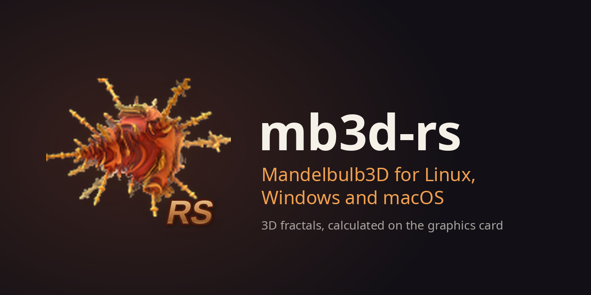

# mb3d-rs — Mandelbulb3D for Linux, Windows and macOS

<!-- languages:start -->
**English** · [Deutsch](docs/i18n/README.de.md) · [Español](docs/i18n/README.es.md) · [Français](docs/i18n/README.fr.md) · [Bahasa Indonesia](docs/i18n/README.id.md) · [Italiano](docs/i18n/README.it.md) · [Nederlands](docs/i18n/README.nl.md) · [Polski](docs/i18n/README.pl.md) · [Português](docs/i18n/README.pt.md) · [Kaszëbsczi](docs/i18n/README.csb.md) · [العربية](docs/i18n/README.ar.md) · [اردو](docs/i18n/README.ur.md) · [हिन्दी](docs/i18n/README.hi.md) · [日本語](docs/i18n/README.ja.md) · [한국어](docs/i18n/README.ko.md) · [简体中文](docs/i18n/README.zh-CN.md) · [繁體中文](docs/i18n/README.zh-TW.md)
<!-- languages:end -->

<!-- latest:start -->
**Latest release: [v0.2.100](https://github.com/thr32423/mb3d-rs/releases/tag/v0.2.100)** (5 Nov 2026, 13:32 UTC) · [Download](#download) · [What's new](docs/UPDATES.md)
<!-- latest:end -->

mb3d-rs is [Mandelbulb3D](https://github.com/thargor6/mb3d) (MB3D), the
3D fractal program, rewritten so that it runs on today's computers: on
**Linux, Windows and macOS**, and with the picture calculated on the
**graphics card** where MB3D could only use the processor. It opens MB3D's
parameter files (`.m3p`, `.m3i`, text parameters from forums), uses MB3D's
formulas and maps, and makes the same pictures.

<a href="docs/img/main_window.jpg">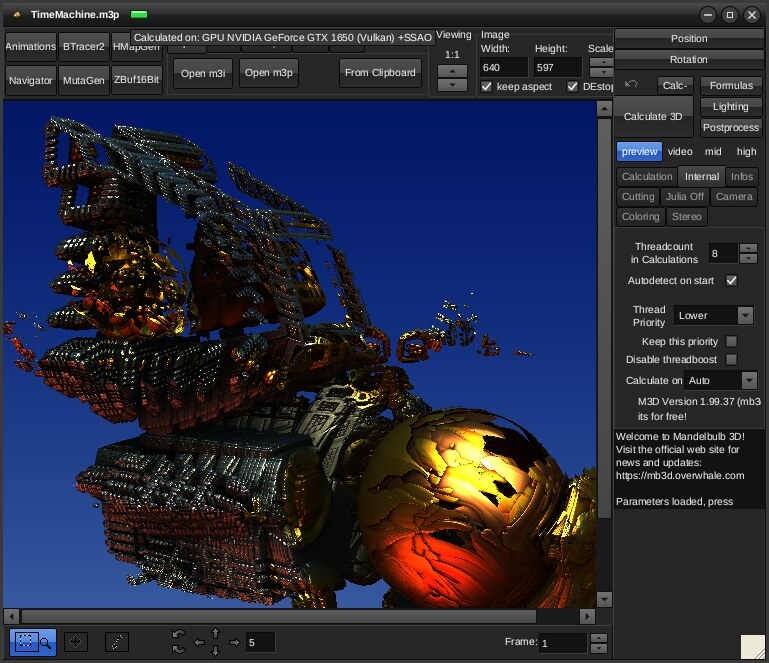</a>

It comes as two programs:

* **Mandelbulb3D** — the desktop program, with MB3D's own windows: the
  main window, Formulas, Lighting, Post processing, Navigator, Animation,
  Batch, Big renders, Monte Carlo, Voxel export, Bulb Tracer 2, MutaGen
  and the rest. If you know MB3D, you know this program; MB3D's tutorials
  apply.

  <details><summary>Read more</summary>

  The windows are MB3D's own — made from MB3D's original window
  definitions, so every button, slider and hint is where it is in MB3D:
  
  * **Main window:** open and save parameters (`.m3p`, `.m3i`, text, the
    clipboard), save pictures (PNG, JPEG, BMP, 16 bit Z-buffer), the mouse
    modes, the rotation buttons, image size, the quality presets, undo,
    *Calculate 3D* with the growing picture and the statistics, and all
    the pages (Calculation, Internal, Infos, Cutting, Julia, Camera,
    Coloring, Stereo).
  * **Formulas:** the six formula slots, MB3D's formula lists and options,
    hybrid types, favourites, and the JIT formula editor.
  * **Lighting:** lights 1–6, presets, the palette, the Object, Ambient,
    d.Fog and Back pic pages; changes repaint the picture at once, without a
    new calculation.
  * **Post processing:** normals on the z-buffer, hard and ambient shadows,
    reflections and transparency, depth of field.
  * **Navigator:** walk and look around with keys and mouse, then *View to
    main*.
  * **Animation maker, Batch processing, Big renders, Monte Carlo, Voxel
    export, Bulb Tracer 2** (meshes) with the mesh preview, the **HeightMap
    generator, MutaGen, ZBuf16Bit, Map sequences, Ini dirs** — all as in
    MB3D.
  * **Swarm** (new, on the Tools tab): your computers render together,
    see [Rendering on several computers](#rendering-on-several-computers-the-swarm).

  </details>
* **mb3d** — a command line renderer for scripts and batch jobs: pictures,
  animations, batch lists, Monte Carlo renders, voxel and mesh exports,
  Gaussian splats, all without a window.

## Is it safe to run? Check it yourself

You do not have to take our word for it. [scanrepo.dev](https://www.scanrepo.dev)
is an independent service that examines a GitHub repository for the signs
of harmful software: code that starts other programs, connects to the
internet, hides what it does, or bypasses the safety checks of the
programming language. Anyone can run it on this repository at any time:

**[▶ Scan mb3d-rs on scanrepo.dev](https://www.scanrepo.dev/scan/github/thr32423/mb3d-rs)**
(click *Rescan* for a fresh result of the current code)

Version 0.2.85 was rated **safe: 5 out of 100** (scanned 30 October 2026,
rules of the scanner's engine 10). Its one warning is the line that starts
the formulas the program compiles at run time for speed: running freshly
made machine code cannot be written in Rust's checked form, and that line
and the bridge to Intel's noise filter are the only places the program
allows it; the rest is an informational note. (Earlier: 0.2.66 was rated
0 out of 100 by an older engine, see also
[the 0.2.44 result](docs/img/scan_0.2.44.png).) An earlier version was flagged,
and we changed the code in response ([issue #4](https://github.com/thr32423/mb3d-rs/issues/4));
it is now written to stay this way. The programs contain no code that
connects to the internet; the only other program they ask your system to
open is your file manager, when you click a button to open a folder.

A scan looks for known warning signs; it is not a guarantee. These let
you check further on your own:

* **All of the source code is here.** The downloads are built from it by
  GitHub's own build servers, by the steps you can read in
  [the release workflow](.github/workflows/release.yml), not on anyone's
  personal computer.
* **Every release lists checksums** (`SHA256SUMS`), so you can confirm
  that the file you downloaded is exactly the one that was published;
  the one-line install below does this for you. Releases from 0.2.45 on
  also carry GitHub's build attestations: `gh attestation verify
  FILE --repo thr32423/mb3d-rs` shows which commit a download was built
  from.

## What is new compared with Mandelbulb3D

* **The graphics card calculates the picture** — the image itself, the
  shadows, the ambient occlusion, the reflections and the Monte Carlo
  renders. On a typical computer this is several times faster than the
  processor alone; see [Speed](#speed) below.
* **Auto mode**: the graphics card and the processor work on every picture
  together, and nothing ever waits — if the card is not ready, the
  processor starts anyway and the card joins in.
* **An LED in the title bar** shows where the last picture was calculated.
* **Interface size** from 75 to 200 % for high resolution screens.

  <a href="docs/img/themes_150.png"></a>

  <details><summary>Read more</summary>

  **Prefs ▸ Visual themes ▸ Interface size** makes all windows and their
  text larger or smaller (75 to 200 %), for high resolution screens; the
  layouts stay exactly as in MB3D.
  
  | 100 % | 150 % |
  |---|---|
  | 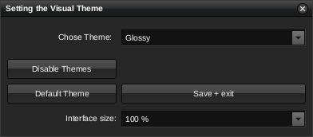 |  |

  </details>
* **Eight looks** for the windows, all of them theme files you can copy and
  change: two reproduce MB3D's looks, six are new.

  <a href="docs/img/themes/Midnight.jpg">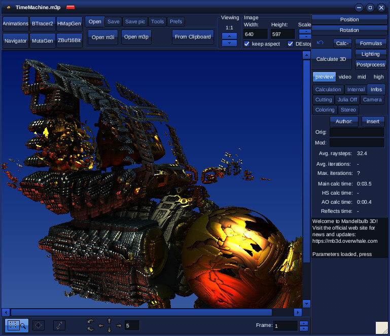</a>

  <details><summary>Read more</summary>

  **Prefs ▸ Visual themes** offers eight looks, each a file in the `Themes`
  folder: *Glossy* (the dark default) and *Windows* reproduce MB3D's own
  two looks, the other six are new. Click a picture for its full size.
  
  | | |
  |---|---|
  | <a href="docs/img/themes/Glossy.jpg"></a> | <a href="docs/img/themes/Windows.jpg">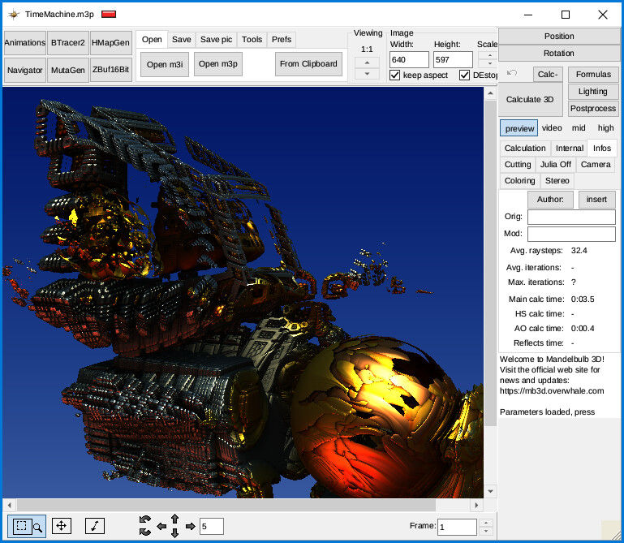</a> |
  | **Glossy**: MB3D's default | **Windows**: MB3D's "Themes off" |
  | <a href="docs/img/themes/Graphite.jpg">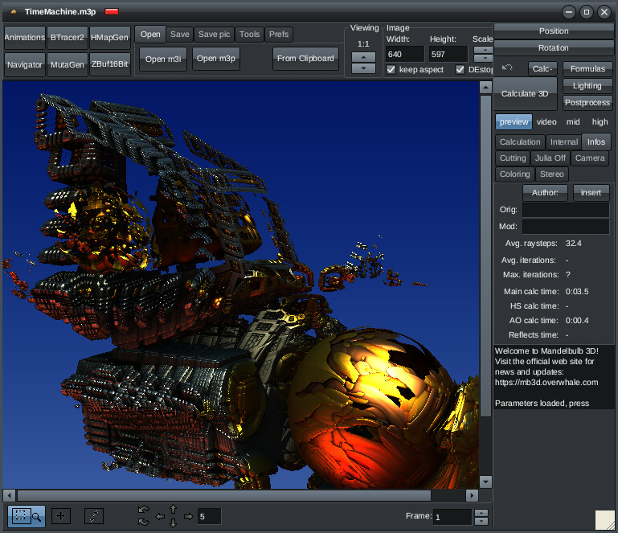</a> | <a href="docs/img/themes/Daylight.jpg">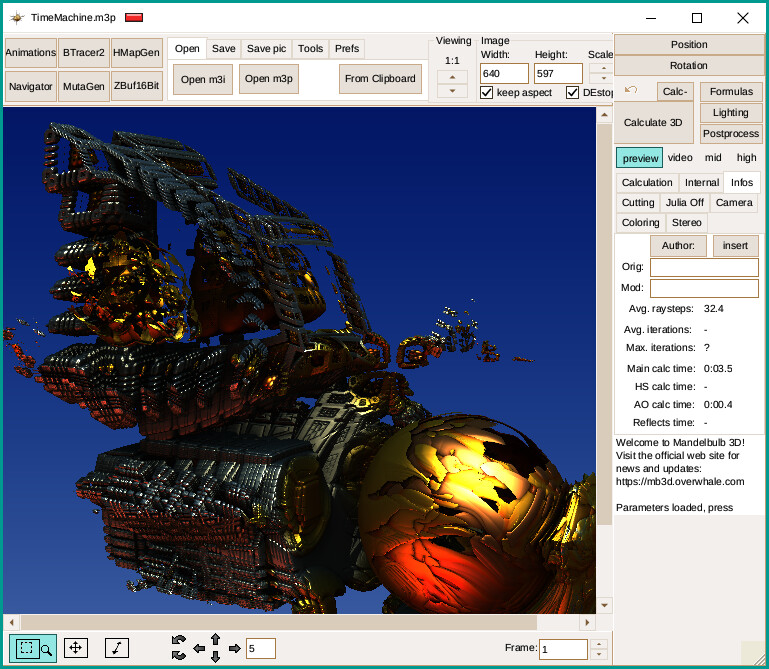</a> |
  | **Graphite**: lighter neutral grey, steel-blue accents | **Daylight**: warm light grey, teal accents |
  | <a href="docs/img/themes/Midnight.jpg"></a> | <a href="docs/img/themes/Ember.jpg">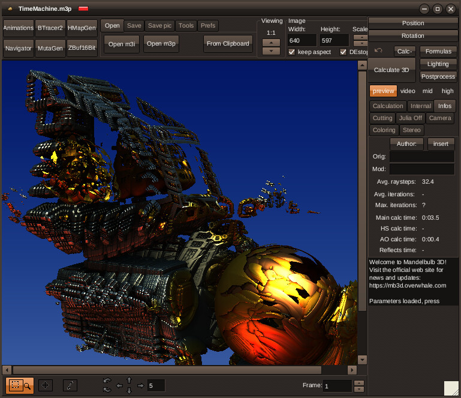</a> |
  | **Midnight**: deep navy, blue accents | **Ember**: warm charcoal, orange accents |
  | <a href="docs/img/themes/Forest.jpg">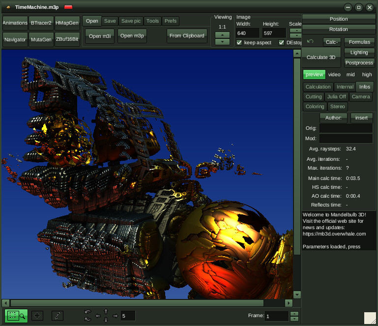</a> | <a href="docs/img/themes/Highcontrast.jpg">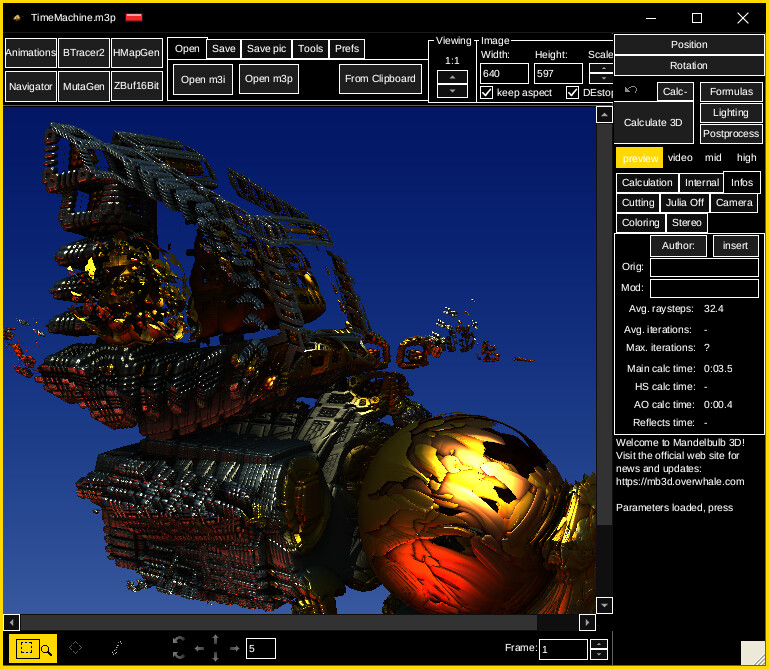</a> |
  | **Forest**: dark green-grey, green accents | **High contrast**: black, white text, yellow highlights |
  
  A theme is a small text file in the `Themes` folder next to the program;
  copy one, change its colours, and it appears in the list at the next
  start.

  </details>
* **A crash leaves a note on every system**: a panic of the program (or
  the error it ends with) is appended to `mb3d_crash.txt`, next to the
  program or in its data folder (before only on Windows). Send that file
  with a bug report.
* **All the graphics cards of the computer calculate**, with nothing to
  set: every card found takes bands of rows of the picture from the same
  pool as the first card and the processor, so a faster card simply
  takes more; the shadows, the occlusion, the Monte Carlo rays and the
  reflections are shared the same way, and an animation renders a frame
  per card at once. A slow card (integrated graphics beside a dedicated
  one) does what it can and never holds a picture up: once the free rows
  are gone, the idle cards and the processor take over the rows it has
  not delivered. A card that fails is left out, the others carry on.
  `mb3d --list-cards` shows what was found. (Tested with one card opened
  twice and with a software Vulkan driver as a second card; not yet on a
  computer with two real cards.)
* **An unfinished picture is a `.m3i` file.** What a stopped, crashed or
  killed render has calculated is kept in the cache (the Unfinished
  renders window, `mb3d resume`); for a picture that file is now a
  `.m3i` image file at every moment, `image.m3i` in the render's folder,
  with the rows not calculated yet as background. Copy it out whenever
  you like, or press *Save m3i* in the Unfinished renders window (`mb3d
  resume --m3i KEY file.m3i` on the command line; both also write the
  `data.bin` of an earlier version as a `.m3i`), and open it here or in
  Mandelbulb3D, no conversion needed. (Monte Carlo renders keep their
  own records, the `.m3c` of a pass is written with `--m3c`.)
* **Hotkeys for the windows**: a key combination brings the main window,
  the Navigator, the Animation, Formulas, Lighting, Post processing or
  Monte Carlo window to the front from any window (Ctrl+1 to Ctrl+7), and
  Ctrl+W closes the window you are in (on macOS Cmd). Set your own under *Prefs > Hotkeys*: click a field and
  press the keys, Backspace takes a hotkey away.
* **The interface in your language**: every text of the windows comes
  from a language file; twelve languages ship, and the program writes the
  file of a new language for you to translate.

  <details><summary>Read more</summary>

  The language badge at the right end of the main window's title bar
  shows the interface language (`EN`); a click opens the language window.
  A language is a text file in the `Languages` folder next to the program.
  Shipped: English, Deutsch, Français, Italiano, Nederlands, Polski,
  Kaszëbsczi, हिन्दी, 日本語, 한국어, 简体中文 and 繁體中文 (each with its flag; the
  East Asian ones bring a subset of Noto Sans CJK for their characters,
  Hindi brings Noto Sans Devanagari, whose joined letters and vowel signs
  are set with the rustybuzz text shaper).
  The translations were machine made and checked for structure, not by
  native speakers: corrections are welcome, each is one line of the file. To translate: type the name of your language and
  press *Create language file*; the program writes `Languages/<name>.lng`
  with every text in English, one per line (`Button2.Caption = Calculate
  3D`). Translate the texts right of the `=` with a text editor and press
  *Reload*: the windows follow at once, without a restart. A line left out
  keeps the English text. *Save + exit* keeps the language for the next
  start.

  </details>
* **Linux, Windows and macOS** (Intel and Apple Silicon).
* **A command line program** for everything that needs no window.
* **Very big pictures in one piece**: 15000 x 20000 pixels and more
  without running out of memory, and the depth of field uses all
  processor cores (11 times faster on 24 threads than before 0.2.45, with
  the same picture).
* **16 bit pictures:** PNG files with 65,536 instead of 256 steps per
  colour, for editing without banding.

  <a href="docs/img/png16_compare.png">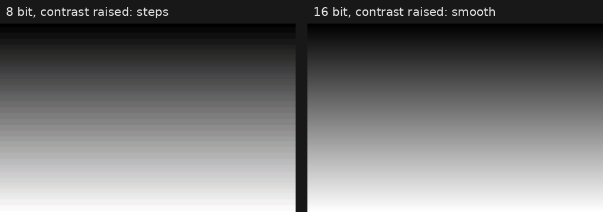</a>

  <details><summary>Read more</summary>

  MB3D saves 8 bit pictures: 256 steps per colour. That is plenty to look
  at, but when a picture is edited afterwards — brightness, contrast,
  curves — smooth areas such as the background or fog break into visible
  bands. **Save pic ▸ PNG** offers a second file type, **PNG 16 bit
  colour**: the colours as the program calculated them, before they are
  rounded to 256 steps, with all shadows, reflections and depth of field.
  The file looks the same, and stays smooth when it is edited.
  
  <a href="docs/img/png16_compare.png"></a>
  
  <a href="docs/img/save_png16.png">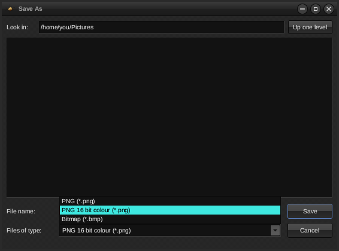</a>

  </details>
* **A noise filter** for Monte Carlo and all other pictures, the DCT
  denoising known from GIMP, and for Monte Carlo renders also a neural
  one, Intel Open Image Denoise.

  <a href="docs/img/mc_noise.png">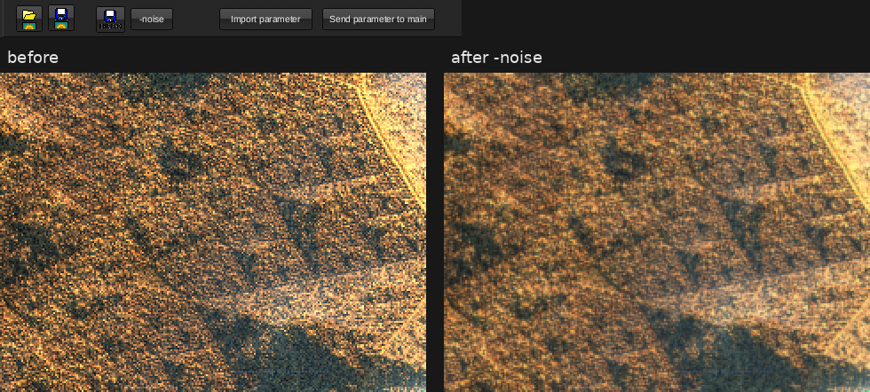</a>

  <details><summary>Read more</summary>

  A **noise filter** removes grain from the pictures: the **DCT denoising**
  of GIMP's *Filters ▸ Enhance ▸ Noise Reduction ▸ Denoise DCT*, which of
  GIMP's filters suited these pictures best (see the credits below).
  
  * **Monte Carlo window ▸ -noise** (a button MB3D had hidden): filters the
    shown picture, and the saved one, with a strength that follows the rays
    per pixel. The rendering itself goes on unfiltered, and its next update
    shows it unfiltered again.
  * **Post processing ▸ Noise Filter**: *Filter now* filters the picture of
    the main window; *Filter new pictures automatically* filters every new
    one. *Strength* is the strength of the noise to remove (4 is light;
    higher removes more grain and more fine detail).
  
  Monte Carlo pictures have the most grain. Against pictures rendered with
  512 rays per pixel, the filtered pictures were closer than the unfiltered
  ones in all 13 tests (four scenes, 4 to 32 rays): by up to 23 % at 4 rays,
  5 to 10 % at 8 rays, 1 to 3 % at 32 rays, where little grain is left.
  
  <a href="docs/img/mc_noise.png"></a>
  
  <a href="docs/img/postpro_noise.png">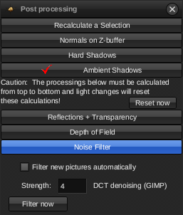</a>

  The **neural noise filter** is
  [Intel Open Image Denoise](https://www.openimagedenoise.org), the
  filter of Blender's Cycles and many other path tracers, trained on
  rendered pictures. It filters the rendering's averages of the rays
  (before exposure and saturation), so the picture keeps its brightness.
  Intel's library comes with the program (the `oidn` folder; in the .deb
  and .rpm, `/usr/lib/mb3d-rs/oidn`); `MB3D_OIDN` can name another one.

  * **Monte Carlo window ▸ -noise AI**: filters the shown picture, and the
    saved one, as *-noise* does; the rendering goes on unfiltered.
  * **Command line**: `mb3d montecarlo scene.m3p --rays 8 --denoise-ai`.
  * It takes 0.2 to 0.6 seconds for a 640 x 480 picture on the processor.

  The difference from the 512-ray picture (mean over all pixels, lower is
  better):

  | Scene | 4 rays | DCT filter | neural filter | 8 rays | DCT filter | neural filter |
  |---|---|---|---|---|---|---|
  | TreePlanet | 1.89 % | 1.52 % | **1.23 %** | 0.88 % | 0.82 % | **0.79 %** |
  | Cutted sphere over carpet | 5.30 % | 3.87 % | **2.34 %** | 2.80 % | 2.37 % | **1.66 %** |
  | Julia on box | 1.61 % | **1.01 %** | 1.08 % | 0.98 % | **0.81 %** | 0.84 % |
  | MengerTrees | 1.95 % | 1.54 % | **1.26 %** | 1.15 % | 1.05 % | **0.94 %** |

  The neural filter is closest in three of the four scenes; on the Julia
  set's fine grain the DCT filter is a little closer. It shows most on
  glass and mirrors, where few rays leave the most grain:

  <a href="docs/img/mc_noise_ai.jpg">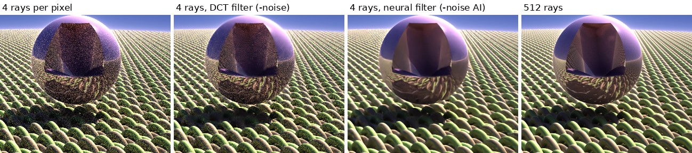</a>

  </details>
* **Transparent backgrounds** for pictures and animations.

  <a href="docs/img/transparent.png">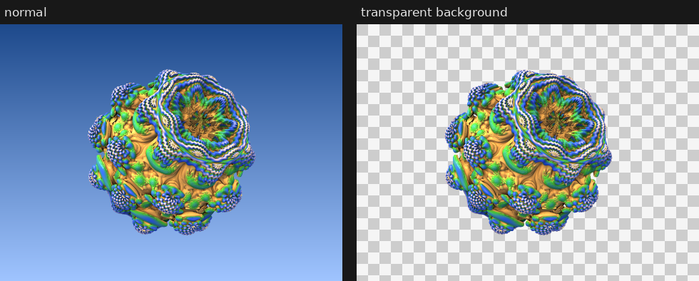</a>

  <details><summary>Read more</summary>

  Pictures and animation frames can be saved with a **transparent
  background**, to put the fractal onto another picture or into a video
  editor: **Save pic ▸ PNG ▸ PNG transparent background**, and in the
  Animation maker **Transparent background** (PNG frames). With anti-aliasing (a
  viewing scale of 1:2 or more, or `--aa`) the edges are soft, and they
  carry no fringe of the old background colour. Depth pictures for
  compositing were already there (*Save Z buffer too*, `--depth`).
  
  <a href="docs/img/transparent.png"></a>

  </details>
* **Videos of animations:** an AVI file straight from the program, or
  the ffmpeg command for a small MP4.

  <a href="docs/img/anim_video.png">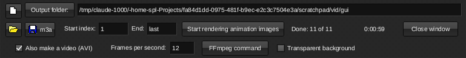</a>

  <details><summary>Read more</summary>

  In the Animation maker, **Also make a video (AVI)** joins the frames into
  a video when they are rendered, at the **Frames per second** you set:
  `<project name>.avi` in the output folder, next to the frames, which are
  kept. It plays in VLC and mpv and opens in video editors (Kdenlive,
  Shotcut, DaVinci Resolve). Each frame is stored as a whole picture, so the
  files are big: good for editing and keeping, less for sharing.
  
  For a small video to share, **FFmpeg command** puts the command for an MP4
  (or, with a transparent background, a WebM) on the clipboard and in the
  messages. Install [ffmpeg](https://ffmpeg.org), paste the command into a
  terminal when the frames are done, and it makes the video; this program
  starts no other programs itself.
  
  <a href="docs/img/anim_video.png"></a>

  </details>
* **A preview of parameter files** in the Open dialog.

  <a href="docs/img/open_preview.png">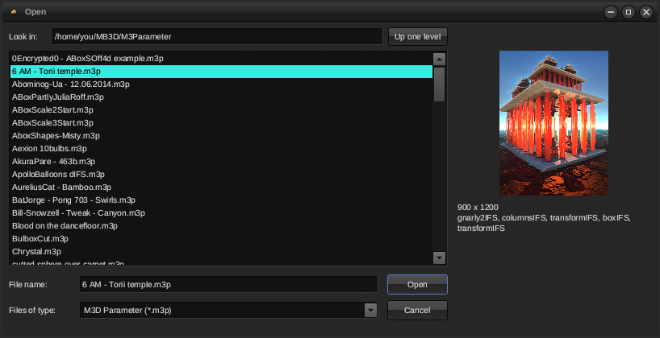</a>

  <details><summary>Read more</summary>

  **Open ▸ Open m3p** and **Open m3i** show a small picture of the
  clicked parameter file, with its size and formulas, before it is
  opened; the arrow keys move through the list with the preview. The
  picture is calculated in the background on the processor, so the
  dialog stays responsive, and each file's preview is kept while the
  program runs.
  
  <a href="docs/img/open_preview.png"></a>

  </details>
* **Navigator: exact values and Reset view.** Click a value and type it;
  go back to the view the Navigator started from.

  <a href="docs/img/navigator_values.png">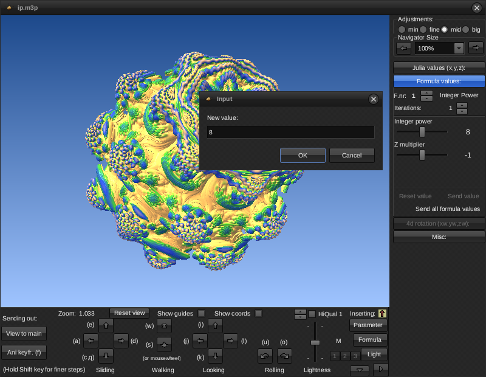</a>

  <details><summary>Read more</summary>

  * **Click a value** in the Navigator's panels — Julia values, formula
    values, 4D rotation, the Misc values — and type the exact number, as in
    MB3D (angles in degrees). The slider then continues from that value.
  * **Click the zoom** and type it, when the zoom steps are too coarse (a
    wish from MB3D's issue list); a typed zoom stays (*Fixed zoom*).
  * **Reset view** goes back to the position, direction and zoom the
    Navigator took from the main window; the adjusted values stay.
  
  <a href="docs/img/navigator_values.png"></a>

  </details>
* **A new formula, SphereTree:** a tree of touching spheres that branch
  smaller and smaller, by Tom Lowe.

  <a href="docs/img/spheretree_ball.jpg">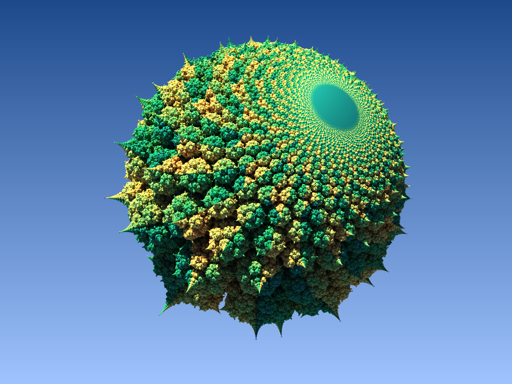</a>

  <details><summary>Read more</summary>

  **SphereTree** is a formula Mandelbulb3D does not have: a tree of spheres
  that touch each other and branch into smaller and smaller spheres, like
  foam or coral. Tom Lowe, who invented the Mandelbox, published it in 2020
  (see the credits below). It is in the formula list with the dIFS formulas
  and has four settings:
  
  * **PackRatio** (0 to 1.22): the size of the spheres; at 1 they just
    touch, above 1 the outer ones break off.
  * **Levels**: how deep the tree goes (6 is plenty for most pictures).
  * **Rotated**: 1 turns every level a twelfth of a turn, and the tree
    becomes a round ball of sphere clusters.
  * **Colour scale**: every branch of the tree has its own colour. Choose
    *2nd choice* (the orbit trap) in the colour settings of the Lighting to
    see them; this setting spreads them over the colour gradient.
  
  It works alone and after dIFS transforms (the third picture repeats it
  with *tilingbrickIFS*), and it is calculated on the graphics card as well
  as on the processor. Set the iterations to 1: the formula calculates the
  whole tree at once. Parameters with SphereTree open only in this program,
  not in Mandelbulb3D.
  
  <a href="docs/img/spheretree_ball.jpg"></a>
  
  | <a href="docs/img/spheretree_close.jpg">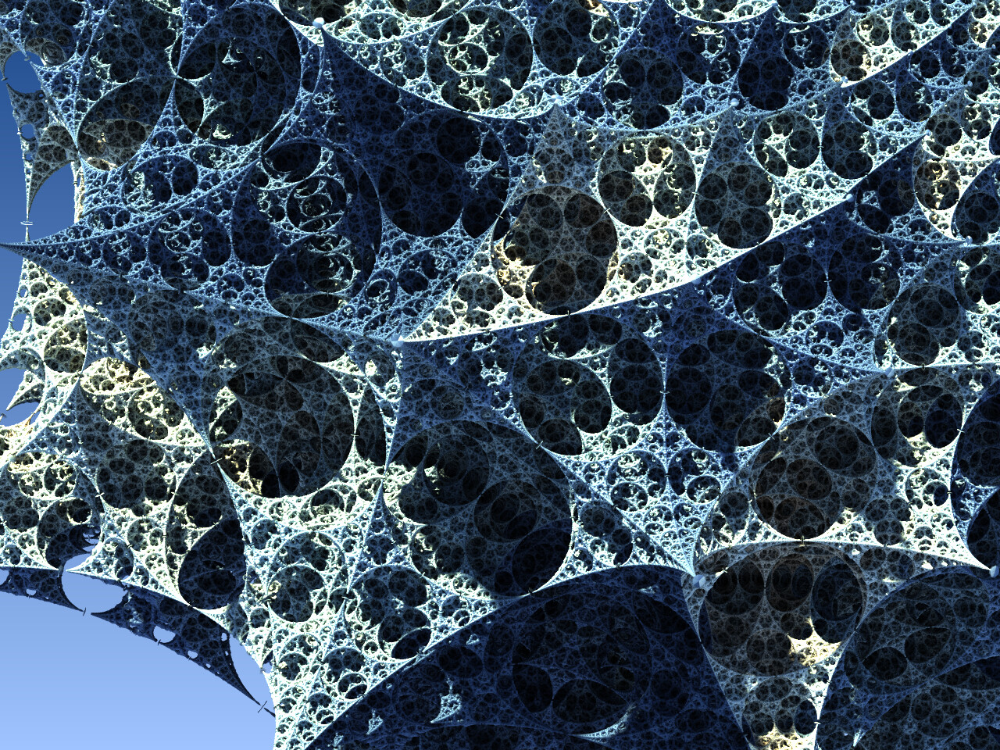</a> | <a href="docs/img/spheretree_swarm.jpg">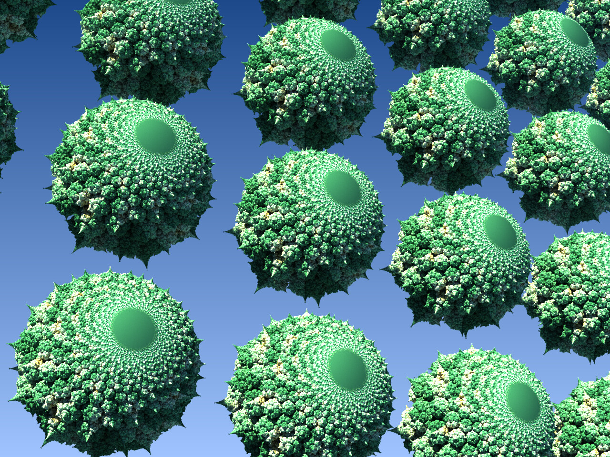</a> |
  |:---:|:---:|

  </details>
* **A new formula, DomeTree:** a dome that sprouts a ring of smaller
  domes, each with its own ring, by Tom Lowe.

  <a href="docs/img/dometree_mc.jpg">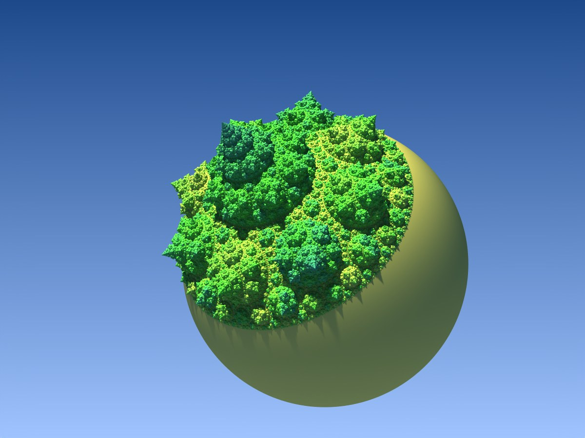</a>

  <details><summary>Read more</summary>

  **DomeTree** is Tom Lowe's second tree after SphereTree (see the
  credits): a ball whose one side grows a ring of domes, each dome its
  own smaller ring, level after level, made of circle inversions. It is
  in the formula list with the dIFS formulas and has five settings:

  * **Levels**: how deep the tree goes (16 is plenty).
  * **Children**: the domes in each ring, 4 to 10.
  * **Bend angle** (0.3 to 1.3 work best): how far the domes bulge; low
    values give flat discs, high ones round domes. Above about 1.3 the
    surface turns grainy.
  * **Colour scale**: every dome has its own colour. Choose *2nd choice*
    (the orbit trap) in the colour settings of the Lighting and a wide
    colour range (for example 0 to 100) to see them.
  * **Start curved**: 1 (the default) starts with the ball, 0 with a flat
    floor that grows the first ring.

  Use a small *Raystep* (0.2; 0.05 with 9 or 10 children): the shape's
  distance estimate is rough, as in TGlad's own Fragmentarium file. Like
  SphereTree it runs on the graphics card and the processor, needs only
  1 iteration, and parameters with it open only in this program.

  <a href="docs/img/dometree_mc.jpg"></a>

  | <a href="docs/img/dometree_5.jpg">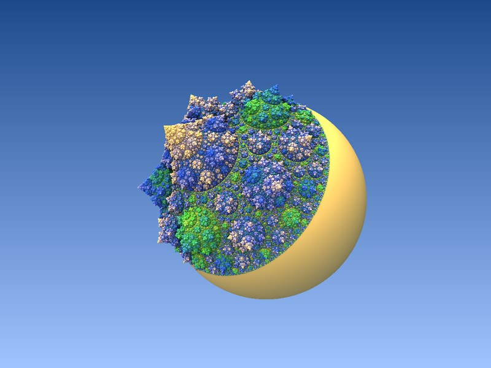</a> | <a href="docs/img/dometree_flat.jpg">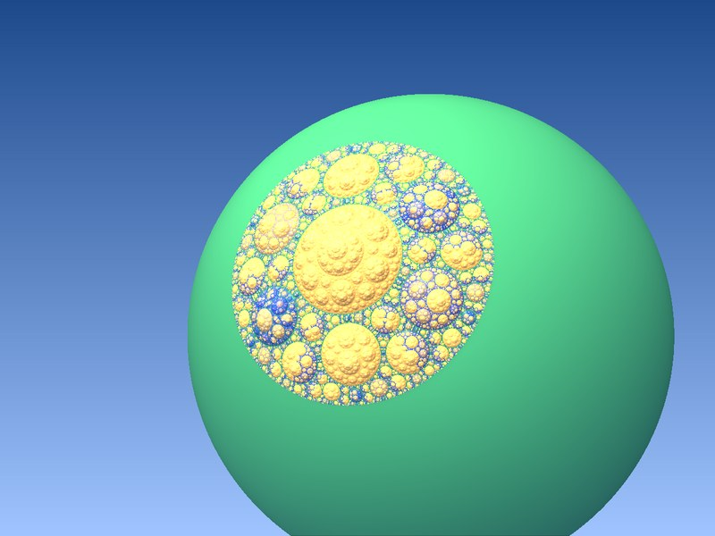</a> | <a href="docs/img/dometree_10.jpg">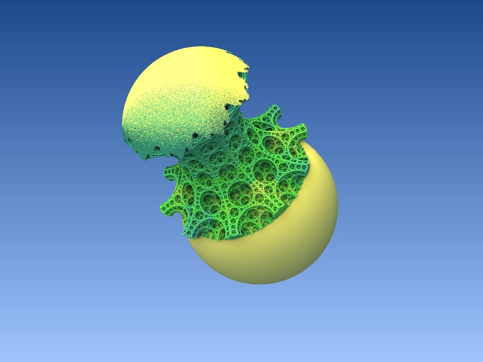</a> |
  |:---:|:---:|:---:|

  </details>
* **A new formula, UlamSpiral:** Ulam's spiral of prime numbers in 3D, as
  a city, a skyline, spheres or a block.

  <a href="docs/img/ulam_2d.png">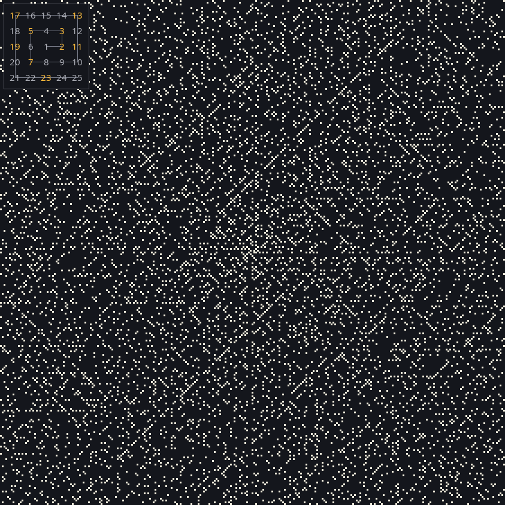</a>

  <details><summary>Read more</summary>

  In 1963 the mathematician Stanisław Ulam sat through "a long and very
  boring paper" at a meeting and doodled on a sheet of squared paper. His
  first idea was to set up chess problems; instead he numbered the squares
  1, 2, 3, … in a spiral, 1 in the middle, and circled the prime numbers.
  The primes lined up on diagonal lines, as if they followed a pattern, and
  they still do when a computer draws millions of them (Ulam tried 100,000
  on the MANIAC II at Los Alamos; Martin Gardner put the picture on the
  cover of Scientific American in 1964). Nobody has fully explained it to
  this day.
  
  <a href="docs/img/ulam_2d.png"></a>
  
  **UlamSpiral** builds that spiral in 3D, one shape per number, in four
  forms (*Mode*):
  
  * **0, prime towers**: a plate for every number and a tower on each
    prime. The diagonal lines of primes become rows of towers.
  * **1, divisor skyline**: a column for every number, the higher the more
    divisors it has; the primes are the low streets between them.
  * **2, divisor spheres**: a sphere for every number, the larger the more
    divisors it has (the primes are the small ones).
  * **3, a block of primes**: the numbers wound around cube shells instead
    of a square, a cube on each prime.
  
  *Rings* sets the size of the spiral (60 rings are the numbers up to
  14,641), *Height* the height of the towers or columns, *Gap* the space
  between them. With *2nd choice* (the orbit trap) in the colour settings
  the colour follows the number of divisors, so the primes have a colour
  of their own. Like SphereTree it runs on the graphics card and the
  processor, works after dIFS transforms, needs only 1 iteration, and
  parameters with it open only in this program.
  
  <a href="docs/img/ulam_city.jpg">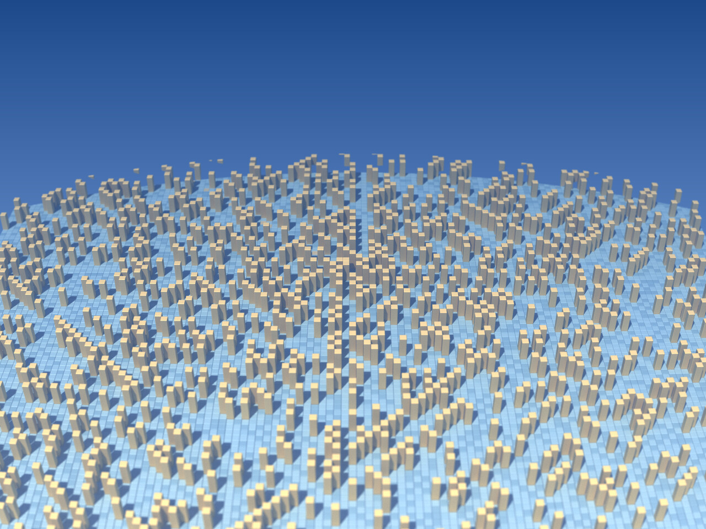</a>
  
  | <a href="docs/img/ulam_skyline.jpg">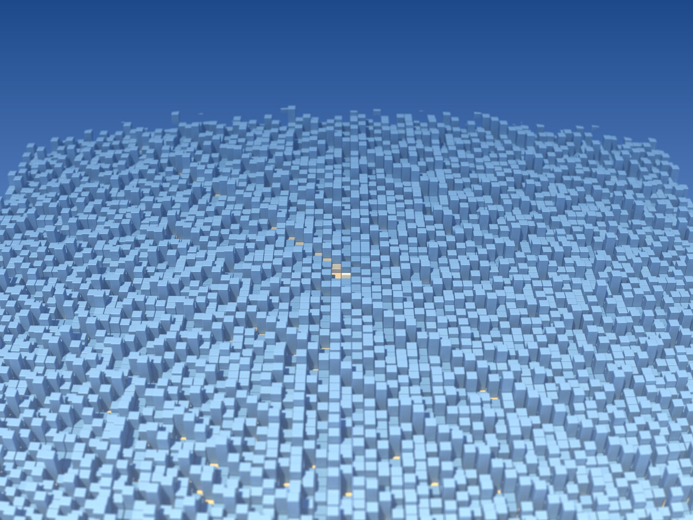</a> | <a href="docs/img/ulam_spheres.jpg">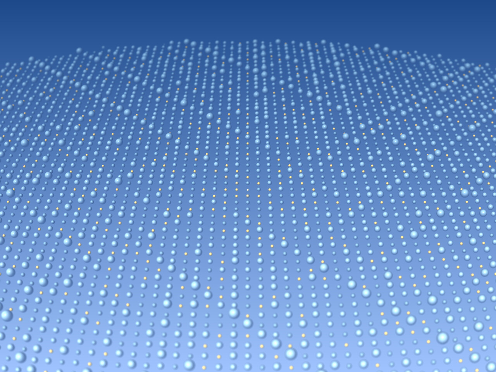</a> | <a href="docs/img/ulam_block.jpg">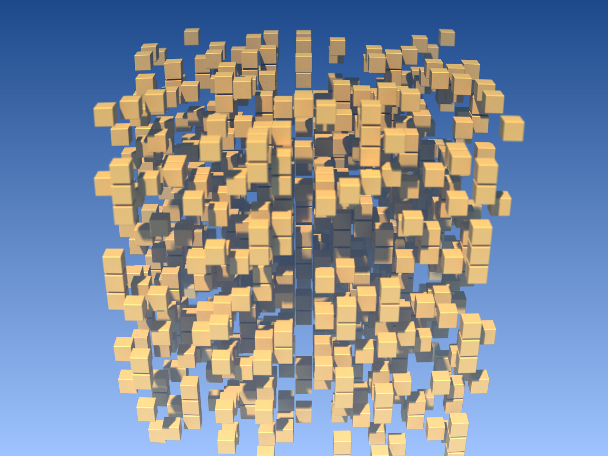</a> |
  |:---:|:---:|:---:|

  </details>
* **A stopped render continues where it was.** What a render calculated
  is kept when it is stopped, and also when the program is closed or
  crashes, or the computer goes off (it is saved to the disk every 5
  minutes): Calculate 3D, Monte Carlo (also in the middle of a pass), the
  frame of an animation or the picture of a batch under way, a voxel
  export, a Bulb Tracer mesh, Big render tiles, and a swarm render (Stop
  on the computer that made the job keeps every finished part, and each
  computer keeps the part it was at). Calculate 3D and Monte Carlo of the
  same parameters ask whether to continue, the others continue by
  themselves; the **Resume** button (Open tab) lists the unfinished
  renders, to continue or delete them. On the command line the same
  command continues by itself (also a picture in `--tiles`, `montecarlo`,
  `animate`, `batch`, `voxel` and `mesh`); `--fresh` starts again, `mb3d
  resume` lists them. A continued render is the same as one calculated in
  one go.
* **Rendering shared between your computers**, a "swarm": computers that
  see one shared folder render a picture, a Big render, a Monte Carlo
  picture or an animation together. See
  [Rendering on several computers](#rendering-on-several-computers-the-swarm).
* **Community formulas and maps**: 129 formulas and 154 maps that the
  official repository lacks, from the Mandelbulb3D 1.99.37 package that
  Machina Infinitum offers as a free download. The formulas are by Edgar
  Malinovsky, gnj, DarkBeam (Luca GN), bugman, Aexion, Buddhi, pupukuusikko,
  Jos Leys, Knighty, trafassel, Nrx, Eiffie, Quasihedron, Inigo Quilez,
  Yannis Picart, Jotero and others whose files name no author;
  `M3Formulas/CREDITS-community.md` names the author of each (`teapot.m3f`
  by DarkBeam is under CC BY-SA 3.0). The maps are from DarkBeam's
  collection, under his terms (free to use, not to be sold unchanged), with
  pictures shared on DeviantArt by CmdrChaos, Fractales75, Nic022 and
  UndeadAcademy; maps 3046–3048 are by Kronpano
  (`M3Maps/CREDITS-community.md`). The 608 light presets in `M3Lights` come from the same package; their
  files name no maker (`M3Lights/CREDITS-community.md`).
* **Ideas from Mandelbulb3D SE**: Glenn Olander's Mandelbulb3D SE, a macOS
  app built on mb3d-rs, gave two ideas: checking every graphics card shader
  in the tests without a graphics card, and Stop ending the painting of a
  picture at once.
* **A new formula, PseudoKleinian:** the "Kleinian architecture" of
  halls, arches and spheres as one formula with its own exact distance.

  <a href="docs/img/kleinian_hall.jpg">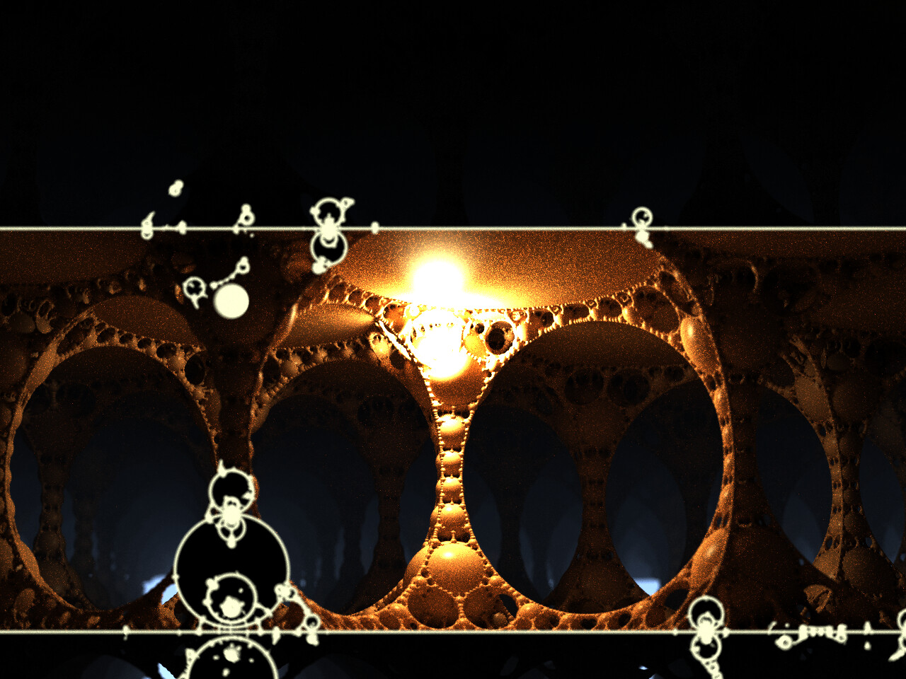</a>

  <details><summary>Read more</summary>

  The halls, arches, pillars and nested spheres known as "Kleinian
  architecture" are among the best-loved 3D fractal pictures. In MB3D they
  can only be made as a hybrid of several formulas with carefully matched
  settings, the recipe Theli-at found in 2011; knighty then wrote the same
  thing as one formula with its own distance estimate, and that is
  **PseudoKleinian**. Each level folds the point into a box, inverts it in
  a sphere and adds an offset, and the distance is measured exactly to a
  floor plane after the folds, so the walls come out clean and the picture
  renders fast. The settings are knighty's: *Levels* (8), *Size* (the
  inversion sphere), *CSize X/Y/Z* (the box; his 0.924, 0.908, 0.924 give
  the classic halls, and small changes give new buildings), *Julia X/Y/Z*
  (an offset per level), *Shape* (0 the floor plane, 1 a cylinder-plane of
  *Thickness* through *Offset*, 2 a rounded box), *DE offset* (hollows the
  surface) and *Colour scale* (with *2nd choice*, the orbit trap: the
  smallest orbit radius, the classic Kleinian banding).
  
  The structure fills all of space, so you look at it from inside: start
  with the view centre near the origin and the camera a unit or two back,
  and move through the halls with the Navigator. In the Monte Carlo
  renderer an interior gets almost no sky light, so put a positional light
  into the hall (the first picture) or cut the structure open with a
  cutting plane and look in from above (the second). It runs on the graphics
  card and the processor, needs 1 iteration, works after dIFS transforms
  and in DE combinations like the other dIFS formulas (though inside a
  space-filling structure those change little), and parameters with it
  open only in this program.
  
  <a href="docs/img/kleinian_hall.jpg"></a>
  
  <a href="docs/img/kleinian_top.jpg">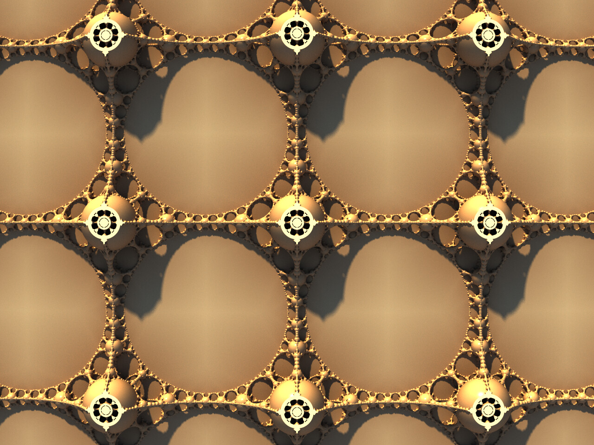</a>

  </details>
* **Stereo pairs in one step**: both eye images rendered and shown side by
  side, for parallel or cross-eyed viewing. Contributed by Rathinagiri S
  ([SRathinaGiri](https://github.com/SRathinaGiri)).

  <a href="docs/img/stereo_pair.jpg">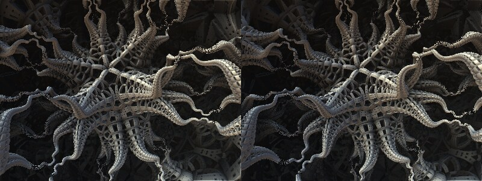</a>

  <details><summary>Read more</summary>

  **Stereo ▸ Render stereo pair** renders the left and then the right eye
  image with the tab's stereo settings and shows them side by side in the
  main window. They are placed for parallel viewing (left image on the
  left); **Cross-eyed preview** swaps them for cross-eyed viewing. It is a
  preview: lighting and colours
  cannot be changed afterwards without rendering again, and it does not
  work with tiles. The buttons for the single eye images are still there.
  
  <a href="docs/img/stereo_pair.jpg"></a>

  </details>
* **Time left for the whole picture**: the bar under the picture fills once
  over the whole calculation, and beside it the time left until the picture
  is finished, shadows, occlusion and reflections included.

  <a href="docs/img/time_left.png"></a>

  <details><summary>Read more</summary>

  MB3D's bar starts again at every stage. Here it shows the whole
  calculation: the main rendering, then the hard shadows and ambient
  occlusion, the reflections and the depth of field. How long the stages
  after the main rendering take is estimated from what the scene asks for
  and how the main rendering went; the estimate was fitted on about 1400
  renders of 366 scenes. A picture calculated again expects the times it
  took the last time.
  
  The first picture with new formulas on the graphics card waits for its
  shaders to compile: the line then says *shaders compiling* with the time
  left, which takes the processor's pace and, when the shaders will be
  ready in time, the card joining in. Details in
  [TECHNICAL.md](docs/TECHNICAL.md#time-left-and-the-progress-bar).
  
  <a href="docs/img/time_left.png">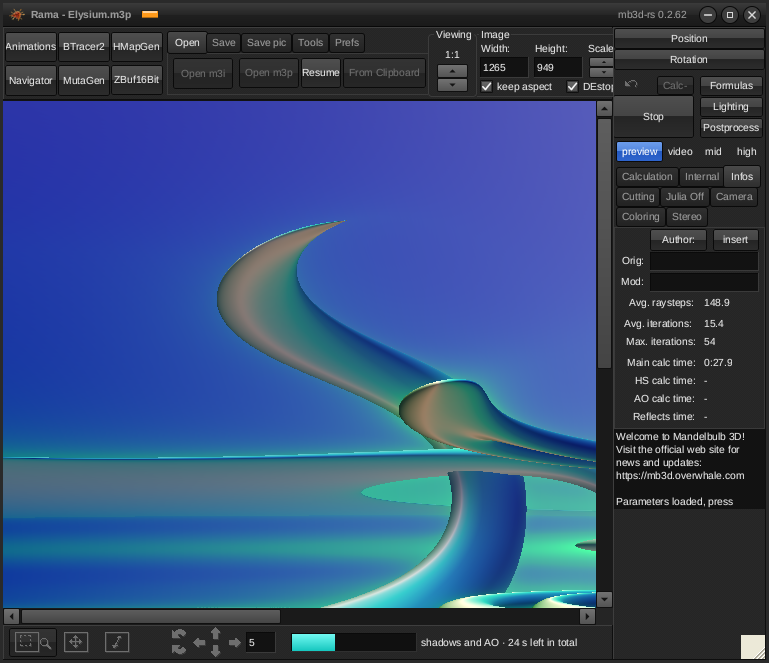</a>

  </details>
* **History** behind the clock icon of the title bar: every picture you
  calculated with its thumbnail, every file you opened or saved, as a list,
  as rows or as tiles of any size, grouped by day or in one run; search
  it, sort it, show only the pictures that differ, and load any entry
  with a double click. A history of hundreds of thousands of entries
  opens at once.
* **AI assistants can use mb3d** (`mb3d mcp`, the Model Context
  Protocol): ask Claude's desktop app or Claude Code in plain words, or by
  voice through the assistant, to describe, change and render your
  parameter files, breed variations or render what you worked on last;
  the assistant sees the pictures and can adjust them. The **AI** button
  on the Prefs tab connects it with a click (or `mb3d mcp --setup`). mb3d stays offline (the assistant's app starts it on your
  computer), writes only into the `AI` folder and never deletes anything;
  pictures above 4K need your agreement.
* **A log of everything** behind the page icon of the title bar: every
  click, setting and typed value, every calculation with its stages and
  times, files opened and saved, windows, messages, warnings and errors,
  in a window that follows them live and in a file a day. A session that
  froze or was killed is reported at the next start, and a crash report
  carries the log's last lines.
* **Lighting stays live** after hard shadows and reflections: move a light
  or change its colour and the picture changes at once, as in Mandelbulb3D.

  <a href="docs/img/lighting_live.png">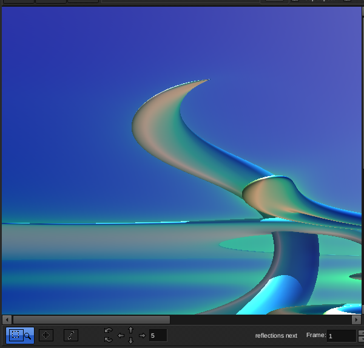</a>

  <details><summary>Read more</summary>

  Render plainly, then try out light positions and colours: each change in
  the Lighting window repaints at once with the shadows as they were
  calculated, as in Mandelbulb3D. Changing a light's colour or intensity
  never calculates the shadows again. The shadows of a light you moved,
  the reflections and the depth of field come back with the buttons of
  the Post processing window, as in Mandelbulb3D.
  
  A calculation you stopped can also still be continued after you changed
  the lighting. A way of working with it: [Lighting workflow](https://github.com/thr32423/mb3d-rs/wiki/Lighting-workflow)
  in the wiki. Details in
  [TECHNICAL.md](docs/TECHNICAL.md#lights-volumetric-light-cutting-planes-depth-of-field).
  
  <a href="docs/img/lighting_live.png">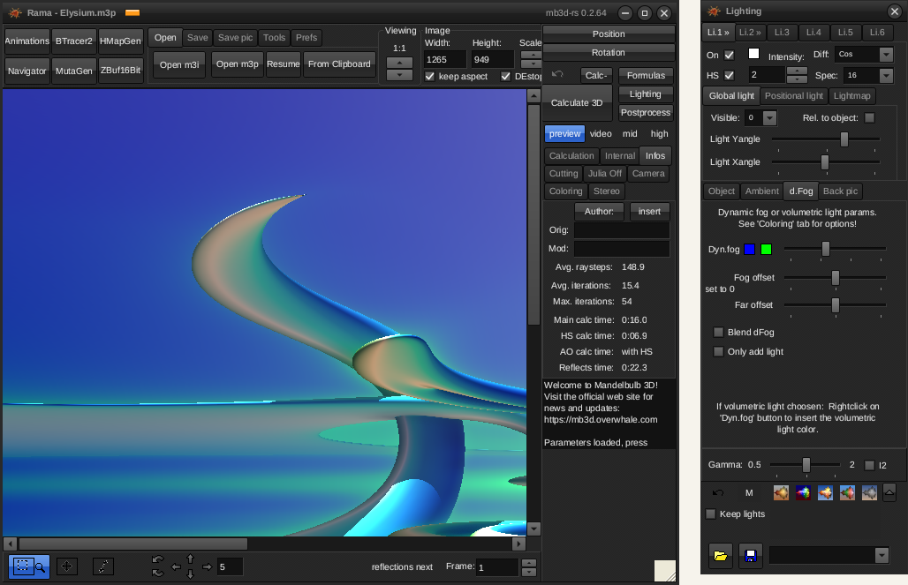</a>

  </details>
* **A ground plane or water** under (or behind) the fractal, an idea from
  Mandelbulber: a plane across the X, Y or Z axis, calculated together
  with the fractal, with its shadows, ambient occlusion, reflections and
  Monte Carlo light, in its own colour, flat or with waves.

  <a href="docs/img/ground_water.jpg">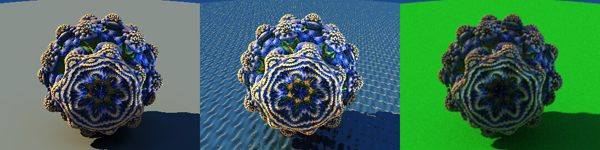</a>

  <details><summary>Read more</summary>

  Main window, page *Cutting*: tick *Ground plane*, choose the axis and
  the position, the colour, how much it reflects (0 to 1: a mirror when
  the reflections are calculated) and the waves' height and length. The
  solid side is always the one away from the camera. It is calculated on
  the graphics card and on the processor, and left out of the voxel and
  mesh exports. Mandelbulb3D has no place for it in its parameters:
  mb3d-rs keeps it in a small block after them (in .m3p and .m3i files,
  and as `{mb3d-rs: ...}` after the title of text parameters), which
  Mandelbulb3D does not read. Scene keys `ground`, `ground_color`,
  `ground_reflect`, `ground_waves`; details in
  [TECHNICAL.md](docs/TECHNICAL.md#lights-volumetric-light-cutting-planes-depth-of-field).

  **Transparent water**: with *Water* above 0 (how much light it lets
  through) a fractal half under water shows beneath the surface, bent by
  the refraction (*Refraction*: 1.33 for water) and turning into the
  colour of deep water (the colour button) with depth: the *Absorption*
  says how murky it is (0 clear, 3 murky), and in a
  blue-green water red fades first, so what lies under it turns
  turquoise. The lights' glints on the waves stay on the surface. The
  normal render shows it with the reflections on (Post processing),
  Monte Carlo always; without the reflections the water stays opaque.
  Scene keys `ground_transparency`, `ground_absorption`,
  `ground_water_color`, `ground_ior`; an example in
  [CLOUDS_WATER.md](docs/CLOUDS_WATER.md#transparent-water).

  **Scattering** (the row below *Refraction*): the water scatters light
  as real water does. It glows turquoise looking towards the sun, the
  wave crests shine through, the sun's light falls into it as shafts cut
  by the fractal's shadows, and what lies under the water glows softly
  in its colour; Monte Carlo traces the light through the water as it
  scatters. The second field is its direction (0.8: mostly forward). 0
  is the look without it. Scene keys `ground_scattering`,
  `ground_scatter_dir`; see
  [CLOUDS_WATER.md](docs/CLOUDS_WATER.md#transparent-water).

  **Try it**: on the *Cutting* page tick *Ground plane* and put its height
  through the fractal, set *Water* to 1, *Absorption* to 1 and
  *Scattering* to 0.5, and switch the reflections on (*Postprocess*,
  *Reflections + Transparency*, *Calculate R. (+ T.) automatically*),
  then *Calculate 3D*. Three finished scenes to paste, with their settings:
  [WATER_EXAMPLES.md](docs/WATER_EXAMPLES.md).

  *Water* (transparency) 0, 0.5 and 1:

  <a href="docs/img/water_transparency.jpg">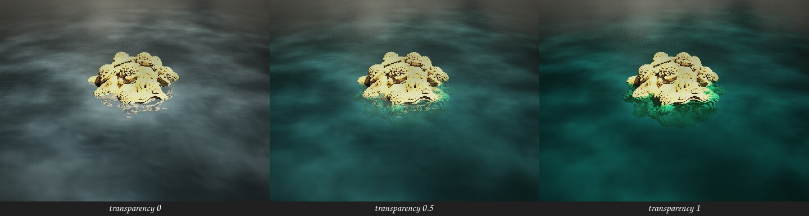</a>

  *Absorption* 0.3, 1 and 3, from clear to murky:

  <a href="docs/img/water_absorption.jpg">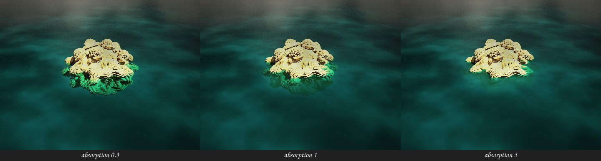</a>

  *Scattering* 0, 0.5 and 1 looking towards the sun, and the light shafts
  with a low sun in front:

  <a href="docs/img/water_scattering.jpg">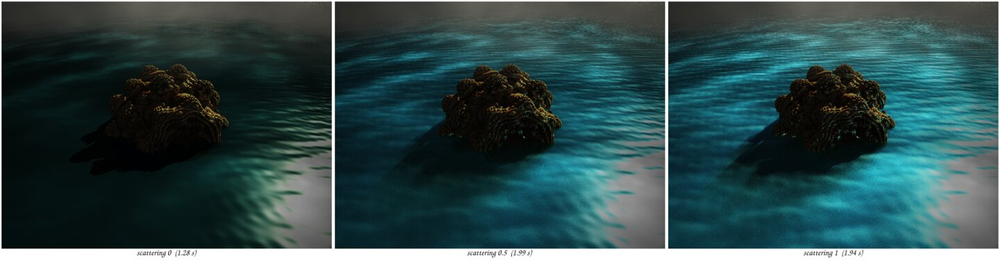</a>

  <a href="docs/img/water_shafts.jpg">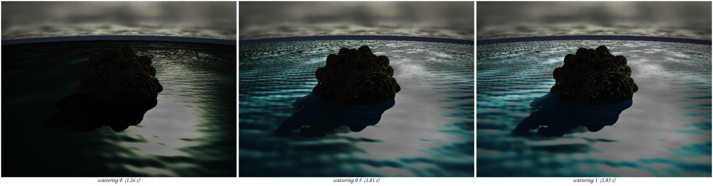</a>

  **The waves** are an irregular sea of sixteen waves along one wind
  direction (before 0.2.98 three regular waves made a checkerboard;
  scenes with waves look different since). Old (left of each pair) and
  new, small and large waves, the sun in front and behind:

  <a href="docs/img/water_waves.jpg">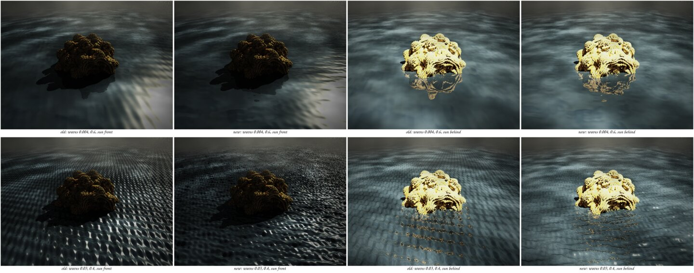</a>

  </details>
* **Light from an HDR picture**: a 360° Radiance `.hdr` picture as the
  background lights a Monte Carlo render, with its full brightness, and
  its sun becomes a light with soft shadows (an idea from Mandelbulber).

  <a href="docs/img/hdr_sun.jpg">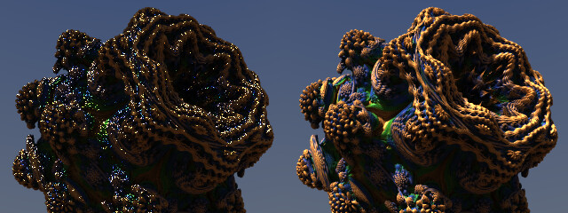</a>

  <details><summary>Read more</summary>

  Choose the `.hdr` file as the background picture in the Lighting window
  (not "direct"). Monte Carlo then lights the scene with the sky, and the
  brightest spot of the picture, its sun, is taken out and added as a light
  with shadows of the sun's size: found only by chance, the sun would leave
  bright speckles (left). Background pictures of 8 or 16 bits stay as they
  were.

  </details>
* **OpenEXR pictures** for compositing (Blender, Nuke, DaVinci Resolve):
  the colours in floating point, not clipped above white, with the layers
  opacity, depth and normals. *Save pic* > *OpenEXR*, or `mb3d -o
  picture.exr` (also with tiles and the swarm).

  <a href="docs/img/exr_layers.jpg">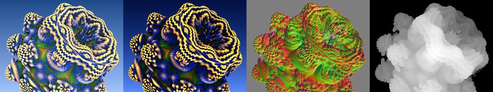</a>

  <details><summary>Read more</summary>

  The colours are linear, as OpenEXR expects: shown with the usual display
  curve they look as the PNG, and the highlights keep their brightness above
  white. The layers: `A` (opacity, as for a transparent PNG), `Z` (the
  distance from the camera in fractal units) and `N.X`, `N.Y`, `N.Z` (the
  surface normals). Details in [TECHNICAL.md](docs/TECHNICAL.md).

  </details>
* **A fisheye camera and 360° stereo for VR** (ideas from Mandelbulber):
  a fisheye of up to 360°, and panoramas for VR headsets with depth in
  every direction.

  <a href="docs/img/fisheye_water.jpg">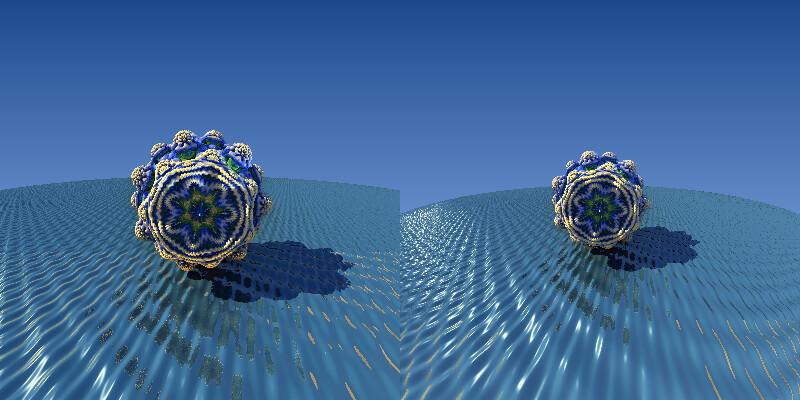</a>
  <a href="docs/img/vr_panorama.jpg">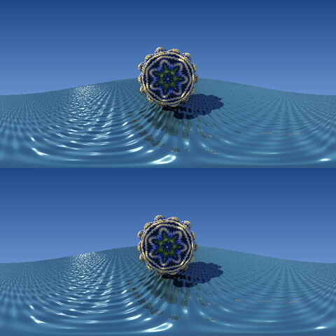</a>

  <details><summary>Read more</summary>

  Main window, page *Camera*: *Fisheye* (the field of view, FOVy, up to
  360°, spans the picture's height; a square picture shows a round view).
  A 360° panorama with stereo gives each ray its own eye position, turned
  with the direction it looks in, so the depth is right all around:
  `mb3d -s optic=2 --stereo-pair top-bottom` writes both eyes, the left one
  above, as VR players expect (a 2:1 picture per eye). The eyes are 6.5 cm
  apart, the point looked at as far away as the stereo viewing distance
  (`stereo_screen`'s second value, 2 m). Mandelbulb3D has no fisheye: the
  mb3d-rs block of the parameters keeps it.

  </details>
* **Volumetric clouds** (an idea from Mandelbulber): a layer of clouds
  above, below or around the fractal, lit by the scene's light, in front of
  and behind the fractal.

  <a href="docs/img/clouds.jpg">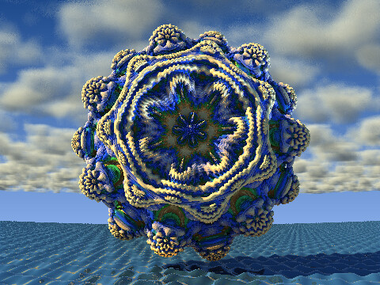</a>

  Three examples with clouds, water and reflections, with their parameters
  to paste in and where each setting is:
  [docs/CLOUDS_WATER.md](docs/CLOUDS_WATER.md).

  <details><summary>Read more</summary>

  Post processing window, section *Clouds*: tick *Paint clouds*, set the
  layer (an axis and two heights on it), how thick the clouds are, how much
  of the sky they cover, the size of their shapes and their colour, then
  *Paint now*. They are painted over the finished picture in a fraction of
  a second, so trying out settings is quick; each pixel looks through the
  layer up to the surface it hit. An animation can move them
  (`cloud_offset` between keyframes). Reflections show them, and Monte Carlo too; Mandelbulb3D does not have them (the mb3d-rs block of the
  parameters keeps them). They cast their shadows on the fractal and the ground, also from outside the picture.

  </details>
* **Surface materials** (ideas from Mandelbulber) on top of the palette:
  Fresnel (more reflection at grazing angles, as glass and lacquer have),
  iridescence (the shimmering colours of a thin film) and glow.

  <a href="docs/img/material.jpg">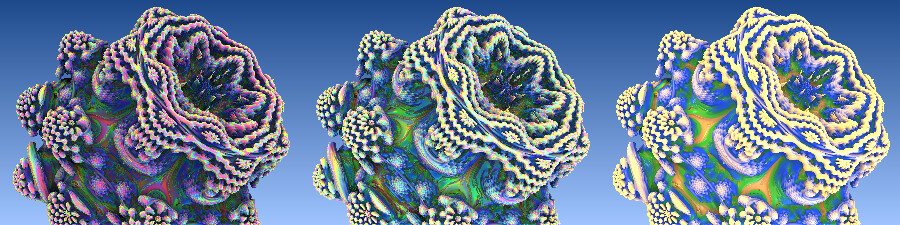</a>

  <details><summary>Read more</summary>

  Post processing window, section *Material*: tick *Surface material*, set
  Fresnel (0 to 1), iridescence (0 to 1, and a shift of its colours) and glow,
  then *Paint now*. Fresnel shows best with the reflections calculated. Off,
  the pictures are exactly Mandelbulb3D's; the ground plane keeps its own
  colour and reflection. Also in Monte Carlo.

  </details>
* **Two fractals in one scene** (an idea from Mandelbulber): with a DE
  combination, the second hybrid part can stand apart from the first,
  moved, turned and scaled, combined as union, intersection or cut.

  <a href="docs/img/two_objects.jpg">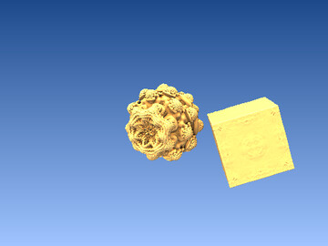</a>

  <details><summary>Read more</summary>

  Formula window, with a DE combination chosen: *Part 2 at* (its middle),
  *Size* and *Turned* (degrees about x, y and z). Union (*Min*) puts the two
  objects side by side, intersection (*Max*) keeps only what both share, the
  inverted max cuts the second out of the first, the smooth union melts them
  together. Calculated on the graphics card and the processor; the mb3d-rs
  block of the parameters keeps the place (Mandelbulb3D shows the two parts
  in one place).

  </details>
* **Animation curves** (an idea from Mandelbulber): a value of the scene
  over all frames of an animation, and its keyframes as handles to drag.

  <a href="docs/img/curves.png"></a>

  <details><summary>Read more</summary>

  *Animation maker* > *Curves*: choose the zoom, a coordinate of the position,
  an angle of the rotation, the field of view, Z start, the ground's position
  or the clouds' drift, and see it over every frame as the animation
  interpolates it. The keyframes are squares on their frames: drag one up or
  down, or click it and type a value. The quadratic Bezier interpolation
  passes beside the keyframes, and the curve shows that before anything is
  rendered. A third interpolation, *Catmull-Rom* (not in MB3D), is smooth and passes through every keyframe (`mb3d animate --catmull-rom`).

  </details>
* **Finishing the picture**: exposure, a glow around bright light, filmic
  tone mapping, contrast, saturation, warmth, a vignette and the colour
  fringes of a lens, as a last pass over the whole picture.

  <a href="docs/img/finishing.jpg"></a>

  <details><summary>Read more</summary>

  Post processing window, section *Finishing*: tick *Finish the picture*,
  set the exposure in stops, *Filmic* (bright light rolls off softly instead
  of turning flat white), the glow (strength, reach as a part of the
  picture's diagonal, and from which brightness it glows), contrast,
  saturation, warmth, vignette and colour fringes, then *Paint now*. The
  painting then runs in floating point, so the light above white is kept
  until the tone mapping. It applies to every picture, animation frame and
  Monte Carlo render (after the noise filter); off, the pictures are exactly
  as before. Scene keys `finish_exposure`, `finish_tonemap = filmic`,
  `glow = strength, radius, threshold`, `finish_contrast`,
  `finish_saturation`, `finish_warmth`, `vignette`, `chromatic`. In a big
  render made of separate tile pictures each tile glows on its own.

  </details>
* **A fine relief on the surface**: rough, stone (ridges and cracks) or
  grain, finer than the calculation's detail, with a colour variation.

  <a href="docs/img/relief.jpg"></a>

  <details><summary>Read more</summary>

  Post processing window, section *Material*: *Relief* with its strength, the
  size of its features (in the fractal's units, so it stays on the surface
  when the camera moves) and its fineness, and *Colour variation*. It tilts
  the surface where the light is calculated, so shading, highlights,
  reflections and Monte Carlo all see it; the shape itself is not changed
  (the outline stays smooth). Not on the ground plane. Scene keys
  `detail = stone, 1.5, 0.12, 0.5` (kind, strength, size, fineness) and
  `detail_color`.

  </details>
* **Turntables, recorded flights and motion blur** for animations.

  <a href="docs/img/motion_blur.jpg"></a>

  <details><summary>Read more</summary>

  *Animation maker* > *Turntable*: eight keyframes of one whole turn around
  the middle of the main window's view, a smooth loop (`mb3d animate
  scene.m3p --orbit 8 --frames 25`). *Navigator* > *Rec*: while the button is
  down, every new view of the flight (at most two a second) becomes the next
  keyframe; with Catmull-Rom the animation passes through all of them.
  *Motion blur* in the Animation maker: each frame is the average of that
  many pictures within the *Shutter* time (a part of the time to the next
  frame), so what moves smears; it takes that many times as long
  (`mb3d animate --motion-blur 8,0.5`).

  </details>
* **Gaussian splats** of the fractal, to look at from every side in
  Blender (5.3 and later), SuperSplat and other splat viewers: *Bulb
  Tracer2* > *Gaussian splats...*, or `mb3d splat scene.m3p -o fractal.ply`.

  <a href="docs/img/splats.jpg"></a>

  <details><summary>Read more</summary>

  The window exports the main window's scene; its settings are those of
  the command line. The fractal is calculated from 16 directions
  (*Directions*, `--views`), each a picture of 640 x 640 pixels (*Size of
  each view*, `--size`), with its lights, shadows,
  occlusion and reflections. Every pixel of the object becomes a flat
  Gaussian lying on the surface, with the colour it has in the picture.
  Where the pictures overlap, each patch of the surface comes from the
  one that saw it most squarely. The colours change with the direction you
  look from (spherical harmonics, *Colours by direction*, `--sh`), so
  highlights move as they do in the pictures.

  An object seen from outside is calculated from all around the scene's
  middle. A scene seen from inside (a hall, a cave, where the fractal fills
  the whole picture) is calculated from the scene's camera, looking in
  every direction (*Calculate from*, `--around camera`; *Auto*, the
  default, chooses). There,
  a larger `--size` keeps more detail, as each view is 110 degrees wide.

  The lights that turn with the camera, and the ambient light's top and
  bottom colours, are fixed to the object as they light the scene's own
  view, so all sides are lit alike. Depth of field, clouds, glow, vignette
  and the ground plane are left out. The file is in the scene's view (x to
  the right, y into the picture, z up: Blender's front view looks as the
  scene does), the middle or the camera at 0 and the fractal scaled to a
  radius of 1. It takes about 160 bytes per splat, typically 100 to 300 MB;
  `--sh 0` makes it a third of that, without the moving highlights.

  </details>

## Download

Ready-to-run programs for the latest release, no installation needed:

| System | Download |
|---|---|
| Windows (64 bit) | [mb3d-rs-windows-x64.zip](https://github.com/thr32423/mb3d-rs/releases/latest/download/mb3d-rs-windows-x64.zip) |
| Linux (64 bit) | [mb3d-rs-linux-x64.tar.gz](https://github.com/thr32423/mb3d-rs/releases/latest/download/mb3d-rs-linux-x64.tar.gz) |
| Debian, Ubuntu, Mint (installs like other programs) | [mb3d-rs-linux-x64.deb](https://github.com/thr32423/mb3d-rs/releases/latest/download/mb3d-rs-linux-x64.deb) |
| Fedora, RHEL, Rocky, openSUSE (installs like other programs) | [mb3d-rs-linux-x64.rpm](https://github.com/thr32423/mb3d-rs/releases/latest/download/mb3d-rs-linux-x64.rpm) |
| macOS, Apple silicon (M1 and later) | [mb3d-rs-macos-arm64.tar.gz](https://github.com/thr32423/mb3d-rs/releases/latest/download/mb3d-rs-macos-arm64.tar.gz) |
| macOS, Intel | [mb3d-rs-macos-x64.tar.gz](https://github.com/thr32423/mb3d-rs/releases/latest/download/mb3d-rs-macos-x64.tar.gz) |

Unpack it and start **Mandelbulb3D** (`Mandelbulb3D.exe` on Windows) in
the unpacked folder. The folder is laid out like an MB3D installation,
with MB3D's formulas, maps and 80 example parameter files.

* If Windows shows "Windows protected your PC", click *More info* ▸
  *Run anyway*.
* macOS blocks downloaded programs that are not signed: run
  `xattr -dr com.apple.quarantine .` in the unpacked folder once.

**Alternative for Linux and macOS:** instead of downloading by hand, this
one line fetches the latest release into `~/mb3d-rs` (run it again later
to update; the script [download.sh](download.sh) is also in the program's
folder):

```sh
curl -fsSL https://raw.githubusercontent.com/thr32423/mb3d-rs/master/download.sh | sh
```

It checks the download before unpacking it, puts **Mandelbulb3D** in
your application menu (Linux) and makes `Mandelbulb3D` and `mb3d`
commands you can type in any folder. `sh ~/mb3d-rs/download.sh
--uninstall` takes the menu entry and the commands away again; your files
stay.

The Linux programs run on distributions from about 2018 on (Ubuntu 18.04,
Debian 10, Rocky/RHEL 8 and newer).

**Installed like other programs:** on Debian, Ubuntu and Mint, open the
`.deb` file above (or `sudo apt install ./mb3d-rs-linux-x64.deb`); on
Fedora, RHEL and Rocky the `.rpm` file (`sudo dnf install
./mb3d-rs-linux-x64.rpm`, on openSUSE `sudo zypper install
./mb3d-rs-linux-x64.rpm`).
Mandelbulb3D is then in the application menu and `mb3d` works in any
folder; your settings and History are kept in `~/.config/mb3d-rs` and
`~/.local/share/mb3d-rs`.

[Getting started](GETTING_STARTED.md) walks through the first steps; older
versions and the release notes are on the
[releases](https://github.com/thr32423/mb3d-rs/releases) page.

## Guides and help

Step-by-step guides are in the [wiki](https://github.com/thr32423/mb3d-rs/wiki):

* [Installing](https://github.com/thr32423/mb3d-rs/wiki/Installing): Windows, macOS and Linux, updating, where your files are
* [Lighting workflow](https://github.com/thr32423/mb3d-rs/wiki/Lighting-workflow): render plainly, then try out lights, shadows and reflections
* [Swarm setup](https://github.com/thr32423/mb3d-rs/wiki/Swarm-setup): rendering on several computers through a shared folder
* [Troubleshooting and FAQ](https://github.com/thr32423/mb3d-rs/wiki/Troubleshooting-and-FAQ): when something does not work as expected

Every release with its changes: [the whole list](docs/UPDATES.md).

## Rendering on several computers (the swarm)

Computers that see one shared folder render together: a picture in
tiles, a Big render, a Monte Carlo picture, an animation or a batch. Each
computer takes the parts nobody else has, so a fast one takes more of
them, and the computer that started the render puts the results
together. The folder does the sharing: the program opens no network
connection and talks to nobody, so it is as safe as your file sharing.

<a href="docs/img/swarm_window.png"></a>

### Setting it up

Step by step with what to check: [Swarm setup](https://github.com/thr32423/mb3d-rs/wiki/Swarm-setup) in the wiki.

1. **A folder every computer can write to:** a share on a NAS, a Windows
   share, a Samba share or NFS. On Linux, mount it as a folder, for
   example
   `sudo mount -t cifs //192.168.0.10/Public /mnt/share -o username=me,uid=$(id -u),gid=$(id -g)`;
   a share only opened in the file manager (`smb://...`) is not a folder
   the program can use.
2. **The same version of mb3d-rs on every computer.** A computer with
   another version is listed but takes no part.
3. **In Mandelbulb3D:** the **Swarm** button on the Tools tab. Choose the
   shared folder (the same share on every computer; its path may differ),
   give the computer a name for the list, and tick **Share this
   computer**.

That is all. The status line says what happens, for example *Sharing
with omarchy: renders are split between the 2 computers*. Alone in the
swarm, everything renders on this computer as usual.

### What is shared

While *Share this computer* is ticked, the computer renders the parts
other computers put into the folder, and its own renders go to the swarm
whenever another computer is in it:

* **Calculate 3D** (and the Batch window) — the picture in N x M tiles
  (set in the Swarm window), put together here with everything the usual
  calculation gives: lighting changes, post processing, saving as m3i (and
  its memory, see below).
* **Big render** — the tiles are saved one by one as they arrive; the
  whole picture is never held in memory, so this is the way for pictures
  of 100000 x 100000 pixels and more.
* **Monte Carlo** — as on one computer: every computer adds passes to its
  own block until you press Stop, the picture cleans up with everyone's
  rays, and Stop averages the blocks. In the window's batch mode the
  blocks together stop at the batch's ray count.
* **The Animation maker** — the frames, one by one.

The window lists the computers with their cores, graphics card and what
each is doing, the jobs with their progress, and a preview of the newest
job: the tiles rendered, the ones under way with a progress bar, and the
ones still missing.

### On the command line

On every computer that should help, start a worker on the folder:

```sh
mb3d swarm worker /mnt/share/mb3d-swarm --name kitchen-pc
```

Then, on any computer, render with `--swarm` and the same folder:

```sh
mb3d big.m3p --tiles 4x3 --swarm /mnt/share/mb3d-swarm
mb3d animate flight.m3a --swarm /mnt/share/mb3d-swarm
mb3d batch *.m3p -o pictures --swarm /mnt/share/mb3d-swarm
mb3d montecarlo scene.m3p --rays 256 --swarm /mnt/share/mb3d-swarm
```

`mb3d swarm list FOLDER` shows who is in the swarm, what each computer is
doing and how far the jobs are. A Monte Carlo picture on the command line
is split into blocks with their own random rays: 4 blocks of 64 rays per
pixel give the 256 asked for with `--rays 256`.

### Good to know

* **If the other computers stay idle** and their job list is empty while
  this computer renders: the computer that serves the folder with Samba
  and uses it directly lets the others keep an old listing of it. Turn
  that caching off in `/etc/samba/smb.conf`: `smb3 directory leases = no`
  in `[global]`, and `oplocks = no` and `level2 oplocks = no` in the
  share's section, then `sudo systemctl restart smb` and mount the share
  again on the other computers.
* **Memory:** a picture takes about 20 bytes per pixel in this program
  (its image buffer), 10 more in the main window, and then the larger of
  two stages: the main calculation with its shadows and occlusion (16 per
  pixel and 1.2 GB for the card), or the painting (3 per pixel, 20 more
  with depth of field, and one band of the reflections: 3.5 GB at most,
  less when little memory is free, since the band is sized to half of what
  is free when the pass starts). A 12000 x 6000 picture: 6 GB. When a
  picture needs more than the free memory of the computer (asked of Linux,
  Windows and macOS), Calculate 3D says how much it needs and how much is
  free, and asks before it starts: the calculation would swap and the
  program could stop responding for minutes at a time. Big render, alone
  or with the swarm, is the way out: its tiles are saved one by one, the
  whole picture is never held. Calculate 3D with the swarm holds the
  picture here as the usual calculation does (without the main
  calculation's stage, which the tiles' computers do with each tile's
  memory); a computer of the swarm leaves a tile too big for its memory to
  the others.
* **Safety:** a computer renders only what a job asks for and writes only
  into the job's folder; formula code from a job runs in the formula
  emulator like every formula.
* **Speed:** tiles travel as full image buffers, a few hundred megabytes
  for a very big picture, so a fast share pays off. A sync service that
  copies with a delay works too, but slower.
* **Computers that go away:** the part a computer was rendering is taken
  by another once it has not been heard of for half a minute. A job whose
  owner has gone for half an hour is removed by whoever sees it. A job
  that fails on a computer is noted in the window and left to the
  others.
* **Stopping:** unticking *Share this computer* lets the part under way
  finish first; closing the program gives it up, and another computer
  takes it.
* **Stopping the job** (Stop on the computer that made it, or closing
  it, or it crashes): every part already finished is kept on that
  computer, and each computer keeps the part it was rendering. Starting
  the same render again makes a job of only the missing parts, and a
  computer that gets back a part it had begun continues it. The same
  works on the command line: run the same command again. An open-ended
  Monte Carlo render (the window's) puts its blocks together when it is
  stopped, as before.

## How the rendering works

A fractal picture is calculated pixel by pixel: for every pixel a ray is
followed into the scene until it hits the fractal's surface, the formula
being evaluated dozens of times at every step. MB3D does this on the
processor, using all its cores. mb3d-rs can do the same, and it can also
hand the work to the **graphics card**, which has thousands of small
processors and is built for exactly this kind of job.

The **"Calculate on"** setting (Internal tab of the main window) chooses:

| | |
|---|---|
| **Auto** (default) | The card and the processor share the picture: the card takes rows from the top, the processor's threads from the bottom, until they meet. The shadows and the ambient occlusion are shared the same way, or done by the card alone when it is clearly the faster one. |
| **CPU** | The processor only, as in MB3D. |
| **Graphics card** | The card only (it waits until its program is ready). |

The first time a combination of formulas is used, the graphics driver
has to prepare a program for the card — the *shader* — which takes 10 to
15 seconds on the computer measured below. In Auto mode the processor
simply starts without it and the card joins when it is ready, so a small
picture never waits. The prepared shader is kept for the next time (by
the graphics driver, on Linux in the `ShaderCache` folder next to the
program), so the next picture with the same formulas starts on the card
at once.

The **LED** right of the window title tells where the last picture was
calculated: green on the graphics card, orange partly, red on the
processor. Pointing at it shows the details.

[How the rendering works](docs/RENDERING.md) tells the whole story with
pictures: what Auto does the first time, why the card is not always the
faster choice, and what the colours of the LED mean.

Not everything can go to the card: a few formulas cannot be translated for
it, and views zoomed in very deeply are calculated in double precision
(which only some cards can do). The program decides all of this by itself; you only see it in the
LED.

## Speed

All measurements on one computer: an AMD Ryzen 9 3900X (12 cores, 24
threads) with an NVIDIA GeForce RTX 2060, on Linux. The original
**Mandelbulb3D 1.99sr37** was run on the same machine under Wine (its
Windows program runs there unchanged, at full speed, using all cores),
and timed from the click on *Calculate 3D* to the finished picture.
Each parameter file was rendered at the same image size by all three:
MB3D, mb3d-rs on the processor only (**CPU**) and mb3d-rs in **Auto**
mode (graphics card and processor together). The Auto times are those of
the second render of a file, with the card's shader already prepared; the
first render of a new formula combination adds the 10–15 s of shader
preparation on this card.

### MB3D's 80 example parameter files

The example files that come with MB3D (and in this program's
`M3Parameter` folder), each at its own image size.

MB3D could not calculate one of the files (*Test8*: it stops with a "Division by zero" error), so the comparisons count 79 files.

* **mb3d-rs on the processor alone is faster than MB3D** in 71 of the 79 files, a median **1.7 times**; all files together took MB3D 18 min 21 s and mb3d-rs on the processor 17 min 10 s.
* **Auto mode** is faster than MB3D in 77 of 79 files (median 2.1 times); all files together 8 min 17 s. In 30 of the files the processor finished alone, mostly because it needs only a few seconds, before the card gets a turn — there Auto is simply the processor plus a moment's overhead. The card joined in 49 files, the slower ones, where it made the picture a median 1.6 times faster than the processor (up to 13 times: *Insect Menger*, 4.7 s instead of 63.0 s).
* In 4 files Auto was noticeably slower than the processor alone (*Ellarien - Shrooms are coming*, *MengerTrees*, *toricaleggs*, *TreePlanet*): there the card is slower than the 24 processor threads for the scene.
* "Rows on the card" is the share of the picture the graphics card marched in Auto mode (– when the processor finished alone).

<details>
<summary>All 80 files (click to open)</summary>

| Parameter file | MB3D (Wine) | mb3d-rs CPU | mb3d-rs Auto | rows on the card | Auto vs MB3D |
|:--|--:|--:|--:|--:|--:|
| 0Encrypted0 - ABoxSOff4d example | 12.8 s | 7.4 s | 1.9 s | 80 % | 6.7× |
| 6 AM - Torii temple | 23.0 s | 20.4 s | 17.8 s | 60 % | 1.3× |
| Abominog-Ua - 12.06.2014 | 7.6 s | 8.0 s | 7.4 s | 50 % | 1.0× |
| ABoxPartlyJuliaRoff | 2.5 s | 1.4 s | 1.6 s | – | 1.6× |
| ABoxScale2Start | 1.0 s | 0.1 s | 0.3 s | – | 3.3× |
| ABoxScale3Start | 1.5 s | 0.1 s | 0.3 s | – | 5.0× |
| AboxShapes-Misty | 27.5 s | 25.6 s | 17.7 s | – | 1.6× |
| Aexion 10bulbs | 11.5 s | 9.8 s | 2.6 s | 73 % | 4.4× |
| AkuraPare - 463b | 4.0 s | 2.0 s | 0.7 s | 72 % | 5.7× |
| ApolloBalloons dIFS | 75.8 s | 73.2 s | 24.9 s | 57 % | 3.0× |
| AureliusCat - Bamboo | 2.0 s | 1.2 s | 0.7 s | 58 % | 2.9× |
| BatJorge - Pong 703 - Swirls | 4.0 s | 2.8 s | 3.1 s | – | 1.3× |
| Bill-Snowzell - Tweak - Canyon | 4.0 s | 1.6 s | 1.7 s | 44 % | 2.4× |
| Blood on the dancefloor | 7.6 s | 4.4 s | 3.2 s | – | 2.4× |
| BulboxCut | 4.0 s | 2.3 s | 2.3 s | – | 1.7× |
| Chrystal | 5.6 s | 5.2 s | 1.7 s | 79 % | 3.3× |
| cutted sphere over carpet | 7.1 s | 20.7 s | 4.5 s | 48 % | 1.6× |
| Dainbramage - Home of the Ancients | 3.0 s | 1.3 s | 1.2 s | 25 % | 2.5× |
| Dainbramage - Hydra | 3.5 s | 1.7 s | 1.6 s | 41 % | 2.2× |
| Dainbramage - Nothing left but bones | 4.0 s | 3.0 s | 2.4 s | 49 % | 1.7× |
| DEcomb1 | 83.9 s | 93.5 s | 80.3 s | 48 % | 1.0× |
| dIFS heart shrub | 2.5 s | 3.5 s | 3.0 s | – | 0.8× |
| dIFS heart shrub otrap | 5.1 s | 15.6 s | 3.6 s | 93 % | 1.4× |
| dIFS shrub | 4.0 s | 17.3 s | 3.6 s | 93 % | 1.1× |
| Dodeca Torus mix | 2.0 s | 0.5 s | 0.6 s | 14 % | 3.3× |
| DsyneGrafix - Getting Loopy | 2.0 s | 0.8 s | 0.8 s | 25 % | 2.5× |
| Ellarien - Embellished | 3.5 s | 1.1 s | 1.2 s | 49 % | 2.9× |
| Ellarien - Shrooms are coming | 8.1 s | 6.2 s | 6.8 s | – | 1.2× |
| ExcludeBulbMeng | 17.3 s | 12.9 s | 8.5 s | – | 2.0× |
| Fishbowl | 4.6 s | 3.5 s | 1.9 s | 49 % | 2.4× |
| Fractales75 - Kiosk | 3.0 s | 1.8 s | 1.9 s | 47 % | 1.6× |
| Genetic Menger | 1.5 s | 0.5 s | 0.6 s | 46 % | 2.5× |
| genQuat helix mix | 4.0 s | 3.3 s | 1.8 s | 61 % | 2.2× |
| HalTenny - Freak Of Nature | 2.5 s | 0.9 s | 1.2 s | – | 2.1× |
| Hal-Tenny-Resistance (slow) | 18.9 s | 20.3 s | 8.7 s | 78 % | 2.2× |
| Hyperben2 - Ozosphere tweak | 2.0 s | 0.8 s | 0.6 s | 56 % | 3.3× |
| ImpossibleWorld dIFS | 399.8 s | 367.5 s | 99.0 s | 71 % | 4.0× |
| InAndOutside box | 5.1 s | 2.7 s | 1.4 s | 68 % | 3.6× |
| Insect Menger | 4.0 s | 63.0 s | 4.7 s | 93 % | 0.9× |
| Jost1 - Tweak - New tiny temple | 3.5 s | 1.6 s | 1.0 s | 60 % | 3.5× |
| julia on box | 4.6 s | 4.0 s | 1.6 s | 73 % | 2.9× |
| JuliaSetSample | 3.0 s | 1.9 s | 2.2 s | – | 1.4× |
| KentPress - Parameter 3 tweak fogits | 4.0 s | 2.5 s | 3.0 s | – | 1.3× |
| KochSurf Sample 6 | 3.0 s | 1.4 s | 0.8 s | 75 % | 3.8× |
| Lenord - ASurf 2 | 5.1 s | 1.7 s | 1.9 s | 48 % | 2.7× |
| Lenord - Between Dark and Light | 5.6 s | 3.8 s | 2.1 s | 60 % | 2.7× |
| Lenord - The Beanstalk | 3.5 s | 1.8 s | 2.0 s | – | 1.8× |
| LightBulbMoon - A Fabulous Excuse | 3.5 s | 2.0 s | 1.6 s | – | 2.2× |
| LightBulbMoon - No, Never | 5.1 s | 4.0 s | 1.2 s | 82 % | 4.2× |
| Mandelwerk - Makin seashell | 12.0 s | 8.1 s | 8.1 s | 30 % | 1.5× |
| Mandelwerk - TgladTetra inner spirals | 8.6 s | 4.5 s | 1.1 s | 80 % | 7.8× |
| MarkJayBee - Curvichrome | 2.5 s | 1.3 s | 1.3 s | – | 1.9× |
| material colors | 3.0 s | 1.4 s | 1.9 s | – | 1.6× |
| Melting spot bloxx | 23.2 s | 20.4 s | 7.6 s | 73 % | 3.1× |
| Mengerplus for MC | 3.5 s | 2.2 s | 2.5 s | – | 1.4× |
| MengerTrees | 19.3 s | 15.4 s | 16.9 s | – | 1.1× |
| MutaGenD4B12E71C70D4FD00357_canary~ | 7.1 s | 3.7 s | 4.1 s | – | 1.7× |
| Oxnot - Flexing | 2.5 s | 0.7 s | 0.7 s | 59 % | 3.6× |
| Oxnot - Shells | 5.6 s | 3.3 s | 3.6 s | – | 1.6× |
| PaMonk - Ringlets | 5.1 s | 2.7 s | 2.8 s | – | 1.8× |
| QuatP4hybridJulia | 1.5 s | 0.2 s | 0.4 s | – | 3.8× |
| Rama - Elysium | 11.5 s | 10.6 s | 5.5 s | 74 % | 2.1× |
| Recycledrelatives - Fractal Fan | 2.0 s | 0.4 s | 0.6 s | 31 % | 3.3× |
| Recycledrelatives - Test for SurfMod | 4.6 s | 3.0 s | 3.1 s | – | 1.5× |
| Rowratty - Spirals | 4.0 s | 2.5 s | 1.0 s | 69 % | 4.0× |
| Sabine62 - Housing problem | 11.7 s | 10.5 s | 6.8 s | – | 1.7× |
| spineJulia | 91.9 s | 71.7 s | 50.7 s | 35 % | 1.8× |
| Surreal shell | 2.0 s | 0.6 s | 0.8 s | – | 2.5× |
| Test8 | error in MB3D | 0.1 s | 0.3 s |  | – |
| Theli-At - Black Mandelbulb | 1.0 s | 0.2 s | 0.5 s | 22 % | 2.0× |
| Theli-At - Bone Menger using MH | 2.0 s | 0.7 s | 1.1 s | – | 1.8× |
| Theli-At - MengerSpheres | 2.0 s | 0.6 s | 0.6 s | 50 % | 3.3× |
| ThePearl dIFS | 2.5 s | 1.4 s | 1.2 s | 25 % | 2.1× |
| TimeMachine | 1.0 s | 0.5 s | 0.7 s | – | 1.4× |
| toricaleggs | 8.6 s | 5.6 s | 6.6 s | 40 % | 1.3× |
| TreePlanet | 7.6 s | 6.6 s | 7.5 s | – | 1.0× |
| UndeadAcademy tweak - Peacock in blue | 7.6 s | 4.5 s | 1.2 s | 74 % | 6.3× |
| Virtual tubes world (UndeadAcademy style) | 9.1 s | 6.9 s | 4.3 s | 49 % | 2.1× |
| Wada basin - Reflect test | 6.6 s | 4.1 s | 4.6 s | 40 % | 1.4× |
| Waste-and-tragedy - Mandalex | 5.1 s | 3.4 s | 3.8 s | – | 1.3× |

</details>

The pictures are the same: mb3d-rs on the processor makes MB3D's picture
to within rounding, and the Auto pictures differ from the processor's by a
fraction of a percent of the colour range on average (fine detail may
sparkle in different pixels; the [technical notes](docs/TECHNICAL.md)
have the measurements).

### Experimental speed-ups

A few faster ways of calculating change the picture a little, so they are
off unless you switch them on: **Internal** tab → **Experimental...**, tick
*Use the experimental speed-ups*, then the ones you want. They are saved
with the scene (so the command line, the swarm and the AI assistant use
them too); on the command line `-s experimental=on` with `-s step_relax=1.3`,
`-s secant_search=on`, `-s free_steps=on`, `-s occlusion_half=on` or `-s cone_march=on`.
The program keeps your choice from one start to the next, also for the files you open.

Measured on the 80 example files in Auto mode (about 0.4 megapixels,
the faster of two runs each), against the same files without them:

| Speed-up | Whole render | Pictures (pixels off by more than 8 of 255) |
|---|---|---|
| **Step relax 1.3**: longer march steps, an overstep taken again | −5 % (median), up to −20 %; 62 of 80 faster | median 2.6 %; fine shading. *Thin shells can show holes* (BatJorge – Pong 703 – Swirls) |
| **Secant search** for the surface | −2 % (median), up to −18 % | median 0.7 %; fine detail moves slightly |
| **No step limit without dynamic fog** | −1 % (median), up to −30 % in open scenes | mostly the same picture (median 0.03 %) |
| **DE occlusion at half resolution** | −18 % over the 10 files with DE occlusion (DEcomb1 −24 %); that stage up to 4 times faster | 0–27 % of pixels, softer occlusion in fine detail; it looks alike |
| **Cone march**: a coarse ray per block of pixels, every pixel's march starts where it stopped | the march −20 % (median −22 %) on the processor, up to −66 % in open scenes (68 of 69 faster); on the card whole renders of open scenes up to −47 % | median 1.0 %, as much as the march's own random first step changes; *0.2.92 could lose thin parts where the distance estimate is far too large; fixed in 0.2.93* |

Compare with a render without them before relying on one for a picture.
A page with pictures, the gains of all five together and how they affect
each other: [docs/EXPERIMENTAL.md](docs/EXPERIMENTAL.md).

## The command line

`mb3d` renders without a window. Open a terminal in the program's folder
(on Windows a command prompt in the unpacked folder, and type `mb3d`
instead of `./mb3d`). After the one-line install on Linux or macOS, `mb3d`
works in any folder, `man mb3d` shows its manual, and the Tab key
completes its options in bash, zsh and fish:

```sh
./mb3d "M3Parameter/6 AM - Torii temple.m3p" -o torii.png      # full size
./mb3d "M3Parameter/6 AM - Torii temple.m3p" --scale 0.25 -o small.png
./mb3d pasted.txt -o pasted.png        # parameters copied from a forum post
./mb3d City.m3p --tiles 4x4 -o city.png    # a big picture in tiles
./mb3d resume                              # stopped renders: the same command continues
./mb3d --cpu City.m3p -o city.png          # processor only
./mb3d --card City.m3p -o city.png         # graphics card only
./mb3d City.m3p --bits 16 -o city16.png    # 16 bit colour
./mb3d City.m3p --denoise 4 -o city.png    # with the noise filter
./mb3d City.m3p --aa 2 --transparent -o city.png   # transparent background
./mb3d City.m3p -o - | display -          # the picture into another program
./mb3d --help                              # all options
```

Everything else has a sub-command with its own `--help`:

```sh
./mb3d batch M3Parameter --scale 0.2 -o previews        # a whole folder
./mb3d animate start.m3p middle.m3p end.m3p --frames 60 -o frames
./mb3d animate project.m3a -o frames                     # MB3D animations
./mb3d animate project.m3a -o frames --transparent      # ... see-through
./mb3d animate project.m3a -o frames --video flight.avi  # ... and a video
./mb3d montecarlo scene.m3p --rays 64 -o mc.png
./mb3d montecarlo scene.m3p --rays 8 --denoise -o mc.png # ... with the noise filter
./mb3d voxel scene.m3p -o voxels --slices 256            # for 3D printing
./mb3d mesh scene.m3p -o object.stl                      # Bulb Tracer 2
./mb3d splat scene.m3p -o fractal.ply                    # Gaussian splats
./mb3d mutagen scene.m3p -o muta                         # 15 variations
```

The formulas and maps are found next to the program; those of another
MB3D installation can be given with `--formulas` and `--maps`.
Animations are MB3D's: keyframes with MB3D's interpolation, `.m3a`
projects opened and saved, frames written like MB3D so that an
interrupted animation continues and several computers can share one.

## Good to know

* **Same pictures, not bit-identical.** MB3D calculated in the 80-bit
  precision of old x87 arithmetic; this program uses today's 64-bit. The
  pictures match in every structure, but single pixels can differ in the
  last digit of their colour. Monte Carlo renders and MutaGen use their
  own random numbers, so their results are not MB3D's.
* **The graphics card's pictures** differ slightly from the processor's
  (single precision); in very fine detail the sparkle can fall on other
  pixels. Deep zooms switch to double precision by themselves.
* **Speed on the processor** is close to MB3D's: the formulas' machine
  code from MB3D's `.m3f` files was translated so that it runs on any
  processor (also Apple Silicon), at a small cost; the ray marching
  itself is faster. See the tables above. On Linux and Windows the
  formulas of a scene's hybrid are also compiled together into one
  function when a picture starts (in a few milliseconds, with Cranelift),
  so that they hand their values on in the processor's registers.
  Together with a faster loop over the formulas (on every system), CPU
  renders of the 80 example files take 20 % less time than in v0.2.74
  (up to 60 % in some), the pictures the same to the bit. A scene keeps the compiled hybrid only if it
  measures faster; `MB3D_NO_JIT=1` switches it off. On macOS it is on
  too, but still being tested there: `./jit_check.sh` in the unpacked
  folder checks it (it compares
  the compiled formulas with the translated ones and renders the example
  files with and without it; the pictures must be the same).
* **Big pictures** can be rendered in one piece (a 15000 x 20000 picture
  needs about 15 GB of memory; with depth of field it takes hours) or in
  tiles, also on several computers (`--tiles`, and the Big renders
  window), which needs less memory. Calculate 3D does not start a
  picture that does not fit into the free memory (on Linux, where the
  free memory can be told) and says so, and a computer of the swarm
  leaves a tile too big for its memory to the others.
* **Unfinished renders** are kept in the cache folder (`~/.cache/mb3d-rs/resume`,
  on Windows `%LOCALAPPDATA%\mb3d-rs\resume`, or next to the program):
  18 bytes per pixel for a picture (a 15360 x 15360 picture takes 4.2 GB),
  64 for a Monte Carlo render. What was calculated is written at once and
  flushed to the disk every 5 minutes. A render stopped within its first
  10 seconds keeps nothing; unfinished renders older than 30 days go, and the
  oldest ones when all of them take more than 50 GB. A render continues
  only with the same parameters and program version (and the same choice
  of card or processor; a Monte Carlo render's exposure and saturation
  may change). A Monte Carlo render stays unfinished until it reaches its
  rays (a batch, `--rays`, `--passes`) or is deleted in the Resume list.
* **Newer or your own formulas, maps, themes and languages** go into
  `~/.local/share/mb3d-rs/M3Formulas`, `.../M3Maps`, `.../Themes` and `.../Languages`
  (any way of installing; on Windows `%APPDATA%\mb3d-rs\...`). They
  are used in addition to the ones that
  come with the program, and replace a shipped file of the same name, so
  an updated formula from the forums takes effect without touching the
  program's folder.

## Updates

The newest releases with the time they were published and the changes
(commits) they brought; every release is in [the whole list](docs/UPDATES.md).
Each commit links to its full description and code on GitHub; the downloads
of a release are on its page. Times are in UTC.

<!-- updates:start -->
### [v0.2.100](https://github.com/thr32423/mb3d-rs/releases/tag/v0.2.100) · 5 Nov 2026, 13:32 UTC

| Commit | What it does |
|---|---|
| [`3be6271`](https://github.com/thr32423/mb3d-rs/commit/3be62714775187a31307c4822472d7d48e3aaeeb) | Version number and release notes of this release |
| [`f92c32e`](https://github.com/thr32423/mb3d-rs/commit/f92c32e21fa7acb7ba91f9ca855aa29a1d277634) | docs/WATER_EXAMPLES.md: a fourth scene, sunset at sea: a calm mirror sea under the evening sun with clouds to the horizon, the sun's path of light on the waves and a Mandelbulb in the water lit softly from the front; picture, settings and the parameters for From Clipboard |
| [`f208049`](https://github.com/thr32423/mb3d-rs/commit/f208049507d4f1e6a6f960cfb22ed93cd93b110d) | Doc pictures: the cloud and water scenes rendered again (water layer, waves along the wind, clouds to the horizon) |
| [`20a540a`](https://github.com/thr32423/mb3d-rs/commit/20a540a42ea53f68daa2046ec18ece21a6ea098f) | The sea meets the sky at the horizon: water beyond the end of the march (traced to the horizon, its depth past what the G-buffer holds) has the clouds in front of it as far as the open air's (above the clouds the sea showed through them in a blue band) and its mirror rays start at the exact point (blocks); the clouds far away fade into the sky's colour evenly (a cloud far away hides as much, its light is the sky's) where they thinned out within one row of pixels over the horizon and left a dark line of the background; a reflected ray into the open air sees clouds as far beyond its point as the camera's view; a grazing mirror ray off the water that a wave tilts downwards goes up off the next wave |
| [`abc86b7`](https://github.com/thr32423/mb3d-rs/commit/abc86b7df8e26e019597628cc275430c5c9a7ac0) | Waves along the wind, clouds to the horizon, no line at the horizon of a camera over open water: the 16 waves' directions keep within a narrow spread to both sides of the wind (8 degrees for the longest to 30 for the shortest; some crossed it at up to 90 degrees to one side and made a pattern of diamonds, waves coming from left and right), lengths, heights and phases as before; the cloud layer reaches the horizon (a view ray that hits nothing looks 20 times the old distance into it) and fades into the haze with the distance (its density over 1 + (t / the old distance)^2), where it ended a little above the horizon with a hard edge and a clear strip under it (the clouds' shadows on surfaces keep the old reach); a ray rising from the water counts as leaving it within twice the march's stop distance there too (far away the march stops that high above the waves: a black line at the horizon). CLOUDS_WATER.md |
| [`44bb585`](https://github.com/thr32423/mb3d-rs/commit/44bb585bc4f567390b170f6de83ac23c7222022b) | The water's mirror rays on the card too, and the Monte Carlo horizon: a ray rising from the water (water_layer::leaves_water) leaves the ground plane out on the CPU and on the card (a flag per task: the reflection tasks' word 23 bit 16, the Monte Carlo tasks' flags bit 5; ground_on() is off for it), so the water pixels' reflections go to the card again; Monte Carlo puts a primary ray's water hit where the trace from the eye meets the water, with its normal there (far away its march stopped above the waves and its mirror ray ended on them: a dark line at the horizon) |
| [`a313d5d`](https://github.com/thr32423/mb3d-rs/commit/a313d5df16bd33dac543af4ce60ba83fb7a1b4f2) | Monte Carlo: the water between the eye and the start plane: a primary ray that meets the water in front of the start plane, or starts closer to it than the march's stop distance, starts a little above it (clear by the waves' distance estimate), where its march meets it, instead of a flat cut surface (a bright band across the bottom with a camera low over the water, and a line at its edge); a primary ray that the trace from the eye finds meeting no water takes a water hit of its march (far away, above the waves) for the open air. The trace of the water for any ray of the camera is calc::water_hit_ray; it tries its limit as its last point (a step past it left the water just before it unseen) |
| [`1015838`](https://github.com/thr32423/mb3d-rs/commit/1015838a2d233dc39f84bdab0e00fa4bea84db2c) | The water as a ray tracer sees it (water_layer): the fractal is marched as in MB3D, the water of the ground plane is traced from the eye. MB3D's rays start on the start plane, in front of the eye: with the camera low over the water, the water between the eye and that plane was a cut surface without reflections (a dark band across the bottom), the march stopped above the waves far away (its stop distance grows) and left a dark line between the water and the sky, and a seam between the two. After the march (CPU or card) each pixel's ray is followed from the eye to the analytic surface of the waves (sphere tracing, a jump to the crests' height, bisection); where that lies in front of what the march found the pixel is water (its normal and depth where the march would have stopped), where the march found water the ray does not meet it is sky. The reflection pass starts the water in front of the start plane at the exact point (with the fractal's shadows there), and a ray rising from the water is not stopped by it again (it still meets the fractal), as a ray tracer's mirror ray; the water's rays are marched on the CPU. Transparent water, absorption, scattering, light shafts, the fractal's shadows and its mirror image work as before (tests/water.rs); scenes without water are unchanged; the lagoon and golden-hour examples differ by under 1 %, the lagoon 5 % slower. MB3D_NO_WATER_LAYER=1 switches it off; test |
| [`b0d3330`](https://github.com/thr32423/mb3d-rs/commit/b0d33305b7d8c348f4f198ef0985836532889167) | Pascal formulas: SinCos gives the same bits compiled and in the closures on macOS too: the closures called f64::sin_cos, which LLVM turns into one __sincos_stret call on macOS whose sine can differ from sin alone in the last bit, while the compiled code called sin and cos; both now call one shared function jit::sin_cos (not inlined), the compiled code through two helpers (the CI test on the Apple Silicon runner failed on JITRealPowermy's z by one bit) |
| [`b235df5`](https://github.com/thr32423/mb3d-rs/commit/b235df5703556a615db2b089b0cd45e9f45da397) | README: Updates for v0.2.99 |
| [`61ad74f`](https://github.com/thr32423/mb3d-rs/commit/61ad74f6bd0562b3ef0047092d4838831dd6e3c4) | The shader checks of the tests do not ask the card about doubles at all: the macOS runner has a card (Metal) without doubles, so the double precision shaders of shaders_validate_without_a_card were refused there; scene_shader keeps the check (make_scene_shader builds the shader, the test calls it) |

### [v0.2.99](https://github.com/thr32423/mb3d-rs/releases/tag/v0.2.99) · 5 Nov 2026, 06:11 UTC

| Commit | What it does |
|---|---|
| [`6cf16cf`](https://github.com/thr32423/mb3d-rs/commit/6cf16cfeeb8ce15a84d2d68d448ad42e919f6928) | Version number and release notes of this release |
| [`4b743bb`](https://github.com/thr32423/mb3d-rs/commit/4b743bbb31aaa50c542540e7ad9286dc8108b1c0) | The probe keeps a scene in single precision on the card up to 1.5 % mean colour difference (was 1.3 %): formulas just above the old limit (the Pascal JIT_RealPower at 1.48 %) ran in double precision, 3 times slower (2560x1920 on an RTX 2060: 5.2 s -> 1.6 s, the CPU alone 8.0 s) |
| [`a9c697c`](https://github.com/thr32423/mb3d-rs/commit/a9c697ccd51f9bc5c99fcf048448bd29dfee6cd9) | The shader checks without a graphics card pass again: scene_shader asked the card whether it calculates in doubles before making a scene's double precision shader, so on the CI runners (no card) shaders_validate_without_a_card failed since 0.2.97 (42a4125 added the double shaders to it); without any card the shader is made, a card without doubles still refuses it |
| [`a088fe4`](https://github.com/thr32423/mb3d-rs/commit/a088fe457ef9f313b4aa7d13d8b8da100a343a5b) | The Pascal formulas on the graphics card and in the compiled hybrid loop: jit_wgsl translates a formula's tree to a shader function with the interface of the lifted machine-code formulas (record cells, option values in the constants buffer, file constants and untouched locals folded in), single or double precision; gpu.rs builds Pascal slots with it (also mixed with other formulas, cell types unified). examples/pascalgpu: all 72 Pascal formulas agree with the closures on the card in both precisions. clif_jit::compile_hybrid puts Pascal formulas inline (their double fields as the loop's cells, the iteration count and first-iteration flag its variables), alone or mixed with machine-code and built-in formulas; results identical to the formulas called one by one (examples/pascalfused, test). Survey of the 72 alone at 1280x960: 40 on the card (35 single, 5 single finished in double), 13 in double precision (the probe), 3 fall back on single precision overflows, 12 are transforms (rendered in hybrids); e.g. JIT_EM_N_BoxBulb 14.3 s CPU -> 2.1 s card at 2560x1920. The folding moved from jit_pascal to jit.rs (shared) |
| [`3e107e7`](https://github.com/thr32423/mb3d-rs/commit/3e107e74696005b58ad5549c4464ca0aec696f6b) | The Pascal formulas compiled with Cranelift: jit.rs parses a formula into a typed tree (the closures are made from it, results unchanged for all 72 Pascal formulas), jit_pascal compiles the tree for a scene's option values (the options and constants become constants and what depends only on them is computed at compile time, so a branch on an option disappears; integer powers with a known exponent, square roots, rounding, Min/Max inline; the closures' f64 representation kept, so the results are the closures' bit for bit apart from NaN payloads). CalcParams compiles the Pascal slots (cached by formula and values), the iteration calls the compiled function; MB3D_NO_JIT=1 keeps the closures. CPU renders 2560x1920: JIT_RealPower 25.4 s -> 8.0 s (as fast as the built-in Real Power), JIT_EM_Fld_StandartBulb 89.5 s -> 20.4 s. examples/pascalcheck compares the compiled code with the closures (and a saved checksum file); test with the community formulas and a formula using every kind of statement |
| [`c30be88`](https://github.com/thr32423/mb3d-rs/commit/c30be88e084e7294b4f74a1f55826fd20debdb2c) | The community formulas run as compiled code: the 58 machine-code formulas of M3Formulas-community had no translation in src/x86/native and ran in the x86 interpreter, which also kept them out of the Cranelift loop; regenerated with m3f2rs over MB3D's M3Formulas plus the community folder (without M3Formulas-rs, as before). The 450 earlier functions are unchanged byte for byte; m3fcheck --translated: all 60 community machine-code formulas agree with the interpreter bit for bit; clifcheck (CANON_NAN): 50 compiled and identical. CPU renders 480x360 with the same pictures: MandelCup 17.1 s -> 1.6 s, SurfBox 2.0 s -> 0.4 s, CosinePow7 1.65 s -> 0.09 s |
| [`35fdc08`](https://github.com/thr32423/mb3d-rs/commit/35fdc081bb194e9430e973c539178f7f5e5fa44e) | A window pulled very small no longer crashes the program: a rounded rectangle (a button, the file list's scroll bar thumb) squeezed below twice its corner radius made f32::clamp panic with min > max (the Save As dialog with its bottom edge dragged up to the top); the radius is now cut to half the smaller side and an empty rectangle covers nothing; test paints the save dialog with a full file list at every small height and width |
| [`38372c4`](https://github.com/thr32423/mb3d-rs/commit/38372c4e2fe5a42542df261a7a08529f15015044) | Parameters of a newer version keep what this one can read: a line of the mb3d-rs settings block that cannot be read (a newer key, a bad value) is left out with a warning instead of dropping the whole block (pasting 0.2.98's water scenes into 0.2.97 lost the clouds and the ground plane for one unknown key); test |
| [`883e2bd`](https://github.com/thr32423/mb3d-rs/commit/883e2bd373bb45ce7db42dd03e101214ec1ff28f) | docs/WATER_EXAMPLES.md: three scenes with transparent water (turquoise lagoon, deep-water shaft, golden hour) using the irregular waves, transparency, absorption, refraction, scattering and a glow on the fractal, each with its picture, settings and the parameters for From Clipboard; linked from the README and its 16 translations and from CLOUDS_WATER.md |
| [`587d560`](https://github.com/thr32423/mb3d-rs/commit/587d560acc248ff0dd7c90f778e684e26c9f09f6) | README: Updates for v0.2.98 |

### [v0.2.98](https://github.com/thr32423/mb3d-rs/releases/tag/v0.2.98) · 4 Nov 2026, 16:52 UTC

| Commit | What it does |
|---|---|
| [`753faf3`](https://github.com/thr32423/mb3d-rs/commit/753faf3822f9c1afd93325e187d0654ab6ee2dfb) | Version number and release notes of this release |
| [`58d02aa`](https://github.com/thr32423/mb3d-rs/commit/58d02aa9f82c7d0ab7a613bf6365bf72f0c34899) | Docs: transparent water, absorption, scattering, light shafts and the new waves in pictures (docs/img/water_*.jpg) with a how-to in the README and its 16 translations and in CLOUDS_WATER.md; the Cutting page screenshot with the water rows |
| [`b99ba4a`](https://github.com/thr32423/mb3d-rs/commit/b99ba4aececf40831e535a0a665bc4dd2346d6ac) | Docs: the waves are an irregular sea now (CLOUDS_WATER.md, TECHNICAL.md) |
| [`b1ed0e4`](https://github.com/thr32423/mb3d-rs/commit/b1ed0e43c8f956fd65c1938b2be80ecb1aa4a872) | Ground plane waves: an irregular sea instead of three regular sines (whose checkerboard of blobs the water's scattering lit up): 16 sines in a table (scene::WAVES) with pseudo-random directions around a wind direction (wider for the short ones), lengths from 1.2 to 0.25 times wave_len, amplitudes ~ length (an ocean spectrum's falloff), random phases, scaled to the old waves' mean height. The distance divides by the table's steepest possible slope (WAVE_SLOPE) and, from 3 to 6 times the highest crest (WAVE_MAX), blends into the distance to the crests' height, so the waves are not summed far above them (blended, not switched: a switch made far rays stop on its jump). The card's shader gets the same table and the same blend (gpu::wave_code between //@WAVES@ marks; test waves_match_cpu: two wave scenes on the card as on the CPU, the generated code as the table). Scenes with waves look different (accepted for the better look); scenes without waves byte-identical. Large waves cost the main calculation about 60 % more (0.53 -> 0.84 s at 640x480), small waves nothing measurable |
| [`2350ae2`](https://github.com/thr32423/mb3d-rs/commit/2350ae245e768b70bd8f1c06d20298237b13fd05) | Docs: scattering in transparent water (CLOUDS_WATER.md, README in all 17 languages, TECHNICAL.md) |
| [`c2d355c`](https://github.com/thr32423/mb3d-rs/commit/c2d355c21d97ecfbbecab6c2320e89ac01271198) | The scattering row's caption and hints in all 17 languages; Japanese and Chinese font subsets with the new characters |
| [`cf751c7`](https://github.com/thr32423/mb3d-rs/commit/cf751c7001493449f48b2b048c68646413ce77a5) | Scattering in transparent water (ground_scattering 0..1, ground_scatter_dir = Henyey-Greenstein's g, 0.8; 0 and absent = as before, a water switched on in the program starts at 0.5): reflection pass: single scattering along the refracted ray (8 steps placed by the clearest channel's fading, each lit through the water above it, in the shadowed lamps' calc_hs shadows and the waves' focus: light shafts and the fractal's shadow in the water), the water's own light brighter towards the lamps (water::glow_mod), translucent wave crests, the water's light on submerged surfaces times their occlusion; Monte Carlo: volumetric path tracing (free flight to the scattering, next-event estimation of the lamps with calc_hs_mc, Henyey-Greenstein directions, Russian roulette), crests as in the reflection pass. Old scenes and transparent water without the keys byte-identical (normal and Monte Carlo). Cutting page: a Scattering row; PageControl1 24 px taller. Tests: Henyey-Greenstein, sampling, crests and caustics, the keys, the picture |
| [`774ac43`](https://github.com/thr32423/mb3d-rs/commit/774ac4389f9fa3826063e540cd7aa93758320950) | Transparent water: Absorption instead of Visibility (how murky the water is per fractal unit, 0 clear, 1 one sees about a fractal unit deep, 3 murky; 1 / the visibility kept inside), on its own row of the Cutting page with its caption; scene key ground_absorption (ground_visibility still read); the hint in all 17 languages, the old one removed; CLOUDS_WATER.md, TECHNICAL.md, the README and its 16 translations, the AI guide |
| [`b17e628`](https://github.com/thr32423/mb3d-rs/commit/b17e628b3a3d09576deae09f8a7efd023139ad3d) | Docs: transparent water with visibility and water colour (CLOUDS_WATER.md: what each setting does, turquoise with depth, glints, the example's keys; README in all 17 languages; TECHNICAL.md) |
| [`5c68ed8`](https://github.com/thr32423/mb3d-rs/commit/5c68ed8e25cf44e569bf0cafb58947658e2936f2) | The water's visibility and water colour hints in all 17 languages (the two replaced labels removed); Japanese, Korean and Chinese font subsets with the new characters |
| [`0117508`](https://github.com/thr32423/mb3d-rs/commit/01175086ad5796224321b908da3d931f3c504b8c) | Transparent water looks like water: per-channel extinction from the deep water colour (e = 1 + 5 ln(clearest / channel), about 10 : 2 : 1 for the default blue-green #0A3C46, as pure water absorbs red, green and blue) instead of the near-grey absorption, so what lies under the water turns turquoise and fades gradually; the absorption becomes a visibility in fractal units (the clearest channel keeps 1/e at it; ground_visibility, default 1; ground_absorption read as 1 / visibility) and the absorb colour the water colour (ground_water_color; ground_absorb_color read); the water's own light is its colour lit from above without the waves (Monte Carlo now as the reflection pass); the lights' glints on the wave normal stay on transparent water (its specular colour towards white with the transparency, the mirror stays the ground's reflect and Fresnel), so the surface and the waterline show. Cutting page: the visibility field and the water colour button with new hints |
| [`48f41d6`](https://github.com/thr32423/mb3d-rs/commit/48f41d6426f322b16bfc6201973c5dbdf4818b05) | water test: Snell's law against the water's refraction index as stored (f32 1.33 is 1.3300000429 as f64) |
| [`224b196`](https://github.com/thr32423/mb3d-rs/commit/224b19602aa1379b55170c3ced57577dbcf6bf5b) | Docs: transparent water in CLOUDS_WATER.md (the settings, the reflections it needs, an example half under water to paste), README in all 17 languages, the keys in TECHNICAL.md |
| [`f3a4455`](https://github.com/thr32423/mb3d-rs/commit/f3a44557daf7894a8e3dff6e21abc3cd298015a3) | The transparent water's labels in all 17 languages (Water, Refraction and the hints of the Cutting page's new rows); Japanese, Korean and Chinese font subsets with the new characters |
| [`3a598a8`](https://github.com/thr32423/mb3d-rs/commit/3a598a8ea31db7a7d461a1d7e7f74d50a2a289b7) | Transparent water: the ground plane gets a transparency, an absorption, an absorb colour and a refraction index (scene keys ground_transparency, ground_absorption, ground_absorb_color, ground_ior; kept in the mb3d-rs block of .m3p/.m3i and text parameters; two rows on the Cutting page). Where a ray meets the water, Fresnel's equations (MB3D's, CalcSR.pas) split it into the reflection and a ray refracted at the waves' normal, which goes on through the fractal alone (Marcher::no_ground); its light fades by Beer-Lambert and the water's own light (the absorb colour lit as the surface) fills what fades; the light down to a part under water fades too (depth / cosine of its refracted angle). The reflection pass shows it (src/water.rs, SrTracer::water_hit), Monte Carlo natively (Tracer::under_water); without the reflections the water stays opaque. Transparency 0 changes nothing (the CLOUDS_WATER scenes byte-identical on the CPU, normal and Monte Carlo). The card's shader knows no rays under water: with transparent water the reflection pass and Monte Carlo run on the CPU (reflect::water_on_cpu). PageControl1 48 px taller for the rows. Tests: tests/water.rs (the picture, absorption, the card's fallback, the keys), water.rs (Fresnel, Beer-Lambert, ray lengths, normals) |
| [`2c2c6a3`](https://github.com/thr32423/mb3d-rs/commit/2c2c6a3d4b816c017c4357b22610c1914de0d0f6) | Reflections on the CPU: a reflected ray that meets the ground plane takes the ground's normal and colour (gbuffer::GROUND), as the card's reflections do (ground_at in gpu_march.wgsl); before, the CPU coloured it as the fractal, seen as orange specks where a wave's reflection meets the water again. The CLOUDS_WATER scenes on the CPU now differ from the card's by 0.08 instead of 0.45 (Storm) and 1.2 instead of 3.4 (Golden hour) on average per channel |
| [`a5c7da3`](https://github.com/thr32423/mb3d-rs/commit/a5c7da399618aa2fdd7720ba7ab663c58c6c9a55) | README: Updates for v0.2.97 |

All 111 releases, back to v0.1.0: [the whole list](docs/UPDATES.md).
<!-- updates:end -->

## For developers

The [technical notes](docs/TECHNICAL.md) describe how the graphics card
is used, what was ported from MB3D's Delphi sources and how, the three
ways MB3D's formula machine code is run, the scene file format and its
keys, the checks against MB3D, and building from source:

```sh
git clone https://github.com/thr32423/mb3d-rs
cd mb3d-rs
cargo build --release      # target/release/Mandelbulb3D and target/release/mb3d
```

## License

MB3D is licensed under the LGPL 2.1. This port is a derivative work and uses
the same license.

## Credits

Mandelbulb3D, which this program is a port of, was made by these people:

| Author | What they did |
|---|---|
| **Jesse** (fractalforums.com) | Wrote the original Mandelbulb3D (2010–2013, Delphi and 32-bit assembly): the distance estimation renderer, Navigator, formula and hybrid system, post processing (shadows, ambient occlusion, depth of field, reflections), Animation maker, Big renders, Monte Carlo renderer. Released it as freeware; his last release was 1.8.9 (April 2013) |
| **Andreas Maschke** (thargor6) | Maintainer since 2015: published Jesse's source code on GitHub, moved it to Delphi XE6, released 1.9.0 to 1.99.37 (2023). Added the JIT formula editor, MutaGen, BulbTracer and BulbTracer2 mesh export, the HeightMap generator, ZBuf16Bit, animated maps, the themed interface, point cloud export, Monte Carlo batch and network rendering. His code is under the LGPL 2.1 |
| **DarkBeam** (Luca GN) | By far the most formulas (credited in 210 of 464 `.m3f` files); the formula bundle of 1.8.2; the interim builds 1.8.9 x1 and x2 |
| **David Makin** | Helped Jesse implement the distance estimation; formulas (12 files) |
| **Tglad** (Tom Lowe) | Invented the Amazing Box (Mandelbox); formulas (13 files) |
| **Buddhi** | The fast distance estimation of the Amazing Box; formulas (6 files) |
| **Daniel White** | With Paul Nylander, the 2009 "triplex" Mandelbulb that MB3D's built-in bulb formula is based on; the fast integer power formulas Jesse used |
| **Paul Nylander** | With Daniel White, the Mandelbulb |
| **M. Benesi** | Formulas (33 files) |
| **Knighty** | Formulas (18 files), among them Knots2, koch_surf, the JCube3 approximation, and JosKn-KleinIFS with Jos Leys |
| **Aexion** | Formulas (12 files), among them the built-in "Aexion C" |
| **Kali** | Formulas (8 files), among them Amazing Surf |
| **Bethchen** | Formulas (8 files) |
| **msltoe** | The Riemann formula |
| **Fracmonk** | The CommQuat formula |
| **Trafassel** | The IdesFormula |
| **Syntopia** | Inspiration and testing; the Sierpinski4 and Menger4 formulas |
| **Jos Leys** | JosKn-KleinIFS, with Knighty |
| **Mark Townsend, Inigo Quilez, T. Gintz, Kerry Mitchell, Pseudogenius, dwsel** | Formulas |
| **Alef** (Edgar Malinovsky) | The JIT formula pack (`EM_JIT_M3Formulas`) |
| **Schmiegel** | Test parameters for the 1.99 releases |
| **Matteo** | Suggested and supported Monte Carlo batch rendering |
| **Zeyu-Li** | Documentation on GitHub (2020) |
| **NASA, GIMP** | Source material for the maps |

* **Contributors to this program**: Rathinagiri S
  ([SRathinaGiri](https://github.com/SRathinaGiri)): the stereo pair
  preview ([#12](https://github.com/thr32423/mb3d-rs/pull/12)), saving stereo pairs, the
  Navigator's axes and the grouped taskbar
  ([#13](https://github.com/thr32423/mb3d-rs/pull/13)), the stereo controls
  ([#14](https://github.com/thr32423/mb3d-rs/pull/14)), sorting in the file dialogs
  ([#17](https://github.com/thr32423/mb3d-rs/pull/17)) and their sortable columns
  ([#19](https://github.com/thr32423/mb3d-rs/pull/19)), and the program icon in the Windows
  executable.
* **Bug reports and suggestions**:
  [kronpano](https://github.com/kronpano)
  ([#1](https://github.com/thr32423/mb3d-rs/issues/1),
  [#2](https://github.com/thr32423/mb3d-rs/issues/2),
  [#3](https://github.com/thr32423/mb3d-rs/issues/3),
  [#4](https://github.com/thr32423/mb3d-rs/issues/4),
  [#8](https://github.com/thr32423/mb3d-rs/issues/8)),
  [lukastrips](https://github.com/lukastrips)
  ([#6](https://github.com/thr32423/mb3d-rs/issues/6),
  [#20](https://github.com/thr32423/mb3d-rs/issues/20)),
  [Rodrigo-Spacecraft](https://github.com/Rodrigo-Spacecraft)
  ([#9](https://github.com/thr32423/mb3d-rs/issues/9)), Michael Pettovello,
  Geoffrey N. Barnes.
* **The PseudoKleinian formula** is knighty's (Fragmentarium, 2011,
  "Theli-at's Pseudo Kleinian" after Theli-at's hybrid discovery of the
  look on fractalforums.com); this program's version is written in Rust
  and WGSL from its algorithm.
* **The SphereTree formula** is by Tom Lowe (TGlad): recursive Eisenstein
  Ford sphere packings on a Riemann sphere projection, published on
  [fractalforums.org](https://fractalforums.org/fractal-mathematics-and-new-theories/28/new-sphere-tree/3557)
  in June 2020 with a Fragmentarium file
  ([TGlad/FragmentariumExamples](https://github.com/TGlad/FragmentariumExamples)).
  This program's version is written in Rust and WGSL from that
  algorithm; the colouring per branch was added.
* **The DomeTree formula** is by Tom Lowe (TGlad), `DomeTree.frag` in
  [TGlad/FragmentariumExamples](https://github.com/TGlad/FragmentariumExamples);
  this program's version is written in Rust and WGSL from that
  algorithm, with a colour per dome added.
* **The fonts of the languages** are Noto Sans CJK (subsets) and Noto
  Sans Devanagari by the Noto Project Authors (SIL Open Font License,
  `Languages/OFL-*.txt`); Devanagari is shaped with
  [rustybuzz](https://github.com/harfbuzz/rustybuzz) (MIT), the Rust port
  of HarfBuzz.
* **The icon** is Mandelbulb3D's own icon (`m3d128.ico` from
  [thargor6/mb3d](https://github.com/thargor6/mb3d), LGPL 2.1), with its
  background made transparent and the letters "RS" (for the Rust port)
  added; the letters are set in Liberation Sans Bold (SIL Open Font
  License).
* **The noise filter** is the DCT image denoising algorithm of Guoshen Yu
  and Guillermo Sapiro: *DCT image denoising: a simple and effective image
  denoising algorithm*, Image Processing On Line 1 (2011),
  [doi:10.5201/ipol.2011.ys-dct](https://doi.org/10.5201/ipol.2011.ys-dct).
  It is the algorithm of **GIMP**'s *Denoise DCT* filter (from GIMP's
  image library [GEGL](https://gegl.org)); GIMP's filters were compared
  on Monte Carlo pictures, and this one came out best. This program has
  its own implementation of the algorithm, written from the paper; it
  contains no code of GIMP or GEGL (GEGL is under the LGPL 3, this
  program under the LGPL 2.1).
* **The neural noise filter** is
  [Intel Open Image Denoise](https://www.openimagedenoise.org) by Intel
  (Apache License 2.0), shipped as Intel releases it, with the
  [oneTBB](https://github.com/uxlfoundation/oneTBB) library it uses
  (Apache License 2.0); their licences are in `oidn/doc`. The program
  loads it while running.
* **The formulas are compiled at run time** with
  [Cranelift](https://cranelift.dev) of the Bytecode Alliance
  (Apache License 2.0 with LLVM exception), on Linux and Windows.
