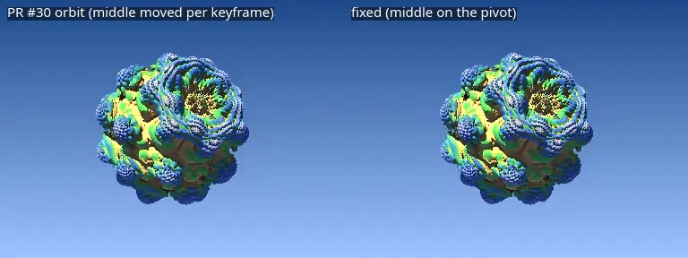
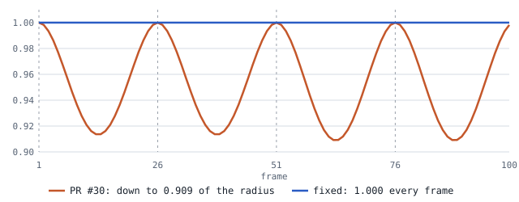
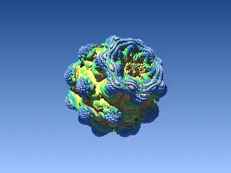
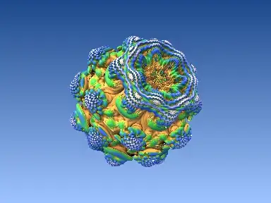
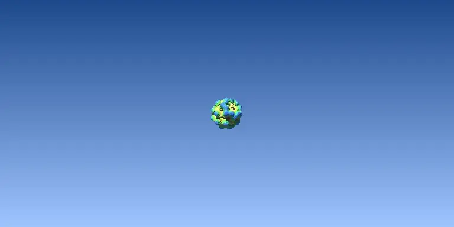
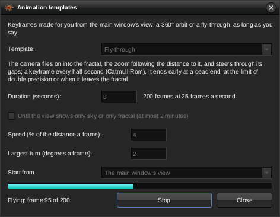
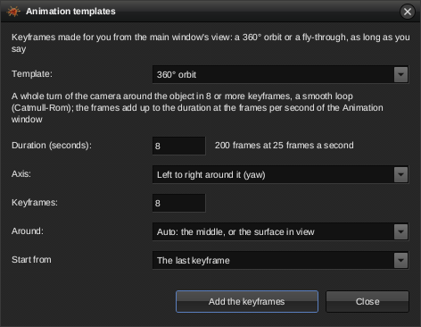

# Orbit and flight renders

Example renders of the animation templates in 0.3.1: the 360° orbit, the
fly-through and the 360° VR orbit, made with `mb3d animate`. The templates,
360° photos and 360° VR animations are the work of Rathinagiri S
([SRathinaGiri](https://github.com/SRathinaGiri), pull request
[#30](https://github.com/thr32423/mb3d-rs/pull/30)); the exact orbit, the
pivot search and the fly-through on its own thread were added after it.
How to use them is in the [README](../README.md) (*Animation*).

The scene is the Integer Power bulb seen from 5 units away, with the middle
moved into the empty space in front of it (as after a Navigator flight), so
the orbit's automatic pivot is the bulb's surface. The moving pictures
below are the videos in short, smaller loops; click one for the full video
(attached to the
[v0.2.100 release](https://github.com/thr32423/mb3d-rs/releases/tag/v0.2.100)).

## 360° orbit with 4 keyframes: first version and exact orbit

Left: the orbit as first sent, which moves the middle around the pivot in
every keyframe (with the pivot search fixed; without it, it orbited empty
space). Right: the middle placed on the pivot once, so the keyframes differ
only in their rotation. Between the keyframes the first version's camera
swoops in and the bulb drifts off-centre; the exact orbit keeps its
distance.

*The camera's distance to the pivot divided by its distance at frame 1, read
from the 100 frames' parameter files; dashed lines are the keyframes.*

## Tumble: yaw, pitch and roll at once

`--orbit 12 --orbit-axis all --duration 8`: 200 frames, 9 s on the graphics
card.

## Fly-through

The automatic Navigator walk from the preset's view: it closes in, follows
the surface and steers into a gap. A keyframe every half second, Catmull-Rom
between them. `--fly --duration 10`: 250 frames, 15 s.

## 360° VR orbit

Every frame is a 2:1 spherical panorama. The file carries the Spherical
Video V1 and V2 metadata (written by `mb3d vr360`), so a VR player or
YouTube shows it as a sphere; a normal player shows it flat.
`--orbit 8 --duration 6 --vr -W 768`: 150 frames.

## The Animation templates window

<table>
<tr>
<td width="50%"></td>
<td width="50%"></td>
</tr>
<tr>
<td>Flying on its own thread: a progress bar, <i>Add</i> becomes <i>Stop</i>, the settings are locked.</td>
<td>The <i>Start from</i> choice: the main window's view or the last keyframe.</td>
</tr>
</table>

A test without a window: an 8 s flight gives 17 keyframes; an 8-keyframe
orbit from the last of them brings it to 25, and the flight's last keyframe
becomes the orbit's first.
