# Clouds, water and reflections

mb3d-rs can paint a layer of volumetric clouds into a scene: real 3D clouds,
lit by the scene's sun, in front of and behind the fractal, and casting
shadows on what lies below. Mandelbulb3D never had them. The three pictures
below combine them with two other features that are new in mb3d-rs:

- **Clouds**: a layer between two heights, with its density, coverage, size
  and colour. They are painted after the picture is calculated, so trying
  settings takes a fraction of a second.
- **Water (ground plane)**: a flat plane calculated with the fractal, as
  solid ground or as water with waves of a chosen height and length.
- **Reflections**: the water mirrors the fractal, the sky and the clouds
  (each reflected ray passes through the cloud layer too).

All three pictures also use the finishing pass (filmic tone mapping, a soft
glow and a vignette) and soft or hard shadows. Each picture below comes with
its parameters to paste into the program, and the last section shows where
each setting is. Back to the [README](../README.md).

## 1. Golden hour

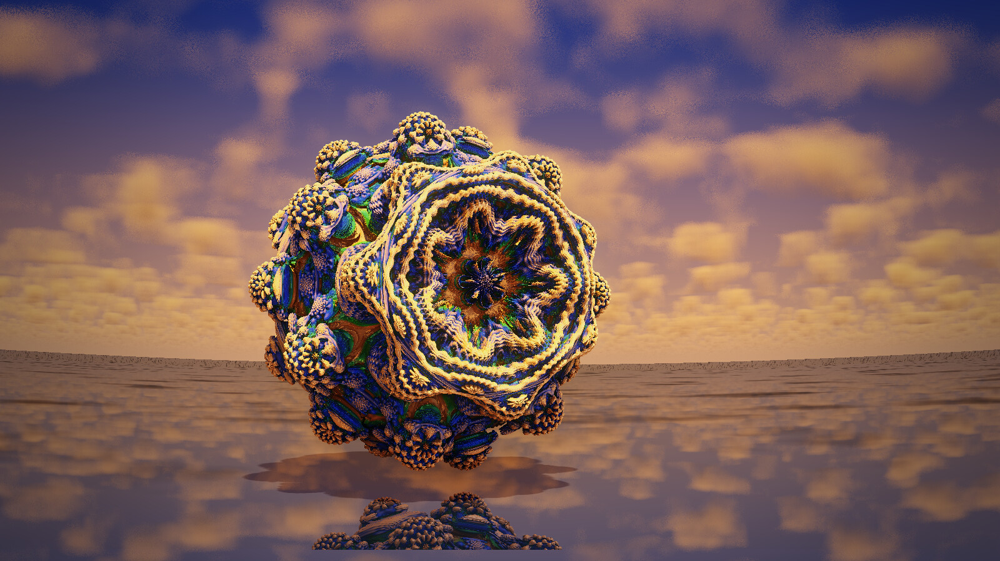

A power 8 Mandelbulb floats over a mirror-calm sea at sunset. The clouds are
high above it and out of its way; the sea reflects them, the sky and the
bulb, and a soft shadow falls on the water. The calm water is a choice: with
waves, their pattern turned into noise near the horizon.

Copy all of the text below, press *From Clipboard* in the main window, then
*Calculate 3D*:

```text
Mandelbulb3Dv18{
g.....E/...o0...C....2A..............1.......E3EBnAnAnAnQzXaNaNaNaNiz0..........
................................OaNaNaNaVz1........A./.........E........2/2...wD
...Uz6........../I.0/....2............E/................/...................BnAH
z.EnAngD1..................................................3.....y1...sD...../..
.w1...sD6ivw0rfUax1..........AI.VPvOyHpjYbdhGpXXVw1ow.f7aC9OzM8w.7gxG9nD7UxabeDs
Ixnn1IuOXIABzaMpAy/9XNqDU.....2...........UaNalD/2....sD..G.0...................
.............oAnAt1.........z................................................s..
.....0...............wzzz1.U..6.......3...EB....w....M2..U.E....5/...I1....DS.52
.....cXG.yDsU0rzaEXOz9zcS/..pc..z19M..EbG7eFT5wj6gZW/J1Xnz1...........U.wwDIU/8.
.AL9s6Jkkz9.2RiGMQZtz0........../EU0.wzzz1...........s/...................E.2c..
zzzz.................................2./8.kzzzD............8....................
/EU0.wzzz1...................................2CcN/UvNPcveeWCNq0.yRiibHJJUk1f..XR
SvBmx3CcN/UvNPcvQsLsUa3.ibhVi1bTV1OK.sSq4uCly3CcN/UvNPcvMwLsUa3.ibhVinqTV1OK.sSq
4uCkz3CcN/UvNPcv..EsUa3ceeWCNq0cIJ36wk8cwyLsUa3c................................
E....2..F3E..........6....EGiFLNbJaQU.pPrJaQ.........................6..........
...................6./........zj................................................
................................................................................
........................}
{Titel: Golden hour}
{mb3d-rs: clouds = y, -2.4, -4.2; cloud_density = 0.7; cloud_coverage = 0.42; cloud_size = 1.8; cloud_color = #FFE6CC; finish_exposure = 0.2; finish_tonemap = filmic; glow = 0.5, 0.03, 0.8; finish_contrast = 0; finish_saturation = 1; finish_warmth = 0.25; vignette = 0.35; chromatic = 0; ground = y, 1.15; ground_color = #0E1626; ground_reflect = 0.9}
```

## 2. Above the clouds

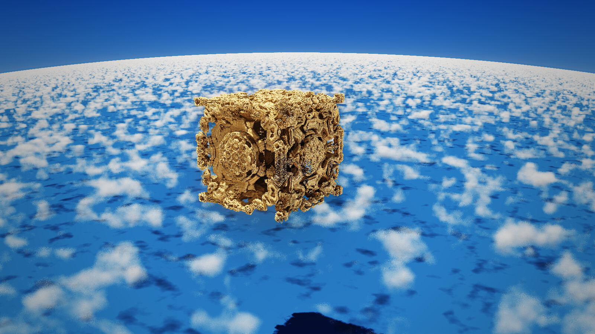

A box fractal (Amazing Box alternated with a power 2 bulb) floats high above
a layer of small clouds, and the ocean far below shows through the gaps. The
dark patches on the water are the clouds' shadows: they shade whatever lies
under them. The sea is needed for that, and also for the look: without
anything below, every ray through the layer runs on forever and the clouds
turn into a flat, dark mass.

Copy all of the text below, press *From Clipboard* in the main window, then
*Calculate 3D*:

```text
Mandelbulb3Dv18{
g.....E/...o0...S....26............8.1.......s3EnAnAnAnAnznAnAnAnAnsz...........
................................nAnAnAnAHz1........Y./.........E........2/2...wD
...Uz6........../I.0/....2............E/................/......................U
z.....kD1.................................................k1.....y1...sD...../..
.w1...sDnAuxWEcdmx1..........om.WrSHScqDZpcnp1YF7xXvnzhAtRVRz..KA0LDA6pjULOsB3vJ
dxfpnjcV3VUJz.Z97zIgM6rDU.....2...............kD.2....sD..G.0...................
.............oAnAt1.........z................................................s/.
.....0...............wzzz1.U..6.......3...EB....m.....3..U.B....t....I1....DS.52
.....k2S.zDwk1zzOkYazzwsr1..oc..z1Dq..kuvBTuCfwD6.BC4POwoz1...........U.mwDM.0A.
.IFcRtBvfz9.np0CG3Awz0........../EU0.wzzz1...........s/...................E.2c..
zzzz.................................2./8.kzzzD............8....................
/EU0.wzzz1...................................2CcN/UvNPcveeWCNq0.yRiibHJJUk1f..XR
SvBmx3CcN/UvNPcvQsLsUa3.ibhVi1bTV1OK.sSq4uCly3CcN/UvNPcvMwLsUa3.ibhVinqTV1OK.sSq
4uCkz3CcN/UvNPcv..EsUa3ceeWCNq0cIJ36wk8cwyLsUa3c................................
E....6E.F3U.....2....A....EEh3aSdtqNU6oPs/......................................
...................yz0........yD........kz1.....................................
................................................................................
.....................2..........0....YYPoJqNZ756ExqRZ75.........................
0..............................E........kz9.....................................
................................................................................
................................}
{Titel: Above the clouds}
{mb3d-rs: clouds = y, 2.6, 3.9; cloud_density = 1; cloud_coverage = 0.4; cloud_size = 1.2; cloud_color = #FFFFFF; finish_exposure = 0; finish_tonemap = filmic; glow = 0.4, 0.03, 0.85; finish_contrast = 0; finish_saturation = 1; finish_warmth = 0; vignette = 0.25; chromatic = 0; ground = y, 9; ground_color = #1B3A5C; ground_reflect = 0}
```

## 3. Storm

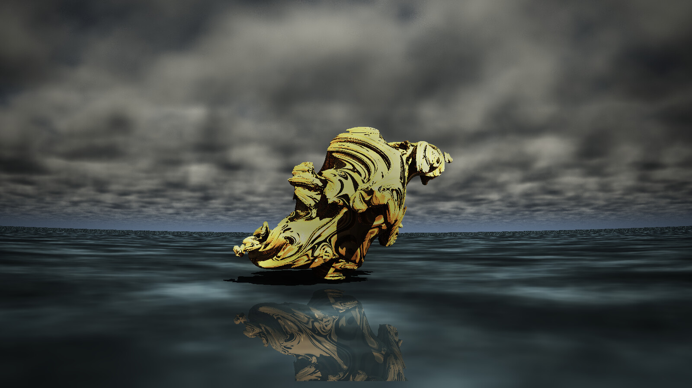

A 4D quaternion Julia set rises from dark water under a heavy storm sky.
Dense, grey clouds cover almost two thirds of the sky; the gold of the
fractal is the only warm colour, and the water mirrors it. Contrast is up and
saturation down for the mood.

Copy all of the text below, press *From Clipboard* in the main window, then
*Calculate 3D*:

```text
Mandelbulb3Dv18{
g.....E/...o0...A....2.............2.1.......E3E..........UaNaNaNaNiz0..........
..........kV2RiGMQZpz...........OaNaNaNadz1........A./.........E........2/2...wD
...Uz6........../I.0/.................E/................/......................U
z.....kD1....2UaNaNaNaNmzCnAnAnAnAyDOaNaNaNa7z1...........U0.....y1...sD...../..
.w1...sDnQpfo45JUx1..........MuikE1LsDojjihldlSG4w14SrefCXEMzI4RrOknt6mDuapiSUyu
1xnIjp8Ozvk6zqqK7GgE8/qDU.....2...............kD/2....sD..G.0...................
.............oAnAt1.........z................................................k..
.....0...............wzzz1.U..6......c3...EB....4/...Q1..UE6....c....I1....DS.52
.....kXFKxjKcVrzSI0Azv4TA0..po..z1Cg...Fbf24LNxj6Eot8VlJaz1...........U.mwDEE/5.
.AL9s6Jkkz9.2RiGMQZtz0........../EU0.wzzz1...........s/...................E.2c..
zzzz.................................2./8.kzzzD............8....................
/EU0.wzzz1...................................2CcN/UvNPcveeWCNq0.yRiibHJJUk1f..XR
SvBmx3CcN/UvNPcvQsLsUa3.ibhVi1bTV1OK.sSq4uCly3CcN/UvNPcvMwLsUa3.ibhVinqTV1OK.sSq
4uCkz3CcN/UvNPcv..EsUa3ceeWCNq0cIJ36wk8cwyLsUa3c................................
E....2..F3E.....0....6....EIp34RZ7bPdxaP........................................
...................wz0..........................................................
................................................................................
........................}
{Titel: Storm}
{mb3d-rs: clouds = y, -1.4, -3.4; cloud_density = 1; cloud_coverage = 0.64; cloud_size = 1; cloud_color = #A0ACBA; finish_exposure = 0.4; finish_tonemap = filmic; glow = 0.7, 0.04, 0.75; finish_contrast = 0.25; finish_saturation = 0.85; finish_warmth = 0; vignette = 0.5; chromatic = 0; ground = y, 0.9; ground_color = #2A3846; ground_reflect = 0.5}
```

## As a 360° panorama

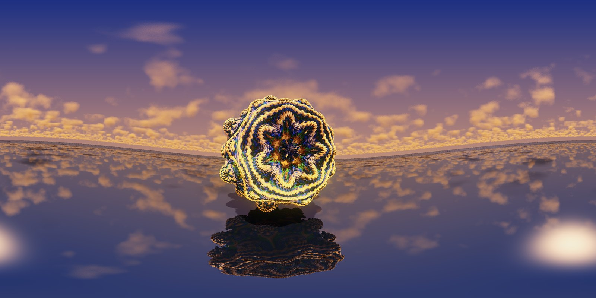

The clouds, the ground and the reflections go all the way round, so each of
the three scenes also works as a panorama for 360° viewers and VR headsets.
On the main window's *Camera* tab, choose *360 Panorama* under *Camera
lense*, and make the picture twice as wide as it is high (for example 4096
by 2048). The field of view sets itself: 360° across, 180° up and down.

- The vignette and the colour fringes are left out in a panorama: its left
  and right edges meet behind the viewer, where a lens's dark corners would
  show as a dark band.
- Leave the depth of field off (none of the three scenes uses it): in a
  panorama it blurs the sky and the water all round.
- Keep the camera level, or the horizon bends into a wave.

## Transparent water

The water can also be see-through: a fractal that stands half in it shows
beneath the surface, bent by the refraction and turning into the colour of
deep water the deeper it goes: first turquoise, as red light fades long
before green and blue, then the water's own colour. Four settings make it,
next to the waves on the *Cutting* page:

- **Water** (`ground_transparency`, 0 to 1): how much light the water lets
  through. 0 is the opaque ground of before; 1 is clear water, whose mirror
  is then as strong as Fresnel's equations make it: faint where you look
  down into the water, strong at grazing angles towards the horizon. In
  between, the ground's own colour and its *reflect* value blend in.
- **Absorption** (`ground_absorption`, its own row below *Water*): how
  murky the water is, how fast the light fades in it per fractal unit.
  0 is perfectly clear water; at 1 the water colour's clearest channel
  keeps a third of its light (1/e) after one fractal unit, the others
  less, about the size of a fractal: parts just under the surface stay
  clear, the bottom half of a bulb turns turquoise and fades. 3 is murky,
  0.3 clear as a mountain lake. The light that reaches a part
  under water has crossed the water above it too, so deep parts also get
  darker, not only distant ones.
- **Water colour** (`ground_water_color`, the colour button below
  *Water*): the colour of deep water. What the water absorbs is replaced
  by its own scattered light in this colour (lit by the lights from above
  and the sky, without the waves' shading), so deep water turns into it,
  not into black. The colour also decides how fast each colour of the
  light fades: with the default blue-green #0A3C46, red fades about ten
  times and green twice as fast as blue (as in pure water, which absorbs
  0.45, 0.06 and 0.02 of the light per metre); a grey water dims all
  alike. A greener #0A5A50 makes a shallow sea, a deep blue #08204A an
  ocean.
- The lights' glints on the waves stay on the surface however clear the
  water is, so the waterline and the waves show where the sun is in front
  of you.
- **Refraction** (`ground_ior`): the refraction index, 1.33 for water; 1
  does not bend the light.
- **Scattering** (`ground_scattering`, 0 to 1, the row below
  *Refraction*): how much the water scatters light, as real water does
  with its particles. 0 is the look without scattering (and what scenes
  saved before have); a water switched on in the program starts at 0.5.
  The water then glows turquoise when you look towards the sun and is
  darker looking away; the wave crests between you and a low sun shine
  through; the sun's light falls into the water as shafts, broken into
  bands by the waves and cut by the fractal's shadows (the lights with
  hard or soft shadows on cast them); and what lies under the water glows
  softly in its colour, less in its hollows. Clearer water (a lower
  absorption, e.g. 0.3) shows the shafts deeper. The second field
  (`ground_scatter_dir`, 0 to 0.95, 0.8) is the direction: water scatters
  mostly forward, towards where the light goes; 0 scatters alike in every
  direction.

  The normal render follows the light once along each ray under the water
  (eight steps, each with a shadow ray towards the lamps) and adds the
  light scattered many times as a glow of the water colour that depends
  on the angle to the lamps; Monte Carlo traces the light through the
  water as it is (it scatters, is absorbed and scatters again). A
  scattering water takes the normal render's reflection pass about a
  fifth to a half longer.

Three finished scenes with all of it, ready to paste: [WATER_EXAMPLES.md](WATER_EXAMPLES.md).

What each setting does, on a Mandelbulb standing half in the water
(`ground = y, -0.45`, reflections on):

**Water (transparency)** 0, 0.5 and 1: the opaque ground of before, then
the part under the water showing through more and more.

<a href="img/water_transparency.jpg">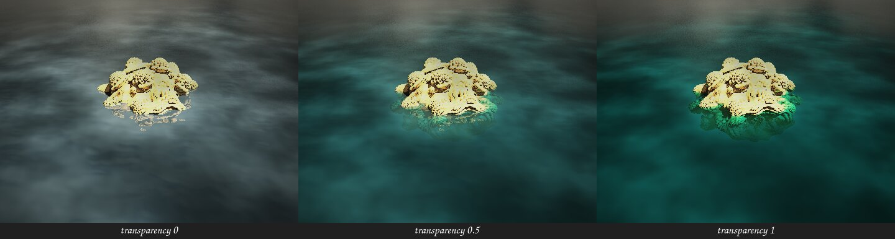</a>

**Absorption** 0.3, 1 and 3: clear water shows the whole submerged half,
turned green; at 1 it fades with depth; murky water hides all but what is
just below the surface.

<a href="img/water_absorption.jpg">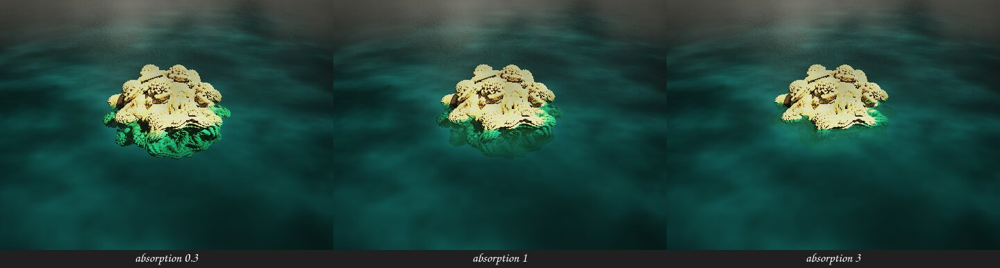</a>

**Scattering** 0, 0.5 and 1, looking towards the sun: without it the
water is dark; with it the water glows turquoise and the wave crests
shine through.

<a href="img/water_scattering.jpg">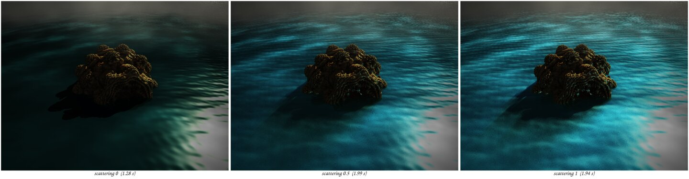</a>

**Light shafts**, scattering 0, 0.5 and 1 with a low sun in front and
clear water (absorption 0.3): the fractal's shadow reaches through the
water towards the camera, beside the sunlit bands.

<a href="img/water_shafts.jpg">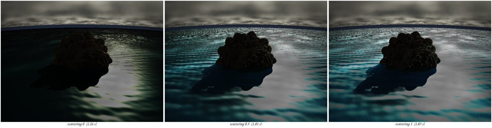</a>

The normal render shows the transparency with the reflections on
(*Postprocess*, *Reflections + Transparency*, *Calculate R. (+ T.)
automatically*); without them the water stays opaque, as the picture
painted before the reflections are calculated. Monte Carlo always shows it.
With transparent water the reflections and Monte Carlo are calculated on
the processor (the graphics card's part of them does not know the rays
under the water yet), which makes them slower.

Example: a Mandelbulb half under clear water, seen from above at a slant.
Copy all of the text below, press *From Clipboard* in the main window, then
*Calculate 3D*:

```text
Mandelbulb3Dv18{
g.....m....K0...A....2.............2.1.......E3E................................
........................................kz1........A./.........E........2/2...wD
...Uz6........../I.0/.................E/................/......................U
z.....kD1.....UaNaNaNaNmzCnAnAnAnAyDOaNaNaNa7z1...........U0.....y1...sD...../..
.w1...sDcO2VlTjtYx1..........IvqGtWoDaojlNoFMO2.sw96fqQH.moMzox6zwIEUCpjLyWEQbRY
4xXffnBSGL6Jz2e/t4zbo7qDU.....2...............kD/2....sD..G.0...................
.............oAnAt1.........z................................................k..
.....0...............wzzz1.U..6......c3...EB....4/...Q1..UE6....c....I1....DS.52
.....kXFKxjKcVrzSI0Azv4TA0..po..z1Cg...Fbf24LNxj6Eot8VlJaz1...........U.mwDEE/5.
.AL9s6Jkkz9.2RiGMQZtz0........../EU0.wzzz1...........s/...................E.2c..
zzzz.................................2./8.kzzzD............8....................
/EU0.wzzz1...................................2CcN/UvNPcveeWCNq0.yRiibHJJUk1f..XR
SvBmx3CcN/UvNPcvQsLsUa3.ibhVi1bTV1OK.sSq4uCly3CcN/UvNPcvMwLsUa3.ibhVinqTV1OK.sSq
4uCkz3CcN/UvNPcv..EsUa3ceeWCNq0cIJ36wk8cwyLsUa3c................................
E....2..F3E..........6....EGiFLNbJaQU.pPrJaQ.........................6..........
...................6./........zj................................................
................................................................................
........................}
{Titel: Half under water}
{mb3d-rs: clouds = y, -1.4, -3.4; cloud_density = 1; cloud_coverage = 0.64; cloud_size = 1; cloud_color = #A0ACBA; finish_exposure = 0; finish_tonemap = filmic; glow = 0.3, 0.03, 0.85; finish_contrast = 0.25; finish_saturation = 0.85; finish_warmth = 0; vignette = 0.5; chromatic = 0; ground = y, -0.45; ground_color = #2A3846; ground_reflect = 0.5; ground_waves = 0.004, 0.6; ground_transparency = 1; ground_visibility = 1; ground_water_color = #0A3C46; ground_ior = 1.33}
```

## Where the settings are

The screens show the settings of picture 1, Golden hour, as they look after
pasting its parameters.

**Pasting parameters.** Main window, tab *Open*: *From Clipboard* reads the
parameters you copied.

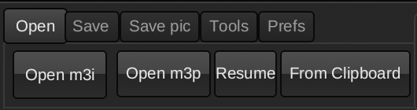

**Water.** Main window, page *Cutting*: tick *Ground plane* and choose the
axis (Y). Below it: the height of the plane (1.15), its colour, and how much
it reflects (0.9). *Waves* takes their height and length; a height of 0
gives still water. The waves are an irregular sea: sixteen waves of
lengths from 1.2 to 0.25 times the given length, mostly along one wind
direction, the long ones higher, so no grid or repeating pattern shows
(before November 2026 three regular waves made a checkerboard of blobs;
scenes with waves look different since). Since 5 November 2026 their
directions keep within a narrow spread around the wind, from 8 degrees
for the longest waves to 30 for the shortest, so the crests run as long
lines across the wind; before, some crossed it at up to 90 degrees and
made a pattern of diamonds. Below, the old waves (left of
each pair) and the new ones: small waves 0.004, 0.6 on top, large waves
0.03, 0.4 below, the sun in front and behind.

<a href="img/water_waves.jpg">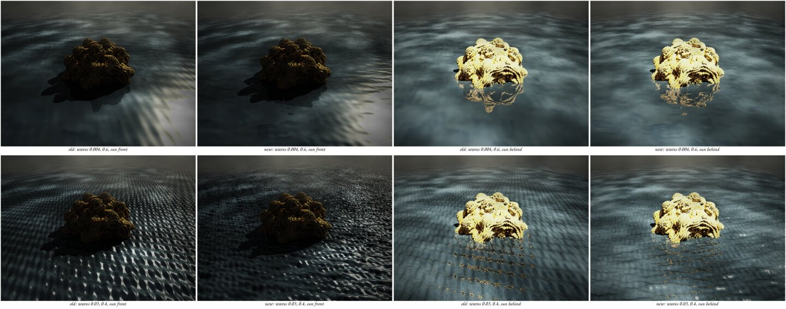</a>
 The two rows below them make the water transparent
(see [Transparent water](#transparent-water)): *Water* takes its
transparency, *Absorption* how murky it is, the colour button its deep
colour, and *Refraction* its refraction index.

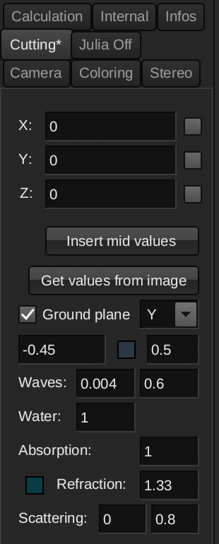

**Reflections.** Main window, *Postprocess*, section *Reflections +
Transparency*: tick *Calculate R. (+ T.) automatically* and set the *Amount*
(0.6). With reflections on, the water becomes a mirror.

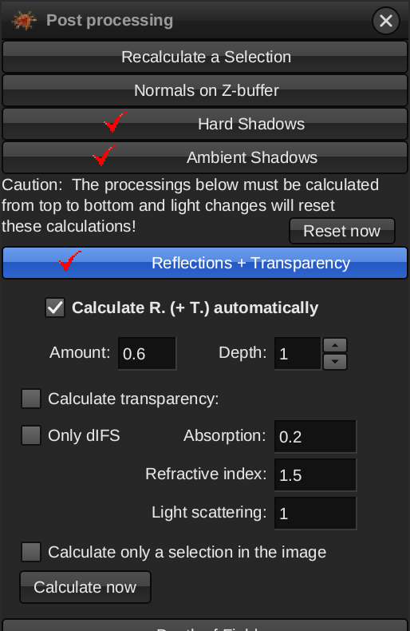

**Clouds.** The same window, section *Clouds*: tick *Paint clouds*, set the
*Layer* (an axis and two heights, here Y from -2.4 to -4.2), the *Density*,
how much of the sky they *Cover*, their *Size* and their colour (the small
square). *Paint now* repaints them in a fraction of a second, so you can try
settings quickly. The layer reaches the horizon: far away the clouds grow
smaller and fade into the haze of the air, so the sky's horizon colour
shows through them more and more (before 5 November 2026 the layer ended a
little above the horizon, with a hard edge and a clear strip under it).

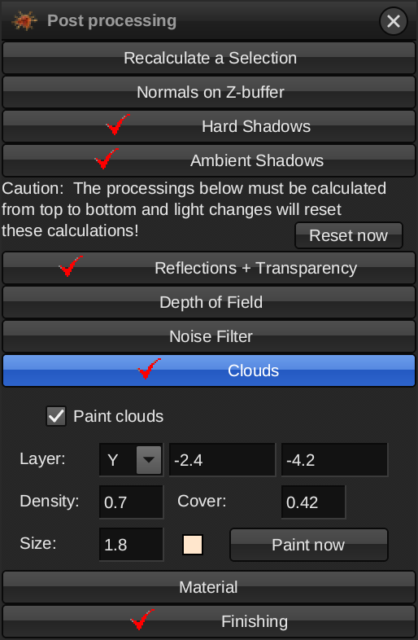

The *Finishing* section of the same window holds the tone mapping, glow,
warmth and vignette that the pictures also use.
