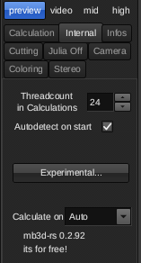
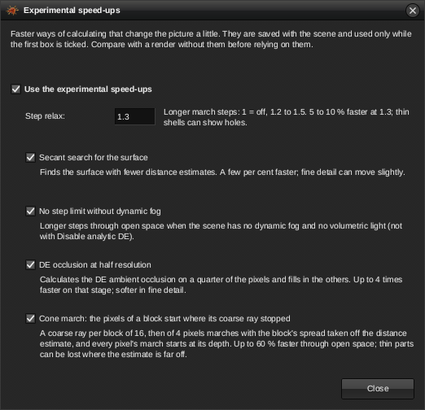
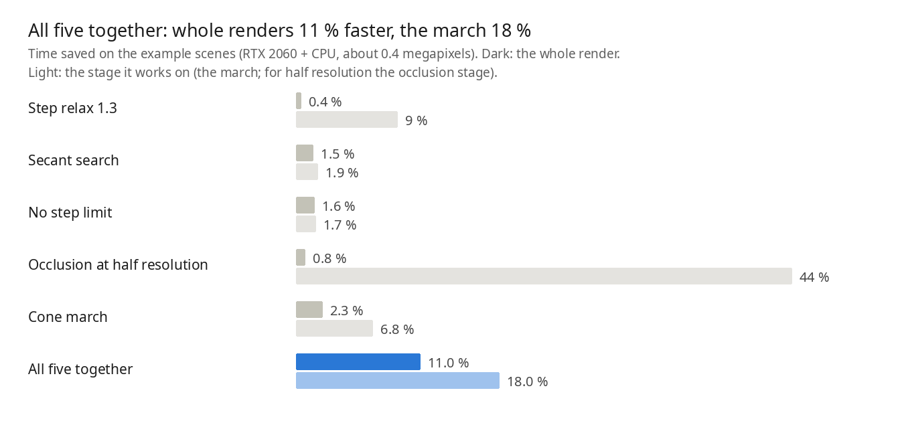

# The experimental speed-ups

mb3d-rs has five experimental speed-ups that change the picture a little, so
they are off until you switch them on. Measured on the 80 example files that
ship with the program (2 November 2026, about 0.4 megapixels, one PC: an RTX
2060 and a Ryzen 9 3900X), all five together make a render 11 % faster on
average and a third faster in open scenes; on the processor alone the cone
march cuts the march by 20 %, up to 66 %. (The figures for the cone march are
those of its fixed version in 0.2.93: in 0.2.92 it could lose thin parts where
the distance estimate is far too large, see [below](#the-cone-march-in-0292).)

## Where they are

The main window → **Internal** tab → **Experimental...** opens the window
below. Tick *Use the experimental speed-ups*, then the ones you want. They are
saved with the scene, so the command line, the swarm and the AI assistant use
them too, and the program keeps your choice from one start to the next.

 

On the command line: `mb3d scene.m3p -s experimental=on -s cone_march=on`,
with the other keys from the table.

| Speed-up | What it does | Scene key |
|---|---|---|
| Step relax | Longer march steps; an overstep is taken again at its safe length | `step_relax = 1.3` |
| Secant search | Finds the surface by interpolating between the last two probes instead of halving | `secant_search = on` |
| No step limit | Longer steps through open space when the scene has no dynamic fog | `free_steps = on` |
| DE occlusion at half resolution | Ambient occlusion on every second pixel of every second row, the others filled in | `occlusion_half = on` |
| Cone march (new in 0.2.92) | A coarse ray per block of pixels; every pixel's march starts where it stopped | `cone_march = on` |

All five work on the processor and on the graphics card.

## Each one on its own

On its own, each speed-up shaves 0.4–2.3 % off a whole render on this PC,
because the graphics card already does most of the marching and the shadows,
occlusion and reflections take their own time. Look at the stage each one
works on and the picture is clearer: step relax cuts the march by 9 %, the
cone march by 7 %, and the half-resolution occlusion cuts the occlusion stage
by 44 %.

On the processor alone the cone march matters most: measured on the same
scenes without the card, it cuts the march by 20 % (median 22 %), up to 66 %
in open scenes, and 68 of the 69 scenes it works in get faster. On the card
it cuts the march by 10 % (median 3 %), up to 47 %.

| Speed-up | Where it shines | Pixels changed (median) | Watch out for |
|---|---|---|---|
| Step relax 1.3 | Fine, deep surfaces: up to −19 % of the whole render | 2.6 % | Holes in thin shells (Pong 703); one slow dIFS scene took 70 % longer |
| Secant search | Scenes with many surface hits: up to −8 % | 0.7 % | Fine detail moves slightly |
| No step limit | Open scenes without dynamic fog: up to −30 % | 0.03 % | Nothing visible |
| Occlusion at half resolution | Scenes with DE occlusion: up to −20 % of the whole render | 0.0 % (up to 23 % in fine detail) | Softer occlusion in fine detail |
| Cone march | Open scenes: up to −47 % of the whole render (−66 % of the march on the processor) | 0.9 % | Off by itself for inside+outside, disable analytic DE and volumetric light |

"Pixels changed" is the share of pixels that differ by more than 8 of 255
from the plain render; the march's own random first step already moves about
1 % of them.

## All five together

All five switched on cut the 78 renders from 173 s to 150 s, 13 % less, and 75
of the 78 scenes got faster (the slowest of the rest, Rama – Elysium, took 4 %
longer). The best scenes: ABoxScale2Start −51 %, Nothing left but bones −50 %,
LightBulbMoon – No, Never −42 %, Mandalex −41 %, DEcomb1 −38 %. The march
stage alone shrinks by 21 % (median 17 %, up to 54 %).

That is a little more than the three march speed-ups give one by one (step
relax 4.9 %, the cone march 4.5 %, no step limit 2.6 %: 12 % together), so they
rarely get in each other's way. The price: a median 3.1 % of the pixels differ
from the plain render, mostly in fine shading; the plain render's own random
first step already moves 1.4 %, and in noisy scenes (spineJulia, the Julia
examples) far more.

## How they affect each other

They work on different parts of a ray, so most pairs simply add up; two pairs
do not.

| Pair | Effect | Why |
|---|---|---|
| Cone march + step relax | **Helps**: together −8.9 % (median) where each alone gives −5.1 % and −5.8 %; better than the better one alone in 37 scenes, worse in 10 | The cone march skips the open space in front of the surface, step relax then lengthens the steps that are left near it: each shortens the part the other cannot |
| Cone march + no step limit | **Overlaps**: together −6.0 % (median), hardly more than the cone march alone (−5.1 %); worse than the better one alone in 18 scenes, better in 16 | Both remove the cost of open space; once the cone march has jumped over it, there are few long steps left to free |
| Step relax + secant search | Independent | One changes the steps, the other only the last search for the surface |
| Occlusion at half resolution + anything | Independent | It works on the occlusion stage after the march; its gain comes on top of the others' |
| Secant search + cone march | Independent | The cone march ends before the surface search begins |

None of the pairs makes a picture worse than the single switches do: the pixel
changes of "all five" (3.1 % median) are about those of step relax (2.3 %)
plus the half-resolution occlusion, and the holes step relax can make in thin
shells appear with or without the others.

## What to switch on

- For previews and test renders: all five. A tenth off every render, a third
  off open scenes, and the differences are invisible at preview size.
- For a final picture: the cone march, no step limit, the secant search and
  the half-resolution occlusion are safe in practice; add step relax only
  after comparing with a plain render, since thin shells can show holes.
- On the processor alone (no graphics card, a laptop, the swarm), the cone
  march is the one that counts: −20 % of the march on average, up to −66 %.
- The switches are saved with the scene, so a parameter file you share carries
  them; tell people when you post one.

Every number here is from the example files at about 0.4 megapixels on one
PC, the times the smaller of two runs. "All five together" and the pairs were
measured again for 0.2.95, after the cone march's fix in 0.2.93, with
`tools/bench.py` (78 scenes: Fishbowl left out, whose run hits a shader
compile, and Test8, which reports no march time); "Each one on its own" is
from the round of 0.2.92, without 6 AM – Torii temple. Your own scenes and
card will differ, but the ordering of the gains should hold. How each
speed-up works: [TECHNICAL.md](TECHNICAL.md#experimental-speed-ups).

## The cone march in 0.2.92

In 0.2.92 the cone march's coarse rays ignored the march's step limit
(MB3D's raystep limiter), which is what finds the thin parts of formulas whose
distance estimate is far too large. In LightBulbMoon – No, Never (Amazing
Surf) 1.8 % of the pixels became background, whole bits of the moon and a
branch; a check for such holes had looked for the wrong background value in
the depth maps and missed them. 0.2.93 keeps the coarse rays within that
limit, and with it a smaller margin around them is as safe in every example
file (1.5 instead of 3), so the cone march also got faster. A coarse ray
also ends now where its steps fall far behind those the pixels would take:
far off its margin grows with the distance and could leave it crawling
along a surface, and on the card a few such rays held up everything else
(6 AM – Torii temple marched 70 % longer with the cone march; now 10 %).
Together: −20 % of the march on the processor instead of −12 %, −10 % on
the card instead of −4 %. If you rendered with the cone march in 0.2.92,
compare thin, far-off parts with a plain render.
