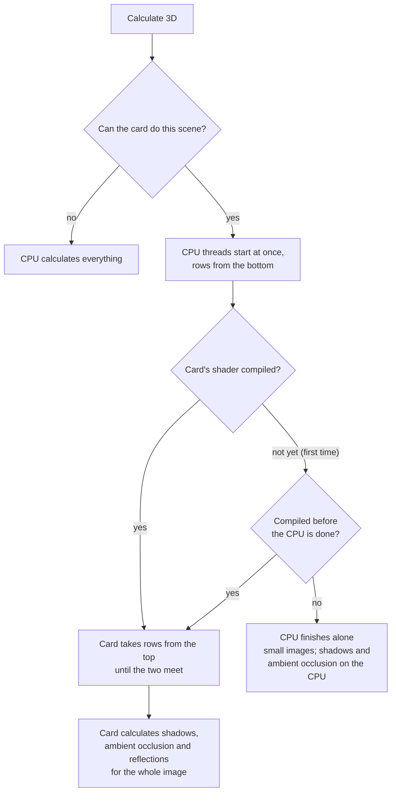

# How mb3d-rs calculates your image

The original Mandelbulb3D calculates everything on the processor (CPU).
mb3d-rs can also use the **graphics card**, which is usually several times
faster, and it decides by itself how to share the work. This page explains
what happens, what the little LED in the title bar tells you, and the
one setting you may want to change. The other things that are new
compared with the original program are listed in the
[README](../README.md#what-is-new-compared-with-mandelbulb3d).

## Two calculators

| | CPU | Graphics card |
|---|---|---|
| What it runs | MB3D's calculation, ported line by line | the same calculation, translated into a *shader* (a program for the card) |
| Speed | close to MB3D's own speed | in the 80 example files a median of 5 times faster (up to 87 times) |
| Scenes | all of them | 73 of the 80 examples (not: 2D slices, the few formulas that cannot be translated, formulas whose numbers grow beyond single precision - those go to the CPU by themselves) |
| Result | MB3D's result | the same image within rounding (see the [comparison of all 80 example files](../README.md#speed) and the [image differences](TECHNICAL.md#cpu-and-graphics-card-compared-gtx-1650-earlier-measurement)) |
| Start-up | none | the **first** time a formula combination is used, its shader must be *compiled*: 10–20 s. The graphics driver keeps the compiled shader (on Linux in the `ShaderCache` folder next to the program), so the next time it is ready at once |

The compile time is the reason why the graphics card is not always the
faster choice: a small preview that the CPU finishes in two seconds would
wait 15 seconds for a shader. mb3d-rs avoids that waiting (see *Auto*
below).

## The "Calculate on" setting

On the **Internal** page of the main window (where the thread count is):

| Setting | What happens |
|---|---|
| **Auto** (default) | The graphics card and the CPU share the image: the card takes rows from the top, the CPU threads from the bottom. The shadows and the ambient occlusion are shared the same way, or calculated by the card alone when it is clearly the faster one. If the card's shader is not ready yet, the CPU starts alone and the card joins when it can - nothing waits. |
| **CPU** | Never uses the graphics card - exactly like the original MB3D. |
| **Graphics card** | Waits for the shader if needed, then calculates on the card. |

The choice is saved in `Mandelbulb3D.ini`. On the command line `mb3d
--cpu` calculates on the CPU, and the environment variable `MB3D_GPU=0`
switches the card off for both programs.

## What *Auto* does

Every image is shared: the CPU threads take rows from the bottom and the
card takes rows from the top, until they meet:

The message box of the main window says when this happens (*"First
calculation of this formula combination: the graphics card's shaders are
being compiled ..."*), so a slower first run is not a surprise.

All shaders a calculation needs (the march, shadows, ambient occlusion,
reflections) compile at the same time in the background, so the waiting
is paid once and not once per shader. Once the card has marched part of
the image, it also calculates the shadows and the ambient occlusion of
the whole image, the CPU's rows included. Only when the card never joined
(its shaders were still compiling when the CPU finished) do they run on
the CPU, like after a CPU calculation. The LED's hint says how the rows
were shared, for example *"71 % of the rows on the card, 29 % on the
CPU +shadows +AO"*.

## The LED in the title bar

Right of the window title a small LED shows where the last calculation
ran. It blinks while a calculation is running.

| Colour | Meaning |
|---|---|
| grey | nothing calculated yet |
| **green** | on the graphics card |
| **orange** | mixed: the image on the card, some steps on the CPU (for example normals on the z-buffer, or shadows after a first run whose shaders were still compiling) |
| **red** | on the CPU (setting *CPU*, or a scene the card cannot do) |

**Hold the mouse over the LED** to see the details: the card's name, the
steps it calculated, the reason for a CPU calculation, and for Monte Carlo
renders how the work was shared.

## Monte Carlo renders

The Monte Carlo renderer follows many random light rays per pixel. The
rays are followed (*marched*) on the graphics card, while the CPU works
out the light, the colours and the noise of every pixel. To keep both
busy, every CPU thread splits its pixels into two halves that take turns:

The CPU also takes a part of every batch of rays from its end. How big
that part is follows from how fast the card and the CPU were on the last
batch, so a slow formula (where the card is not much faster than the CPU)
gets more help from the CPU. The LED's hint shows the result, for
example *"93 % of the marches on the card, 7 % on the CPU"*. With *Auto*
the first passes run on the CPU while the shader compiles.

Speed on a GTX 1650 with 8 CPU threads:

| Scene | CPU only | Card + CPU |
|---|---|---|
| Black Mandelbulb | 7.3 s | 1.9 s |
| ThePearl (dIFS, reflections, transparency) | 30.8 s | 10.5 s |
| toricaleggs (reflections, transparency) | 33 s | 11.8 s |
| Mengerplus | 12.7 s | 6.8 s |
| Mandelwerk seashell (a slow formula) | 87 s | 47.5 s |
