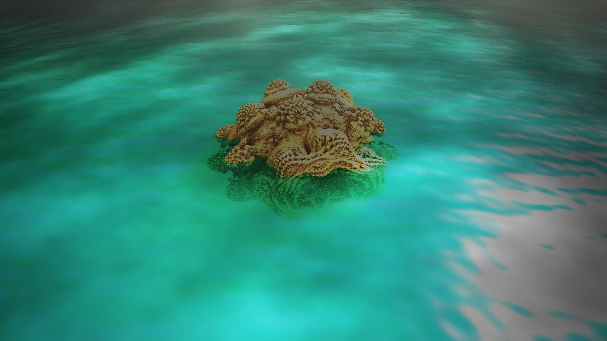
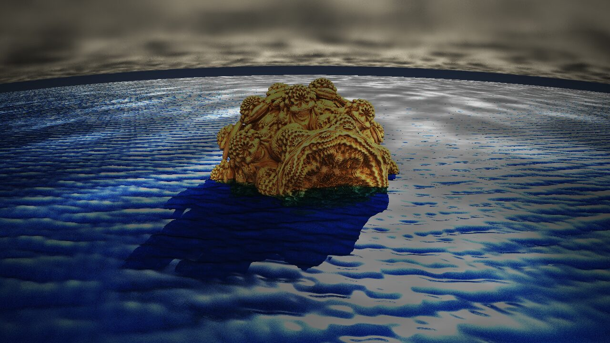
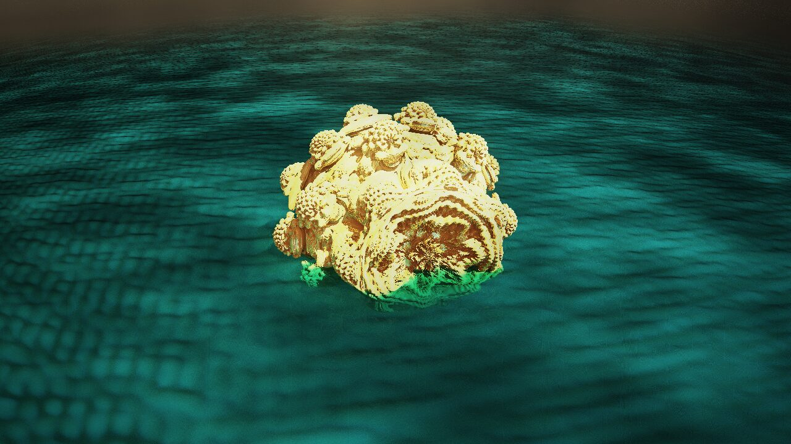

# Three scenes with transparent water

Each scene uses everything the water can do since 0.2.98: the irregular waves, transparency, absorption, refraction and scattering, with a soft glow on the fractal. All three are 1280 × 720 renders of the power-8 Mandelbulb (Integer Power); the settings are explained in [CLOUDS_WATER.md](CLOUDS_WATER.md#transparent-water).

To render one:

1. Copy all of its parameter text below.
2. In the main window press *From Clipboard*, then *Calculate 3D*.
3. The water shows once the reflections are on: *Postprocess*, *Reflections + Transparency*, tick *Calculate R. (+ T.) automatically*.

The water settings are on the *Cutting* page below the waves; the material glow is in *Postprocess*, *Material*, the bloom in *Postprocess*, *Finishing*.

## Turquoise lagoon

A Mandelbulb most of the way under clear, green-turquoise water. The sun stands in front and to the side, so the shallow water glows and the submerged part turns green with depth.

<a href="img/water_lagoon.jpg"></a>

| Setting | Value |
|---|---|
| Water (transparency) | 1 |
| Absorption | 0.5 |
| Water colour | #0A5A50 |
| Refraction | 1.33 |
| Scattering | 0.6, direction 0.8 |
| Waves | height 0.006, length 0.7 |
| Plane | Y at −0.45 |
| Material glow | 0.35 |
| Bloom (glow) | 0.4, 0.03, 0.85 |
| Light 1 (sun) | #FFE6B8, −35° / 115°, 1.4 |
| Light 2 (fill) | #FFE2C0, −25° / 30°, 0.9 |

Parameters for *From Clipboard*:

```text
Mandelbulb3Dv18{
g.....E/...o0...A....2.............2.1.......E3E................................
........................................kz1........A./.........E........2/2...wD
...Uz6........../I.0/.................E/................/......................U
z.....kD1.....UaNaNaNaNmzCnAnAnAnAyDOaNaNaNa7z1...........U0.....y1...sD...../..
.w1...sDGVJthL96Ox1..........6eYbbflnznjBUFKyU3.iw9uJ2IMUy/KzEBvCAOI6WojxhfIH/ZB
wwXaaEl35ROGzc2GbsylFQpDU.....2...............kD/2....sD..G.0...................
.............oAnAt1.........z................................................k..
.....0...............wzzz1.U..6......c3...EB....4/...Q1..UE6....c....I1....DS.52
.....kXFKxjKcVrzSI0Azv4TA0..ps..zPCi..kK84IBACyj6YXppZd1..2...........U.OxzzW1A.
.IFcRtBvPz9.np0CG3Asz.........../EU0.wzzz1...........s/...................E.2c..
zzzz.................................2./8.kzzzD............8....................
/EU0.wzzz1...................................2CcN/UvNPcveeWCNq0.yRiibHJJUk1f..XR
SvBmx3CcN/UvNPcvQsLsUa3.ibhVi1bTV1OK.sSq4uCly3CcN/UvNPcvMwLsUa3.ibhVinqTV1OK.sSq
4uCkz3CcN/UvNPcv..EsUa3ceeWCNq0cIJ36wk8cwyLsUa3c................................
E....2..F3E..........6....EGiFLNbJaQU.pPrJaQ.........................6..........
...................6./........zj................................................
................................................................................
........................}
{Titel: lagoon}
{mb3d-rs: material_fresnel = 0; material_iridescence = 0, 0; material_glow = 0.35; clouds = y, -1.4, -3.4; cloud_density = 1; cloud_coverage = 0.64; cloud_size = 1; cloud_color = #A0ACBA; finish_exposure = 0; finish_tonemap = filmic; glow = 0.4, 0.03, 0.85; finish_contrast = 0.25; finish_saturation = 0.85; finish_warmth = 0; vignette = 0.5; chromatic = 0; ground = y, -0.45; ground_color = #2A3846; ground_reflect = 0.5; ground_waves = 0.006, 0.7; ground_transparency = 1; ground_absorption = 0.5; ground_water_color = #0A5A50; ground_ior = 1.33; ground_scattering = 0.6}
```

## Deep-water shaft

A low camera at the waterline over deep blue, choppy water. The low sun ahead throws the fractal's shadow through the water as a dark shaft between sunlit bands.

<a href="img/water_storm.jpg"></a>

| Setting | Value |
|---|---|
| Water (transparency) | 1 |
| Absorption | 0.3 |
| Water colour | #0A2A55 |
| Refraction | 1.33 |
| Scattering | 0.6, direction 0.8 |
| Waves | height 0.012, length 0.4 |
| Plane | Y at 0 |
| Camera rotation | 12, 20, 0 |
| Material glow | 0.35 |
| Bloom (glow) | 0.4, 0.03, 0.85 |
| Light 1 (sun) | #FFD8A0, −10° / 150°, 1.5 |
| Light 2 (fill) | #FFD8B0, −20° / 25°, 0.9 |

Parameters for *From Clipboard*:

```text
Mandelbulb3Dv18{
g.....E/...o0...A....2.............2.1.......E3E................................
........................................kz1........A./.........E........2/2...wD
...Uz6........../I.0/.................E/................/......................U
z.....kD1.....UaNaNaNaNmzCnAnAnAnAyDOaNaNaNa7z1...........U0.....y1...sD...../..
.w1...sDSSvyMI6fNx1..........YLpsanNk8ojVYDvhrR3Tw9ghjLawZfKzA3O/3x.OJnjrtyizcxF
0xnJ92okDXfBzkclaBEtQYpDU.....2...............kD/2....sD..G.0...................
.............oAnAt1.........z................................................k..
.....0...............wzzz1.U..6......c3...EB....4/...Q1..UE6....c....I1....DS.52
.....kXFKxjKcVrzSI0Azv4TA0..pw..zXBc...Fbf24LNwj6.BC4POw2.2...........U.OxzzM19.
.Eot8VlJKz9.J2OLSnyqz.........../EU0.wzzz1...........s/...................E.2c..
zzzz.................................2./8.kzzzD............8....................
/EU0.wzzz1...................................2CcN/UvNPcveeWCNq0.yRiibHJJUk1f..XR
SvBmx3CcN/UvNPcvQsLsUa3.ibhVi1bTV1OK.sSq4uCly3CcN/UvNPcvMwLsUa3.ibhVinqTV1OK.sSq
4uCkz3CcN/UvNPcv..EsUa3ceeWCNq0cIJ36wk8cwyLsUa3c................................
E....2..F3E..........6....EGiFLNbJaQU.pPrJaQ.........................6..........
...................6./........zj................................................
................................................................................
........................}
{Titel: storm}
{mb3d-rs: material_fresnel = 0; material_iridescence = 0, 0; material_glow = 0.35; clouds = y, -1.4, -3.4; cloud_density = 1; cloud_coverage = 0.64; cloud_size = 1; cloud_color = #A0ACBA; finish_exposure = 0; finish_tonemap = filmic; glow = 0.4, 0.03, 0.85; finish_contrast = 0.25; finish_saturation = 0.85; finish_warmth = 0; vignette = 0.5; chromatic = 0; ground = y, 0; ground_color = #2A3846; ground_reflect = 0.5; ground_waves = 0.012, 0.4; ground_transparency = 1; ground_absorption = 0.3; ground_water_color = #0A2A55; ground_ior = 1.33; ground_scattering = 0.6}
```

## Golden hour

Warm sun from behind the camera on a golden fractal standing in teal water. Its lower part shows under the surface, green, then fading into the water colour.

<a href="img/water_golden.jpg"></a>

| Setting | Value |
|---|---|
| Water (transparency) | 1 |
| Absorption | 1 |
| Water colour | #0A3C46 |
| Refraction | 1.33 |
| Scattering | 0.5, direction 0.8 |
| Waves | height 0.01, length 0.5 |
| Plane | Y at 0.15 |
| Camera rotation | 22, 20, 0 |
| Material glow | 0.25 |
| Bloom (glow) | 0.5, 0.03, 0.85 |
| Light 1 (sun) | #FFC880, −20° / 40°, 1.4 |
| Light 2 | #405070, −60° / −40°, 0.5 |

Parameters for *From Clipboard*:

```text
Mandelbulb3Dv18{
g.....E/...o0...A....2.............2.1.......E3E................................
........................................kz1........A./.........E........2/2...wD
...Uz6........../I.0/.................E/................/......................U
z.....kD1.....UaNaNaNaNmzCnAnAnAnAyDOaNaNaNa7z1...........U0.....y1...sD...../..
.w1...sDSSvyMI6fNx1..........YLpsanNk8ojFUR/nBF.gwfbwZyW5IJKzoT4pJzBwAojUkh.wJ.J
/xXR7PARyU5FzgNeL3nvBTpDU.....2...............kD/2....sD..G.0...................
.............oAnAt1.........z................................................k..
.....0...............wzzz1.U..6......c3...EB....4/...Q1..UE6....c....I1....DS.52
.....kXFKxjKcVrzSI0Azv4TA0..ps..zXAU...Fbf24LNxj6Eot8VlJaz1...........U.mwDEE/5.
.AL9s6Jkkz9.2RiGMQZtz0........../EU0.wzzz1...........s/...................E.2c..
zzzz.................................2./8.kzzzD............8....................
/EU0.wzzz1...................................2CcN/UvNPcveeWCNq0.yRiibHJJUk1f..XR
SvBmx3CcN/UvNPcvQsLsUa3.ibhVi1bTV1OK.sSq4uCly3CcN/UvNPcvMwLsUa3.ibhVinqTV1OK.sSq
4uCkz3CcN/UvNPcv..EsUa3ceeWCNq0cIJ36wk8cwyLsUa3c................................
E....2..F3E..........6....EGiFLNbJaQU.pPrJaQ.........................6..........
...................6./........zj................................................
................................................................................
........................}
{Titel: golden}
{mb3d-rs: material_fresnel = 0; material_iridescence = 0, 0; material_glow = 0.25; clouds = y, -1.4, -3.4; cloud_density = 1; cloud_coverage = 0.64; cloud_size = 1; cloud_color = #A0ACBA; finish_exposure = 0; finish_tonemap = filmic; glow = 0.5, 0.03, 0.85; finish_contrast = 0.25; finish_saturation = 0.85; finish_warmth = 0; vignette = 0.5; chromatic = 0; ground = y, 0.15; ground_color = #2A3846; ground_reflect = 0.5; ground_waves = 0.01, 0.5; ground_transparency = 1; ground_absorption = 1; ground_water_color = #0A3C46; ground_ior = 1.33; ground_scattering = 0.5}
```
