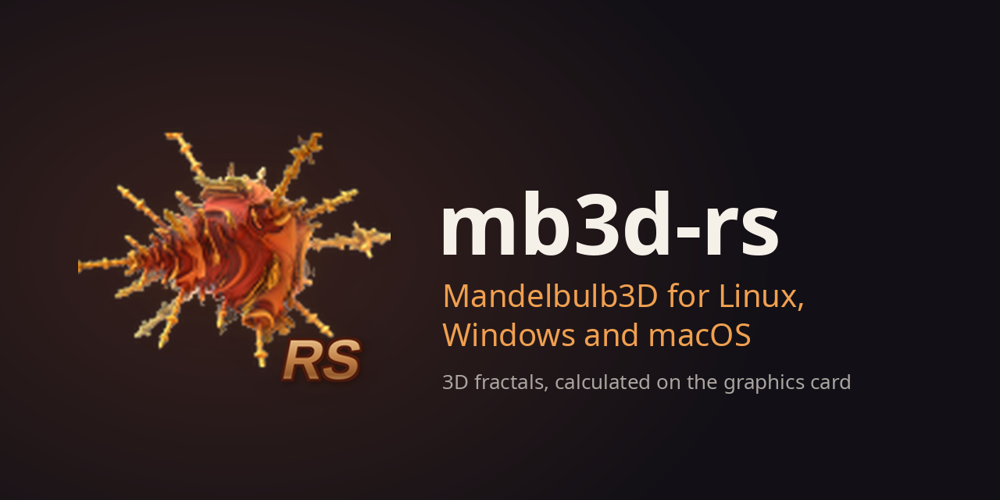

# mb3d-rs — Mandelbulb3D dlô Linuksa, Windowsa ë macOS
<!-- languages:start -->
[English](../../README.md) · [Deutsch](README.de.md) · [Español](README.es.md) · [Français](README.fr.md) · [Bahasa Indonesia](README.id.md) · [Italiano](README.it.md) · [Nederlands](README.nl.md) · [Polski](README.pl.md) · [Português](README.pt.md) · **Kaszëbsczi** · [العربية](README.ar.md) · [اردو](README.ur.md) · [हिन्दी](README.hi.md) · [日本語](README.ja.md) · [한국어](README.ko.md) · [简体中文](README.zh-CN.md) · [繁體中文](README.zh-TW.md)
<!-- languages:end -->
*Przełożoné z anielsczégò README (wersjô 0.2.84). Dze ne dwa sã różnią, prawdã mô [anielsczé README](../../README.md).*

**Zladënczi: [nôwnowszé wëdanié](https://github.com/thr32423/mb3d-rs/releases/latest)** · [Zladënk](#download) · [Co nowégò](../UPDATES.md)

mb3d-rs to je [Mandelbulb3D](https://github.com/thargor6/mb3d) (MB3D),
programa do fraktalów 3D, napisónô na nowò tak, żebë dzejała na
dzysdniowëch kòmpùtrach: na **Linuksu, Windowsu ë macOS**, a òbrôzk
rechùje **graficznô karta**, czej MB3D mògło brëkòwac leno procesora.
Òtmikô lopczi parametrów MB3D (`.m3p`, `.m3i`, tekstowé parametrë z
fòrów), brëkùje fòrmùłów ë mapów MB3D ë robi te same òbrôzczi.

<a href="../img/main_window.jpg">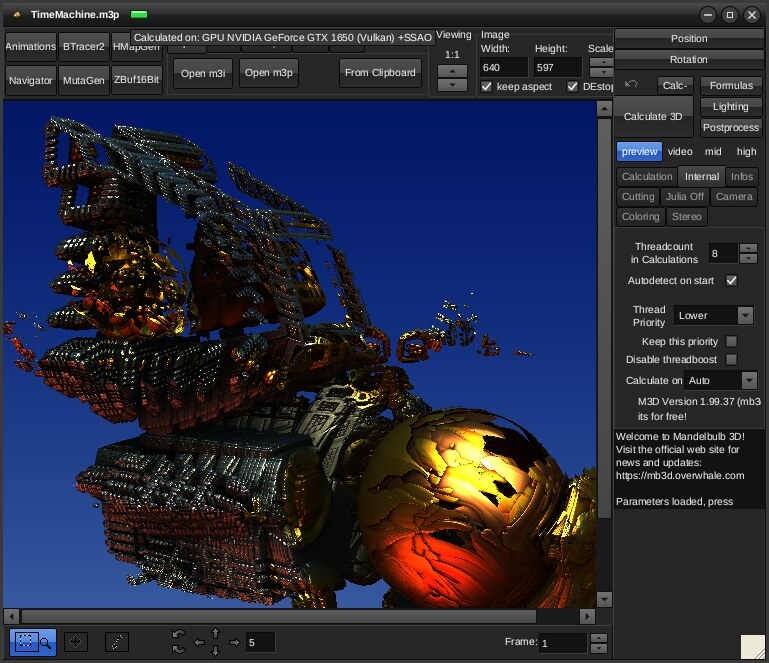</a>

Przëchôdô jakno dwie programë:

* **Mandelbulb3D** — programa na pùlt, z gwôsnyma òknama MB3D:
  przédné òkno, Fòrmùłë, Òswiecenié, Pòstprodukcja, Nawigatór, Animacje,
  Serijné przerôbianié, Wiôldżé renderë, Monte Carlo, Ekspòrt wòkselów,
  Bulb Tracer 2, MutaGen ë jinszé. Chto znaje MB3D, ten znaje tã programã;
  pòrénczi MB3D tu téż dzejają.

  <details><summary>Czëtôj wicy</summary>

  Òkna są te same co w MB3D — zrobioné z òriginalnëch definicjów òknów
  MB3D, tak że kòżdô knąpa, kòżdi sówôk ë kòżdô pòdpòwiédz są tam, dze
  w MB3D:
  
  * **Przédné òkno:** òtmikanié ë zapisywanié parametrów (`.m3p`, `.m3i`,
    tekst, schówk), zapisywanié òbrôzków (PNG, JPEG, BMP, 16-bitowi
    Z-buffer), trybë mëszë, knąpë òbrôcaniô, wiôlgòsc òbrôzka, gòtowé
    nastawë jakòscë, copanié, *Rechùj 3D* z rosnącym òbrôzkã ë statisticzi,
    a téż wszëtczé kartë (Rechòwanié, Bënowé, Infòrmacje, Òbcynanié, Julia,
    Kamera, Farwienié, Stereo).
  * **Fòrmùłë:** szesc placów na fòrmùłë, lëstë ë òpcje fòrmùłów MB3D,
    hibridowé ôrtë, ùlubioné ë edytor fòrmùłów JIT.
  * **Òswiecenié:** widë 1–6, gòtowé nastawë, paleta, kartë Òbiekt,
    Òkòlny, d.Mgła ë Òbrôzk spòdla; zmianë zarô na nowò malëją òbrôzk,
    bez nowégò rechòwaniô.
  * **Pòstprodukcja:** normalné na Z-bufferze, cwiardé ë òkòlné cénie,
    òdbicô ë przezérnosc, głãbiô òstroscë.
  * **Nawigatór:** chòdzë ë zdrzë wkół klawiszama ë mëszą, a pòtemù
    *Pòzdrzatk do przédnégò*.
  * **Twòrzenié animacje, Serijné przerôbianié, Wiôldżé renderë, Monte
    Carlo, Ekspòrt wòkselów, Bulb Tracer 2** (siatczi) z pòdzérkã siatczi,
    **Generator map wësokòscë, MutaGen, ZBuf16Bit, Sekwencje mapów,
    Katalodżi** — wszëtkò tak jak w MB3D.
  * **Rój** (nowi, na karce Nôrzãdła): twòje kòmpùtrë renderëją wespół,
    òbaczë [Renderowanié na wielu kòmpùtrach](#rendering-on-several-computers-the-swarm).

  </details>
* **mb3d** — renderownik z rédczi pòlétów dlô skriptów ë serijnëch
  robòtów: òbrôzczi, animacje, lëstë serijné, renderë Monte Carlo,
  ekspòrt wòkselów ë siatków, gaussowsczé splatë, wszëtkò bez
  òkna.

<a id="is-it-safe-to-run-check-it-yourself"></a>

## Czë ji ùżëcé je bezpieczné? Sprawdzë to sóm

Nie mùszisz nama wierzëc na słowò. [scanrepo.dev](https://www.scanrepo.dev)
to je niezanóleżnô ùsłëżnota, jakô przezérô repòzytorium GitHuba za
znakama szkòdlëwi softwôrë: kòdu, jaczi zrëszô jinszé programë, łączi sã
z internetã, skriwô to, co robi, abò òbchôdô zabezpieczenia jãzëka
programòwaniô. Kòżdi mòże ją w kòżdi chwili pùscëc na tim repòzytorium:

**[▶ Przeskanuj mb3d-rs na scanrepo.dev](https://www.scanrepo.dev/scan/github/thr32423/mb3d-rs)**
(klikni *Rescan*, żebë dostac swiéżi rezultat dlô terôczasnégò kòdu)

Wersjô 0.3.1 dostała òcenã **bezpieczné: 8 z 100** (skanowanié 5 lëstopadnika
2026, prawidła mòtora 10 skanera). Ji warnowania tikają sã réżków, jaczé
zrëszają fòrmùłë, jaczé program kòmpilëje przë robòce dlô chùtkòscë: zrëszaniô
swiéżo zrobionégò kòdu maszinowégò nie dô sã napisac w sprawdzoni fòrmie Rusta,
a te réżczi ë mòst do filtra szëmù firmë Intel to są jedurné place, dze program
na to pòzwôlô; reszta to je informacjowô ùwôga. (Rëchli: 0.2.85 dostała 5 z 100;
0.2.100 bëła przez czile gòdzin ùwôżónô za niebezpieczną, bò dwie matematiczné
fùnkcje kòmpilatora fòrmùłów mia mióno, jaczé skaner bierze za zrëszanié skrëtégò
kòdu; jesz tegò samégò dnia jima zmieniono miona, a test pilnuje terô, żebë taczé
miona nie wrócëłë; 0.2.66 dostała
0 z 100 òd starszégò mòtora, òbôczë téż
[rezultat 0.2.44](../img/scan_0.2.44.png).) Jedna rëchlészô
wersjô bëła òznaczonô, a më zmienilë kòd w òdpòwiedzë
([issue #4](https://github.com/thr32423/mb3d-rs/issues/4)); terô je
napisónô tak, żebë tak òstało. Programë ni mają kòdu, jaczi bë sã łącził
z internetã; jedurnô jinszô programa, jaką proszą twój system òtemknąc,
to twój menedżer lopków, czej klikniesz knąpã, żebë òtemknąc katalog.

Skan szukô znónëch warnowników; to nie je gwarancjô. Tak mòżesz dali
sprawdzëc sóm:

* **Całi zdrojowi kòd je tuwò.** Zladënczi są z niegò ùbùdowóné na
  gwôsnëch serwerach bùdowaniô GitHuba, krokama, jaczé mòżesz przeczëtac
  w [przebiegù wëdaniô](.github/workflows/release.yml), nié na czijim
  prëwatnym kòmpùtrze.
* **Kòżdé wëdanié pòdôwô kòntrolné sumë** (`SHA256SUMS`), tak że mòżesz
  pòcwierdzëc, że zladowóny lopk je dokładno tim, jaczi bëł òpùblikòwóny;
  jednolinijkòwô instalacjô niżi robi to za ce. Wëdania òd 0.2.45 mają
  téż atestacje bùdowaniô GitHuba: `gh attestation verify
  FILE --repo thr32423/mb3d-rs` pòkazëje, z jaczégò commita dany zladënk
  bëł ùbùdowóny.

<a id="what-is-new-compared-with-mandelbulb3d"></a>

## Co je nowégò w zestôwkù z Mandelbulb3D

* **Òbrôzk rechùje graficznô karta** — sóm òbrôzk, cénie, òkòlné cénie
  (ambient occlusion), òdbicô ë renderë Monte Carlo. Na zwëczajnym
  kòmpùtrze je to czile razy chùtszé jak sóm procesor; òbaczë
  [Chùtkòsc](#speed) niżi.
* **Trib Aùto**: graficznô karta ë procesor robią wespół nad kòżdim
  òbrôzkã, a nick nigdë nie żdże — czej karta nie je jesz rëchtowô,
  procesor ë tak zaczinô, a karta dołączô.
* **Diodka LED na pasku titla** pòkazëje, dze bëł rechòwóny slédny òbrôzk.
* **Wiôlgòsc interfejsu** òd 75 do 200 % dlô ekranów z wësoką
  rozdzelnoscą.

  <a href="../img/themes_150.png"></a>

  <details><summary>Czëtôj wicy</summary>

  **Nastawë ▸ Témë ▸ Wiôlgòsc interfejsu** robi wszëtczé òkna ë jich tekst
  wikszé abò mniészé (75 do 200 %), dlô ekranów z wësoką rozdzelnoscą;
  ùkłôd òstôwô dokładno taczi jak w MB3D.
  
  | 100 % | 150 % |
  |---|---|
  | 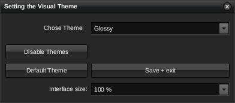 |  |

  </details>
* **Òsmë wëzdrzatków** òknów, wszëtczé jakno lopczi témów, jaczé mòżesz
  skòpiérowac ë zmienic: dwa òddôwają wëzdrzatczi MB3D, szesc je nowëch.

  <a href="../img/themes/Midnight.jpg">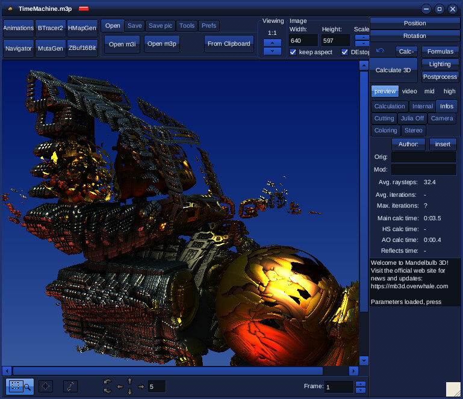</a>

  <details><summary>Czëtôj wicy</summary>

  **Nastawë ▸ Témë** dôwają òsmë wëzdrzatków, kòżdi jakno lopk w katalogù
  `Themes`: *Glossy* (cemny, domëslny) ë *Windows* òddôwają dwa gwôsné
  wëzdrzatczi MB3D, jinszé szesc je nowëch. Klikni òbrôzk, żebë òbaczëc
  gò w pôłny wiôlgòscë.
  
  | | |
  |---|---|
  | <a href="../img/themes/Glossy.jpg"></a> | <a href="../img/themes/Windows.jpg">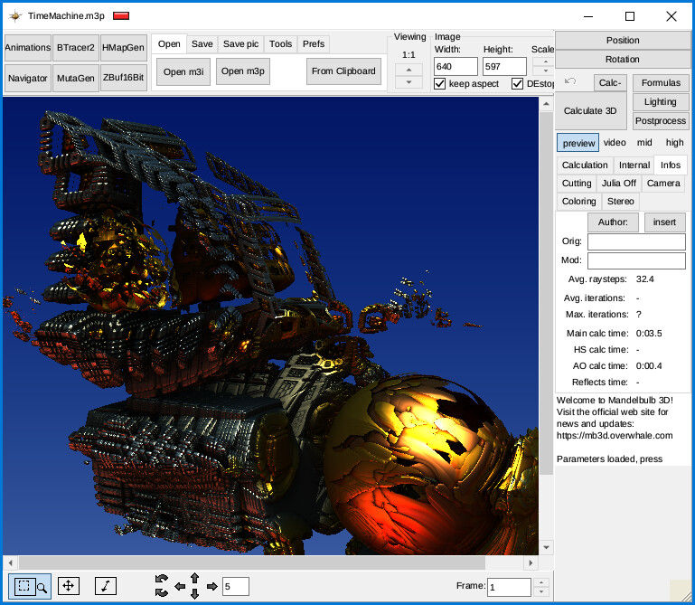</a> |
  | **Glossy**: domëslnô téma MB3D | **Windows**: „Wëłączë témë” w MB3D |
  | <a href="../img/themes/Graphite.jpg">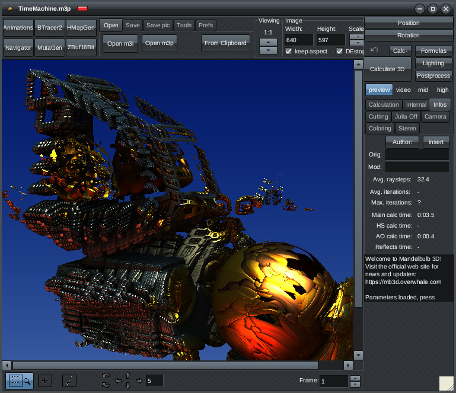</a> | <a href="../img/themes/Daylight.jpg">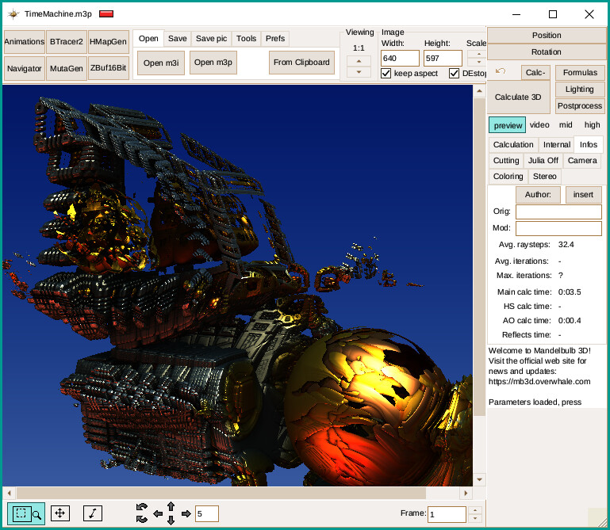</a> |
  | **Graphite**: jasniészi neùtralny szari, stalowòmòdré akcentë | **Daylight**: cepłi jasny szari, mòdrozeloné akcentë |
  | <a href="../img/themes/Midnight.jpg"></a> | <a href="../img/themes/Ember.jpg">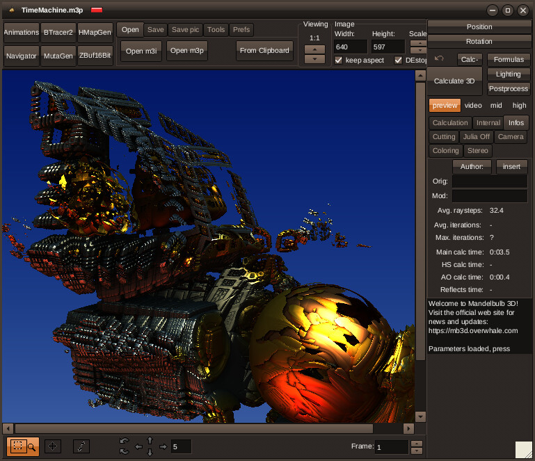</a> |
  | **Midnight**: cemnogranatowô, mòdré akcentë | **Ember**: cepłi grafit, òranżowé akcentë |
  | <a href="../img/themes/Forest.jpg">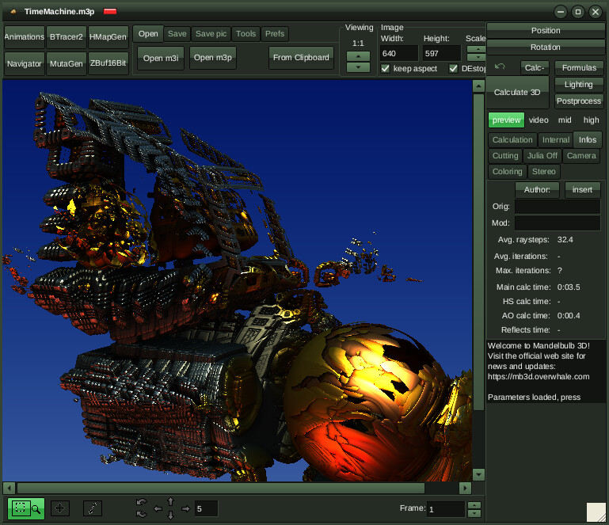</a> | <a href="../img/themes/Highcontrast.jpg">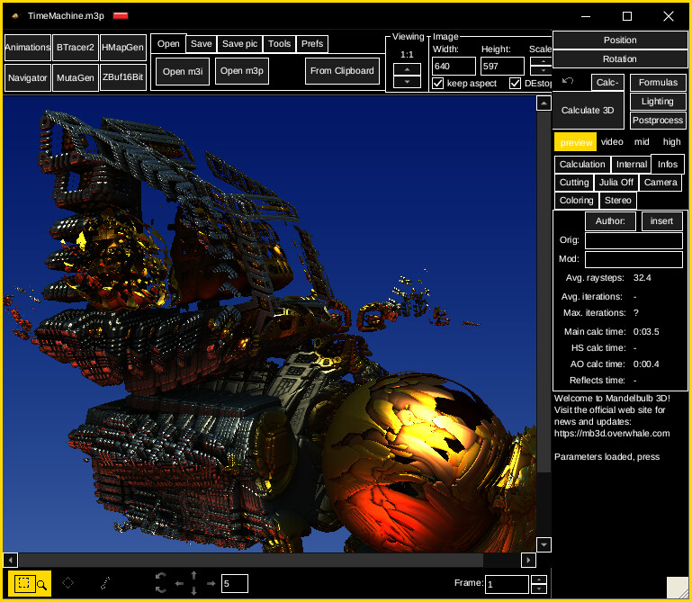</a> |
  | **Forest**: cemnô zelonoszarô, zelené akcentë | **High contrast**: czôrnô, biôłi tekst, żôłté wëszczérzenia |
  
  Téma to je môłi tekstowi lopk w katalogù `Themes` kòl programë;
  skòpiérëj jeden, zmieni jegò farwë, a pòjawi sã na lësce przë
  nôslédnym zrëszenim.

  </details>
* **Awarëjô zostôwiô zôpisk na kòżdim systemie**: panika programë (abò
  fela, z jaką sã kùńczi) je dopisywónô do `mb3d_crash.txt`, kòl programë
  abò w jegò katalogù z pòdôwkama (rëchli leno na Windowsu). Wëslë nen
  lopk razã z zgłoszenim felë.
* **Rechùją wszëtczé graficzné kartë kòmpùtra**, bez nastôwianiô:
  kòżdô nalazłô karta bierze pasma rédów òbrôzka z tegò samégò zbiérkù
  co pierszô karta ë procesor, tak że chùtszô karta prosto bierze wicy;
  cénie, òkòlné cénie, parmienie Monte Carlo ë òdbicô są dzeloné tak
  samò, a animacjô renderëje równoczasno pò jedny klatce na kartã.
  Pòwòlnô karta (integrowónô grafika kòl dedikòwóny) robi, co mòże, ë
  nigdë nie wstrzimiwô òbrôzka: czej wòlné rédë sã skùńczą, wòlné kartë
  ë procesor przejimają rédë, jaczich òna nie òddała. Karta, jakô
  zawòdzy, je pòminiónô, jinszé robią dali. `mb3d --list-cards`
  pòkazëje, co bëło nalazłé. (Testowóné z jedną kartą òtemkłą dwa razy ë
  z softwôrowim drajwerã Vulkan jakno drëgą kartą; jesz nié na
  kòmpùtrze z dwùma prôwdzëwima kartama.)
* **Nieskùńczony òbrôzk je lopkã `.m3i`.** To, co zatrzëmóny, zwalony
  abò zabiti render wërechòwôł, je trzimóné w pamiãcë pòdrãczny (òkno
  Nieskùńczoné renderë, `mb3d resume`); dlô òbrôzka nen lopk je terô w
  kòżdi chwili lopkã òbrôzka `.m3i`, `image.m3i` w katalogù renderu, z
  jesz nierechòwónyma rédama jakno spòdlã. Kòpiérëj gò, czej chcesz, abò
  naceskni *Save m3i* w òknie Nieskùńczoné renderë (`mb3d
  resume --m3i KEY file.m3i` w rédce pòlétów; òbie te drogi zapisëją téż
  `data.bin` z rëchlészi wersje jakno `.m3i`), ë òtemkni gò tuwò abò w
  Mandelbulb3D, bez kònwersji. (Renderë Monte Carlo trzimają swòje
  gwôsné zôpisczi, `.m3c` przebiegù je zapisywóny z `--m3c`.)
* **Skrótë klawiszowé dlô òknów**: kòmbinacjô klawiszów wëcygô na wiéch
  przédné òkno, Nawigatór, òkno Animacje, Fòrmùłë, Òswiecenié,
  Pòstprodukcja abò Monte Carlo z kòżdégò òkna (Ctrl+1 do Ctrl+7), a
  Ctrl+W zamikô òkno, w jakim jes (na macOS Cmd). Nastôw swòje w *Nastawë > Skrótë*: klikni pòle ë
  naceskni klawisze, Backspace rëmô skrót.
* **Interfejs w twòjim jãzëkù**: kòżdi tekst w òknach pòchòdzy z lopka
  jãzëka; programa mô dwanôsce jãzëków, a lopk nowégò jãzëka napisze
  dlô ce sama, żebë të gò przełożił.

  <details><summary>Czëtôj wicy</summary>

  Znaczk jãzëka na prawim kùńcu paska titla przédnégò òkna pòkazëje
  jãzëk interfejsu (`EN`); klëknienié òtmikô òkno jãzëka.
  Jãzëk to je tekstowi lopk w katalogù `Languages` kòl programë.
  W kòmplece: English, Deutsch, Français, Italiano, Nederlands, Polski,
  Kaszëbsczi, हिन्दी, 日本語, 한국어, 简体中文 ë 繁體中文 (kòżdi ze swòją
  fanã; jãzëczi Dalekégò Wschòdu przënôszają dzél Noto Sans CJK dlô swòjich
  znaków, hindi przënôszô Noto Sans Devanagari, czëjegò sparłãczoné lëtrë ë
  znaczi samòzwãków są ùstôwióné szaperã tekstu rustybuzz).
  Przełożenia bëłë zrobioné maszinowò ë sprawdzoné pòd kątã strukturë,
  nié przez rodzymëch gôdającëch: pòprawczi są mile widzóné, kòżdô je
  jedną linijką lopka. Żebë przełożëc: wpiszë miono swòjégò jãzëka ë
  naceskni *Ùsôdzë lopk jãzëka*; programa zapisze `Languages/<name>.lng`
  ze wszëtczima tekstama pò anielskù, pò jednym w linijce (`Button2.Caption = Calculate
  3D`). Przełożë tekstë z prawa òd `=` w tekstowim edytorze ë naceskni
  *Wczëtôj znowa*: òkna sã zarô zmienią, bez nowégò zrëszeniô. Wëpùszczonô
  linijka òstôwiô anielsczi tekst. *Zapiszë + wińdzë* trzimô jãzëk na
  nôslédné zrëszenié.

  </details>
* **Linux, Windows ë macOS** (Intel ë Apple Silicon).
* **Programa z rédczi pòlétów** do wszëtczégò, co nie brëkùje òkna.
* **Baro wiôldżé òbrôzczi w jednym kawôłkù**: 15000 x 20000 pikselów ë
  wicy bez wëczerpaniô pamiãcë, a głãbiô òstroscë brëkùje wszëtczich jąder
  procesora (11 razy chùtszé na 24 wątkach jak przed 0.2.45, z tim
  samim òbrôzkã).
* **16-bitowé òbrôzczi:** lopczi PNG z 65 536 stopniama na farwã, a nié
  256, do edicje bez pasów.

  <a href="../img/png16_compare.png">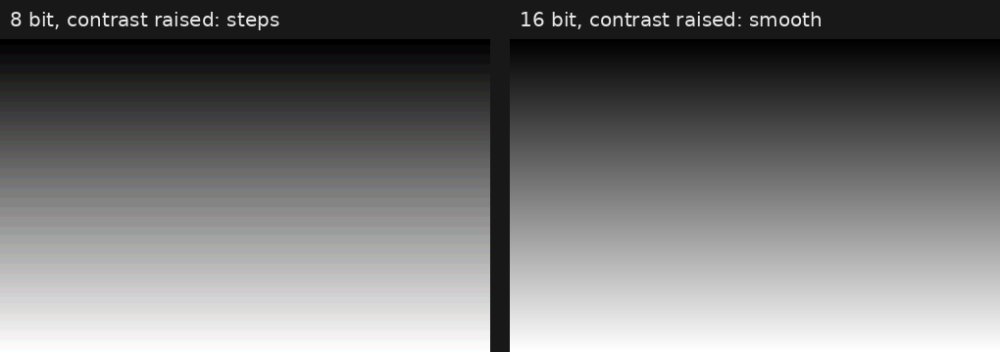</a>

  <details><summary>Czëtôj wicy</summary>

  MB3D zapisëje 8-bitowé òbrôzczi: 256 stopniów na farwã. To je wiele do
  òzéraniô, ale czej òbrôzk je pózni edirowóny — jasnota, kòntrast,
  krziwé — gładczé płaszczi, jak spòdlé abò mgła, rozpôdają sã na widzałé
  pasë. **Zapiszë òbr. ▸ PNG** dôwô drëdżi ôrt lopka, **PNG 16 bit
  farwa**: farwë taczé, jak je programa wërechòwała, nim są zaòkrągloné do
  256 stopniów, ze wszëtczima céniama, òdbiciama ë głãbią òstroscë.
  Lopk wëzdrzi tak samò, a przë edicji òstôwô gładczi.
  
  <a href="../img/png16_compare.png"></a>
  
  <a href="../img/save_png16.png">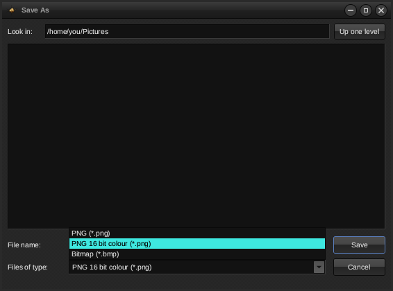</a>

  </details>
* **Filter szëmù** dlô Monte Carlo ë wszëtczich jinszich òbrôzków,
  òdszëmianié DCT znóné z GIMP-a, a dlô renderów Monte Carlo téż
  neùronowi, Intel Open Image Denoise.

  <a href="../img/mc_noise.png">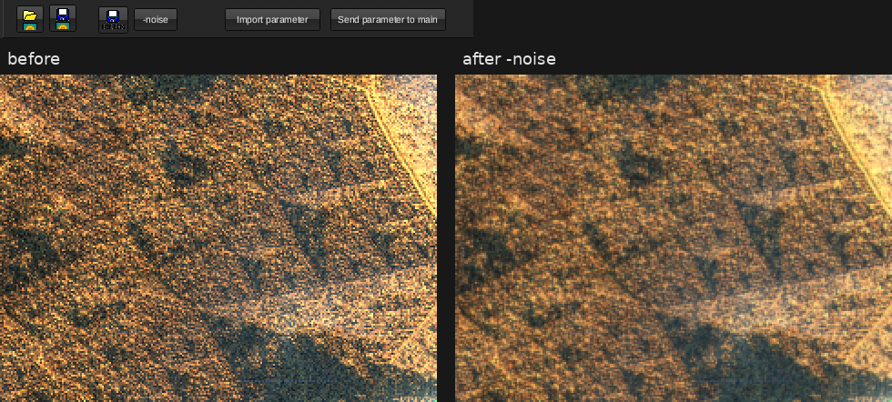</a>

  <details><summary>Czëtôj wicy</summary>

  **Filter szëmù** rëmô zôrno z òbrôzków: to je **òdszëmianié DCT** z
  GIMP-a, *Filters ▸ Enhance ▸ Noise Reduction ▸ Denoise DCT*, jaczi z
  filtrów GIMP-a nôlepi pasowôł do tëch òbrôzków (òbaczë pòdzãkòwania
  niżi).
  
  * **Òkno Monte Carlo ▸ -szëm** (knąpa, jakô MB3D bëło skrëło): filtrëje
    pòkôzóny òbrôzk ë zapisóny, z mòcą, jakô jidze za lëczbą parmieni na
    piksel. Samò renderowanié jidze dali bez filtra, a jegò nôslédnô
    aktualizacjô znowa pòkazëje òbrôzk bez filtra.
  * **Pòstprodukcja ▸ Filter szëmù**: *Filtrëj terô* filtrëje òbrôzk
    przédnégò òkna; *Filtrëj nowé òbrôzczi aùtomatno* filtrëje kòżdi
    nowi. *Mòc* to je mòc szëmù do rëmniãcô (4 je lekkô; wicy rëmô wicy
    zôrna ë wicy drobnëch detalów).
  
  Òbrôzczi Monte Carlo mają nôwicy zôrna. W zestôwkù z òbrôzkama
  renderowónyma z 512 parmieniama na piksel, filtrowóné òbrôzczi bëłë
  blëższé jak niefiltrowóné we wszëtczich 13 testach (sztërë scenë, 4 do
  32 parmieni): do 23 % przë 4 parmieniach, 5 do 10 % przë 8 parmieniach,
  1 do 3 % przë 32 parmieniach, dze òstôwô mało zôrna.
  
  <a href="../img/mc_noise.png"></a>
  
  <a href="../img/postpro_noise.png">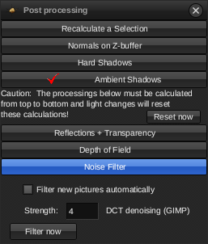</a>

  **Neùronowi filter szëmù** to je
  [Intel Open Image Denoise](https://www.openimagedenoise.org), filter
  z Cycles w Blenderze ë wiele jinszich path tracerów, wëùczony na
  renderowónëch òbrôzkach. Filtrëje strzédnié wôrtnotë parmieni z
  renderowaniô (przed ekspòzycją ë nasycenim), tak że òbrôzk trzimô swòjã
  jasnotã. Biblioteka Intela przëchôdô z programą (katalog `oidn`; w .deb
  ë .rpm `/usr/lib/mb3d-rs/oidn`); `MB3D_OIDN` mòże wskazac jinszą.

  * **Òkno Monte Carlo ▸ -szëm AI**: filtrëje pòkôzóny òbrôzk ë zapisóny,
    tak jak *-szëm*; renderowanié jidze dali bez filtra.
  * **Rédka pòlétów**: `mb3d montecarlo scene.m3p --rays 8 --denoise-ai`.
  * Na procesorze trwô to 0,2 do 0,6 sekùndë dlô òbrôzka 640 x 480.

  Różnica òd òbrôzka z 512 parmieniama (strzédnô ze wszëtczich pikselów,
  mni je lepi):

  | Scena | 4 parmienie | filter DCT | neùronowi filter | 8 parmieni | filter DCT | neùronowi filter |
  |---|---|---|---|---|---|---|
  | TreePlanet | 1.89 % | 1.52 % | **1.23 %** | 0.88 % | 0.82 % | **0.79 %** |
  | Cutted sphere over carpet | 5.30 % | 3.87 % | **2.34 %** | 2.80 % | 2.37 % | **1.66 %** |
  | Julia on box | 1.61 % | **1.01 %** | 1.08 % | 0.98 % | **0.81 %** | 0.84 % |
  | MengerTrees | 1.95 % | 1.54 % | **1.26 %** | 1.15 % | 1.05 % | **0.94 %** |

  Neùronowi filter je nôblëżi w trzech z sztërech scenów; przë drobnym
  zôrnie zbiorë Julii filter DCT je czësto blëżi. Nôbarżi to widzec na
  szkle ë zdrzadłach, dze mało parmieni zostôwiô nôwicy zôrna:

  <a href="../img/mc_noise_ai.jpg">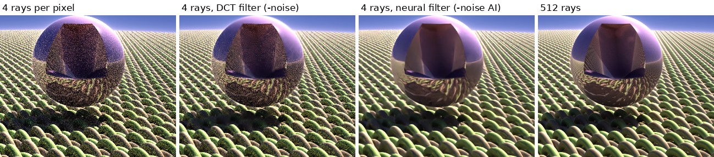</a>

  </details>
* **Przezérné spòdlé** dlô òbrôzków ë animacjów.

  <a href="../img/transparent.png">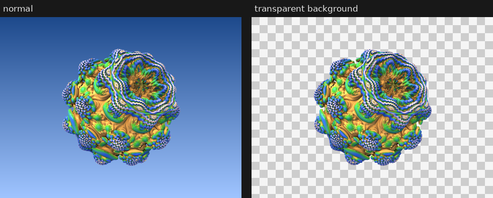</a>

  <details><summary>Czëtôj wicy</summary>

  Òbrôzczi ë klatczi animacje mòżna zapisac z **przezérnym spòdlã**, żebë
  pòłożëc fraktal na jinszi òbrôzk abò w edytorze wideò: **Zapiszë òbr. ▸
  PNG ▸ PNG z przezérnym tłã**, a w òknie Twòrzenié animacje **Przezérné
  tło** (klatczi PNG). Z antialiasingã (skala pòzéraniô 1:2 abò wicy,
  abò `--aa`) kraje są miãkczé ë ni mają òbrëbieniô w farwie starégò
  spòdla. Òbrôzczi głãbi do kòmpòzytowaniô bëłë ju wczasni (*Zapiszë téż
  Z-buffer*, `--depth`).
  
  <a href="../img/transparent.png"></a>

  </details>
* **Wideò z animacjów:** lopk AVI prosto z programë abò kòmanda ffmpeg
  dlô môłégò MP4.

  <a href="../img/anim_video.png">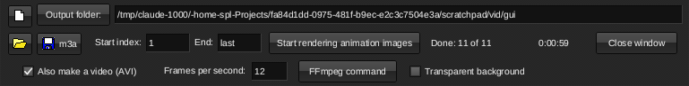</a>

  <details><summary>Czëtôj wicy</summary>

  W òknie Twòrzenié animacje **Zrobi téż wideò (AVI)** sparłãcziwô
  klatczi w wideò, czej są renderowóné, z nastawioną lëczbą **Klatków na
  sekùndã**: `<project name>.avi` w katalogù wëjscégò, kòl klatków, jaczé
  òstôwają. Gro w VLC ë mpv ë òtmikô sã w edytorach wideò (Kdenlive,
  Shotcut, DaVinci Resolve). Kòżdô klatka je trzimónô jakno całi òbrôzk,
  tak że lopczi są wiôldżé: dobré do edicje ë trzimaniô, mni do
  dzeleniô.
  
  Dlô môłégò wideò do dzeleniô **Kòmanda FFmpeg** kładze kòmandã dlô MP4
  (abò, z przezérnym spòdlã, WebM) do schówka ë w kòmùnikatë. Zainstalëjë
  [ffmpeg](https://ffmpeg.org), wklejë kòmandã w terminal, czej klatczi
  są gòtowé, a òna zrobi wideò; ta programa sama nie zrëszô niżódnëch
  jinszich programów.
  
  <a href="../img/anim_video.png"></a>

  </details>
* **Pòdzérk lopków parametrów** w òknie òtmikaniô.

  <a href="../img/open_preview.png">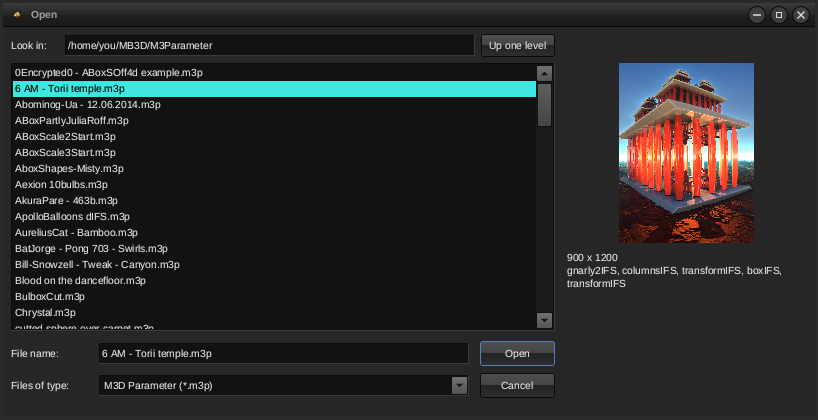</a>

  <details><summary>Czëtôj wicy</summary>

  **Òtemkni ▸ Òtemkni m3p** ë **Òtemkni m3i** pòkazëją môłi òbrôzk
  klikniãtégò lopka parametrów, z jegò wiôlgòscą ë fòrmùłama, nim
  zostanie òtemkłi; klawisze strzélków przesëwają pò lësce z pòdzérkã.
  Òbrôzk je rechòwóny w tle na procesorze, tak że òkno dali reagùje, a
  pòdzérk kòżdégò lopka je trzimóny, pòkąd programa dzejô.
  
  <a href="../img/open_preview.png"></a>

  </details>
* **Nawigatór: dokładné wôrtnotë ë Przëwrócë pòzdrzatk.** Klikni
  wôrtnotã ë wpiszë jã; wrócë do pòzdrzatkù, z jaczégò Nawigatór zaczął.

  <a href="../img/navigator_values.png">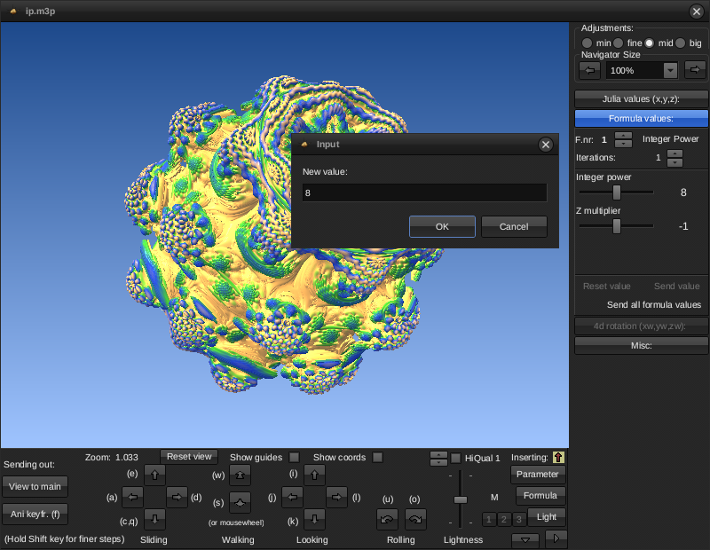</a>

  <details><summary>Czëtôj wicy</summary>

  * **Klikni wôrtnotã** w panelach Nawigatora — wôrtnotë Julii, wôrtnotë
    fòrmùłów, òbrôcanié 4D, wôrtnotë Misc — ë wpiszë dokładną lëczbã, jak
    w MB3D (nórtë w gradach). Sówôk jidze pòtemù dali òd ti wôrtnotë.
  * **Klikni zoom** ë wpiszë gò, czej kroczi zoomù są za grëbé (żëczenié
    z lëstë zgłoszeniów MB3D); wpisóny zoom òstôwô (*Stałi zoom*).
  * **Przëwrócë pòzdrzatk** wrôcô do pòzycje, czerënkù ë zoomù, jaczé
    Nawigatór wzął z przédnégò òkna; zmienioné wôrtnotë òstôwają.
  
  <a href="../img/navigator_values.png"></a>

  </details>
* **Nowô fòrmùła, SphereTree:** drzewò dotikającëch sã kùl, jaczé sã
  rozgałãzywają w corôz mniészé, òd Toma Lowe'a.

  <a href="../img/spheretree_ball.jpg">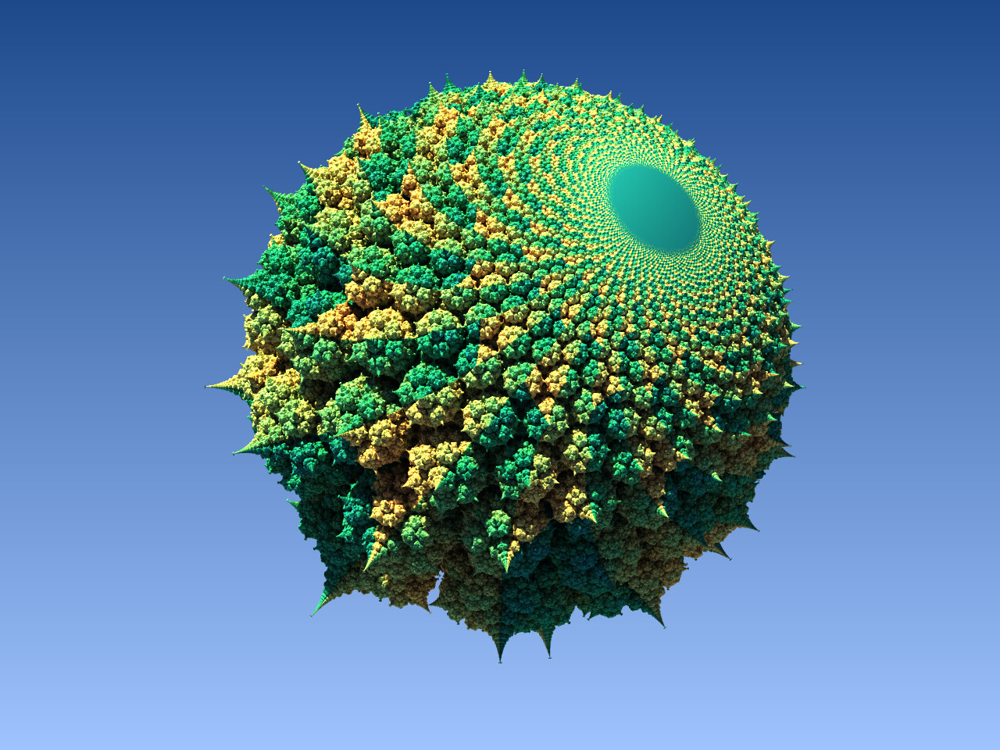</a>

  <details><summary>Czëtôj wicy</summary>

  **SphereTree** to je fòrmùła, jaczi Mandelbulb3D ni mô: drzewò kùl,
  jaczé sã dotikają ë rozgałãzywają w corôz mniészé kùle, jak pjana abò
  kòrale. Tom Lowe, chtëren wëmëslił Mandelbox, òpùblikòwôł jã w 2020
  (òbaczë pòdzãkòwania niżi). Je na lësce fòrmùłów kòl fòrmùłów dIFS ë mô
  sztërë nastawë:
  
  * **PackRatio** (0 do 1.22): wiôlgòsc kùl; przë 1 blós sã dotikają,
    wëżi 1 bùtnowé sã òdłamiwają.
  * **Levels**: jak głãbòkò jidze drzewò (6 je dosc dlô wikszoscë
    òbrôzków).
  * **Rotated**: 1 òbrôcô kòżdi równ ò dwanôstą dzél òbrotu, a drzewò
    robi sã òkrągłą kùlą z grëpów kùl.
  * **Colour scale**: kòżdô gałąz drzewa mô swòjã farwã. Wëbierzë
    *2. wëbiér* (orbit trap) w nastawach farwów w Òswieceniu, żebë je
    òbaczëc; ta nastawa rozkłôdô je pò gradience farwów.
  
  Dzejô sama ë pò transfòrmacjach dIFS (trzecy òbrôzk pòwtôrzô jã z
  *tilingbrickIFS*), ë je rechòwónô tak na graficzny karce, jak na
  procesorze. Nastôw iteracje na 1: fòrmùła rechùje całé drzewò naróz.
  Parametrë z SphereTree òtmikają sã leno w ti programie, nié w
  Mandelbulb3D.
  
  <a href="../img/spheretree_ball.jpg"></a>
  
  | <a href="../img/spheretree_close.jpg">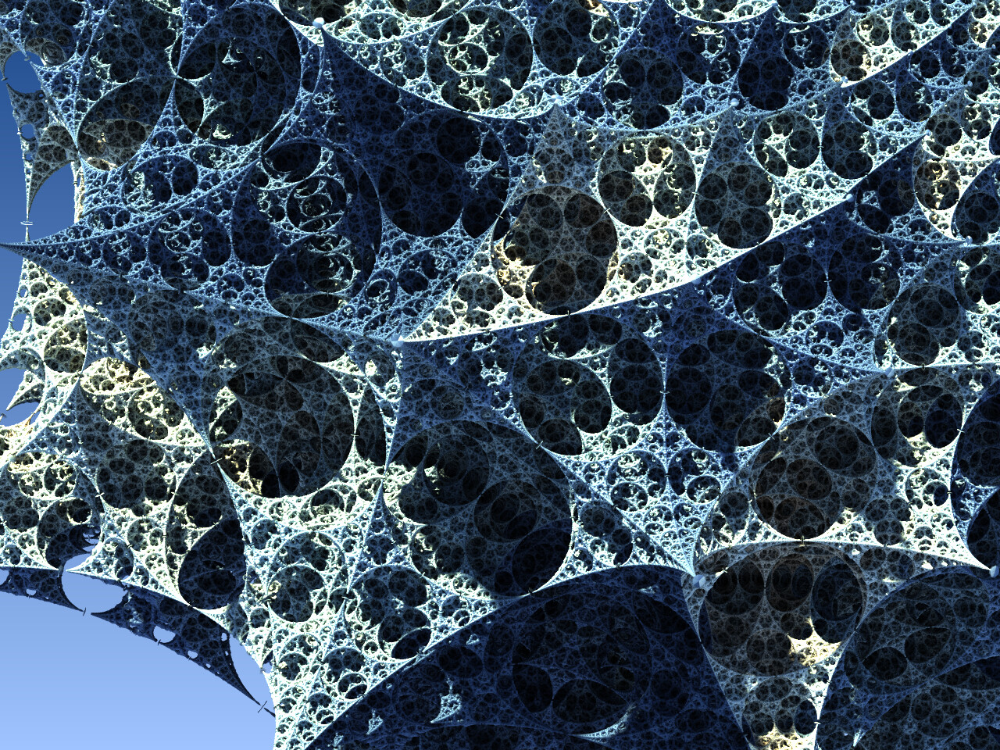</a> | <a href="../img/spheretree_swarm.jpg">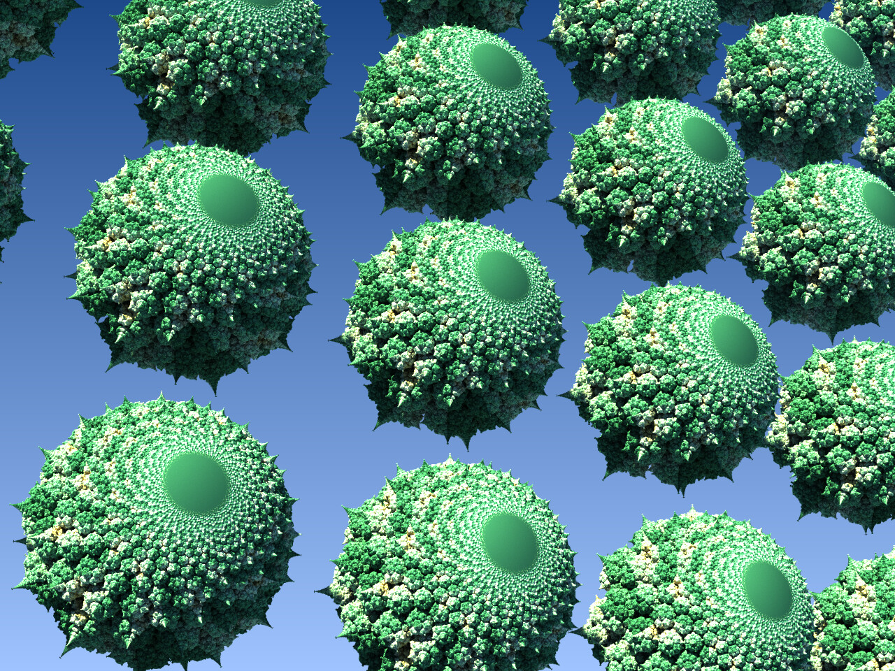</a> |
  |:---:|:---:|

  </details>
* **Nowô fòrmùła, DomeTree:** kùpła, z jaczi wërôstô krąg mniészich
  kùpłów, kòżdô z swòjim krãgã, òd Toma Lowe'a.

  <a href="../img/dometree_mc.jpg">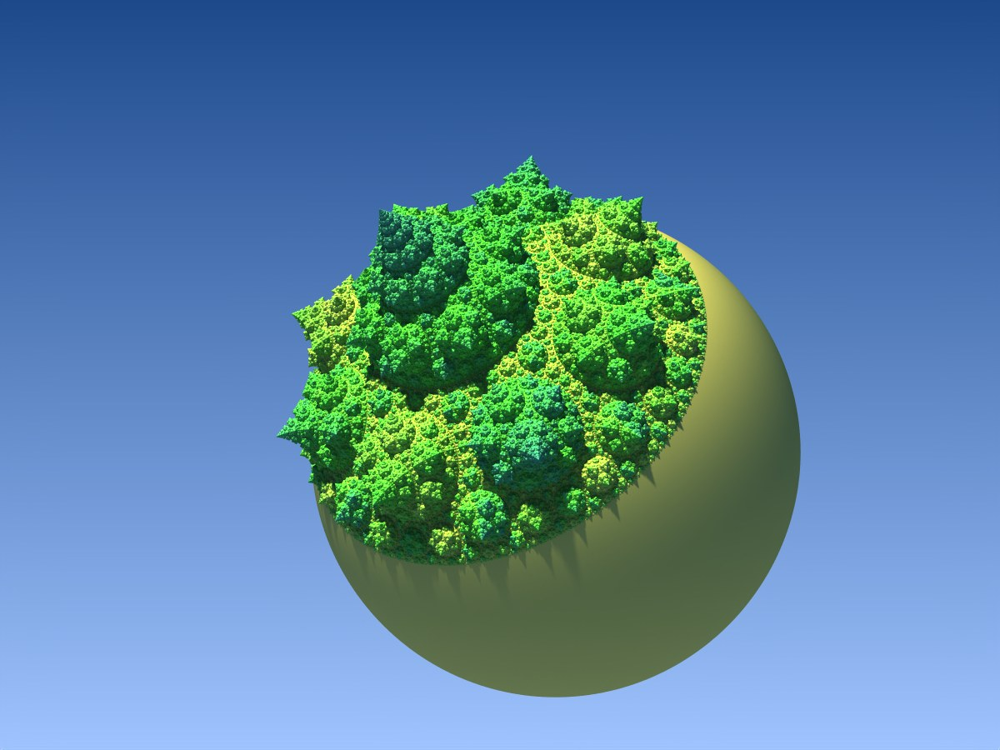</a>

  <details><summary>Czëtôj wicy</summary>

  **DomeTree** to je drëdżé drzewò Toma Lowe'a pò SphereTree (òbaczë
  pòdzãkòwania): kùla, na jaczi jedny stronie rosce krąg kùpłów, kòżdô
  kùpła swój mniészi krąg, równ pò równie, zrobioné z inwersjów w kòłach.
  Je na lësce fòrmùłów kòl fòrmùłów dIFS ë mô piãc nastawów:

  * **Levels**: jak głãbòkò jidze drzewò (16 je dosc).
  * **Children**: kùpłë w kòżdim krãgù, 4 do 10.
  * **Bend angle** (nôlepi 0.3 do 1.3): jak baro kùpłë sã wëdgiwają;
    môłé wôrtnotë dôwają płaszczé tarcze, wiôldżé — òkrągłé kùpłë. Wëżi
    kòl 1.3 wiérzch robi sã zôrnisti.
  * **Colour scale**: kòżdô kùpła mô swòjã farwã. Wëbierzë *2. wëbiér*
    (orbit trap) w nastawach farwów w Òswieceniu ë szeroczi zakres
    farwów (np. 0 do 100), żebë je òbaczëc.
  * **Start curved**: 1 (domëslno) zaczinô òd kùlë, 0 òd płaszczi
    pòdłodżi, z jaczi rosce pierszi krąg.

  Brëkùj môłégò *Raystep* (0.2; 0.05 przë 9 abò 10 dzecach): òceniwanié
  òdległoscë ti fòrmë je grëbé, jak w gwôsnym lopkù Fragmentarium TGlada.
  Tak jak SphereTree dzejô na graficzny karce ë na procesorze, brëkùje
  leno 1 iteracje, a parametrë z nią òtmikają sã leno w ti programie.

  <a href="../img/dometree_mc.jpg"></a>

  | <a href="../img/dometree_5.jpg">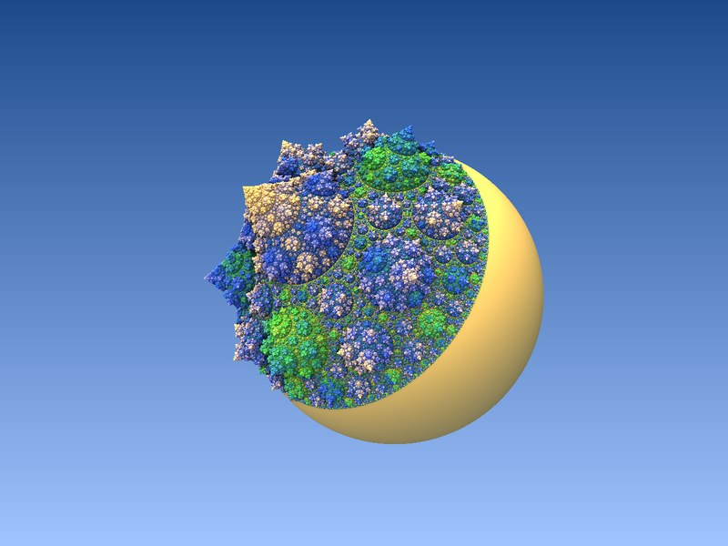</a> | <a href="../img/dometree_flat.jpg">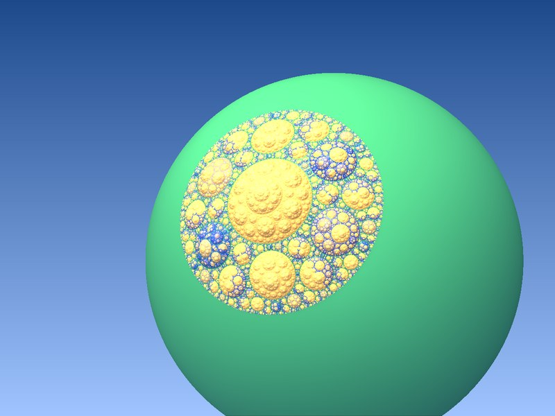</a> | <a href="../img/dometree_10.jpg">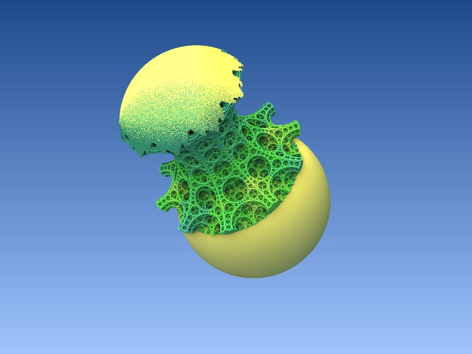</a> |
  |:---:|:---:|:---:|

  </details>
* **Nowô fòrmùła, UlamSpiral:** spirala pierszich lëczbów Ulama w 3D, jakno
  gard, sylwetka gardu, kùle abò blok.

  <a href="../img/ulam_2d.png">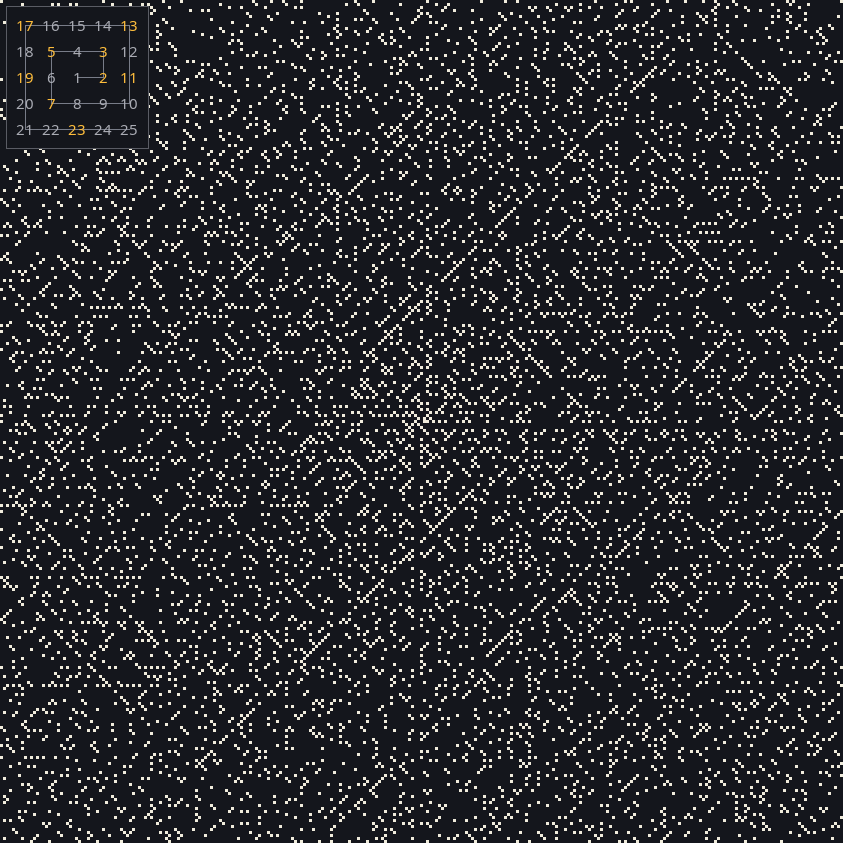</a>

  <details><summary>Czëtôj wicy</summary>

  W 1963 rokù matematik Stanisław Ulam sedzôł na zéńdzenim na „długim ë
  baro nudnym referace” ë rësowôł na kartce w kratkã. Nôpierwi chcôł
  ùstawiac szachòwé zadania; place tegò pònumerowôł kratczi 1, 2, 3, …
  w spiralã, 1 w strzódkù, ë òbkrążił pierszé lëczbë. Pierszé lëczbë
  ùłożëłë sã w pòprzeczné linie, jakbë szłë za jaczims wzorã, ë robią to
  dali, czej kòmpùtr rësëje jich miliónë (Ulam spróbòwôł 100 000 na
  MANIAC II w Los Alamos; Martin Gardner dôł nen òbrôzk na òkłôdkã
  Scientific American w 1964). Do dzysô nicht tegò do kùńca nie
  wëjasnił.
  
  <a href="../img/ulam_2d.png"></a>
  
  **UlamSpiral** bùdëje tã spiralã w 3D, jedna fòrma na lëczbã, w
  sztërech wariantach (*Mode*):
  
  * **0, wieże pierszich lëczbów**: płasta dlô kòżdi lëczbë ë wieża na
    kòżdi pierszi. Pòprzeczné linie pierszich lëczbów robią sã rédama
    wież.
  * **1, sylwetka dzelników**: słup dlô kòżdi lëczbë, tim wëższi, czim
    wicy dzelników mô; pierszé lëczbë to niskié ùlice midzë nima.
  * **2, kùle dzelników**: kùla dlô kòżdi lëczbë, tim wikszô, czim wicy
    dzelników mô (pierszé lëczbë to te môłé).
  * **3, blok pierszich lëczbów**: lëczbë nawiniãté na skòrëpë szescanów
    place kwadratu, szescan na kòżdi pierszi lëczbie.
  
  *Rings* nastôwiô wiôlgòsc spiralë (60 krãgów to lëczbë do 14 641),
  *Height* wësokòsc wież abò słupów, *Gap* plac midzë nima. Z *2. wëbiér*
  (orbit trap) w nastawach farwów farwa jidze za lëczbą dzelników, tak że
  pierszé lëczbë mają swòjã gwôsną farwã. Tak jak SphereTree dzejô na
  graficzny karce ë na procesorze, dzejô pò transfòrmacjach dIFS,
  brëkùje leno 1 iteracje, a parametrë z nią òtmikają sã leno w ti
  programie.
  
  <a href="../img/ulam_city.jpg">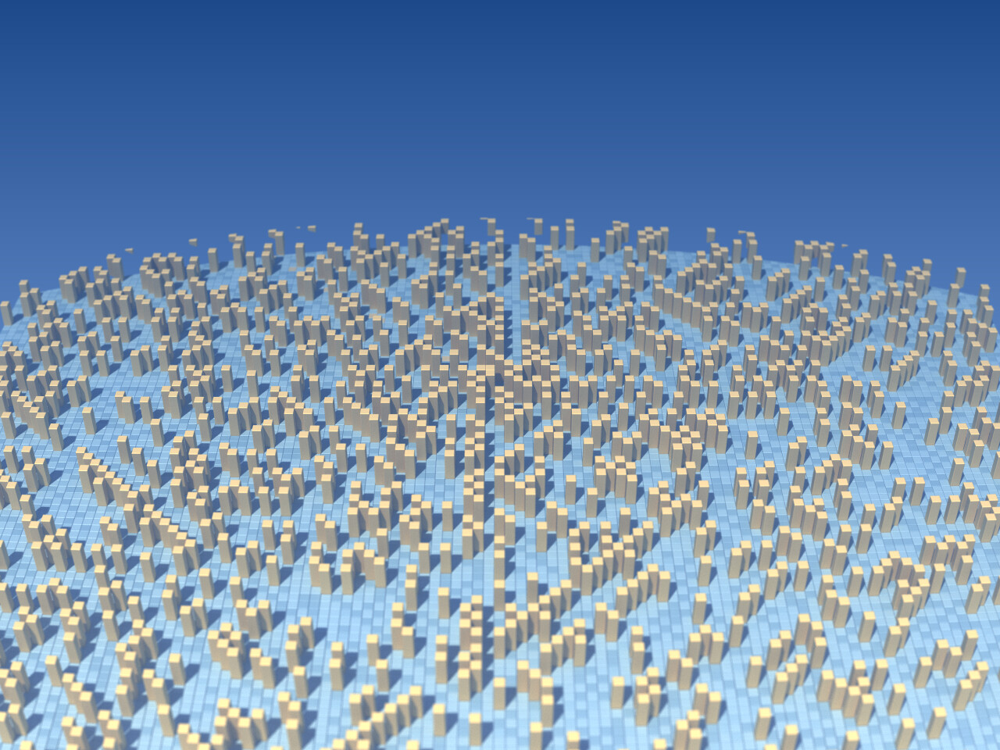</a>
  
  | <a href="../img/ulam_skyline.jpg">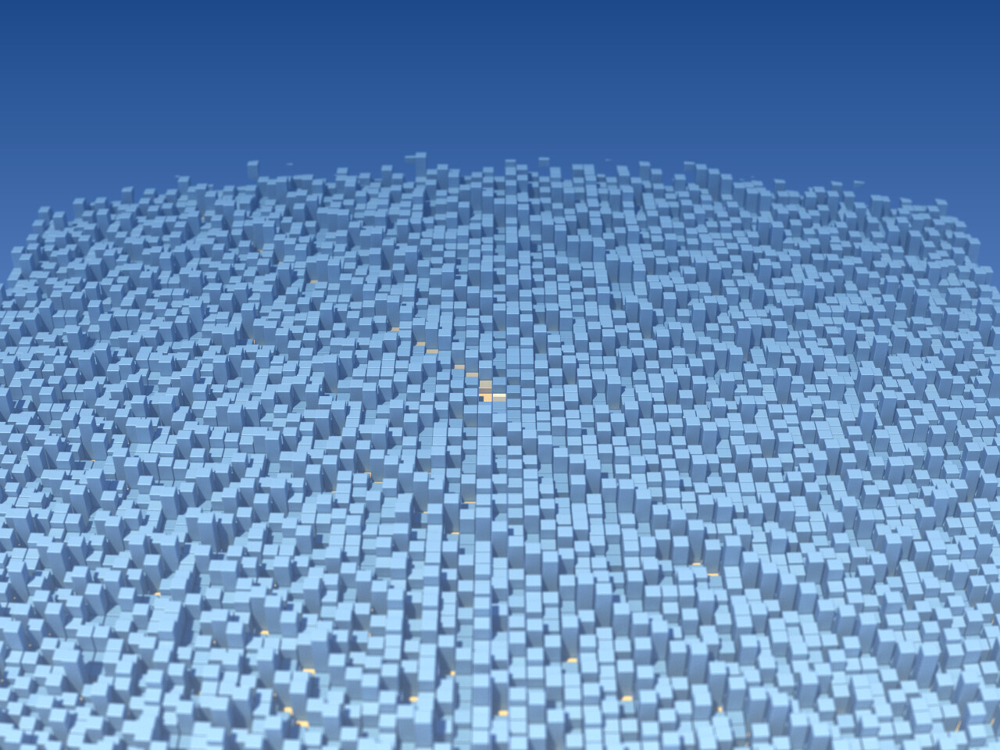</a> | <a href="../img/ulam_spheres.jpg">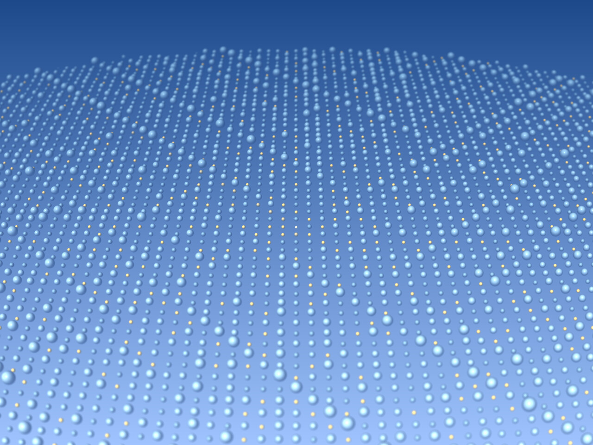</a> | <a href="../img/ulam_block.jpg">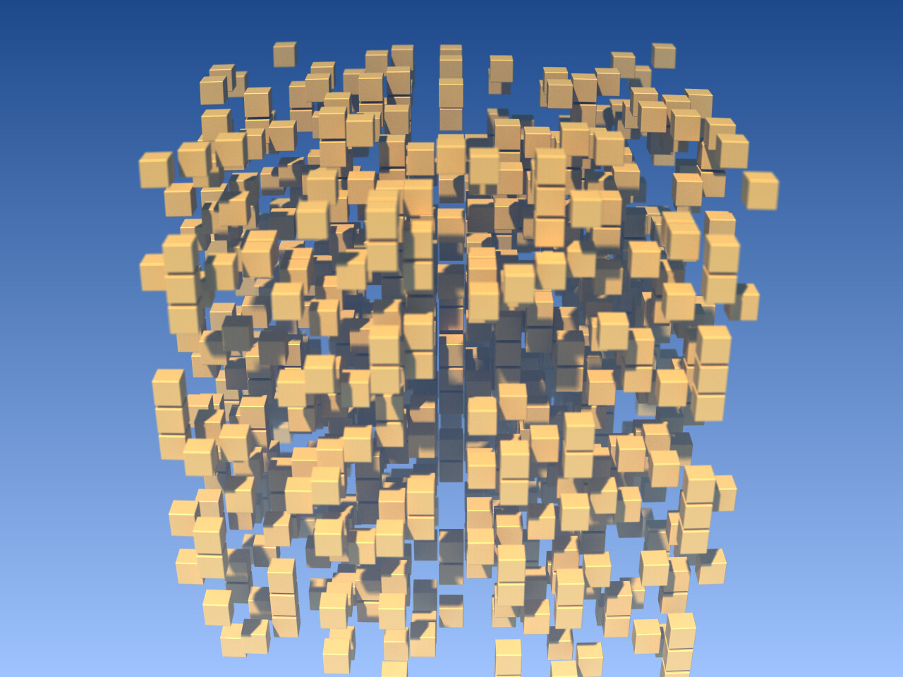</a> |
  |:---:|:---:|:---:|

  </details>
* **Zatrzëmóny render jidze dali tam, dze bëł.** To, co render
  wërechòwôł, òstôwô trzimóné, czej je zatrzëmóny, a téż czej programa je
  zamkłô abò sã zwali, abò czej kòmpùtr sã wëłączi (co 5 minut je to
  zapisywóné na disk): Rechùj 3D, Monte Carlo (téż w pòłowie przebiegù),
  klatka animacje abò òbrôzk serii w robòce, ekspòrt wòkselów, siatka
  Bulb Tracera, kachle Wiôldżégò renderu ë render w roju (Stop na
  kòmpùtrze, jaczi zrobił robòtã, trzimô kòżdi skùńczony dzél, a kòżdi
  kòmpùtr trzimô dzél, przë jaczim bëł). Rechùj 3D ë Monte Carlo z tima
  samima parametrama pëtają, czë jic dali, jinszé jidą dali same z se;
  knąpa **Kòntinuùj** (karta Òtemkni) wëpisëje nieskùńczoné renderë, żebë
  je kòntinuowac abò rëmnąc. W rédce pòlétów ta sama kòmanda jidze dali
  sama (téż òbrôzk w `--tiles`, `montecarlo`, `animate`, `batch`, `voxel`
  ë `mesh`); `--fresh` zaczinô òd nowa, `mb3d resume` je wëpisëje.
  Kòntinuowóny render je taczi sóm jak rechòwóny za jednym razã.
* **Renderowanié dzeloné midzë twòjima kòmpùtrama**, „rój”: kòmpùtrë,
  jaczé widzą jeden dzelony katalog, renderëją wespół òbrôzk, Wiôldżi
  render, òbrôzk Monte Carlo abò animacjã. Òbaczë
  [Renderowanié na wielu kòmpùtrach](#rendering-on-several-computers-the-swarm).
* **Fòrmùłë ë mapë spòlëznë**: 129 fòrmùłów ë 154 map, chtërnëch felëje w òficjalnym repòzytorium, z paczétu Mandelbulb3D 1.99.37, jaczi Machina Infinitum dôwô do darmòwégò sćągniãcô. Fòrmùłë ùsôdzëlë Edgar Malinovsky, gnj, DarkBeam (Luca GN), bugman, Aexion, Buddhi, pupukuusikko, Jos Leys, Knighty, trafassel, Nrx, Eiffie, Quasihedron, Inigo Quilez, Yannis Picart, Jotero ë jinszi, chtërnëch lopczi nie mienią ùsôdzcë; `M3Formulas/CREDITS-community.md` mieni ùsôdzcã kòżdi fòrmùłë (`teapot.m3f` òd DarkBeama je pòd licencją CC BY-SA 3.0). Mapë są z kòlekcji DarkBeama, na jegò warënkach (wòlné ùżëcé, bez przedôwaniô bez zmianë), z òbrazama, jaczé na DeviantArt ùdostãpnilë CmdrChaos, Fractales75, Nic022 ë UndeadAcademy; mapë 3046–3048 są òd Kronpano (`M3Maps/CREDITS-community.md`). 608 nastôwów swiatła w `M3Lights` je z tegò samégò paketu; jich lopczi nie miono ùtwórcë (`M3Lights/CREDITS-community.md`).
* **Ùdbë z Mandelbulb3D SE**: Mandelbulb3D SE (ùtwórca: Glenn Olander), aplikacjô dlô macOS zbùdowónô na mb3d-rs, dało dwie ùdbë: sprôwdzanié w testach kòżdégò shadera grafikòwi kartë bez grafikòwi kartë ë stop, chtëren zarô kùńczi malowanié òbrôzka.
* **Nowô fòrmùła, PseudoKleinian:** „kleinowskô architektura” halów,
  łãków ë kùl jakno jedna fòrmùła z gwôsną dokładną òdległoscą.

  <a href="../img/kleinian_hall.jpg">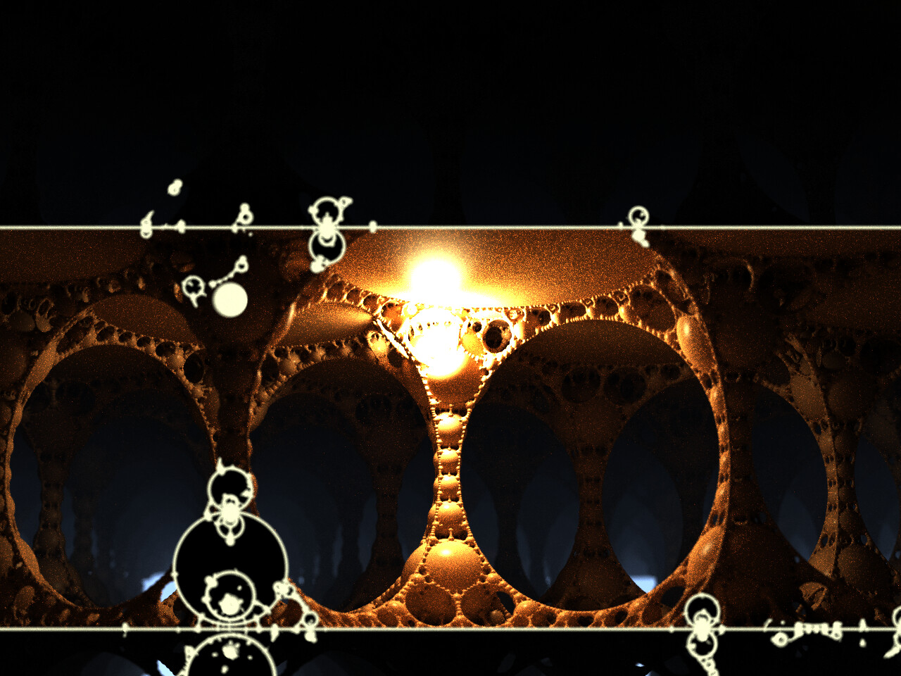</a>

  <details><summary>Czëtôj wicy</summary>

  Hale, łãczi, słupë ë zagnieżdżoné kùle, znóné jakno „kleinowskô
  architektura”, słëchają do nôbarżi lubionëch fraktalnëch òbrôzków 3D.
  W MB3D mòżna je zrobic leno jakno hibrid czile fòrmùłów z sztôłtno
  dopasowónyma nastawama, recepta, jaką Theli-at nalazł w 2011; pòtemù
  knighty napisôł to samò jakno jedną fòrmùłã z gwôsnym òceniwanim
  òdległoscë, ë to je **PseudoKleinian**. Kòżdi równ zôłożi pùnkt w
  pùdło, robi jegò inwersjã w kùli ë dodôwô przesunienié, a òdległosc je
  mierzonô dokładno do płaszczëznë pòdłodżi pò złożeniach, tak że scanë
  wëchôdają czësti, a òbrôzk renderëje sã chùtkò. Nastawë są knighty'ego:
  *Levels* (8), *Size* (kùla inwersje), *CSize X/Y/Z* (pùdło; jegò 0.924,
  0.908, 0.924 dôwają klasyczné hale, a môłé zmianë dôwają nowé bùdinczi),
  *Julia X/Y/Z* (przesunienié na kòżdi równ), *Shape* (0 płaszczëzna
  pòdłodżi, 1 walcowô płaszczëzna z *Thickness* przez *Offset*, 2
  zaòkrąglone pùdło), *DE offset* (wëdrążô wiérzch) ë *Colour scale* (z
  *2. wëbiér*, orbit trap: nômniészi promiéń òrbitë, klasyczné kleinowsczé
  pasë).
  
  Struktura wëpełniô całi rum, tak że zdrzisz na nią òd bënë: zacznij z
  strzódkã pòzdrzatkù kòl pòczątkù ùkładu ë kamerą jednã abò dwie
  jednostczi nazôd, ë chòdzë pò halach z Nawigatorã. W renderowniku
  Monte Carlo do strzodka prawie nie dochôdô wid z nieba, tak że
  pòstawi pòzycjowi wid w halë (pierszi òbrôzk) abò rozetni strukturã
  płaszczëzną òbcynaniô ë zdrzë z górë (drëdżi). Dzejô na graficzny karce
  ë na procesorze, brëkùje 1 iteracje, dzejô pò transfòrmacjach dIFS
  ë w kòmbinacjach DE jak jinszé fòrmùłë dIFS (chòc w strzodkù strukturë,
  jakô wëpełniô rum, te mało co zmieniwają), a parametrë z nią
  òtmikają sã leno w ti programie.
  
  <a href="../img/kleinian_hall.jpg"></a>
  
  <a href="../img/kleinian_top.jpg">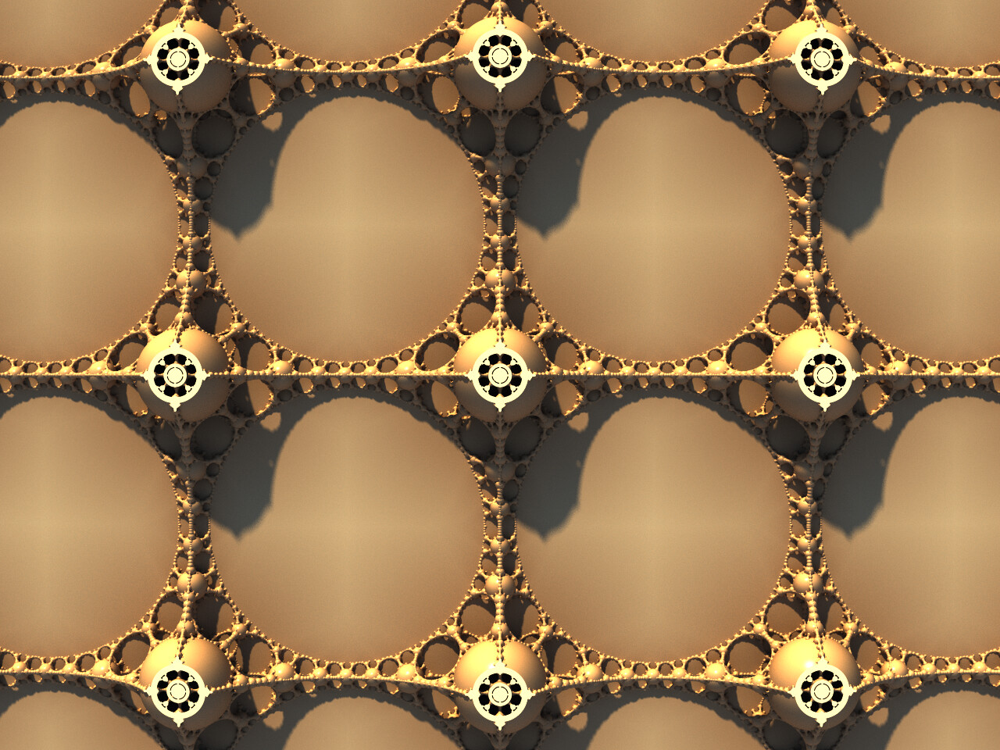</a>

  </details>
* **Stereo pôrë w jednym krokù**: òbadwa òbrôzczi òczów renderowóné ë
  pòkôzóné kòl se, do pòzéraniô równoległégò abò na krziż. Wkłôd òd
  Rathinagiri S ([SRathinaGiri](https://github.com/SRathinaGiri)).

  <a href="../img/stereo_pair.jpg">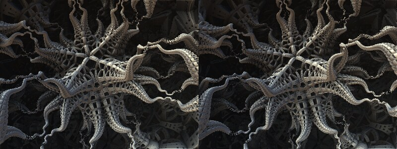</a>

  <details><summary>Czëtôj wicy</summary>

  **Stereo ▸ Renderuj stereo pôrã** renderëje nôpierwi lewi, a pòtemù
  prawi òbrôzk òka z nastawama stereo z ti karte ë pòkazëje je kòl se
  w przédnym òknie. Są ùłożoné do równoległégò pòzéraniô (lewi òbrôzk z
  lewa); **Pòdzérk na krziż** zamieniwô je do pòzéraniô na krziż. To je
  pòdzérk: òswieceniô ë farwów
  nie da sã pózni zmienic bez nowégò renderowaniô, ë nie dzejô to z
  kachlama. Knąpë dlô pòjedinczëch òbrôzków òczów są dali na swòjim
  placu.
  
  <a href="../img/stereo_pair.jpg"></a>

  </details>
* **Òstôwający czas dlô całégò òbrôzka**: pasek pòd òbrôzkã wëpełniô sã
  rôz przez całé rechòwanié, a kòl niegò stoji czas òstôwający do kùńca
  òbrôzka, razã z céniama, òkòlnyma céniama ë òdbiciama.

  <a href="../img/time_left.png"></a>

  <details><summary>Czëtôj wicy</summary>

  Pasek MB3D zaczinô òd nowa przë kòżdim etapie. Tuwò pòkazëje całé
  rechòwanié: przédné renderowanié, pòtemù cwiardé cénie ë òkòlné cénie,
  òdbicô ë głãbiã òstroscë. Jak długò trwają etapë pò przédnym
  renderowanim, je òceniwóné z tegò, czegò scena chce, ë z tegò, jak
  szło przédné renderowanié; òcena bëła dopasowónô na kòl 1400
  renderach 366 scenów. Òbrôzk rechòwóny drëdżi rôz òczekùje czasów z
  slédnégò razu.
  
  Pierszi òbrôzk z nowima fòrmùłama na graficzny karce żdże, jaż sã
  skòmpilëją jegò shaderë: linijka gôdô tedë *kòmpilacjô shaderów* z
  òstôwającym czasã, jaczi rechùje z tempa procesora ë, czej shaderë
  bãdą rëchtowé w czas, z dołączenim sã kartë. Detale w
  [TECHNICAL.md](../TECHNICAL.md#time-left-and-the-progress-bar).
  
  <a href="../img/time_left.png">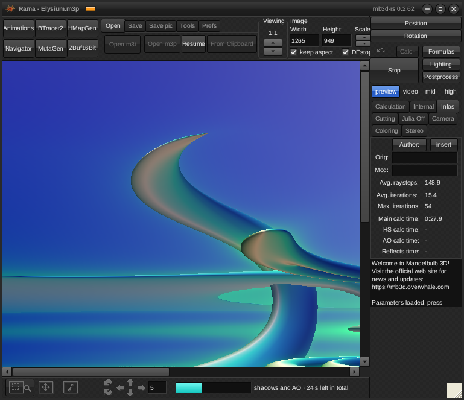</a>

  </details>
* **History** za ikòną zégra na pasku titla: kòżdi wërechòwóny
  òbrôzk z miniaturką, kòżdi òtemkłi abò zapisóny lopk,
  jakno lësta, jakno rédë abò jakno kafle dowòlny wiôlgòscë, pògrëpòwóné
  pò dniach abò w jednym cygù; szëkôj w ni, sortuj jã, pòkażë leno
  òbrôzczi, jaczé sã różnią, ë wczëtôj kòżdi wpis dwùklikniãcym.
  History z setkama tësãców wpisów òtmikô sã zarô.
* **Òswiecenié òstôwô żëwé** pò cwiardëch céniach ë òdbiciach: przesuni
  wid abò zmieni jegò farwã, a òbrôzk zmieni sã zarô, jak w Mandelbulb3D.

  <a href="../img/lighting_live.png">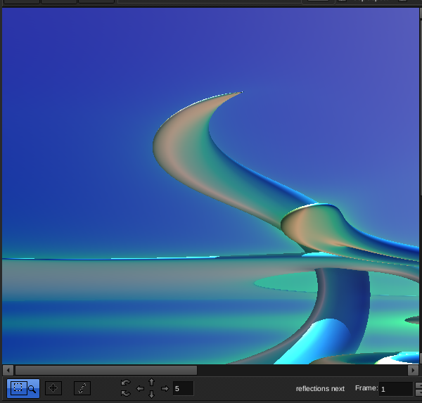</a>

  <details><summary>Czëtôj wicy</summary>

  Renderëj prosto, a pòtemù próbùj pòzycje ë farwë widów: kòżdô zmiana
  w òknie Òswiecenié zarô malëje òbrôzk na nowò z céniama taczima, jak
  bëłë wërechòwóné, jak w Mandelbulb3D. Zmiana farwë abò mòcë widu
  nigdë nie rechùje céni na nowò. Cénie przesëniãtégò widu, òdbicô ë
  głãbiô òstroscë wrôcają z knąpama òkna Pòstprodukcja, jak w
  Mandelbulb3D.
  
  Zatrzëmóné rechòwanié mòżna téż dali kòntinuowac pò zmianie
  òswieceniô. Spòsób robòtë z tim: [Robòta z òswiecenim](https://github.com/thr32423/mb3d-rs/wiki/Lighting-workflow-csb)
  we wiki. Detale w
  [TECHNICAL.md](../TECHNICAL.md#lights-volumetric-light-cutting-planes-depth-of-field).
  
  <a href="../img/lighting_live.png">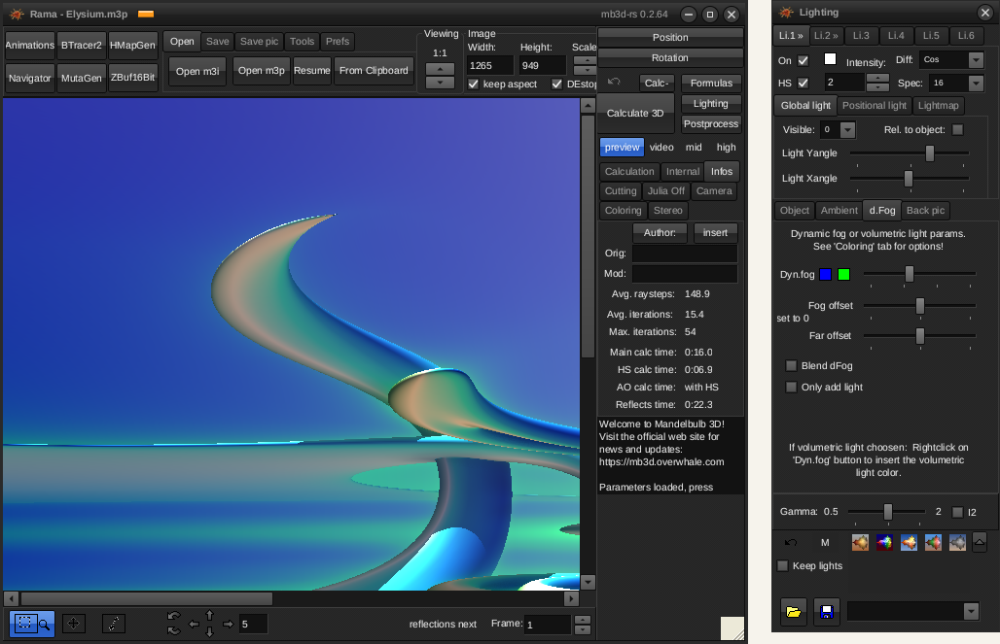</a>

  </details>
* **Zemia abò wòda** pòd (abò za) fraktalã, pòmësł z Mandelbulbera:
  płaszczëzna na sztót òsë X, Y abò Z, rechòwónô razã z fraktalã, z ji
  cyniama, òklùzją òtoczeniô, òdbiciama ë swiatłã Monte Carlo, w swòji farwie,
  gładkô abò z falama.

  <a href="../img/ground_water.jpg">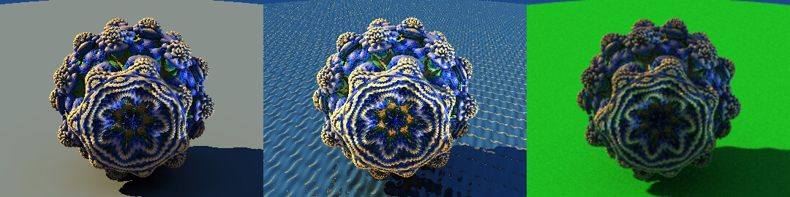</a>

  <details><summary>Czëtôj wicy</summary>

  Przédné òkno, starna *Òbcynanié*: zaznaczë *Zemia*, wëbierzë òsã ë
  pòłożenié, farwã, jak mòckò òdbijô (òd 0 do 1: zdrzadło, czej są rechòwóné
  òdbicé) ë wiżawã ë długòsc falów. Pełnô strona je wiedno ta dali òd kamerë.
  Je rechòwónô na graficzny karce ë na procesorze, a ekspòrtë wòkselów ë
  sécë ji nie mają. Mandelbulb3D ni mô na nią môla w swòjich parametrach:
  mb3d-rs zapisywô ją w môłim blokù za nima (w lopkach .m3p ë .m3i ë jakno
  `{mb3d-rs: ...}` za titlã tekstowëch parametrów), chtërnégò Mandelbulb3D nie
  czëtô. Klucze sceny `ground`, `ground_color`, `ground_reflect`,
  `ground_waves`; drobnotë w [TECHNICAL.md](../TECHNICAL.md#lights-volumetric-light-cutting-planes-depth-of-field).

  **Przezérnô wòda**: z *Wòda* wëżi 0 (wiele swiatła przepùszczô)
  fraktal zanurzony do pòłowë je widzec pòd wiéchrzëzną, przesëniãti
  przez załómanié (*Załómanié*: 1,33 dlô wòdë) ë z głãbòkòscą
  przechòdzący w farwã głãbòczi wòdë (knąpa farwë): *Absorpcja* gôdô, jak mùtny je (0 czësti, 3 mùtny), a w mòdrozelony wòdze
  czerwienô zanikô pierszô, tak że to, co zanurzoné, robi sã turkùsowé.
  Pòłësczi swiatłów na falach òstôwają na wiéchrzëznie. Zwëczajny render
  pòkazëje to z włączonyma òdbicama (Kùńcowô òbróbka), Monte Carlo
  wiedno; bez òdbiców wòda òstôwô nieprzezérnô. Klucze scenë
  `ground_transparency`, `ground_absorption`, `ground_water_color`,
  `ground_ior`; przikłôd w
  [CLOUDS_WATER.md](../CLOUDS_WATER.md#transparent-water).

  **Rozpraszanié** (rząd pòd *Załómanié*): wòda rozpraszô swiatło jak
  prôwdzëwô wòda. W stronã słuńca swiécy turkùsowò, wiérzchë fal
  przeswiécają, swiatło słuńca wpôdô w nią smùgama przecãtima cénią
  fraktala, a to, co pòd wòdą, swiécy łagòdno ji farwą; Monte Carlo
  sledzy swiatło rozpraszóné w wòdze. Drëdżé pòle to jegò czerënk (0,8:
  przédno do przódkù). 0 to wëzdrzatk bez niegò. Klucze scenë
  `ground_scattering`, `ground_scatter_dir`; zdrzë
  [CLOUDS_WATER.md](../CLOUDS_WATER.md#transparent-water).

  **Wëpróbùj**: na starnie *Òbcynanié* zaznaczë *Zemia* ë przepòwadzë ji
  wëższëzna przez fraktal, nastawi *Wòda* na 1, *Absorpcja* na 1 ë
  *Rozpraszanié* na 0,5, ë włączë òdbicô (*Òbróbka*, *Òdbicô +
  przezérnosc*, *Rechùj R. (+ T.) aùtomatno*); pózdze *Rechùj 3D*.

  Trzë gòtowé scenë do wlepienia, z jich nastôwama: [WATER_EXAMPLES.md](../WATER_EXAMPLES.md)

  *Wòda* (przezérnosc) 0, 0,5 ë 1:

  <a href="../img/water_transparency.jpg">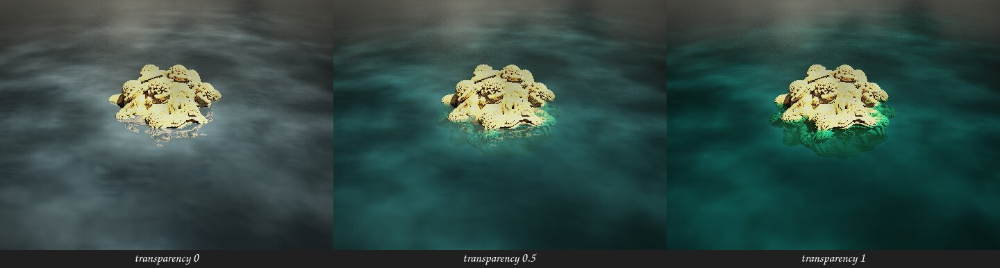</a>

  *Absorpcja* 0,3, 1 ë 3, òd czësti do mãtny:

  <a href="../img/water_absorption.jpg">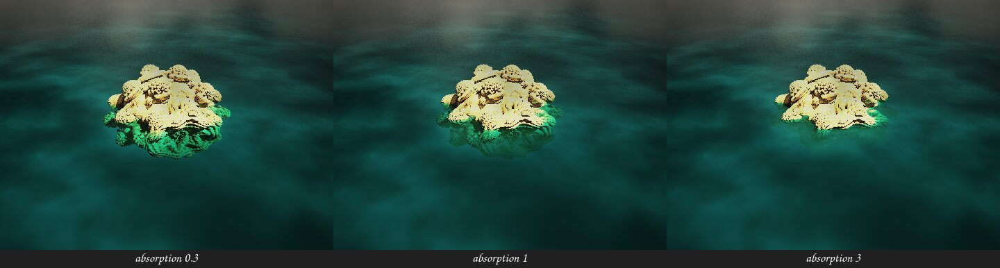</a>

  *Rozpraszanié* 0, 0,5 ë 1 przë patrzenim w stronã słuńca, ë smùgë
  swiatła przë niskim słuńcu z przódkù:

  <a href="../img/water_scattering.jpg">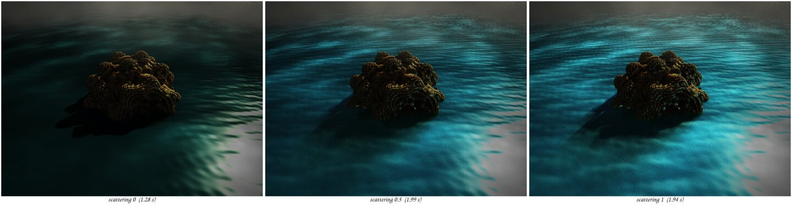</a>

  <a href="../img/water_shafts.jpg">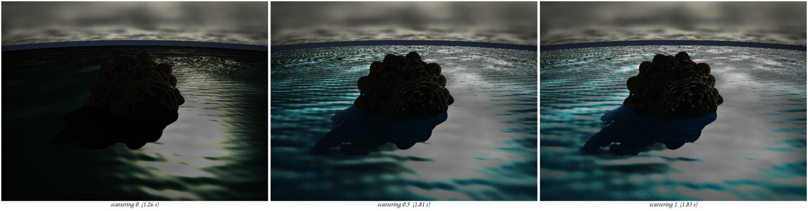</a>

  **Fale** to nieregùlarné mòrze szesnôstu falów wzdłëż jednégò kierënkù
  wiatru (przed 0.2.98 trzë regùlarné fale robiłë szachòwnicã; scenë z
  falama wëzdrzą òd tegò czasu jinaczi). Stôré (z lewi stronë kòżdi parë)
  ë nowé, môłé ë wiôldżé fale, słuńce z przódkù ë z tëłu:

  <a href="../img/water_waves.jpg">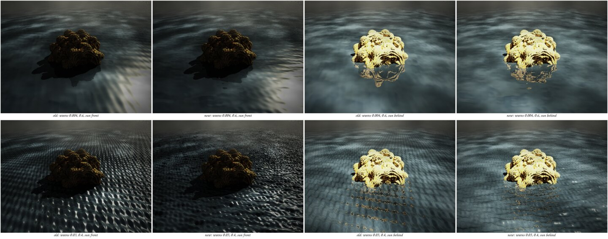</a>

  </details>
* **Swiatło z òbrazu HDR**: òbrôz Radiance 360° (`.hdr`) jakno spódk òswiecywô
  render Monte Carlo pełną jasnotą, a jegò słuńce stôwô sã swiatłã z miękczima
  cyniama (pòmësł z Mandelbulbera).

  <a href="../img/hdr_sun.jpg">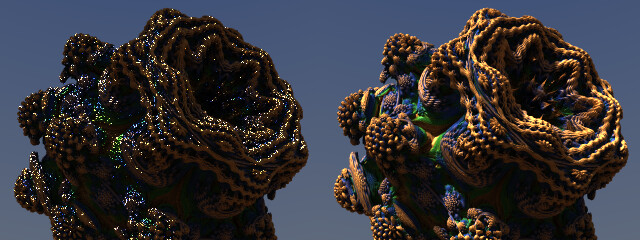</a>

  <details><summary>Czëtôj wicy</summary>

  Wëbierzë lopk `.hdr` jakno òbrôz spódkù w òknie *Òswiecenié* (nie
  „prosto”). Monte Carlo òswiecywô tedë scenã niebã, a nôjjaśniészé môle
  òbrazu, jegò słuńce, je wëjimóné ë dodóné jakno swiatło z cyniama wiôlgòscë
  słuńca: nalezoné le przëtrôfkã, słuńce òstôwiałobë jasné plamczi (z
  lewi). Òbrazë spódkù 8- ë 16-bitowé òstôwają taczé, jaczé bëłë.

  </details>
* **Òbrazë OpenEXR** do compositingù (Blender, Nuke, DaVinci Resolve): farwë
  zmiennoprzecynkòwé, nie òbcãté nad białim, z warstwama krëcô, głãbiznë ë
  normalnëch. *Zapiszë òbr.* > *OpenEXR* abò `mb3d -o òbrôz.exr` (téż z
  kafelkama ë rojã).

  <a href="../img/exr_layers.jpg">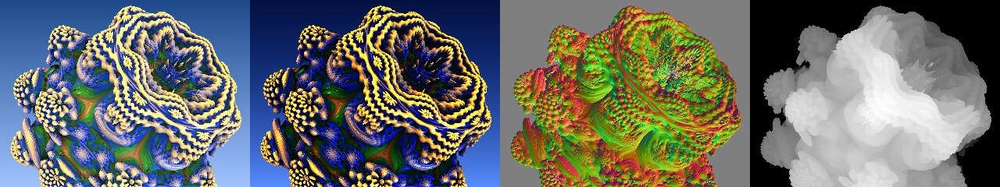</a>

  <details><summary>Czëtôj wicy</summary>

  Farwë są lëniowé, jak żdaje OpenEXR: pòkôzóné z zwëczajną krzëwą ekranu
  wëzdrzą jak PNG, a pòłësczi trzëmają jasnotã nad białim. Warstwë: `A`
  (krëcé, jak w przezérnym PNG), `Z` (òdległosc òd kamerë w jednotkach
  fraktala) ë `N.X`, `N.Y`, `N.Z` (normalné pòwierzchni). Drobnotë w [TECHNICAL.md](../TECHNICAL.md).

  </details>
* **Kamera rëbié òkò ë stereo 360° dlô VR** (pòmësłë z Mandelbulbera): rëbié
  òkò do 360° ë panoramë dlô brël VR z głãbizną w kòżdim kierënkù.

  <a href="../img/fisheye_water.jpg">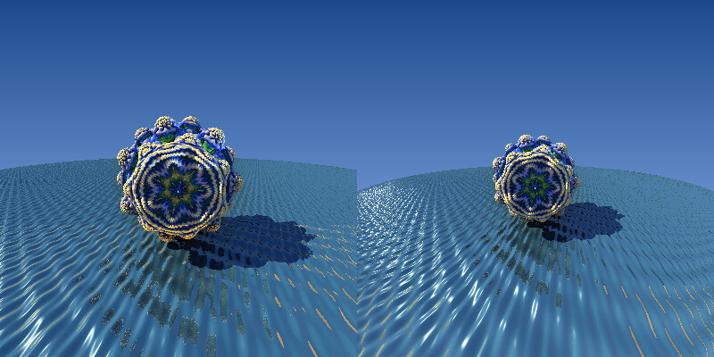</a>
  <a href="../img/vr_panorama.jpg">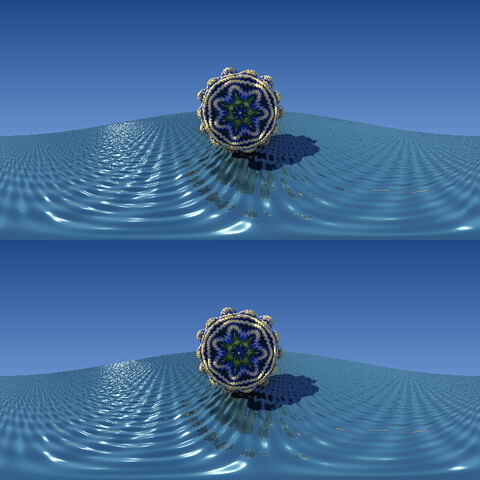</a>

  <details><summary>Czëtôj wicy</summary>

  Przédné òkno, starna *Kamera*: *Rëbié òkò* (pòle widzeniô, FOVy, do 360°,
  òbjimô wiżawã òbrazu; kwadratowi òbrôz pòkazywô òkrągłi widok). Panorama
  360° w stereo dôwô kòżdi promie swòjã pòzycjã òka, òbrócóną z kierënkã, w
  chtërnym zdrzi, tak że głãbizna je pòprawnô wkół:
  `mb3d -s optic=2 --stereo-pair top-bottom` zapisywô òbadwa òczë, lewé na
  górze, jak żdają òdgrëwôcze VR (òbrôz 2:1 na òkò). Òczë są 6,5 cm òd se, a
  òbzéróny pùnkt tak dalek jak òdległosc òbzéraniô stereo (drëgô wôrtnota
  `stereo_screen`, 2 m). Mandelbulb3D ni mô rëbiégò òka: blok mb3d-rs
  parametrów gò trzëmô.

  </details>
* **Wòlumetriczné chmùrë** (pòmësł z Mandelbulbera): warstwa chmùrów nad, pòd
  abò wkół fraktala, òswiecónô swiatłã sceny, przed fraktalã ë za nim.

  <a href="../img/clouds.jpg">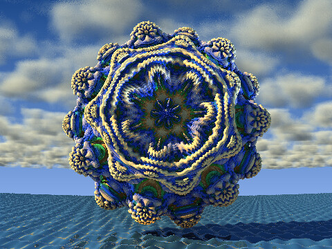</a>

  <details><summary>Czëtôj wicy</summary>

  Òkno *Pòstprodukcja*, dzél *Chmùrë*: zaznaczë *Malëjë chmùrë*, ùstawi warstwã
  (òsã ë dwie wiżawë), gãstosc, kùli nieba pòkriwają, wiôlgòsc ksztôłtów ë farwã,
  pòtemù *Malëjë terô*. Są malowóné na gòtowim òbrazu w dzélu sekùndë, tak że
  sprôwdzanié ùstawów je chùtczé; kòżdi piksel zdrzi przez warstwã do trafiony
  pòwierzchni. Animacjô mòże je rëszac (`cloud_offset` midzë klucznyma
  klatkama). Widzec je w òdbiciach, téż w Monte Carlo; Mandelbulb3D jich ni mô
  (blok mb3d-rs parametrów je trzëmô). Rzucają cenie na fraktal ë zemiã, téż zza òbrazu.

  </details>
* **Materiałë pòwierzchni** (pòmësłë z Mandelbulbera) na paletce: Fresnel (wicy
  òdbicô przë òstrim kące, jak szkło ë lakier), òpalizacjô (farwë cenczi warstwë)
  ë pòswiata.

  <a href="../img/material.jpg">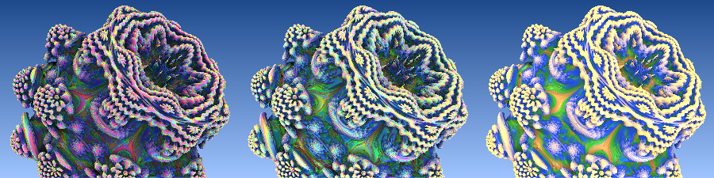</a>

  <details><summary>Czëtôj wicy</summary>

  Òkno *Pòstprodukcja*, dzél *Materiał*: zaznaczë *Materiał pòwierzchni*, ùstawi
  Fresnel (òd 0 do 1), òpalizacjã (òd 0 do 1 ë przesënienié ji farwów) ë
  pòswiatã, pòtemù *Malëjë terô*. Fresnel nôlepi widzec z rechòwónyma
  òdbiciama. Wëłączoné dają akùratno òbrazë Mandelbulb3D; zemia trzëmô swòjã
  farwã ë òdbicé. Téż w Monte Carlo.

  </details>
* **Dwa fraktale w jedny scenie** (pòmësł z Mandelbulbera): przë kòmbinacji DE
  drëdżi dzél hibridë mòże stojec òsóbno òd pierszégò, przesënióny, òbrócony ë
  przeskalowóny, złączoné, przecãté abò wëcãté.

  <a href="../img/two_objects.jpg">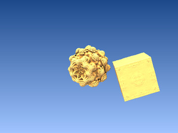</a>

  <details><summary>Czëtôj wicy</summary>

  Òkno *Fòrmùłë*, z wëbróną kòmbinacją DE: *Dzél 2 w* (jegò westrzódk),
  *Wiôlgòsc* ë *Òbrócony* (gradë wkół x, y ë z). Sëma (*Min*) stôwiô òbadwa
  òbiektë kòl se, przecãcé (*Max*) òstôwiô le wspólné, òdwrócony max wëcynô
  drëdżi z pierszégò, gładkô sëma je zlewô. Rechòwóné na graficzny karce ë
  procesorze; blok mb3d-rs parametrów trzëmô môle (Mandelbulb3D pòkazywô òbadwa
  dzéle w jednym môlu).

  </details>
* **Krzëwé animacji** (pòmësł z Mandelbulbera): wôrtnota scenë we wszëtczich
  klatkach animacji, a kluczné ùjęca jakno ùchwëtë do przecygniãcô.

  <a href="../img/curves.png"></a>

  <details><summary>Czëtôj wicy</summary>

  *Twòrzenié animacje* > *Krzëwé*: wëbierzë zoom, kòòrdinatã pòłożeniô, kąt
  òbrócenia, pòle widzeniô, Z pòczątkòwé, pòłożenié zemi abò dryft chmùrów ë
  òbôczë gò w kòżdi klatce tak, jak animacjô gò interpòlëje. Kluczné ùjęca to
  kwadratë na swòjich klatkach: przecygni jeden w górã abò w dół, abò klëknij
  ë wpiszë wôrtnotã. Kwadratowô interpòlacjô Béziera mijô kluczné ùjęca, a
  krzëwô pòkazywô to, nim cos òstanie wërenderowóné. Trzecô interpòlacjô, *Catmull-Rom* (nie je w MB3D), je gładkô ë przechôdô przez kòżdé kluczné ùjęcé (`mb3d animate --catmull-rom`).

  </details>
* **Wëkùńczenié òbrôzka**: ekspòzycjô, blask wkół jasnégò swiatła, filmòwé
  mapòwanié tónów, kòntrast, nasycenié, cepło, winieta ë farwné òbrzeżi
  òbiektiwù, jakno slédné przéńdzenié pò całim òbrôzkù.

  <a href="../img/finishing.jpg"></a>

  <details><summary>Czëtôj wicy</summary>

  Òkno *Pòstprodukcja*, dzél *Wëkùńczenié*: zaznaczë *Wëkùńczë òbrôzk*,
  ùstawi ekspòzycjã w stopniach EV, *Filmòwé* (jasné swiatło miękkò gasnie, a
  nié stôwô sã płaską bielą), blask (mòc, zasãg jakno dzél
  przekątny òbrôzka ë òd jaczi jasnotë swiécy), kòntrast, nasycenié, cepło,
  winietã ë farwné òbrzeżi, pòtemù *Malëjë terô*. Malowanié jidze tedë na
  lëczbach zmiennoprzecynkòwëch, tak że swiatło nad białim je trzëmóné do
  mapòwaniô tónów. Dzejô na kòżdi òbrôzk, klatkã animacji ë render Monte
  Carlo (pò filtrze szëmù); wëłączoné dôwô òbrôzczi akùratno taczé jak
  przódë. Klucze sceny `finish_exposure`, `finish_tonemap = filmic`,
  `glow = strength, radius, threshold`, `finish_contrast`,
  `finish_saturation`, `finish_warmth`, `vignette`, `chromatic`. We
  wiôldżim renderze z òsóbnëch òbrôzków kafelków kòżdi kafel swiécy sóm.

  </details>
* **Drobnô rzezba na pòwierzchni**: chropawô, kamień (grzbietë ë pãkniãcô)
  abò zôrno, drobniészô jak detal rechòwaniô, ze zmianą farwë.

  <a href="../img/relief.jpg"></a>

  <details><summary>Czëtôj wicy</summary>

  Òkno *Pòstprodukcja*, dzél *Materiał*: *Rzezba* z ji mòcą, wiôlgòscą
  ksztôłtów (w jednotkach fraktala, tak że òstôwô na pòwierzchni, czej kamera
  sã rësza) ë drobnotą, a téż *Zmiana farwë*. Nachilô pòwierzchniã tam, dze
  je rechòwóné swiatło, tak że cenie, pòłësczi, òdbicô ë Monte Carlo jã
  widzą; sóm ksztôłt sã nie zmieniô (òbrës òstôwô gładczi). Nie na zemi.
  Klucze sceny `detail = stone, 1.5, 0.12, 0.5` (zort, mòc, wiôlgòsc,
  drobnota) ë `detail_color`.

  </details>
* **Òbrotnice, nagróné lotë ë rozmëcé rëchù** w animacjach.

  <a href="../img/motion_blur.jpg"></a>

  <details><summary>Czëtôj wicy</summary>

  *Twòrzenié animacje* > *Òbrotnica*: òsmë klucznëch ùjãców jednégò całégò
  òbrotu wkół westrzódka widoku przédnégò òkna, gładkô pãtla
  (`mb3d animate scene.m3p --orbit 8 --frames 25`). *Nawigatór* > *Nagr*:
  pòczi knąpa je wcësniãtô, kòżdi nowi widok lotu (nôwicy dwa na sekùndã)
  stôwô sã nôslédnym klucznym ùjęcym; z Catmull-Rom animacjô przechôdô przez
  wszëtczé. *Rozmëcé rëchù* w Twòrzenim animacje: kòżdô klatka je strzédną
  z tëli òbrôzków w czasu *Migawczi* (dzélu czasu do nôslédny klatczi), tak
  że to, co sã rësza, sã rozmazywô; trwô to tëli razy dłëżi
  (`mb3d animate --motion-blur 8,0.5`).

  *Twòrzenié animacje* > *Szablonë animacje...* robi kluczowé klatczi z
  pòzdrzatkù głównégò òkna na czas w sekùndach (przë klatkach na sekùndã
  òkna): *Òrbita 360°* wkół wëbrany òsë (òd lewi do prawi, górą,
  przechilenié, wszëtczé trzë razã abò òs X, Y abò Z fraktala; `--orbit 8
  --duration 10 --orbit-axis pitch`) abò *Przelot*, w jaczim kamera leci
  dali w głãbiã fraktala, zoom jidze za òdległoscą, trzimô kùrs i skrãcô le,
  cobë òbińc to, w co bë ùderzëła (`--fly --duration 20`; `--duration 0`:
  jaż pòzdrzatk wëkôże le niebò abò le fraktal). *VR 360°* w Twòrzenié
  animacje (`--vr`) robi z kòżdi klatczi sferiwą panoramã (2:1); z *Renderuj
  stereo animacjã* wideo mô òczë jedno nad drëdżim (lewé na górze), a
  pòlecenié ffmpeg kùńczi sã na `mb3d vr360 video.mp4 --stereo tb`, jaczé
  znaczi MP4 jakno wideo 360 dlô YouTube, Meta Quest i VLC. Sferiwô panorama
  zapisónô jakno JPEG mô XMP Photo Sphere, tak że Facebook wëkazëje jã jakno
  òdjimk 360.

  <a href="../img/orbit_template.jpg"></a>

  <a href="../img/fly_through.jpg"></a>

  Szablonë animacje, fòtografie 360° ë filmë VR 360° dołożił Rathinagiri S
  ([SRathinaGiri](https://github.com/SRathinaGiri),
  [#30](https://github.com/thr32423/mb3d-rs/pull/30)). Òrbita trzimô kamerã
  w ti sami òdległoscë òd pùnktu òbrótu w kòżdi klatce, téż midzë kluczowima
  klatkama: pòstrzódk wëzdrzatkù je nôprzód stôwiony w pùnkce òbrótu, tak że
  kluczowé klatczi rozrézniają sã leno òbrótã. Dodónô pò jinszich kluczowich
  klatkach, kùńczi sã znowa swòją pierszą kluczową klatką, tak że òbrót je
  całi; *Zaczni òd* bierze wëzdrzatk przédnégò òkna abò slédną kluczową
  klatkã. Przelot je rëchòwóny w tle z paskã pòstãpù, a *Stop* trzimô to, co
  ju przeleconé. Filmë (dodóné do wëdaniô v0.2.100, zrobioné wersją pò nim):
  [òrbita z 4 kluczowima klatkama, pierszô wersjô ë dokładnô kòl
  se](https://github.com/thr32423/mb3d-rs/releases/download/v0.2.100/anim-templates-orbit-compare.mp4),
  [kòzłowanié](https://github.com/thr32423/mb3d-rs/releases/download/v0.2.100/anim-templates-tumble.mp4),
  [przelot](https://github.com/thr32423/mb3d-rs/releases/download/v0.2.100/anim-templates-fly-through.mp4),
  [òrbita VR
  360°](https://github.com/thr32423/mb3d-rs/releases/download/v0.2.100/anim-templates-vr360-orbit.mp4).
  Wszëtczé sztërë z rëszającymi sã òbrôzkama ë ùwôgama: [docs/ANIMATION_TEMPLATES.md](../ANIMATION_TEMPLATES.md).

  </details>
* **Gaussowsczé splatë** fraktala, do òbzéraniô z kòżdi stronë w
  Blenderze (5.3 ë nowszim), SuperSplat ë jinszich programach do splatów: *Bulb
  Tracer2* > *Gaussowsczé splatë...*, abò `mb3d splat scene.m3p -o fractal.ply`.

  <a href="../img/splats.jpg"></a>

  <details><summary>Czëtôj wicy</summary>

  Òkno ekspòrtëje scenã przédnégò òkna; jegò ùstawë są taczé jak w rédce
  pòlétów. Fraktal je rechòwóny z 16 kerënków (*Kerënczi*, `--views`), kòżdi
  to òbrôzk 640 x 640 pikselów (*Wiôlgòsc kòżdégò widoku*, `--size`), z jegò
  swiatłama, céniama, òkòlnyma céniama ë òdbiciama. Kòżdi piksel òbiektu
  stôwô sã płaską gaussowską plamą leżącą na pòwierzchni, z farwą, jaką mô na
  òbrôzkù. Tam, dze òbrôzczi na se zachôdają, kòżdi kawel pòwierzchni
  pòchôdô z tegò, chtëren gò widzôł nôbarżi na prosto. Farwë zmieniają sã
  z kerënkã, z jaczégò zdrzisz (sfericzné harmòniczi, *Farwë wedle kerënkù*,
  `--sh`), tak że pòłësczi rëszają sã jak na òbrôzkach.

  Òbiekt widzóny z bùtnowi stronë je rechòwóny wkół westrzódka scenë. Scena
  widzónô z nótrzë (zala, jama, dze fraktal wëpełniô całi òbrôzk) je
  rechòwónô z kamerë scenë, zdrzącë w kòżdim kerënkù (*Rechùjë z*,
  `--around camera`; *Aùto*, domëszlné, wëbiérô samò). Tam wikszi `--size`
  trzëmô wicy detalów, bò kòżdi widok je szeroczi na 110 gradów.

  Swiatła, co sã òbracają z kamerą, ë farwë górë ë dołu òkòlnégò swiatła są
  przëmòcowóné do òbiektu tak, jak òswiecywają widok scenë, tak że wszëtczé
  stronë są òswiecone równo. Głãbiô òstroscë, chmùrë, blask, winieta ë zemia
  są pòminãté. Lopk je w widokù scenë (x w prawò, y w òbrôzk, z w górã: przédny
  widok Blendera wëzdrzi tak jak scena), westrzódk abò kamera w 0, a fraktal
  przeskalowóny do prawidła 1. Biere kòl 160 bajtów na splat, zwëczajno 100
  do 300 MB; `--sh 0` zmniészô to do trzecégò dzélu, bez rëszającëch sã
  pòłësków.

  </details>

<a id="download"></a>

## Zladënk

Gòtowé do zrëszeniô programë z nôwnowszégò wëdaniô, bez instalacje:

| System | Zladënk |
|---|---|
| Windows (64 bit) | [mb3d-rs-windows-x64.zip](https://github.com/thr32423/mb3d-rs/releases/latest/download/mb3d-rs-windows-x64.zip) |
| Linux (64 bit) | [mb3d-rs-linux-x64.tar.gz](https://github.com/thr32423/mb3d-rs/releases/latest/download/mb3d-rs-linux-x64.tar.gz) |
| Debian, Ubuntu, Mint (instalëje sã jak jinszé programë) | [mb3d-rs-linux-x64.deb](https://github.com/thr32423/mb3d-rs/releases/latest/download/mb3d-rs-linux-x64.deb) |
| Fedora, RHEL, Rocky, openSUSE (instalëje sã jak jinszé programë) | [mb3d-rs-linux-x64.rpm](https://github.com/thr32423/mb3d-rs/releases/latest/download/mb3d-rs-linux-x64.rpm) |
| macOS, Apple silicon (M1 ë nowszé) | [mb3d-rs-macos-arm64.tar.gz](https://github.com/thr32423/mb3d-rs/releases/latest/download/mb3d-rs-macos-arm64.tar.gz) |
| macOS, Intel | [mb3d-rs-macos-x64.tar.gz](https://github.com/thr32423/mb3d-rs/releases/latest/download/mb3d-rs-macos-x64.tar.gz) |

Rozpakùjë ë zrëszë **Mandelbulb3D** (`Mandelbulb3D.exe` na Windowsu) w
rozpakòwónym katalogù. Katalog je ùłożony jak instalacjô MB3D, z
fòrmùłama ë mapama MB3D ë 80 przëkładowima lopkama parametrów.

* Jeżlë Windows pòkôże "Windows protected your PC", klikni *More info* ▸
  *Run anyway*.
* macOS blokùje zladowóné programë, jaczé nie są pòdpisóné: pùscë rôz
  `xattr -dr com.apple.quarantine .` w rozpakòwónym katalogù.

**Jinszô mòżlëwòsc dlô Linuksa ë macOS:** place zladowiwac rãczno, ta
jedna linijka cygnie nôwnowszé wëdanié do `~/mb3d-rs` (pùscë jã znowa
pózni, żebë zaktualizowac; skript [download.sh](../../download.sh) je téż w
katalogù programë):

```sh
curl -fsSL https://raw.githubusercontent.com/thr32423/mb3d-rs/master/download.sh | sh
```

Sprawdzô zladënk przed rozpakòwanim, dodôwô **Mandelbulb3D** do menu
aplikacjów (Linux) ë robi kòmandë `Mandelbulb3D` ë `mb3d`, jaczé mòżesz
wpisac w kòżdim katalogù. `sh ~/mb3d-rs/download.sh
--uninstall` rëmô zôpis z menu ë kòmandë; twòje lopczi
òstôwają.

Programë dlô Linuksa dzejają na distribucjach òd kòl 2018 rokù
(Ubuntu 18.04, Debian 10, Rocky/RHEL 8 ë nowszé).

**Zainstalowóné jak jinszé programë:** na Debianie, Ubuntu ë Mint òtemkni
lopk `.deb` wëżi (abò `sudo apt install ./mb3d-rs-linux-x64.deb`); na
Fedorze, RHEL ë Rocky lopk `.rpm` (`sudo dnf install
./mb3d-rs-linux-x64.rpm`, na openSUSE `sudo zypper install
./mb3d-rs-linux-x64.rpm`).
Mandelbulb3D je tedë w menu aplikacjów, a `mb3d` dzejô w kòżdim
katalogù; twòje nastawë ë History są trzimóné w `~/.config/mb3d-rs` ë
`~/.local/share/mb3d-rs`.

[Pierszé krokë](../../GETTING_STARTED.md) prowadzą przez zôczątk; starszé
wersje ë notë do wëdaniów są na starnie
[wëdaniów](https://github.com/thr32423/mb3d-rs/releases).

<a id="guides-and-help"></a>

## Pòrénczi ë pòmòc

Pòrénczi krok pò krokù są we [wiki](https://github.com/thr32423/mb3d-rs/wiki/Home-csb):

* [Instalacjô](https://github.com/thr32423/mb3d-rs/wiki/Installing-csb): Windows, macOS ë Linux, aktualizacjô, dze są twòje lopczi
* [Robòta z òswiecenim](https://github.com/thr32423/mb3d-rs/wiki/Lighting-workflow-csb): renderëj prosto, a pòtemù próbùj widë, cénie ë òdbicô
* [Nastôw roju](https://github.com/thr32423/mb3d-rs/wiki/Swarm-setup-csb): renderowanié na wielu kòmpùtrach przez dzelony katalog
* [Problemë ë FAQ](https://github.com/thr32423/mb3d-rs/wiki/Troubleshooting-and-FAQ-csb): czej cos nie dzejô tak, jak sã spòdzéwôsz

Kòżdé wëdanié z jegò zmianama: [całô lësta](../UPDATES.md).

<a id="rendering-on-several-computers-the-swarm"></a>

## Renderowanié na wielu kòmpùtrach (rój)

Kòmpùtrë, jaczé widzą jeden dzelony katalog, renderëją wespół: òbrôzk w
kachlach, Wiôldżi render, òbrôzk Monte Carlo, animacjã abò seriã. Kòżdi
kòmpùtr bierze dzéle, jaczich nicht jinszi ni mô, tak że chùtczi kòmpùtr
bierze jich wicy, a kòmpùtr, jaczi zaczął render, skłôdô rezultatë do
kùpë. Dzelenié robi katalog: programa nie òtmikô niżódnégò sécowégò
pòłączeniô ë z nikim nie gôdô, tak że je tak bezpiecznô, jak twòje
ùdostãpnianié lopków.

<a href="../img/swarm_window.png"></a>

<a id="setting-it-up"></a>

### Nastôw

Krok pò krokù z tim, co sprawdzëc: [Nastôw roju](https://github.com/thr32423/mb3d-rs/wiki/Swarm-setup-csb) we wiki.

1. **Katalog, do jaczégò kòżdi kòmpùtr mòże pisac:** ùdostãpnienié na
   NAS-u, ùdostãpnienié Windowsa, Samba abò NFS. Na Linuksu zamòntëjë gò
   jakno katalog, na przëkłôd
   `sudo mount -t cifs //192.168.0.10/Public /mnt/share -o username=me,uid=$(id -u),gid=$(id -g)`;
   ùdostãpnienié òtemkłé leno w menedżerze lopków (`smb://...`) nie je
   katalogã, jaczi programa mòże brëkòwac.
2. **Ta sama wersjô mb3d-rs na kòżdim kòmpùtrze.** Kòmpùtr z jinszą
   wersją je wëpisóny, ale nie bierze ùdzélu.
3. **W Mandelbulb3D:** knąpa **Rój** na karce Nôrzãdła. Wëbierzë
   dzelony katalog (to samò ùdostãpnienié na kòżdim kòmpùtrze; jegò
   stegna mòże bëc jinszô), daj kòmpùtrowi miono na lëstã ë zaznaczë
   **Dzelë nen kòmpùtr**.

To je wszëtkò. Linijka stanu gôdô, co sã dzeje, na przëkłôd *Dzelenié z
omarchy: renderë są dzeloné midzë 2 kòmpùtrë*. Czej w roju je sóm, wszëtkò
renderëje sã na tim kòmpùtrze jak zwëczajno.

<a id="what-is-shared"></a>

### Co je dzeloné

Pòkąd *Dzelë nen kòmpùtr* je zaznaczoné, kòmpùtr renderëje dzéle, jaczé
jinszé kòmpùtrë wkładają do katalogù, a jegò gwôsné renderë jidą do
roju, czej je w nim jaczi jinszi kòmpùtr:

* **Rechùj 3D** (ë òkno Serijné przerôbianié) — òbrôzk w N x M kachlach
  (nastawionëch w òknie Rój), skłôdóny tuwò ze wszëtczim, co dôwô
  zwëczajné rechòwanié: zmianë òswieceniô, pòstprodukcja, zapisywanié
  jakno m3i (ë jegò pamiãc, òbaczë niżi).
* **Wiôldżi render** — kachle są zapisywóné jedna pò drëdżi, tak jak
  przëchôdają; całi òbrôzk nigdë nie je trzimóny w pamiãcë, tak że to je
  droga do òbrôzków 100000 x 100000 pikselów ë wikszich.
* **Monte Carlo** — jak na jednym kòmpùtrze: kòżdi kòmpùtr dodôwô
  przebiedżi do swòjégò bloku, jaż naceskniesz Stop, òbrôzk sã czëszczi
  z parmieniama wszëtczich, a Stop ùsrzédniwô blokë. W serijnym tribie
  òkna blokë razã stôwają przë lëczbie parmieni serie.
* **Twòrzenié animacje** — klatczi, jedna pò drëdżi.

Òkno wëpisëje kòmpùtrë z jich jądrama, graficzną kartą ë tim, co kòżdi
robi, robòtë z jich pòstãpã ë pòdzérk nôwnowszi robòtë: wërenderowóné
kachle, te w robòce z paskã pòstãpù ë te, jaczich jesz felëje.

<a id="on-the-command-line"></a>

### W rédce pòlétów

Na kòżdim kòmpùtrze, jaczi mô pòmagac, zrëszë robòtnika na katalogù:

```sh
mb3d swarm worker /mnt/share/mb3d-swarm --name kitchen-pc
```

Pòtemù, na jaczim lubòsc kòmpùtrze, renderëjë z `--swarm` ë tim samim katalogã:

```sh
mb3d big.m3p --tiles 4x3 --swarm /mnt/share/mb3d-swarm
mb3d animate flight.m3a --swarm /mnt/share/mb3d-swarm
mb3d batch *.m3p -o pictures --swarm /mnt/share/mb3d-swarm
mb3d montecarlo scene.m3p --rays 256 --swarm /mnt/share/mb3d-swarm
```

`mb3d swarm list FOLDER` pòkazëje, chto je w roju, co kòżdi kòmpùtr
robi ë jak dalekò są robòtë. Òbrôzk Monte Carlo w rédce pòlétów je
dzelony na blokë z gwôsnyma przëtrôfkòwima parmieniama: 4 blokë pò 64
parmienie na piksel dôwają 256, ò jaczé pëtô `--rays 256`.

<a id="good-to-know"></a>

### Dobrze wiedzec

* **Czej jinszé kòmpùtrë stoją bez robòtë**, a jich lësta robòtów je
  pùstô, czej nen kòmpùtr renderëje: kòmpùtr, jaczi ùdostãpniwô katalog
  przez Sambã ë sóm gò brëkùje prosto, pòzwôlô jinszim trzëmac stôrą
  lëstã jegò zamkłoscë. Wëłączë to cache'owanié w `/etc/samba/smb.conf`:
  `smb3 directory leases = no` w `[global]`, a `oplocks = no` ë
  `level2 oplocks = no` w dzélu ùdostãpnieniô, pòtemù
  `sudo systemctl restart smb` ë zamòntëjë ùdostãpnienié znowa na
  jinszich kòmpùtrach.
* **Pamiãc:** òbrôzk zajimô w ti programie kòl 20 bajtów na piksel (jegò
  bùfor òbrôzka), 10 wicy w przédnym òknie, a pòtemù wikszi z dwùch
  etapów: przédné rechòwanié z jegò céniama ë òkòlnyma céniama (16 na
  piksel ë 1,2 GB dlô kartë) abò malënk (3 na piksel, 20 wicy z głãbią
  òstroscë ë jedno pasmò òdbiców: nôwicy 3,5 GB, mni, czej je mało wòlny
  pamiãcë, bò pasmò je dobiérzoné na pòłowã tegò, co je wòlné na zôczątkù
  przebiegù). Òbrôzk 12000 x 6000: 6 GB. Czej òbrôzk brëkùje wicy jak
  wòlnô pamiãc kòmpùtra (pëtónô ù Linuksa, Windowsa ë macOS), Rechùj 3D
  gôdô, kùli pamiãcë brëkùje ë kùli je wòlny, ë pëtô, nim zacznie:
  rechòwanié bë mùszało brëkòwac swapa, a programa bë mògła minutama nie
  òdpòwiadac. Wiôldżi render, sóm abò z rojã, je wińdzenim: jegò kachle
  są zapisywóné jedna pò drëdżi, całi òbrôzk nigdë nie je trzimóny.
  Rechùj 3D z rojã trzimô òbrôzk tuwò tak, jak zwëczajné rechòwanié
  (bez etapù przédnégò rechòwaniô, jaczi robią kòmpùtrë kachlów z
  pamiãcą kòżdi kachlë); kòmpùtr roju òstôwiô kachlã za wiôlgą na swòjã
  pamiãc jinszim.
* **Bezpiek:** kòmpùtr renderëje leno to, ò co robòta pëtô, ë pisze
  leno do katalogù robòtë; kòd fòrmùłë z robòtë dzejô w emùlatorze
  fòrmùłów jak kòżdô fòrmùła.
* **Chùtkòsc:** kachle jidą jakno pôłné bùforë òbrôzka, czile sta
  megabajtów dlô baro wiôldżégò òbrôzka, tak że chùtczi ùdostãpnienié sã
  òpłôcô. Ùsłëżnota synchronizacje, jakô kòpiérëje z òpòzdzenim, téż
  dzejô, ale pòwòlni.
* **Kòmpùtrë, jaczé òdchôdają:** dzél, jaczi kòmpùtr renderowôł, bierze
  jinszi, czej ò nim nie bëło czëc przez pół minutë. Robòtã, czëji
  gòspòdôrz zniknął na pół gòdzënë, rëmô ten, chto jã ùzdrzi. Robòta,
  jakô sã nie ùdô na jednym kòmpùtrze, je òznaczonô w òknie ë zostôwionô
  jinszim.
* **Zatrzëmiwanié:** òdznaczenié *Dzelë nen kòmpùtr* pòzwôlô nôpierwi
  skùńczëc dzél w robòce; zamkniãcé programë gò òpùszczô, a bierze gò
  jinszi kòmpùtr.
* **Zatrzëmanié robòtë** (Stop na kòmpùtrze, jaczi jã zrobił, abò jegò
  zamkniãcé, abò czej sã zwali): kòżdi ju skùńczony dzél òstôwô na tim
  kòmpùtrze, a kòżdi kòmpùtr trzimô dzél, jaczi renderowôł. Zrëszenié
  tegò samégò renderu znowa robi robòtã leno z felëjącëch dzélów, a
  kòmpùtr, jaczi dostónie nazôd dzél, jaczi bëł zaczął, kòntinuëje gò.
  Tak samò to dzejô w rédce pòlétów: pùscë tã samã kòmandã jesz rôz.
  Render Monte Carlo bez kùńca (ten z òkna) skłôdô swòje blokë, czej je
  zatrzëmóny, jak wczasni.

<a id="how-the-rendering-works"></a>

## Jak dzejô renderowanié

Fraktalny òbrôzk je rechòwóny piksel pò pikselu: dlô kòżdégò piksela
parmiéń jidze w scenã, jaż trafi w wiérzch fraktala, a fòrmùła je
rechòwónô dzesątczi razy przë kòżdim krokù. MB3D robi to na procesorze,
brëkùjącë wszëtczich jegò jąder. mb3d-rs mòże robic to samò, a mòże téż
dac robòtã **graficzny karce**, jakô mô tësące môłëch procesorów ë je
zbùdowónô prawie do taczi robòtë.

Nastawa **„Rechùj na”** (karta Bënowé w przédnym òknie) wëbiérô:

| | |
|---|---|
| **Aùto** (domëslno) | Karta ë procesor dzelą sã òbrôzkã: karta bierze rédë òd górë, wątczi procesora òd dołu, jaż sã zéńdą. Cwiardé cénie ë òkòlné cénie są dzeloné tak samò abò robi je sama karta, czej je wëjimno chùtszô. |
| **CPU** | Leno procesor, jak w MB3D. |
| **Graficznô karta** | Leno karta (żdże, jaż jejé programa bãdze rëchtowô). |

Pierszi rôz, czej je brëkòwónô jakô kòmbinacjô fòrmùłów, drajwer
grafiki mùszi przërëchtowac programã dlô kartë — *shader* — co na
kòmpùtrze zmierzonym niżi trwô 10 do 15 sekùndów. W tribie Aùto procesor
prosto zaczinô bez niegò, a karta dołączô, czej je rëchtowô, tak że môłi
òbrôzk nigdë nie żdże. Przërëchtowóny shader je trzimóny na drëdżi rôz
(przez drajwer grafiki, na Linuksu w katalogù `ShaderCache` kòl
programë), tak że nôslédny òbrôzk z tima samima fòrmùłama zaczinô na
karce zarô.

**Diodka LED** z prawa òd titla òkna gôdô, dze bëł rechòwóny slédny
òbrôzk: zelonô na graficzny karce, òranżowô w dzélu, czerwiónô na
procesorze. Wskôzanié jã mëszą pòkazëje detale.

[Jak dzejô renderowanié](../RENDERING.md) òpòwiôdô całą historiã z
òbrôzkama: co Aùto robi pierszi rôz, czemù karta nie je wiedno chùtszim
wëbòrã ë co znaczą farwë diodczi LED.

Nié wszëtkò mòże jic na kartã: czile fòrmùłów nie da sã dlô ni
przełożëc, a pòzdrzatczi baro głãbòkò zblëżoné są rechòwóné w dëbeltny
precyzje (co mògą leno niejedné kartë). Programa decyduje ò tim wszëtczim sama; widzysz to leno w
LED.

<a id="speed"></a>

## Chùtkòsc

Wszëtczé miarë na jednym kòmpùtrze: AMD Ryzen 9 3900X (12 jąder, 24
wątczi) z NVIDIA GeForce RTX 2060, na Linuksu. Òriginalné
**Mandelbulb3D 1.99sr37** bëło zrëszoné na ti sami maszinie pòd Wine (jegò
programa dlô Windowsa dzejô tam bez zmianów, z pôłną chùtkòscą, na
wszëtczich jądrach) ë mierzoné òd klëkniãcô *Rechùj 3D* do gòtowégò
òbrôzka. Kòżdi lopk parametrów bëł renderowóny w ti sami wiôlgòscë
òbrôzka przez wszëtczé trzë: MB3D, mb3d-rs leno na procesorze (**CPU**)
ë mb3d-rs w tribie **Aùto** (graficznô karta ë procesor razã). Czasë Aùto
są z drëdżégò renderu lopka, z ju przërëchtowónym shaderã kartë; pierszi
render nowi kòmbinacje fòrmùłów dodôwô 10–15 s rëchtowaniô shadera na ti
karce.

<a id="mb3ds-80-example-parameter-files"></a>

### 80 przëkładowëch lopków parametrów MB3D

Przëkładowé lopczi, jaczé przëchôdają z MB3D (ë w katalogù
`M3Parameter` ti programë), kòżdi w swòji wiôlgòscë òbrôzka.

MB3D nie mògło wërechòwac jednégò z lopków (*Test8*: stôwô z felą „Division by zero”), tak że zestôwczi rechùją 79 lopków.

* **mb3d-rs sóm na procesorze je chùtszé jak MB3D** w 71 z 79 lopków, w mediane **1,7 razy**; wszëtczé lopczi razã zabrałë MB3D 18 min 21 s, a mb3d-rs na procesorze 17 min 10 s.
* **Trib Aùto** je chùtszi jak MB3D w 77 z 79 lopków (mediana 2,1 razy); wszëtczé lopczi razã 8 min 17 s. W 30 lopkach procesor skùńcził sóm, nôczãscy dlôtegò, że brëkùje leno czile sekùndów, nim karta przińdze do robòtë — tam Aùto je prosto procesorã z chwilą narzutu. Karta dołączëła w 49 lopkach, tëch pòwòlniészich, dze zrobiła òbrôzk w mediane 1,6 razy chùtszi jak procesor (do 13 razy: *Insect Menger*, 4.7 s place 63.0 s).
* W 4 lopkach Aùto bëło wëjimno pòwòlniészé jak sóm procesor (*Ellarien - Shrooms are coming*, *MengerTrees*, *toricaleggs*, *TreePlanet*): tam karta je dlô ti scenë pòwòlniészô jak 24 wątczi procesora.
* „Rédë na karce” to je dzél òbrôzka, jaczi graficznô karta przeszła w tribie Aùto (–, czej procesor skùńcził sóm).

<details>
<summary>Wszëtczé 80 lopków (klikni, żebë òtemknąc)</summary>

| Lopk parametrów | MB3D (Wine) | mb3d-rs CPU | mb3d-rs Aùto | rédë na karce | Aùto vs MB3D |
|:--|--:|--:|--:|--:|--:|
| 0Encrypted0 - ABoxSOff4d example | 12.8 s | 7.4 s | 1.9 s | 80 % | 6.7× |
| 6 AM - Torii temple | 23.0 s | 20.4 s | 17.8 s | 60 % | 1.3× |
| Abominog-Ua - 12.06.2014 | 7.6 s | 8.0 s | 7.4 s | 50 % | 1.0× |
| ABoxPartlyJuliaRoff | 2.5 s | 1.4 s | 1.6 s | – | 1.6× |
| ABoxScale2Start | 1.0 s | 0.1 s | 0.3 s | – | 3.3× |
| ABoxScale3Start | 1.5 s | 0.1 s | 0.3 s | – | 5.0× |
| AboxShapes-Misty | 27.5 s | 25.6 s | 17.7 s | – | 1.6× |
| Aexion 10bulbs | 11.5 s | 9.8 s | 2.6 s | 73 % | 4.4× |
| AkuraPare - 463b | 4.0 s | 2.0 s | 0.7 s | 72 % | 5.7× |
| ApolloBalloons dIFS | 75.8 s | 73.2 s | 24.9 s | 57 % | 3.0× |
| AureliusCat - Bamboo | 2.0 s | 1.2 s | 0.7 s | 58 % | 2.9× |
| BatJorge - Pong 703 - Swirls | 4.0 s | 2.8 s | 3.1 s | – | 1.3× |
| Bill-Snowzell - Tweak - Canyon | 4.0 s | 1.6 s | 1.7 s | 44 % | 2.4× |
| Blood on the dancefloor | 7.6 s | 4.4 s | 3.2 s | – | 2.4× |
| BulboxCut | 4.0 s | 2.3 s | 2.3 s | – | 1.7× |
| Chrystal | 5.6 s | 5.2 s | 1.7 s | 79 % | 3.3× |
| cutted sphere over carpet | 7.1 s | 20.7 s | 4.5 s | 48 % | 1.6× |
| Dainbramage - Home of the Ancients | 3.0 s | 1.3 s | 1.2 s | 25 % | 2.5× |
| Dainbramage - Hydra | 3.5 s | 1.7 s | 1.6 s | 41 % | 2.2× |
| Dainbramage - Nothing left but bones | 4.0 s | 3.0 s | 2.4 s | 49 % | 1.7× |
| DEcomb1 | 83.9 s | 93.5 s | 80.3 s | 48 % | 1.0× |
| dIFS heart shrub | 2.5 s | 3.5 s | 3.0 s | – | 0.8× |
| dIFS heart shrub otrap | 5.1 s | 15.6 s | 3.6 s | 93 % | 1.4× |
| dIFS shrub | 4.0 s | 17.3 s | 3.6 s | 93 % | 1.1× |
| Dodeca Torus mix | 2.0 s | 0.5 s | 0.6 s | 14 % | 3.3× |
| DsyneGrafix - Getting Loopy | 2.0 s | 0.8 s | 0.8 s | 25 % | 2.5× |
| Ellarien - Embellished | 3.5 s | 1.1 s | 1.2 s | 49 % | 2.9× |
| Ellarien - Shrooms are coming | 8.1 s | 6.2 s | 6.8 s | – | 1.2× |
| ExcludeBulbMeng | 17.3 s | 12.9 s | 8.5 s | – | 2.0× |
| Fishbowl | 4.6 s | 3.5 s | 1.9 s | 49 % | 2.4× |
| Fractales75 - Kiosk | 3.0 s | 1.8 s | 1.9 s | 47 % | 1.6× |
| Genetic Menger | 1.5 s | 0.5 s | 0.6 s | 46 % | 2.5× |
| genQuat helix mix | 4.0 s | 3.3 s | 1.8 s | 61 % | 2.2× |
| HalTenny - Freak Of Nature | 2.5 s | 0.9 s | 1.2 s | – | 2.1× |
| Hal-Tenny-Resistance (slow) | 18.9 s | 20.3 s | 8.7 s | 78 % | 2.2× |
| Hyperben2 - Ozosphere tweak | 2.0 s | 0.8 s | 0.6 s | 56 % | 3.3× |
| ImpossibleWorld dIFS | 399.8 s | 367.5 s | 99.0 s | 71 % | 4.0× |
| InAndOutside box | 5.1 s | 2.7 s | 1.4 s | 68 % | 3.6× |
| Insect Menger | 4.0 s | 63.0 s | 4.7 s | 93 % | 0.9× |
| Jost1 - Tweak - New tiny temple | 3.5 s | 1.6 s | 1.0 s | 60 % | 3.5× |
| julia on box | 4.6 s | 4.0 s | 1.6 s | 73 % | 2.9× |
| JuliaSetSample | 3.0 s | 1.9 s | 2.2 s | – | 1.4× |
| KentPress - Parameter 3 tweak fogits | 4.0 s | 2.5 s | 3.0 s | – | 1.3× |
| KochSurf Sample 6 | 3.0 s | 1.4 s | 0.8 s | 75 % | 3.8× |
| Lenord - ASurf 2 | 5.1 s | 1.7 s | 1.9 s | 48 % | 2.7× |
| Lenord - Between Dark and Light | 5.6 s | 3.8 s | 2.1 s | 60 % | 2.7× |
| Lenord - The Beanstalk | 3.5 s | 1.8 s | 2.0 s | – | 1.8× |
| LightBulbMoon - A Fabulous Excuse | 3.5 s | 2.0 s | 1.6 s | – | 2.2× |
| LightBulbMoon - No, Never | 5.1 s | 4.0 s | 1.2 s | 82 % | 4.2× |
| Mandelwerk - Makin seashell | 12.0 s | 8.1 s | 8.1 s | 30 % | 1.5× |
| Mandelwerk - TgladTetra inner spirals | 8.6 s | 4.5 s | 1.1 s | 80 % | 7.8× |
| MarkJayBee - Curvichrome | 2.5 s | 1.3 s | 1.3 s | – | 1.9× |
| material colors | 3.0 s | 1.4 s | 1.9 s | – | 1.6× |
| Melting spot bloxx | 23.2 s | 20.4 s | 7.6 s | 73 % | 3.1× |
| Mengerplus for MC | 3.5 s | 2.2 s | 2.5 s | – | 1.4× |
| MengerTrees | 19.3 s | 15.4 s | 16.9 s | – | 1.1× |
| MutaGenD4B12E71C70D4FD00357_canary~ | 7.1 s | 3.7 s | 4.1 s | – | 1.7× |
| Oxnot - Flexing | 2.5 s | 0.7 s | 0.7 s | 59 % | 3.6× |
| Oxnot - Shells | 5.6 s | 3.3 s | 3.6 s | – | 1.6× |
| PaMonk - Ringlets | 5.1 s | 2.7 s | 2.8 s | – | 1.8× |
| QuatP4hybridJulia | 1.5 s | 0.2 s | 0.4 s | – | 3.8× |
| Rama - Elysium | 11.5 s | 10.6 s | 5.5 s | 74 % | 2.1× |
| Recycledrelatives - Fractal Fan | 2.0 s | 0.4 s | 0.6 s | 31 % | 3.3× |
| Recycledrelatives - Test for SurfMod | 4.6 s | 3.0 s | 3.1 s | – | 1.5× |
| Rowratty - Spirals | 4.0 s | 2.5 s | 1.0 s | 69 % | 4.0× |
| Sabine62 - Housing problem | 11.7 s | 10.5 s | 6.8 s | – | 1.7× |
| spineJulia | 91.9 s | 71.7 s | 50.7 s | 35 % | 1.8× |
| Surreal shell | 2.0 s | 0.6 s | 0.8 s | – | 2.5× |
| Test8 | fela w MB3D | 0.1 s | 0.3 s |  | – |
| Theli-At - Black Mandelbulb | 1.0 s | 0.2 s | 0.5 s | 22 % | 2.0× |
| Theli-At - Bone Menger using MH | 2.0 s | 0.7 s | 1.1 s | – | 1.8× |
| Theli-At - MengerSpheres | 2.0 s | 0.6 s | 0.6 s | 50 % | 3.3× |
| ThePearl dIFS | 2.5 s | 1.4 s | 1.2 s | 25 % | 2.1× |
| TimeMachine | 1.0 s | 0.5 s | 0.7 s | – | 1.4× |
| toricaleggs | 8.6 s | 5.6 s | 6.6 s | 40 % | 1.3× |
| TreePlanet | 7.6 s | 6.6 s | 7.5 s | – | 1.0× |
| UndeadAcademy tweak - Peacock in blue | 7.6 s | 4.5 s | 1.2 s | 74 % | 6.3× |
| Virtual tubes world (UndeadAcademy style) | 9.1 s | 6.9 s | 4.3 s | 49 % | 2.1× |
| Wada basin - Reflect test | 6.6 s | 4.1 s | 4.6 s | 40 % | 1.4× |
| Waste-and-tragedy - Mandalex | 5.1 s | 3.4 s | 3.8 s | – | 1.3× |

</details>

Òbrôzczi są te same: mb3d-rs na procesorze robi òbrôzk MB3D z
dokładnoscą do zaòkrąglenia, a òbrôzczi Aùto różnią sã òd procesorowëch
strzédno ò ùłómk procentu zakresu farwów (drobné detale mògą sã
skrzëc w jinëch pikselach; [techniczné notë](../TECHNICAL.md)
mają miarë).

<a id="experimental-speed-ups"></a>

### Eksperimentalné przëspieszenia

Czile chùtszich spòsobów rechòwaniô krzynã zmieniwô òbrôzk, tej są
wëłączoné, jaż të je nie włączësz: karta **Bënowé** →
**Eksperimentalno...**, zaznaczë *Brëkùj eksperimentalnëch przëspieszeniów*,
a pòtemù te, chtërne chcesz. Òne są zapisywóné razã ze sceną (tak brëkùją je
téż rédka pòlétów, rój ë asystent AI); w rédce pòlétów `-s experimental=on`
z `-s step_relax=1.3`, `-s secant_search=on`, `-s free_steps=on`,
`-s occlusion_half=on` abò `-s cone_march=on`.
Programa trzimô twój wëbiér òd jednegò zrëszeniô do drëgòwò, téż dlô lopków, jaczé òtmëkôsz.

Zmierzoné na 80 przëkładowëch lopkach w tribie Aùto (kòl 0,4 megapikselów,
chùtszi z dwóch renderów kòżdégò), w zestôwkù z timi samima lopkama bez nich:

| Przëspieszenié | Całi render | Òbrôzczi (piksele, co sã różnią ò wicy jak 8 z 255) |
|---|---|---|
| **Wëdłużenié krokù 1,3**: dłëgszé kroczi marszu, za dalek zrobiony krok je pòwtôrzóny | −5 % (mediana), do −20 %; 62 z 80 chùtszé | mediana 2,6 %; drobné cenienié. *Cenczé skòrëpë mògą miec dzurë* (BatJorge – Pong 703 – Swirls) |
| **Szukanié pòwierzchni metodą secznëch** | −2 % (mediana), do −18 % | mediana 0,7 %; drobné detale krzynã sã przesuwają |
| **Bez lëmitu krokòw bez dinamiczny mgłë** | −1 % (mediana), do −30 % w òtemkłëch scenach | nôczãscy ten sam òbrôzk (mediana 0,03 %) |
| **DE occlusion przë pòłowie rozdzélnoscë** | −18 % w 10 lopkach z DE occlusion (DEcomb1 −24 %); ten etap do 4 razy chùtszi | 0–27 % pikselów, miãkszô òkluzjô w drobnëch detalach; wëzdrzi tak samò |
| **Stożkòwi marsz**: grëbi parmiéń na blok piksli, marsz kòżdégò piksla zaczinô sã tam, gdze sã zatrzimôł | marsz −20 % (mediana −22 %) na procesorze, do −66 % w òtemkłëch scenach (68 z 69 chùtszé); na karce całé renderë òtemkłëch scen do −47 % | mediana 1,0 %, tëli, jak zmieniwô gwôsny przëpôdkòwi pierszi krok marszu; *0.2.92 mògł gùbic cenczé dzéle tam, gdze szacënk òdległoscë je za wiôldżi; pòprôwioné w 0.2.93* |

Nim zaùfôsz jednémù z nich przë òbrôzkù, pòrównôj z renderã bez nich.

<a id="the-command-line"></a>

## Rédka pòlétów

`mb3d` renderëje bez òkna. Òtemkni terminal w katalogù programë
(na Windowsu wiérsz pòlétów w rozpakòwónym katalogù, ë wpisëjë `mb3d`
place `./mb3d`). Pò jednolinijkòwi instalacji na Linuksu abò macOS `mb3d`
dzejô w kòżdim katalogù, `man mb3d` pòkazëje jegò pòrénk, a klawisz Tab
dopòwiôdô jegò òpcje w bash, zsh ë fish:

```sh
./mb3d "M3Parameter/6 AM - Torii temple.m3p" -o torii.png      # full size
./mb3d "M3Parameter/6 AM - Torii temple.m3p" --scale 0.25 -o small.png
./mb3d pasted.txt -o pasted.png        # parameters copied from a forum post
./mb3d City.m3p --tiles 4x4 -o city.png    # a big picture in tiles
./mb3d resume                              # stopped renders: the same command continues
./mb3d --cpu City.m3p -o city.png          # processor only
./mb3d --card City.m3p -o city.png         # graphics card only
./mb3d City.m3p --bits 16 -o city16.png    # 16 bit colour
./mb3d City.m3p --denoise 4 -o city.png    # with the noise filter
./mb3d City.m3p --aa 2 --transparent -o city.png   # transparent background
./mb3d City.m3p -o - | display -          # the picture into another program
./mb3d --help                              # all options
```

Wszëtkò jinszé mô pòdkòmandã z gwôsnym `--help`:

```sh
./mb3d batch M3Parameter --scale 0.2 -o previews        # a whole folder
./mb3d animate start.m3p middle.m3p end.m3p --frames 60 -o frames
./mb3d animate project.m3a -o frames                     # MB3D animations
./mb3d animate project.m3a -o frames --transparent      # ... see-through
./mb3d animate project.m3a -o frames --video flight.avi  # ... and a video
./mb3d montecarlo scene.m3p --rays 64 -o mc.png
./mb3d montecarlo scene.m3p --rays 8 --denoise -o mc.png # ... with the noise filter
./mb3d voxel scene.m3p -o voxels --slices 256            # for 3D printing
./mb3d mesh scene.m3p -o object.stl                      # Bulb Tracer 2
./mb3d splat scene.m3p -o fractal.ply                    # Gaussian splats
./mb3d mutagen scene.m3p -o muta                         # 15 variations
```

Fòrmùłë ë mapë są szukóné kòl programë; te z jinszi instalacje MB3D
mòżna pòdac z `--formulas` ë `--maps`.
Animacje są MB3D: klatczi klëczowé z interpolacją MB3D, projektë `.m3a`
òtmikóné ë zapisywóné, klatczi pisóné jak w MB3D, tak że przerwónô
animacjô jidze dali, a czile kòmpùtrów mòże sã nią pòdzelëc.

<a id="good-to-know-1"></a>

## Dobrze wiedzec

* **Te same òbrôzczi, nié bit w bit.** MB3D rechòwało w 80-bitowi
  precyzje stôrëch x87; ta programa brëkùje dzysdniowi 64-bitowi. Òbrôzczi
  pasëją w kòżdi strukturze, ale pòjedinczé piksle mògą sã różnic w
  slédny cyfrze farwë. Renderë Monte Carlo ë MutaGen brëkùją swòjich
  gwôsnëch przëtrôfkòwëch lëczbów, tak że jich rezultatë nie są taczé jak w
  MB3D.
* **Òbrôzczi graficzny kartë** różnią sã czësto òd procesorowëch
  (pòjedinczô precyzjô); w baro drobnëch detalach skrzenié mòże padac
  na jinszé piksle. Głãbòczé zoomë przełączają sã same na dëbeltną
  precyzjã.
* **Chùtkòsc na procesorze** je blëskô MB3D: maszinowi kòd fòrmùłów z
  lopków `.m3f` MB3D bëł przełożony tak, żebë dzejôł na kòżdim
  procesorze (téż Apple Silicon), za môłą cenã; samò ray marching
  je chùtszé. Òbaczë tabelë wëżi. Na Linuksu ë Windowsu fòrmùłë
  hibridu scenë są téż kòmpilowóné razã w jedną fùnkcjã, czej òbrôzk
  zaczinô (w czile milisekùndach, z Cranelift), tak że przekazëją
  swòje wôrtnotë w registrach procesora.
  Razã z chùtszą pãtlą pò fòrmùłach (na kòżdim systemie) renderë CPU
  80 przëkładowëch lopków trwają ò 20 % krócy jak w v0.2.74 (w niejednëch
  do 60 %), a òbrôzczi są te same do bita. Scena trzimô skòmpilowóny hibrid leno, czej
  wëchôdô chùtszi; `MB3D_NO_JIT=1` gò wëłącziwô. Na macOS je téż
  włączony, ale tam jesz je testowóny: `./jit_check.sh` w rozpakòwónym
  katalogù gò sprawdzô (zestôwiô
  skòmpilowóné fòrmùłë z przełożonyma ë renderëje przëkładowé lopczi z
  nim ë bez niegò; òbrôzczi mùszą bëc te same).
* **Wiôldżé òbrôzczi** mòżna renderowac w jednym kawôłkù (òbrôzk 15000 x
  20000 brëkùje kòl 15 GB pamiãcë; z głãbią òstroscë trwô to gòdzënë)
  abò w kachlach, téż na wielu kòmpùtrach (`--tiles` ë òkno Wiôldżé
  renderë), co brëkùje mni pamiãcë. Rechùj 3D nie zaczinô òbrôzka,
  jaczi nie wlézie do wòlny pamiãcë (na Linuksu, dze wòlną pamiãc
  mòżna pòznac) ë ò tim gôdô, a kòmpùtr roju òstôwiô kachlã za wiôlgą na
  swòjã pamiãc jinszim.
* **Nieskùńczoné renderë** są trzimóné w katalogù pamiãcë pòdrãczny (`~/.cache/mb3d-rs/resume`,
  na Windowsu `%LOCALAPPDATA%\mb3d-rs\resume`, abò kòl programë):
  18 bajtów na piksel dlô òbrôzka (òbrôzk 15360 x 15360 zajimô 4,2 GB),
  64 dlô renderu Monte Carlo. To, co bëło wërechòwóné, je zapisywóné zarô
  a co 5 minut gwës zapisóné na disk. Render zatrzëmóny w pierszich 10
  sekùndach nick nie trzimô; nieskùńczoné renderë starszé jak 30 dni są
  rëmóné, a téż nôstarszé, czej wszëtczé razã zajimają wicy jak 50 GB.
  Render jidze dali leno z tima samima parametrama ë wersją programë (ë
  tim samim wëbòrã kartë abò procesora; ekspòzycjô ë nasycenié renderu
  Monte Carlo mògą sã zmienic). Render Monte Carlo òstôwô nieskùńczony,
  pòkąd nie dobãdze swòjich parmieni (seriô, `--rays`, `--passes`) abò
  nie bãdze rëmniãti z lëstë Kòntinuùj.
* **Nowszé abò twòje gwôsné fòrmùłë, mapë, témë ë jãzëczi** jidą do
  `~/.local/share/mb3d-rs/M3Formulas`, `.../M3Maps`, `.../Themes` ë `.../Languages`
  (przë kòżdim spòsobie instalacje; na Windowsu `%APPDATA%\mb3d-rs\...`). Są
  brëkòwóné òkróm tëch, jaczé
  przëchôdają z programą, ë zastãpiwają dostôwiony lopk z tim samim
  mionã, tak że zaktualizowónô fòrmùła z fòrów dzejô bez dotikaniô
  katalogù programë.

<a id="updates"></a>

## Aktualizacje

Kòżdé wëdanié z jegò zmianama je wëpisóné w [UPDATES.md](../UPDATES.md) (pò anielskù).

<a id="for-developers"></a>

## Dlô programistów

[Techniczné notë](../TECHNICAL.md) òpisëją, jak je brëkòwónô graficznô
karta, co ë jak bëło przeniesoné z zdrojów MB3D w Delphi, trzë
spòsobë ùrëchòmieniô maszinowégò kòdu fòrmùłów MB3D, fòrmat lopka scenë
ë jegò klucze, kòntrolë w zestôwkù z MB3D ë bùdowanié ze zdrojów:

```sh
git clone https://github.com/thr32423/mb3d-rs
cd mb3d-rs
cargo build --release      # target/release/Mandelbulb3D and target/release/mb3d
```

<a id="license"></a>

## Licencjô

MB3D je licencjonowóné na LGPL 2.1. Nen pòrt je pòchòdną robòtą ë
brëkùje ti sami licencje.

<a id="credits"></a>

## Pòdzãkòwania

Lëdze ë projektë, na jaczich bùdëje mb3d-rs, są wëmienioné w [anielsczim README](../../README.md#credits).
