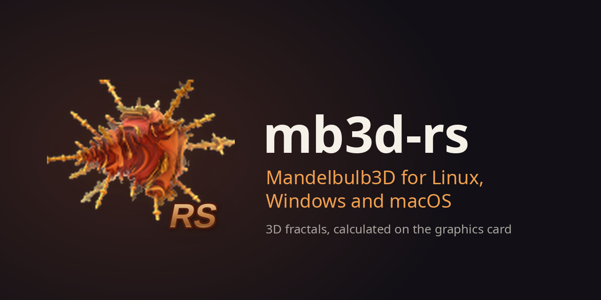

# mb3d-rs — Mandelbulb3D para Linux, Windows y macOS
<!-- languages:start -->
[English](../../README.md) · [Deutsch](README.de.md) · **Español** · [Français](README.fr.md) · [Bahasa Indonesia](README.id.md) · [Italiano](README.it.md) · [Nederlands](README.nl.md) · [Polski](README.pl.md) · [Português](README.pt.md) · [Kaszëbsczi](README.csb.md) · [العربية](README.ar.md) · [اردو](README.ur.md) · [हिन्दी](README.hi.md) · [日本語](README.ja.md) · [한국어](README.ko.md) · [简体中文](README.zh-CN.md) · [繁體中文](README.zh-TW.md)
<!-- languages:end -->

*Traducido del README en inglés (versión 0.2.86). Donde ambos difieran, el que vale es el [README en inglés](../../README.md).*

**Descargas: [la última versión](https://github.com/thr32423/mb3d-rs/releases/latest)** · [Descarga](#download) · [Novedades](../UPDATES.md)

mb3d-rs es [Mandelbulb3D](https://github.com/thargor6/mb3d) (MB3D), el
programa de fractales 3D, reescrito para que funcione en los equipos
de hoy: en **Linux, Windows y macOS**, y con la imagen calculada en la
**tarjeta gráfica**, donde MB3D solo podía usar el procesador. Abre los
archivos de parámetros de MB3D (`.m3p`, `.m3i`, parámetros de texto de los
foros), usa las fórmulas y los mapas de MB3D y produce las mismas imágenes.

<a href="../img/main_window.jpg">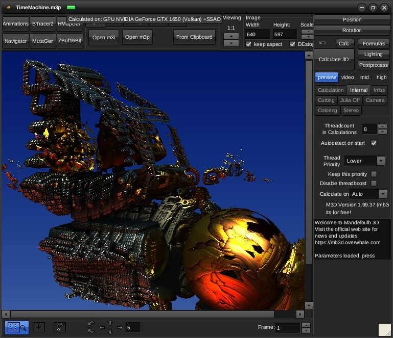</a>

Consta de dos programas:

* **Mandelbulb3D** — el programa de escritorio, con las ventanas propias de
  MB3D: la ventana principal, Fórmulas, Iluminación, Posprocesado, Navegador,
  Animación, Lotes, Renders grandes, Monte Carlo, Exportación de vóxeles,
  Bulb Tracer 2, MutaGen y las demás. Si conoce MB3D, conoce este programa;
  los tutoriales de MB3D siguen sirviendo.

  <details><summary>Más información</summary>

  Las ventanas son las de MB3D: están hechas a partir de las definiciones de
  ventana originales de MB3D, así que cada botón, deslizador y sugerencia
  está donde está en MB3D:
  
  * **Ventana principal:** abrir y guardar parámetros (`.m3p`, `.m3i`, texto,
    el portapapeles), guardar imágenes (PNG, JPEG, BMP, búfer Z de 16 bits),
    los modos del ratón, los botones de rotación, el tamaño de imagen, los
    ajustes de calidad predefinidos, deshacer, *Calcular 3D* con la imagen
    que va creciendo y las estadísticas, y todas las pestañas (Cálculo,
    Interno, Info, Corte, Julia, Cámara, Coloreado, Estéreo).
  * **Fórmulas:** las seis casillas de fórmula, las listas y opciones de
    fórmulas de MB3D, los tipos de híbridos, los favoritos y el editor de
    fórmulas JIT.
  * **Iluminación:** las luces 1–6, los ajustes predefinidos, la paleta, las
    pestañas Objeto, Ambiente, d.Niebla e Imagen fondo; los cambios repintan
    la imagen al instante, sin un nuevo cálculo.
  * **Posprocesado:** normales en el búfer Z, sombras duras y ambientales,
    reflejos y transparencia, profundidad de campo.
  * **Navegador:** recorra la escena y mire alrededor con el teclado y el
    ratón, y después *Vista al principal*.
  * **Creador de animaciones, Procesamiento por lotes, Renders grandes, Monte
    Carlo, Exportación de vóxeles, Bulb Tracer 2** (mallas) con la vista
    previa de mallas, el **Generador de mapas de altura, MutaGen, ZBuf16Bit,
    Secuencias de mapas, Carpetas** — todo como en MB3D.
  * **Enjambre** (nuevo, en la pestaña Herramientas): sus equipos
    renderizan juntos, véase
    [Renderizar en varios equipos](#rendering-on-several-computers-the-swarm).

  </details>
* **mb3d** — un renderizador de línea de comandos para scripts y trabajos por
  lotes: imágenes, animaciones, listas de lotes, renders Monte Carlo,
  exportaciones de vóxeles y de mallas, splats gaussianos, todo sin
  ventana.

<a id="is-it-safe-to-run-check-it-yourself"></a>

## ¿Es seguro ejecutarlo? Compruébelo usted mismo

No tiene por qué creernos sin más. [scanrepo.dev](https://www.scanrepo.dev)
es un servicio independiente que examina un repositorio de GitHub en busca
de indicios de software dañino: código que inicia otros programas, se
conecta a internet, oculta lo que hace o se salta las comprobaciones de
seguridad del lenguaje de programación. Cualquiera puede ejecutarlo sobre
este repositorio en cualquier momento:

**[▶ Analizar mb3d-rs en scanrepo.dev](https://www.scanrepo.dev/scan/github/thr32423/mb3d-rs)**
(pulse *Rescan* para obtener un resultado nuevo del código actual)

La versión 0.2.85 obtuvo la calificación **segura: 5 de 100** (analizada
el 30 de octubre de 2026, reglas del motor 10 del analizador). Su único aviso
es la línea que pone en marcha las fórmulas que el programa compila en
tiempo de ejecución para ganar velocidad: ejecutar código máquina recién
generado no se puede escribir en la forma comprobada de Rust, y esa línea y
el puente al filtro de ruido de Intel son los únicos lugares donde el
programa lo permite; lo demás es una nota informativa. (Antes: la 0.2.66
obtuvo 0 de 100 con un motor más antiguo; véase también
[el resultado de la 0.2.44](../img/scan_0.2.44.png).) Una versión anterior
fue señalada y cambiamos el código en respuesta
([issue #4](https://github.com/thr32423/mb3d-rs/issues/4)); ahora está
escrito para que siga así. Los programas no contienen código que se conecte
a internet; el único otro programa que piden abrir al sistema es su
gestor de archivos, cuando pulsa un botón para abrir una carpeta.

Un análisis busca señales de alarma conocidas; no es una garantía. Con
esto puede comprobar más por su cuenta:

* **Todo el código fuente está aquí.** Las descargas se compilan a partir de
  él en los propios servidores de compilación de GitHub, con los pasos que
  puede leer en [el flujo de publicación](../../.github/workflows/release.yml),
  no en el equipo personal de nadie.
* **Cada versión incluye sumas de verificación** (`SHA256SUMS`), para que
  pueda confirmar que el archivo descargado es exactamente el publicado;
  la instalación de una línea de más abajo lo hace por usted. Las versiones
  a partir de la 0.2.45 también llevan las atestaciones de compilación de
  GitHub: `gh attestation verify
  FILE --repo thr32423/mb3d-rs` muestra a partir de qué commit se compiló
  una descarga.

<a id="what-is-new-compared-with-mandelbulb3d"></a>

## Novedades respecto a Mandelbulb3D

* **La tarjeta gráfica calcula la imagen** — la imagen en sí, las sombras,
  la oclusión ambiental, los reflejos y los renders Monte Carlo. En un
  equipo normal esto es varias veces más rápido que el procesador solo;
  véase [Velocidad](#speed) más abajo.
* **Modo Auto**: la tarjeta gráfica y el procesador trabajan juntos en cada
  imagen, y nada espera nunca — si la tarjeta no está lista, el procesador
  empieza igualmente y la tarjeta se une después.
* **Un LED en la barra de título** muestra dónde se calculó la última imagen.
* **Tamaño de la interfaz** del 75 al 200 % para pantallas de alta resolución.

  <a href="../img/themes_150.png"></a>

  <details><summary>Más información</summary>

  **Prefs ▸ Temas ▸ Tamaño de la interfaz** agranda o reduce todas las
  ventanas y su texto (del 75 al 200 %), para pantallas de alta resolución;
  la disposición se mantiene exactamente como en MB3D.
  
  | 100 % | 150 % |
  |---|---|
  | 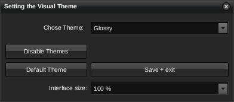 |  |

  </details>
* **Ocho aspectos** para las ventanas, todos ellos archivos de tema que puede
  copiar y modificar: dos reproducen los aspectos de MB3D, seis son nuevos.

  <a href="../img/themes/Midnight.jpg">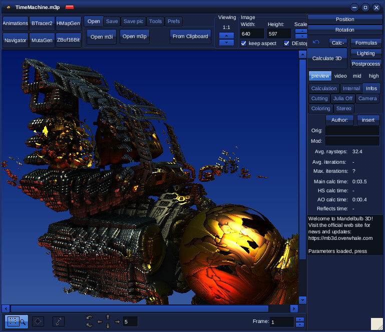</a>

  <details><summary>Más información</summary>

  **Prefs ▸ Temas** ofrece ocho aspectos, cada uno un archivo de la carpeta
  `Themes`: *Glossy* (el oscuro predeterminado) y *Windows* reproducen los
  dos aspectos propios de MB3D; los otros seis son nuevos. Pulse una imagen
  para verla a tamaño completo.
  
  | | |
  |---|---|
  | <a href="../img/themes/Glossy.jpg"></a> | <a href="../img/themes/Windows.jpg">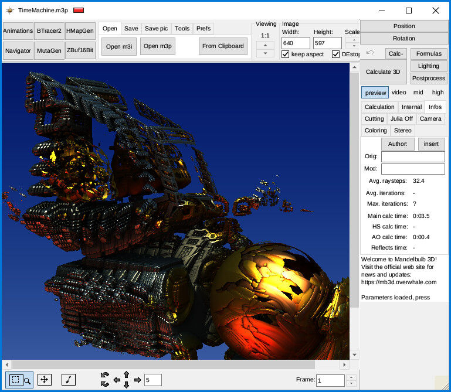</a> |
  | **Glossy**: el predeterminado de MB3D | **Windows**: el "Themes off" de MB3D |
  | <a href="../img/themes/Graphite.jpg">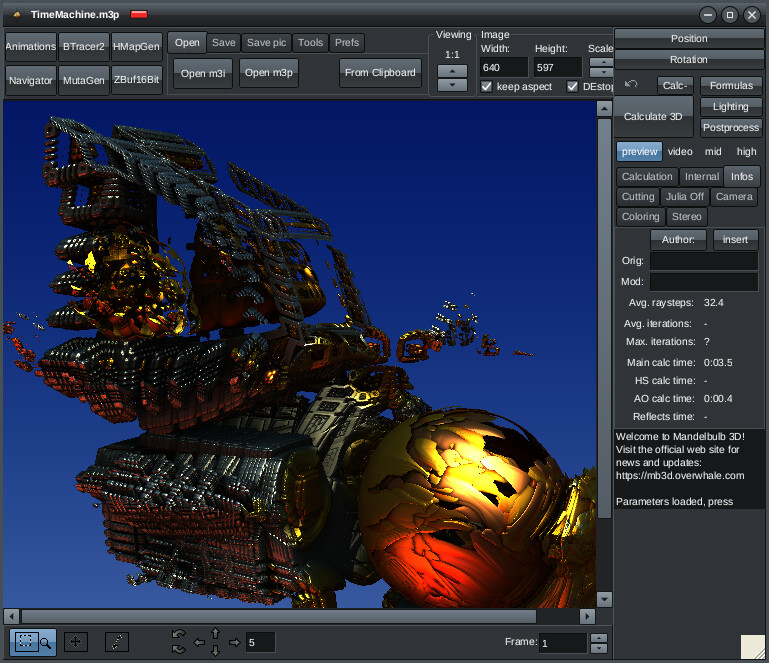</a> | <a href="../img/themes/Daylight.jpg">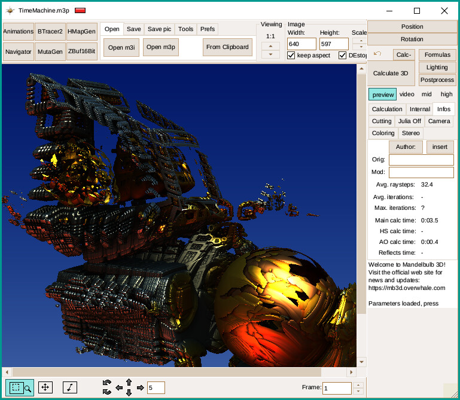</a> |
  | **Graphite**: gris neutro más claro, acentos azul acero | **Daylight**: gris claro cálido, acentos verde azulado |
  | <a href="../img/themes/Midnight.jpg"></a> | <a href="../img/themes/Ember.jpg">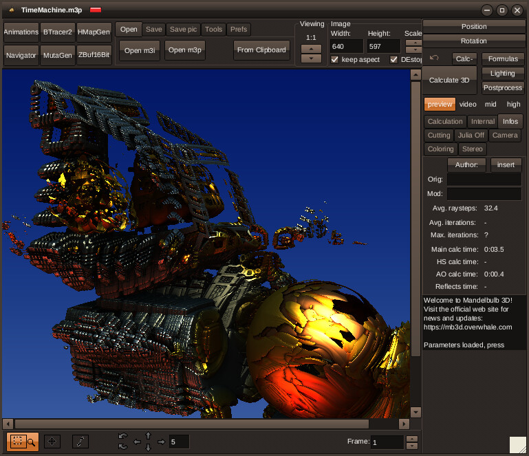</a> |
  | **Midnight**: azul marino profundo, acentos azules | **Ember**: carbón cálido, acentos naranjas |
  | <a href="../img/themes/Forest.jpg">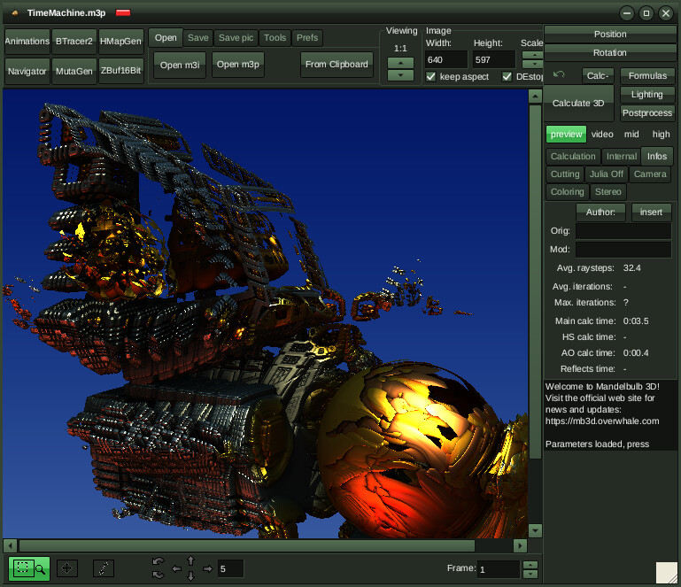</a> | <a href="../img/themes/Highcontrast.jpg">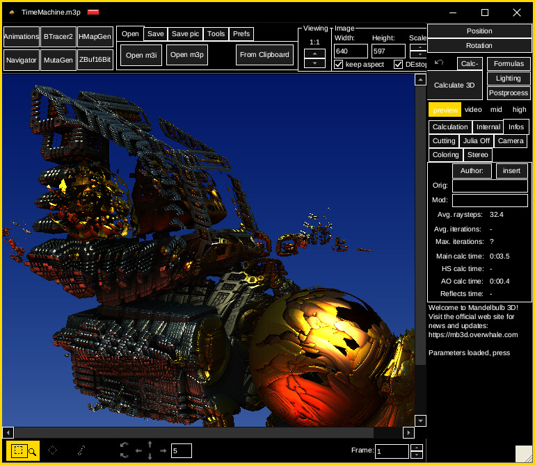</a> |
  | **Forest**: gris verdoso oscuro, acentos verdes | **High contrast**: negro, texto blanco, resaltados amarillos |
  
  Un tema es un pequeño archivo de texto en la carpeta `Themes`, junto al
  programa; copie uno, cambie sus colores y aparecerá en la lista la próxima
  vez que inicie el programa.

  </details>
* **Un fallo deja una nota en todos los sistemas**: un pánico del programa (o
  el error con el que termina) se añade a `mb3d_crash.txt`, junto al
  programa o en su carpeta de datos (antes solo en Windows). Envíe ese
  archivo con el informe de errores.
* **Calculan todas las tarjetas gráficas del equipo**, sin nada que
  configurar: cada tarjeta encontrada toma franjas de filas de la imagen del
  mismo fondo común que la primera tarjeta y el procesador, así que una
  tarjeta más rápida simplemente toma más; las sombras, la oclusión, los
  rayos Monte Carlo y los reflejos se reparten del mismo modo, y una
  animación renderiza a la vez un fotograma por tarjeta. Una tarjeta lenta
  (gráficos integrados junto a una dedicada) hace lo que puede y nunca
  retrasa una imagen: cuando ya no quedan filas libres, las tarjetas
  ociosas y el procesador se encargan de las filas que no ha entregado. Una
  tarjeta que falla queda fuera y las demás siguen. `mb3d --list-cards`
  muestra lo que se ha encontrado. (Probado con una tarjeta abierta dos
  veces y con un controlador Vulkan por software como segunda tarjeta;
  todavía no en un equipo con dos tarjetas reales.)
* **Una imagen sin terminar es un archivo `.m3i`.** Lo que un render
  detenido, caído o interrumpido a la fuerza ha calculado se conserva en la
  caché (la ventana Renders sin terminar, `mb3d resume`); para una imagen,
  ese archivo es ahora en todo momento un archivo de imagen `.m3i`,
  `image.m3i` en la carpeta del render, con las filas aún no calculadas como
  fondo. Cópielo cuando quiera, o pulse *Guardar m3i* en la ventana Renders
  sin terminar (`mb3d
  resume --m3i KEY file.m3i` en la línea de comandos; ambos escriben también
  el `data.bin` de una versión anterior como `.m3i`), y ábralo aquí o en
  Mandelbulb3D, sin conversión. (Los renders Monte Carlo llevan su propio
  registro; el `.m3c` de una pasada se escribe con `--m3c`.)
* **Atajos de teclado para las ventanas**: una combinación de teclas trae al
  frente, desde cualquier ventana, la ventana principal, el Navegador o las
  ventanas Animación, Fórmulas, Iluminación, Posprocesado o Monte Carlo
  (Ctrl+1 a Ctrl+7), y Ctrl+W cierra la ventana en la que está (en macOS,
  Cmd). Defina los suyos en *Prefs > Atajos*: pulse un campo y
  pulse las teclas; Retroceso quita un atajo.
* **La interfaz en su idioma**: todos los textos de las ventanas vienen de
  un archivo de idioma; se incluyen doce idiomas, y el programa le escribe
  el archivo de un idioma nuevo para que lo traduzca.

  <details><summary>Más información</summary>

  La insignia de idioma en el extremo derecho de la barra de título de la
  ventana principal muestra el idioma de la interfaz (`EN`); al pulsarla se
  abre la ventana de idiomas. Un idioma es un archivo de texto en la carpeta
  `Languages`, junto al programa.
  Incluidos: English, Deutsch, Français, Italiano, Nederlands, Polski,
  Kaszëbsczi, हिन्दी, 日本語, 한국어, 简体中文 y 繁體中文 (cada uno con su bandera;
  los de Asia oriental traen un subconjunto de Noto Sans CJK para sus
  caracteres, el hindi trae Noto Sans Devanagari, cuyas letras unidas y
  signos vocálicos se componen con el modelador de texto rustybuzz).
  Las traducciones se hicieron a máquina y se revisó su estructura, no las
  revisaron hablantes nativos: las correcciones son bienvenidas, cada una es
  una línea del archivo. Para traducir: escriba el nombre de su idioma y
  pulse *Crear archivo de idioma*; el programa escribe `Languages/<name>.lng`
  con todos los textos en inglés, uno por línea (`Button2.Caption = Calculate
  3D`). Traduzca los textos a la derecha del `=` con un editor de texto y pulse
  *Recargar*: las ventanas cambian al instante, sin reiniciar. Una línea que
  falte conserva el texto en inglés. *Guardar + salir* mantiene el idioma
  para el próximo inicio.

  </details>
* **Linux, Windows y macOS** (Intel y Apple Silicon).
* **Un programa de línea de comandos** para todo lo que no necesita ventana.
* **Imágenes muy grandes de una sola pieza**: 15000 x 20000 píxeles y más
  sin quedarse sin memoria, y la profundidad de campo usa todos los núcleos
  del procesador (11 veces más rápida con 24 hilos que antes de la 0.2.45,
  con la misma imagen).
* **Imágenes de 16 bits:** archivos PNG con 65 536 niveles por color en lugar
  de 256, para editarlos sin bandas.

  <a href="../img/png16_compare.png">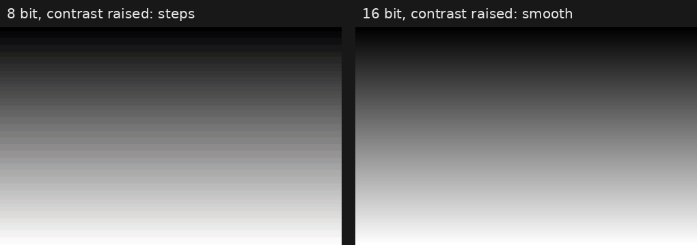</a>

  <details><summary>Más información</summary>

  MB3D guarda imágenes de 8 bits: 256 niveles por color. Es más que
  suficiente para verlas, pero cuando una imagen se edita después — brillo,
  contraste, curvas — las zonas suaves como el fondo o la niebla se rompen
  en bandas visibles. **Guardar imagen ▸ PNG** ofrece un segundo tipo de
  archivo, **PNG color 16 bits**: los colores tal como los calculó el
  programa, antes de redondearlos a 256 niveles, con todas las sombras,
  reflejos y profundidad de campo. El archivo se ve igual y sigue siendo
  suave cuando se edita.
  
  <a href="../img/png16_compare.png"></a>
  
  <a href="../img/save_png16.png">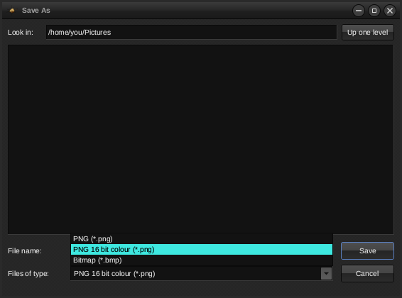</a>

  </details>
* **Un filtro de ruido** para Monte Carlo y todas las demás imágenes, la
  eliminación de ruido DCT conocida de GIMP, y para los renders Monte Carlo
  también uno neuronal, Intel Open Image Denoise.

  <a href="../img/mc_noise.png">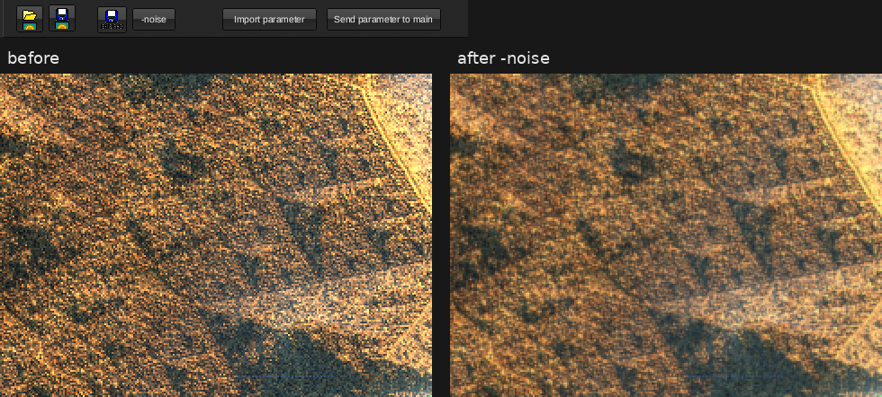</a>

  <details><summary>Más información</summary>

  Un **filtro de ruido** elimina el grano de las imágenes: la **eliminación de
  ruido DCT** de *Filtros ▸ Realzar ▸ Reducción de ruido ▸ Denoise DCT* de
  GIMP, que de entre los filtros de GIMP fue el que mejor se adaptó a estas
  imágenes (véanse los créditos más abajo).
  
  * **Ventana Monte Carlo ▸ -ruido** (un botón que MB3D tenía oculto): filtra
    la imagen mostrada, y la guardada, con una intensidad que sigue a los
    rayos por píxel. El render en sí continúa sin filtrar, y su siguiente
    actualización la vuelve a mostrar sin filtrar.
  * **Posprocesado ▸ Filtro de ruido**: *Filtrar ahora* filtra la imagen de
    la ventana principal; *Filtrar imágenes nuevas automáticamente* filtra
    cada imagen nueva. *Intensidad* es la intensidad del ruido que se
    elimina (4 es suave; valores más altos eliminan más grano y más detalle
    fino).
  
  Las imágenes Monte Carlo son las que más grano tienen. Comparadas con
  imágenes renderizadas con 512 rayos por píxel, las imágenes filtradas
  quedaron más cerca que las no filtradas en las 13 pruebas (cuatro escenas,
  de 4 a 32 rayos): hasta un 23 % con 4 rayos, del 5 al 10 % con 8 rayos y
  del 1 al 3 % con 32 rayos, donde queda poco grano.
  
  <a href="../img/mc_noise.png"></a>
  
  <a href="../img/postpro_noise.png">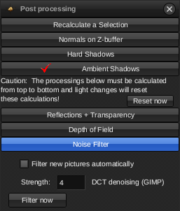</a>

  El **filtro de ruido neuronal** es
  [Intel Open Image Denoise](https://www.openimagedenoise.org), el filtro
  de Cycles de Blender y de muchos otros trazadores de caminos, entrenado
  con imágenes renderizadas. Filtra los promedios de los rayos del render
  (antes de la exposición y la saturación), así que la imagen conserva su
  brillo. La biblioteca de Intel viene con el programa (la carpeta `oidn`;
  en el .deb y el .rpm, `/usr/lib/mb3d-rs/oidn`); `MB3D_OIDN` puede indicar
  otra.

  * **Ventana Monte Carlo ▸ -ruido IA**: filtra la imagen mostrada, y la
    guardada, como hace *-ruido*; el render continúa sin filtrar.
  * **Línea de comandos**: `mb3d montecarlo scene.m3p --rays 8 --denoise-ai`.
  * Tarda de 0,2 a 0,6 segundos para una imagen de 640 x 480 en el procesador.

  La diferencia con la imagen de 512 rayos (media sobre todos los píxeles,
  cuanto más baja, mejor):

  | Escena | 4 rayos | filtro DCT | filtro neuronal | 8 rayos | filtro DCT | filtro neuronal |
  |---|---|---|---|---|---|---|
  | TreePlanet | 1.89 % | 1.52 % | **1.23 %** | 0.88 % | 0.82 % | **0.79 %** |
  | Cutted sphere over carpet | 5.30 % | 3.87 % | **2.34 %** | 2.80 % | 2.37 % | **1.66 %** |
  | Julia on box | 1.61 % | **1.01 %** | 1.08 % | 0.98 % | **0.81 %** | 0.84 % |
  | MengerTrees | 1.95 % | 1.54 % | **1.26 %** | 1.15 % | 1.05 % | **0.94 %** |

  El filtro neuronal es el más cercano en tres de las cuatro escenas; en el
  grano fino del conjunto de Julia el filtro DCT queda un poco más cerca. Se
  nota sobre todo en el vidrio y los espejos, donde pocos rayos dejan el
  mayor grano:

  <a href="../img/mc_noise_ai.jpg">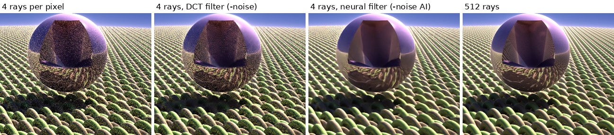</a>

  </details>
* **Fondos transparentes** para imágenes y animaciones.

  <a href="../img/transparent.png">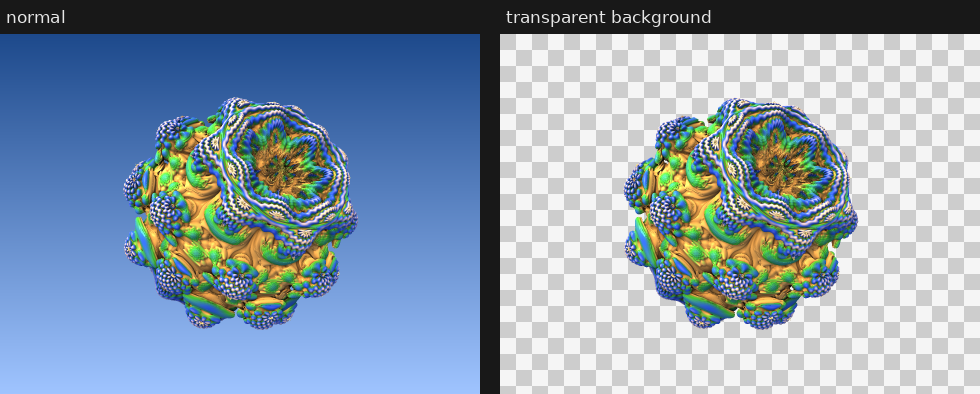</a>

  <details><summary>Más información</summary>

  Las imágenes y los fotogramas de animación pueden guardarse con **fondo
  transparente**, para poner el fractal sobre otra imagen o en un editor de
  vídeo: **Guardar imagen ▸ PNG ▸ PNG fondo transparente**, y en el Creador
  de animaciones **Fondo transparente** (fotogramas PNG). Con antialiasing
  (una escala de visualización de 1:2 o más, o `--aa`) los bordes son
  suaves y no llevan ningún halo del color de fondo anterior. Las imágenes
  de profundidad para composición ya existían (*Guardar también el búfer Z*,
  `--depth`).
  
  <a href="../img/transparent.png"></a>

  </details>
* **Vídeos de animaciones:** un archivo AVI directamente desde el programa, o
  el comando de ffmpeg para un MP4 pequeño.

  <a href="../img/anim_video.png">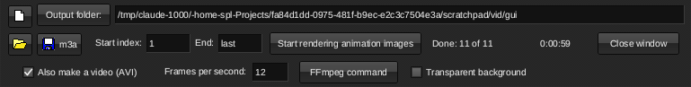</a>

  <details><summary>Más información</summary>

  En el Creador de animaciones, **Crear también un vídeo (AVI)** une los
  fotogramas en un vídeo a medida que se renderizan, a los **Fotogramas por
  segundo** que indique: `<project name>.avi` en la carpeta de salida, junto
  a los fotogramas, que se conservan. Se reproduce en VLC y mpv y se abre en
  editores de vídeo (Kdenlive, Shotcut, DaVinci Resolve). Cada fotograma se
  guarda como una imagen completa, así que los archivos son grandes: buenos
  para editar y conservar, menos para compartir.
  
  Para un vídeo pequeño que compartir, **Comando FFmpeg** pone el comando
  para un MP4 (o, con fondo transparente, un WebM) en el portapapeles y en
  los mensajes. Instale [ffmpeg](https://ffmpeg.org), pegue el comando en un
  terminal cuando los fotogramas estén terminados, y creará el vídeo; este
  programa no inicia por sí mismo ningún otro programa.
  
  <a href="../img/anim_video.png"></a>

  </details>
* **Una vista previa de los archivos de parámetros** en el diálogo Abrir.

  <a href="../img/open_preview.png">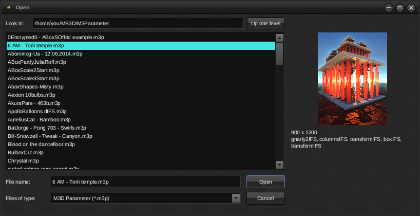</a>

  <details><summary>Más información</summary>

  **Abrir ▸ Abrir m3p** y **Abrir m3i** muestran una pequeña imagen del
  archivo de parámetros pulsado, con su tamaño y sus fórmulas, antes de
  abrirlo; las teclas de flecha recorren la lista con la vista previa. La
  imagen se calcula en segundo plano en el procesador, así que el diálogo
  sigue respondiendo, y la vista previa de cada archivo se conserva
  mientras el programa está abierto.
  
  <a href="../img/open_preview.png"></a>

  </details>
* **Navegador: valores exactos y Restablecer vista.** Pulse un valor y
  escríbalo; vuelva a la vista desde la que partió el Navegador.

  <a href="../img/navigator_values.png">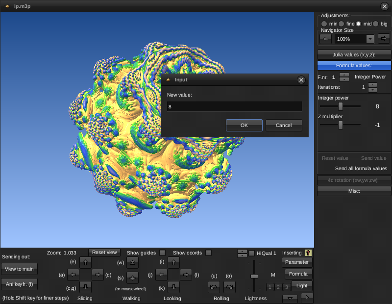</a>

  <details><summary>Más información</summary>

  * **Pulse un valor** en los paneles del Navegador — valores Julia, valores
    de fórmula, rotación 4D, los valores de Varios — y escriba el número
    exacto, como en MB3D (ángulos en grados). El deslizador continúa luego
    desde ese valor.
  * **Pulse el zoom** y escríbalo, cuando los pasos de zoom son demasiado
    gruesos (un deseo de la lista de issues de MB3D); un zoom escrito se
    mantiene (*zoom fijo*).
  * **Restablecer vista** vuelve a la posición, la dirección y el zoom que
    el Navegador tomó de la ventana principal; los valores ajustados se
    mantienen.
  
  <a href="../img/navigator_values.png"></a>

  </details>
* **Una fórmula nueva, SphereTree:** un árbol de esferas que se tocan y se
  ramifican cada vez más pequeñas, de Tom Lowe.

  <a href="../img/spheretree_ball.jpg">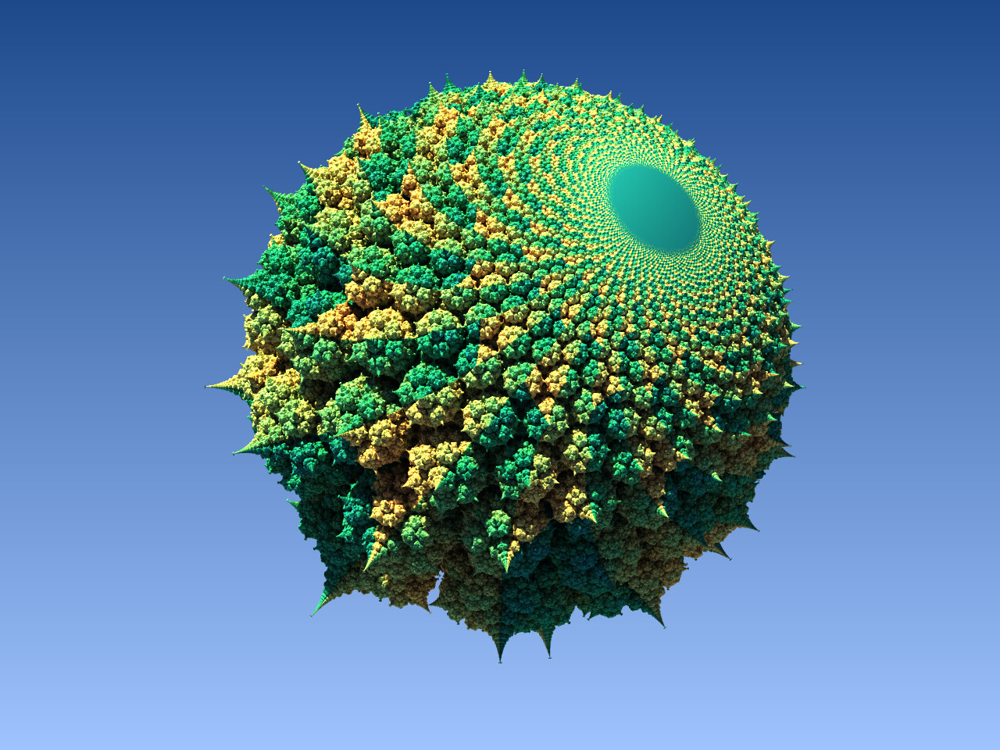</a>

  <details><summary>Más información</summary>

  **SphereTree** es una fórmula que Mandelbulb3D no tiene: un árbol de esferas
  que se tocan entre sí y se ramifican en esferas cada vez más pequeñas, como
  espuma o coral. Tom Lowe, el inventor del Mandelbox, la publicó en 2020
  (véanse los créditos más abajo). Está en la lista de fórmulas junto a las
  fórmulas dIFS y tiene cuatro ajustes:
  
  * **PackRatio** (de 0 a 1.22): el tamaño de las esferas; con 1 apenas se
    tocan, por encima de 1 las exteriores se desprenden.
  * **Levels**: la profundidad del árbol (6 basta para la mayoría de las
    imágenes).
  * **Rotated**: 1 gira cada nivel una doceava parte de vuelta, y el árbol se
    convierte en una bola redonda de racimos de esferas.
  * **Colour scale**: cada rama del árbol tiene su propio color. Elija
    *2ª elección* (la trampa de órbita) en los ajustes de color de la
    Iluminación para verlos; este ajuste los reparte sobre el degradado de
    colores.
  
  Funciona sola y después de transformaciones dIFS (la tercera imagen la
  repite con *tilingbrickIFS*), y se calcula tanto en la tarjeta gráfica
  como en el procesador. Ponga las iteraciones en 1: la fórmula calcula el
  árbol entero de una vez. Los parámetros con SphereTree solo se abren en
  este programa, no en Mandelbulb3D.
  
  <a href="../img/spheretree_ball.jpg"></a>
  
  | <a href="../img/spheretree_close.jpg">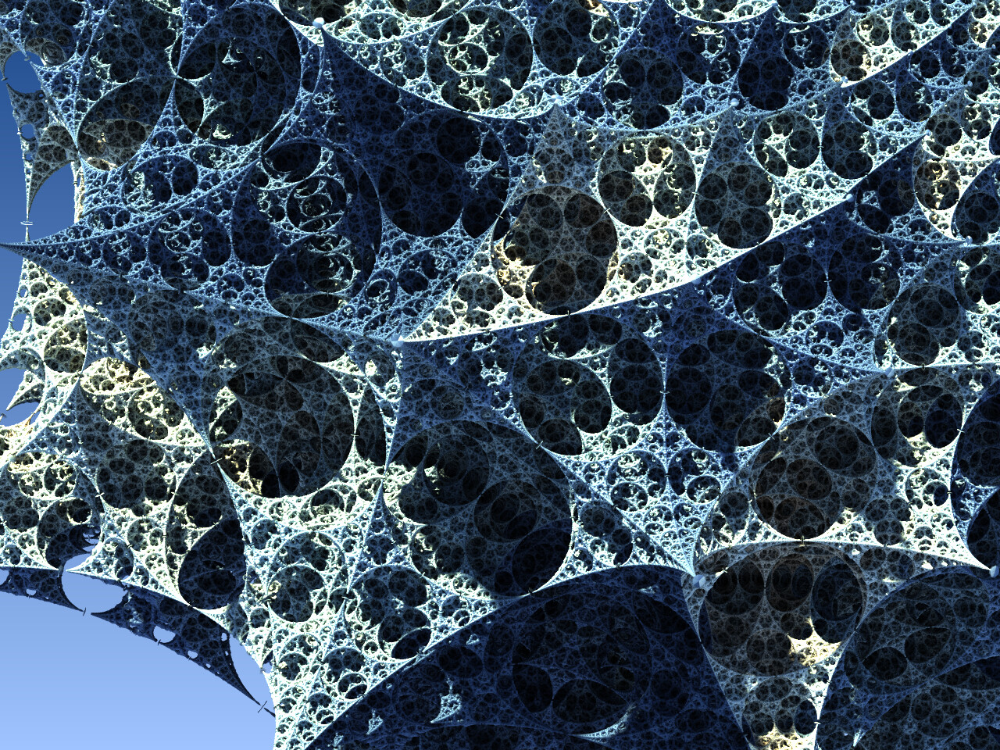</a> | <a href="../img/spheretree_swarm.jpg">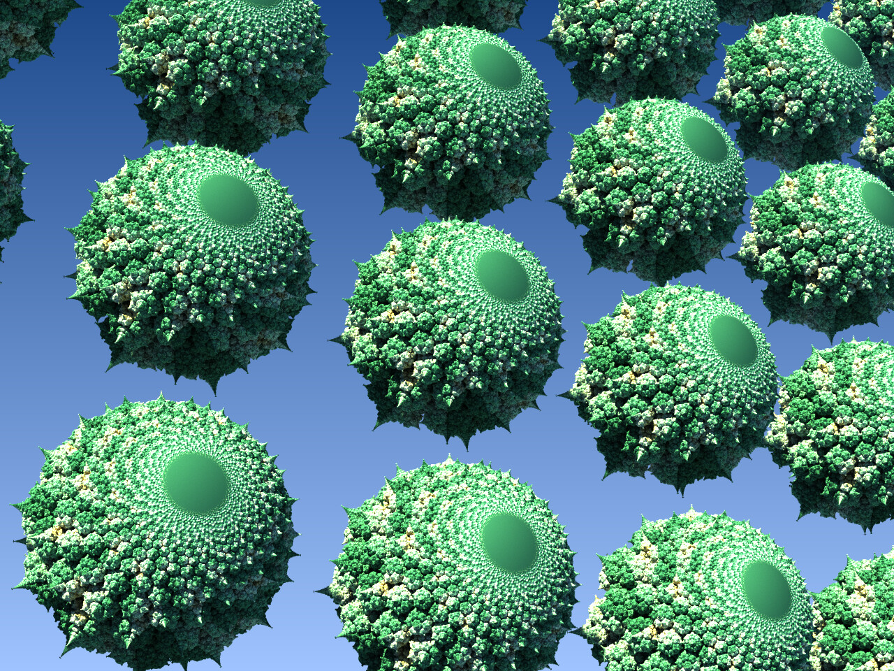</a> |
  |:---:|:---:|

  </details>
* **Una fórmula nueva, DomeTree:** una cúpula de la que brota un anillo de
  cúpulas más pequeñas, cada una con su propio anillo, de Tom Lowe.

  <a href="../img/dometree_mc.jpg">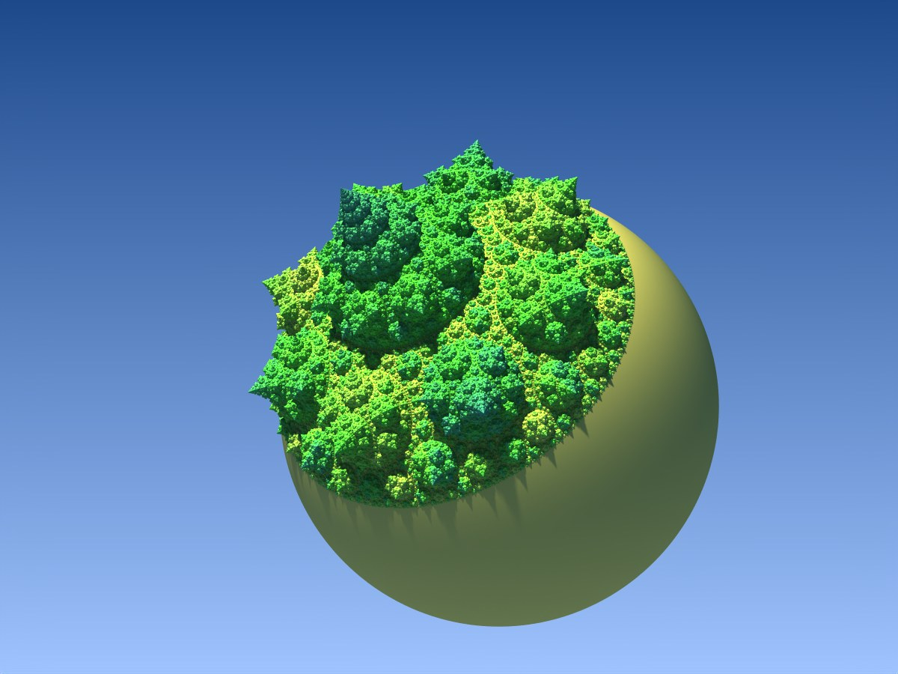</a>

  <details><summary>Más información</summary>

  **DomeTree** es el segundo árbol de Tom Lowe después de SphereTree (véanse
  los créditos): una bola a la que, por un lado, le crece un anillo de
  cúpulas, y cada cúpula su propio anillo más pequeño, nivel tras nivel,
  hecho de inversiones en círculos. Está en la lista de fórmulas junto a las
  fórmulas dIFS y tiene cinco ajustes:

  * **Levels**: la profundidad del árbol (16 es suficiente).
  * **Children**: las cúpulas de cada anillo, de 4 a 10.
  * **Bend angle** (de 0.3 a 1.3 funciona mejor): cuánto se abomban las
    cúpulas; valores bajos dan discos planos, valores altos cúpulas
    redondas. Por encima de 1.3, más o menos, la superficie se vuelve
    granulosa.
  * **Colour scale**: cada cúpula tiene su propio color. Elija *2ª elección*
    (la trampa de órbita) en los ajustes de color de la Iluminación y un
    rango de color amplio (por ejemplo de 0 a 100) para verlos.
  * **Start curved**: 1 (el valor predeterminado) empieza con la bola, 0 con
    un suelo plano del que crece el primer anillo.

  Use un *Raystep* pequeño (0.2; 0.05 con 9 o 10 cúpulas): la estimación de
  distancia de la forma es aproximada, como en el propio archivo de
  Fragmentarium de TGlad. Como SphereTree, funciona en la tarjeta gráfica y
  en el procesador, necesita solo 1 iteración, y los parámetros con ella
  solo se abren en este programa.

  <a href="../img/dometree_mc.jpg"></a>

  | <a href="../img/dometree_5.jpg">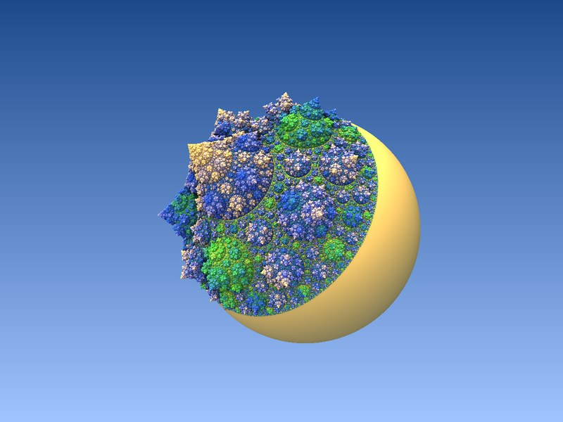</a> | <a href="../img/dometree_flat.jpg">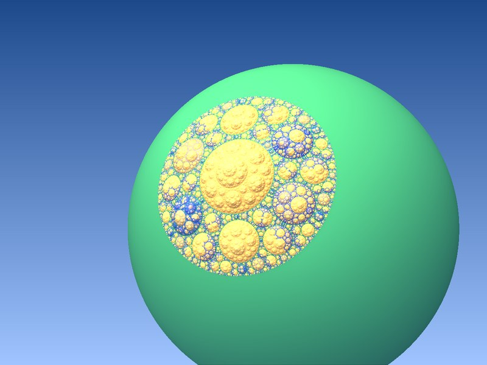</a> | <a href="../img/dometree_10.jpg">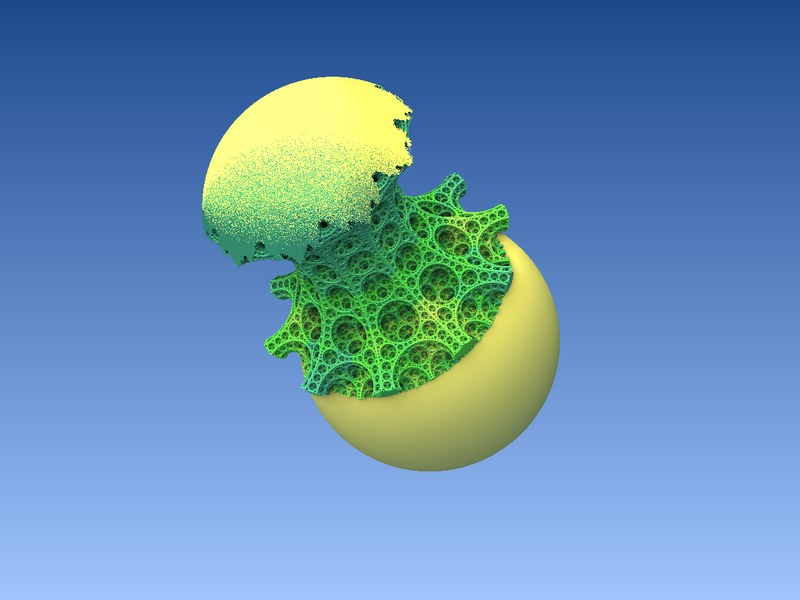</a> |
  |:---:|:---:|:---:|

  </details>
* **Una fórmula nueva, UlamSpiral:** la espiral de números primos de Ulam en
  3D, como una ciudad, un perfil de rascacielos, esferas o un bloque.

  <a href="../img/ulam_2d.png">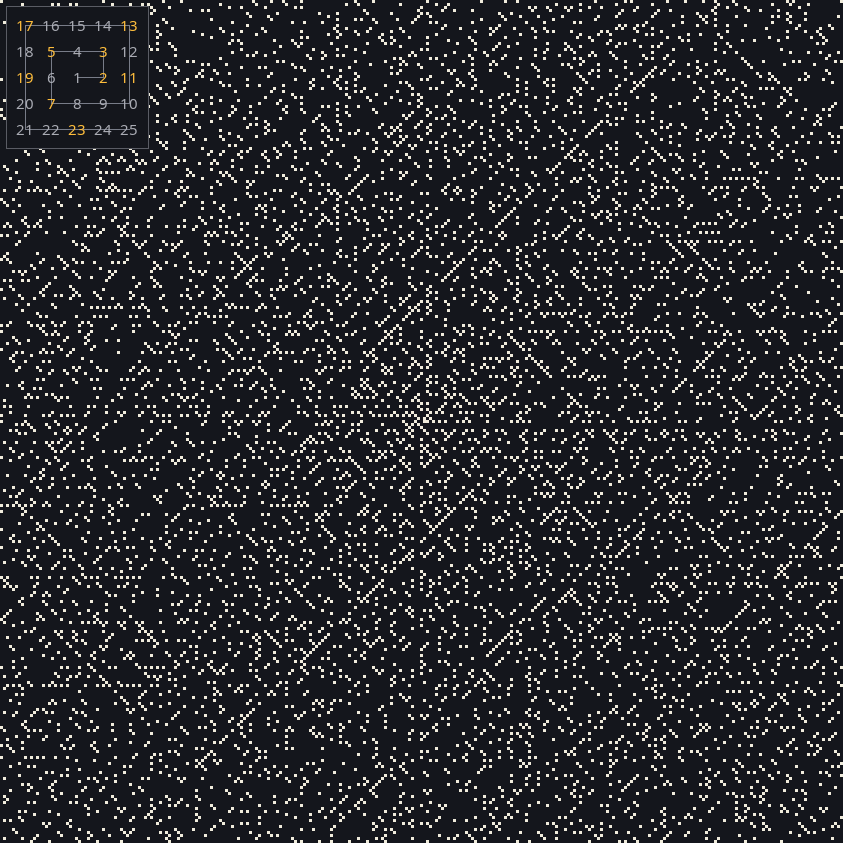</a>

  <details><summary>Más información</summary>

  En 1963 el matemático Stanisław Ulam asistía en una reunión a "una
  ponencia larga y muy aburrida" y garabateaba en una hoja de papel
  cuadriculado. Su primera idea fue plantear problemas de ajedrez; en lugar
  de eso numeró las casillas 1, 2, 3, … en espiral, con el 1 en el centro, y
  rodeó con un círculo los números primos. Los primos se alinearon en
  diagonales, como si siguieran un patrón, y lo siguen haciendo cuando un
  equipo informático dibuja millones de ellos (Ulam probó con 100 000 en el MANIAC II
  de Los Álamos; Martin Gardner llevó la imagen a la portada de Scientific
  American en 1964). Nadie lo ha explicado del todo hasta hoy.
  
  <a href="../img/ulam_2d.png"></a>
  
  **UlamSpiral** construye esa espiral en 3D, una forma por número, en cuatro
  variantes (*Mode*):
  
  * **0, torres de primos**: una placa por cada número y una torre sobre cada
    primo. Las diagonales de primos se convierten en hileras de torres.
  * **1, perfil de divisores**: una columna por cada número, más alta cuantos
    más divisores tiene; los primos son las calles bajas entre ellas.
  * **2, esferas de divisores**: una esfera por cada número, más grande
    cuantos más divisores tiene (los primos son las pequeñas).
  * **3, un bloque de primos**: los números enrollados en capas de cubos en
    lugar de en un cuadrado, con un cubo sobre cada primo.
  
  *Rings* fija el tamaño de la espiral (60 anillos son los números hasta el
  14 641), *Height* la altura de las torres o columnas, *Gap* el espacio
  entre ellas. Con *2ª elección* (la trampa de órbita) en los ajustes de
  color, el color sigue el número de divisores, así que los primos tienen un
  color propio. Como SphereTree, funciona en la tarjeta gráfica y en el
  procesador, funciona después de transformaciones dIFS, necesita solo 1
  iteración, y los parámetros con ella solo se abren en este programa.
  
  <a href="../img/ulam_city.jpg">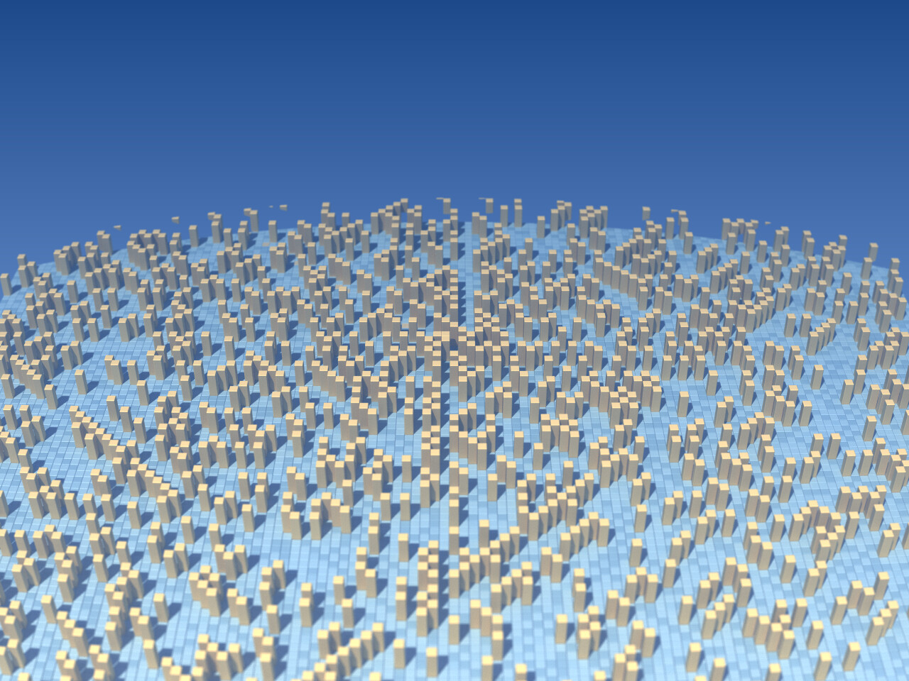</a>
  
  | <a href="../img/ulam_skyline.jpg">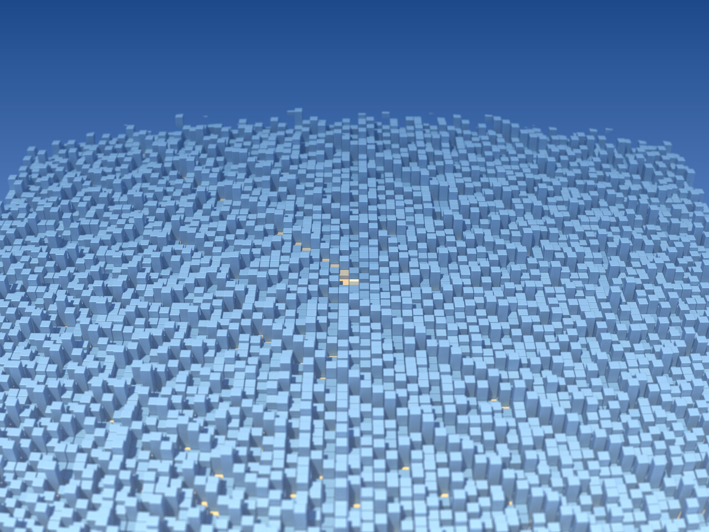</a> | <a href="../img/ulam_spheres.jpg">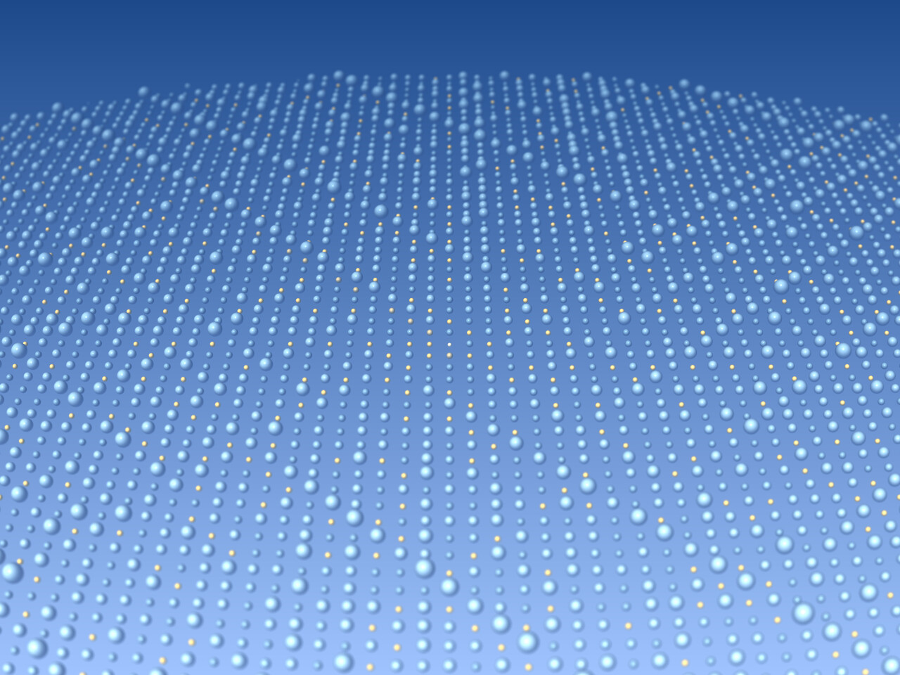</a> | <a href="../img/ulam_block.jpg">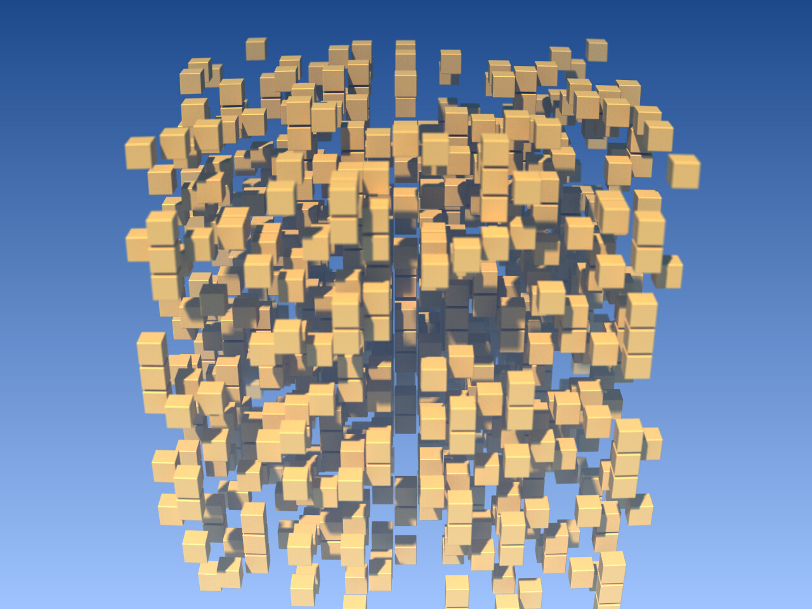</a> |
  |:---:|:---:|:---:|

  </details>
* **Un render detenido continúa donde estaba.** Lo que un render ha calculado
  se conserva cuando se detiene, y también cuando se cierra el programa o
  este falla, o el equipo se apaga (se guarda en el disco cada 5
  minutos): Calcular 3D, Monte Carlo (también a mitad de una pasada), el
  fotograma de una animación o la imagen de un lote en curso, una
  exportación de vóxeles, una malla de Bulb Tracer, las teselas de un Render
  grande y un render de enjambre (Detener en el equipo que creó la tarea
  conserva todas las partes terminadas, y cada equipo conserva la parte en
  la que estaba). Calcular 3D y Monte Carlo con los mismos parámetros
  preguntan si continuar; los demás continúan solos; el botón **Reanudar**
  (pestaña Abrir) lista los renders sin terminar, para continuarlos o
  borrarlos. En la línea de comandos, el mismo comando continúa solo
  (también una imagen en `--tiles`, `montecarlo`,
  `animate`, `batch`, `voxel` y `mesh`); `--fresh` empieza de nuevo, `mb3d
  resume` los lista. Un render continuado es igual que uno calculado de una
  sola vez.
* **Renderizado compartido entre sus equipos**, un "enjambre": los equipos
  que ven una misma carpeta compartida renderizan juntos una imagen, un
  Render grande, una imagen Monte Carlo o una animación. Véase
  [Renderizar en varios equipos](#rendering-on-several-computers-the-swarm).
* **Fórmulas y mapas de la comunidad**: 129 fórmulas y 154 mapas que faltan en el repositorio oficial, del paquete Mandelbulb3D 1.99.37 que Machina Infinitum ofrece como descarga gratuita. Las fórmulas son de Edgar Malinovsky, gnj, DarkBeam (Luca GN), bugman, Aexion, Buddhi, pupukuusikko, Jos Leys, Knighty, trafassel, Nrx, Eiffie, Quasihedron, Inigo Quilez, Yannis Picart, Jotero y otros cuyos archivos no nombran autor; `M3Formulas/CREDITS-community.md` nombra al autor de cada una (`teapot.m3f` de DarkBeam está bajo CC BY-SA 3.0). Los mapas son de la colección de DarkBeam, bajo sus condiciones (uso libre, no se venden sin cambios), con imágenes compartidas en DeviantArt por CmdrChaos, Fractales75, Nic022 y UndeadAcademy; los mapas 3046–3048 son de Kronpano (`M3Maps/CREDITS-community.md`). Los 608 ajustes de luz de `M3Lights` vienen del mismo paquete; sus archivos no nombran autor (`M3Lights/CREDITS-community.md`).
* **Ideas de Mandelbulb3D SE**: Mandelbulb3D SE de Glenn Olander, una app de macOS basada en mb3d-rs, aportó dos ideas: comprobar en las pruebas cada shader de la tarjeta gráfica sin tarjeta gráfica, y que Detener termine al instante el pintado de una imagen.
* **Una fórmula nueva, PseudoKleinian:** la "arquitectura kleiniana" de
  salas, arcos y esferas como una sola fórmula con su propia distancia
  exacta.

  <a href="../img/kleinian_hall.jpg">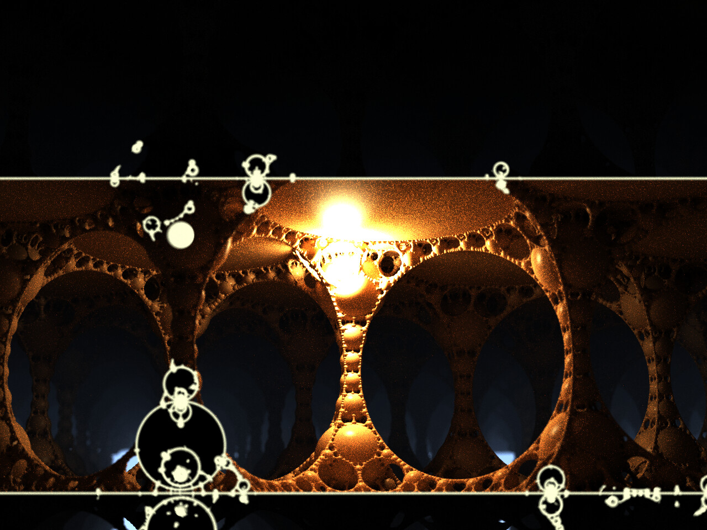</a>

  <details><summary>Más información</summary>

  Las salas, arcos, pilares y esferas anidadas conocidas como "arquitectura
  kleiniana" están entre las imágenes de fractales 3D más queridas. En MB3D
  solo se pueden hacer como un híbrido de varias fórmulas con ajustes
  cuidadosamente combinados, la receta que encontró Theli-at en 2011;
  knighty escribió después lo mismo como una sola fórmula con su propia
  estimación de distancia, y eso es **PseudoKleinian**. Cada nivel pliega el
  punto dentro de una caja, lo invierte en una esfera y le suma un
  desplazamiento, y la distancia se mide exactamente hasta un plano de suelo
  tras los pliegues, así que las paredes salen limpias y la imagen se
  renderiza rápido. Los ajustes son los de knighty: *Levels* (8), *Size* (la
  esfera de inversión), *CSize X/Y/Z* (la caja; sus 0.924, 0.908, 0.924 dan
  las salas clásicas, y pequeños cambios dan edificios nuevos), *Julia X/Y/Z*
  (un desplazamiento por nivel), *Shape* (0 el plano de suelo, 1 un
  plano-cilindro de grosor *Thickness* a través de *Offset*, 2 una caja
  redondeada), *DE offset* (vacía la superficie) y *Colour scale* (con
  *2ª elección*, la trampa de órbita: el radio de órbita más pequeño, las
  bandas kleinianas clásicas).
  
  La estructura llena todo el espacio, así que se mira desde dentro: empiece
  con el centro de la vista cerca del origen y la cámara una o dos unidades
  atrás, y muévase por las salas con el Navegador. En el renderizador Monte
  Carlo un interior apenas recibe luz del cielo, así que coloque una luz
  posicional dentro de la sala (la primera imagen) o abra la estructura con
  un plano de corte y mire desde arriba (la segunda). Funciona en la tarjeta
  gráfica y en el procesador, necesita 1 iteración, funciona después de
  transformaciones dIFS y en combinaciones DE como las demás fórmulas dIFS
  (aunque dentro de una estructura que llena el espacio estas cambian poco),
  y los parámetros con ella solo se abren en este programa.
  
  <a href="../img/kleinian_hall.jpg"></a>
  
  <a href="../img/kleinian_top.jpg">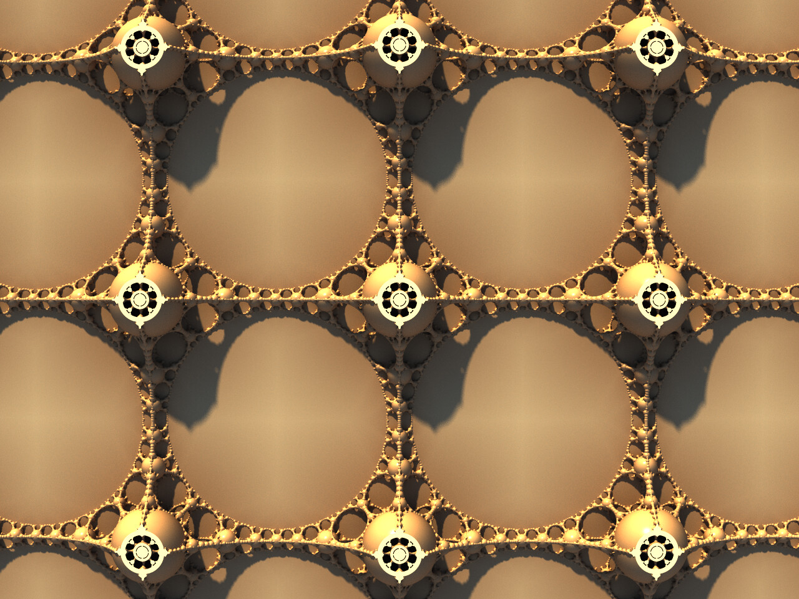</a>

  </details>
* **Pares estéreo en un solo paso**: las imágenes de ambos ojos renderizadas y
  mostradas una junto a otra, para visión paralela o cruzada. Aportado por
  Rathinagiri S ([SRathinaGiri](https://github.com/SRathinaGiri)).

  <a href="../img/stereo_pair.jpg">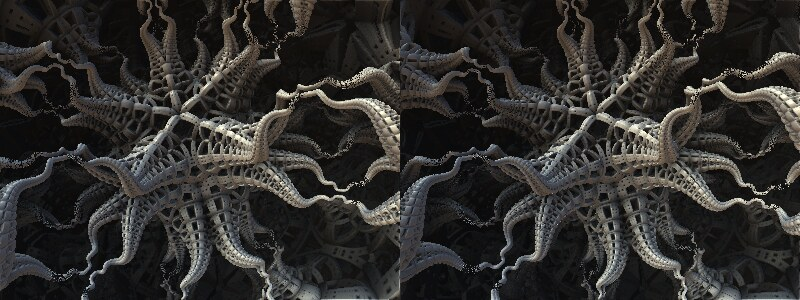</a>

  <details><summary>Más información</summary>

  **Estéreo ▸ Renderizar par estéreo** renderiza la imagen del ojo izquierdo y
  luego la del derecho con los ajustes estéreo de la pestaña y las muestra
  una junto a otra en la ventana principal. Se colocan para visión paralela
  (la imagen izquierda a la izquierda); **Vista previa ojos cruzados** las
  intercambia para visión cruzada. Es una vista previa: la iluminación y los
  colores no se pueden cambiar después sin volver a renderizar, y no
  funciona con teselas. Los botones para las imágenes de cada ojo por
  separado siguen ahí.
  
  <a href="../img/stereo_pair.jpg"></a>

  </details>
* **Tiempo restante para toda la imagen**: la barra bajo la imagen se llena
  una sola vez durante todo el cálculo, y a su lado aparece el tiempo que
  falta hasta que la imagen esté terminada, sombras, oclusión y reflejos
  incluidos.

  <a href="../img/time_left.png">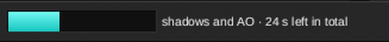</a>

  <details><summary>Más información</summary>

  La barra de MB3D empieza de nuevo en cada etapa. Aquí muestra el cálculo
  completo: el render principal, luego las sombras duras y la oclusión
  ambiental, los reflejos y la profundidad de campo. Lo que tardarán las
  etapas posteriores al render principal se estima a partir de lo que pide
  la escena y de cómo fue el render principal; la estimación se ajustó con
  unos 1400 renders de 366 escenas. Una imagen calculada de nuevo cuenta con
  los tiempos que tardó la última vez.
  
  La primera imagen con fórmulas nuevas en la tarjeta gráfica espera a que
  se compilen sus shaders: la línea dice entonces *compilando shaders* con
  el tiempo restante, que tiene en cuenta el ritmo del procesador y, si los
  shaders van a estar listos a tiempo, la incorporación de la tarjeta.
  Detalles en
  [TECHNICAL.md](../TECHNICAL.md#time-left-and-the-progress-bar).
  
  <a href="../img/time_left.png">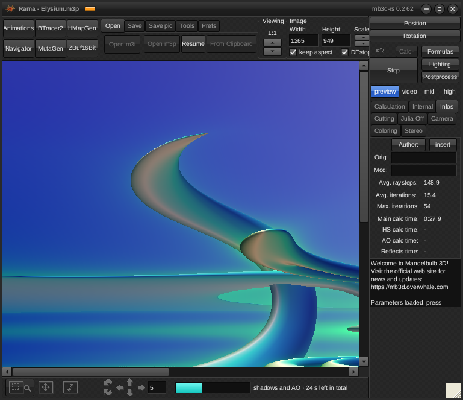</a>

  </details>
* **Historial** tras el icono del reloj de la barra de título: cada imagen
  que ha calculado con su miniatura, cada archivo que ha abierto o guardado,
  como lista, como filas o como mosaicos de cualquier tamaño, agrupados por
  día o en una sola serie; búsquelo, ordénelo, muestre solo las imágenes que
  difieren y cargue cualquier entrada con un doble clic. Un historial de
  cientos de miles de entradas se abre al instante.
* **Los asistentes de IA pueden usar mb3d** (`mb3d mcp`, el Model Context
  Protocol): pida a la aplicación de escritorio de Claude o a Claude Code, con
  palabras normales o por voz a través del asistente, que describa, cambie y
  renderice sus archivos de parámetros, cree variaciones o renderice aquello
  en lo que trabajó por última vez; el asistente ve las imágenes y puede
  ajustarlas. El botón **IA** de la pestaña Prefs lo conecta con un clic (o
  `mb3d mcp --setup`). mb3d sigue sin conexión (la aplicación del asistente
  lo inicia en su equipo), escribe solo en la carpeta `AI` y nunca borra
  nada; las imágenes de más de 4K necesitan su consentimiento.
* **Un registro de todo** tras el icono de página de la barra de título: cada
  clic, ajuste y valor escrito, cada cálculo con sus etapas y tiempos, los
  archivos abiertos y guardados, las ventanas, mensajes, avisos y errores,
  en una ventana que los sigue en directo y en un archivo por día. Una sesión
  que se congeló o se cerró a la fuerza se informa en el siguiente inicio, y
  un informe de fallo lleva las últimas líneas del registro.
* **La iluminación sigue en vivo** después de las sombras duras y los
  reflejos: mueva una luz o cambie su color y la imagen cambia al instante,
  como en Mandelbulb3D.

  <a href="../img/lighting_live.png">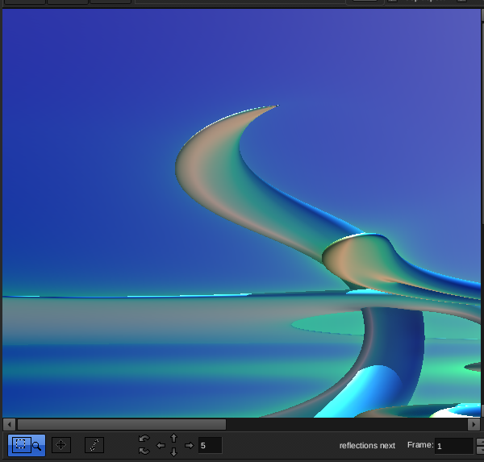</a>

  <details><summary>Más información</summary>

  Renderice sin más y después pruebe posiciones y colores de las luces: cada
  cambio en la ventana Iluminación repinta al instante con las sombras tal
  como se calcularon, como en Mandelbulb3D. Cambiar el color o la intensidad
  de una luz nunca vuelve a calcular las sombras. Las sombras de una luz que
  ha movido, los reflejos y la profundidad de campo vuelven con los botones
  de la ventana Posprocesado, como en Mandelbulb3D.
  
  Un cálculo que haya detenido también puede continuarse después de cambiar
  la iluminación. Una forma de trabajar con ello: [Flujo de trabajo de iluminación](https://github.com/thr32423/mb3d-rs/wiki/Lighting-workflow-es)
  en la wiki. Detalles en
  [TECHNICAL.md](../TECHNICAL.md#lights-volumetric-light-cutting-planes-depth-of-field).
  
  <a href="../img/lighting_live.png">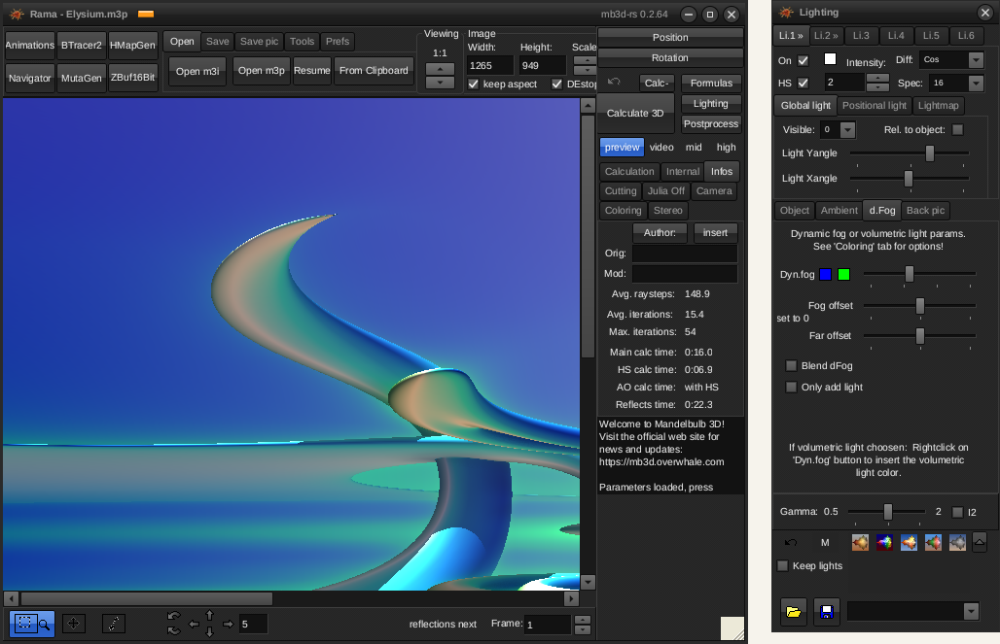</a>

  </details>
* **Un plano de suelo o agua** bajo (o detrás de) el fractal, una idea de
  Mandelbulber: un plano perpendicular al eje X, Y o Z, calculado junto con el
  fractal, con sus sombras, oclusión ambiental, reflejos y luz Monte Carlo, en
  su propio color, liso o con olas.

  <a href="../img/ground_water.jpg">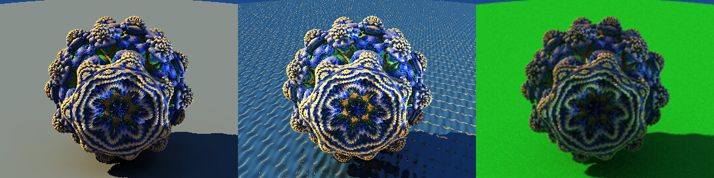</a>

  <details><summary>Más información</summary>

  Ventana principal, página *Corte*: marque *Plano de suelo*, elija el eje y la
  posición, el color, cuánto refleja (0 a 1: un espejo cuando se calculan los
  reflejos) y la altura y longitud de las olas. El lado sólido es siempre el
  que está lejos de la cámara. Se calcula en la tarjeta gráfica y en el
  procesador, y no entra en las exportaciones de vóxeles y mallas.
  Mandelbulb3D no tiene sitio para él en sus parámetros: mb3d-rs lo guarda en
  un pequeño bloque detrás de ellos (en los archivos .m3p y .m3i, y como
  `{mb3d-rs: ...}` tras el título de los parámetros de texto), que
  Mandelbulb3D no lee. Claves de escena `ground`, `ground_color`,
  `ground_reflect`, `ground_waves`; detalles en [TECHNICAL.md](../TECHNICAL.md#lights-volumetric-light-cutting-planes-depth-of-field).

  **Agua transparente**: con *Agua* por encima de 0 (cuánta luz deja
  pasar) un fractal medio sumergido se ve bajo la superficie, desviado
  por la refracción (*Refracción*: 1,33 para el agua) y tomando con la
  profundidad el color del agua profunda (el botón de color): la *Absorción* dice qué tan turbia es (0 clara, 3 turbia), y en
  agua verdeazulada el rojo se apaga primero, así que lo sumergido se
  vuelve turquesa. Los brillos de las luces sobre las olas siguen en la
  superficie. El render normal lo muestra con los reflejos activados
  (Postprocesado), Monte Carlo siempre; sin reflejos el agua sigue
  opaca. Claves de escena `ground_transparency`, `ground_absorption`,
  `ground_water_color`, `ground_ior`; un ejemplo en
  [CLOUDS_WATER.md](../CLOUDS_WATER.md#transparent-water).

  **Dispersión** (la fila bajo *Refracción*): el agua dispersa la luz
  como el agua real. Brilla turquesa mirando hacia el sol, las crestas
  de las olas se transparentan, la luz del sol cae en ella en rayos
  cortados por las sombras del fractal y lo que está bajo el agua brilla
  suavemente en su color; Monte Carlo sigue la luz mientras se dispersa
  en el agua. El segundo campo es su dirección (0,8: sobre todo hacia
  delante). 0 es el aspecto sin ella. Claves de escena
  `ground_scattering`, `ground_scatter_dir`; véase
  [CLOUDS_WATER.md](../CLOUDS_WATER.md#transparent-water).

  **Pruébalo**: en la página *Corte* marca *Plano de suelo* y haz que su
  altura atraviese el fractal, pon *Agua* en 1, *Absorción* en 1 y
  *Dispersión* en 0,5, y activa los reflejos (*Posprocesar*, *Reflejos +
  transparencia*, *Calcular R. (+ T.) automáticamente*); después *Calcular
  3D*.

  Tres escenas listas para pegar, con sus ajustes: [WATER_EXAMPLES.md](../WATER_EXAMPLES.md)

  *Agua* (transparencia) 0, 0,5 y 1:

  <a href="../img/water_transparency.jpg">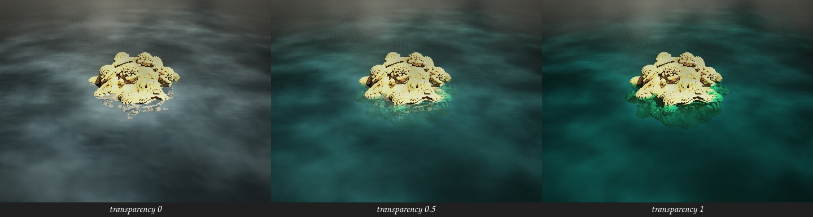</a>

  *Absorción* 0,3, 1 y 3, de clara a turbia:

  <a href="../img/water_absorption.jpg">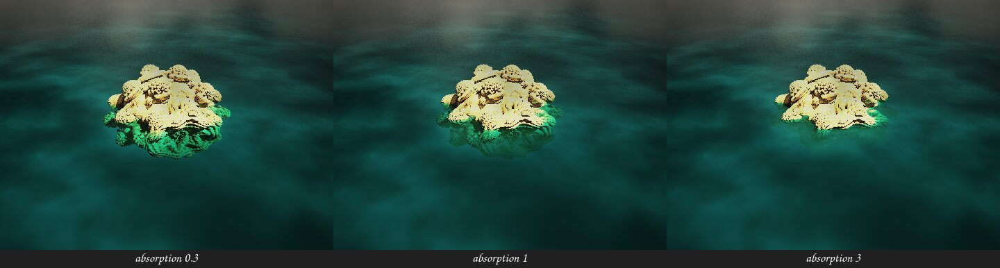</a>

  *Dispersión* 0, 0,5 y 1 mirando hacia el sol, y los rayos de luz con un
  sol bajo delante:

  <a href="../img/water_scattering.jpg">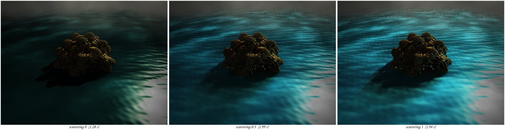</a>

  <a href="../img/water_shafts.jpg">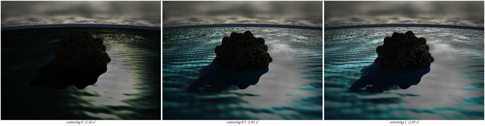</a>

  **Las olas** son un mar irregular de dieciséis olas a lo largo de una
  dirección del viento (antes de 0.2.98 tres olas regulares formaban un
  tablero de ajedrez; las escenas con olas se ven distintas desde
  entonces). Antiguas (a la izquierda de cada par) y nuevas, olas pequeñas
  y grandes, con el sol delante y detrás:

  <a href="../img/water_waves.jpg">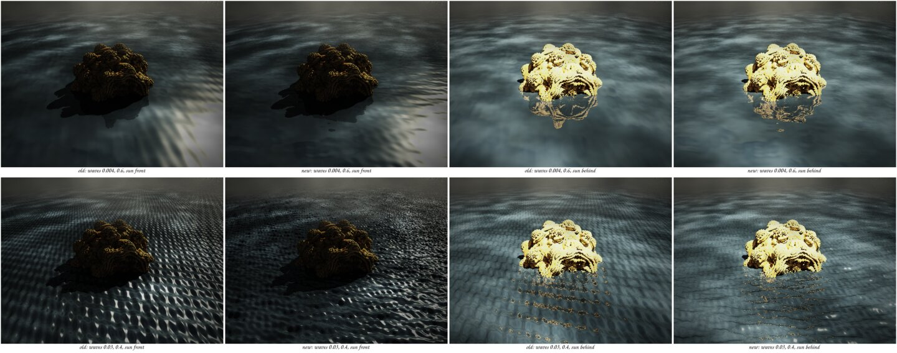</a>

  </details>
* **Luz de una imagen HDR**: una imagen Radiance de 360° (`.hdr`) como fondo
  ilumina un render Monte Carlo con todo su brillo, y su sol se convierte en
  una luz con sombras suaves (una idea de Mandelbulber).

  <a href="../img/hdr_sun.jpg">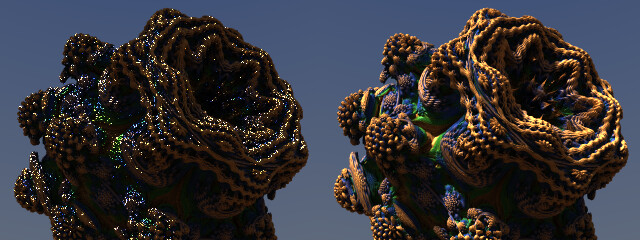</a>

  <details><summary>Más información</summary>

  Elija el archivo `.hdr` como imagen de fondo en la ventana *Iluminación* (no
  «directa»). Monte Carlo ilumina entonces la escena con el cielo, y el punto
  más brillante de la imagen, su sol, se saca y se añade como una luz con
  sombras del tamaño del sol: encontrado solo por azar, el sol dejaría motas
  brillantes (izquierda). Las imágenes de fondo de 8 o 16 bits quedan como
  estaban.

  </details>
* **Imágenes OpenEXR** para composición (Blender, Nuke, DaVinci Resolve): los
  colores en coma flotante, sin recortar por encima del blanco, con las capas
  de opacidad, profundidad y normales. *Guardar imagen* > *OpenEXR*, o
  `mb3d -o imagen.exr` (también con mosaicos y el enjambre).

  <a href="../img/exr_layers.jpg">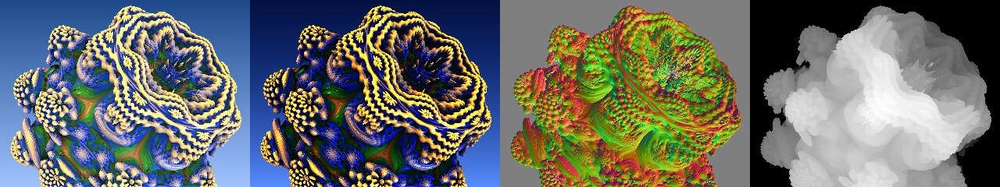</a>

  <details><summary>Más información</summary>

  Los colores son lineales, como espera OpenEXR: mostrados con la curva de
  pantalla habitual se ven como el PNG, y los brillos conservan su intensidad
  por encima del blanco. Las capas: `A` (opacidad, como en un PNG
  transparente), `Z` (la distancia a la cámara en unidades del fractal) y
  `N.X`, `N.Y`, `N.Z` (las normales de la superficie). Detalles en [TECHNICAL.md](../TECHNICAL.md).

  </details>
* **Una cámara ojo de pez y estéreo 360° para RV** (ideas de Mandelbulber):
  un ojo de pez de hasta 360° y panoramas para visores de RV con profundidad
  en todas las direcciones.

  <a href="../img/fisheye_water.jpg">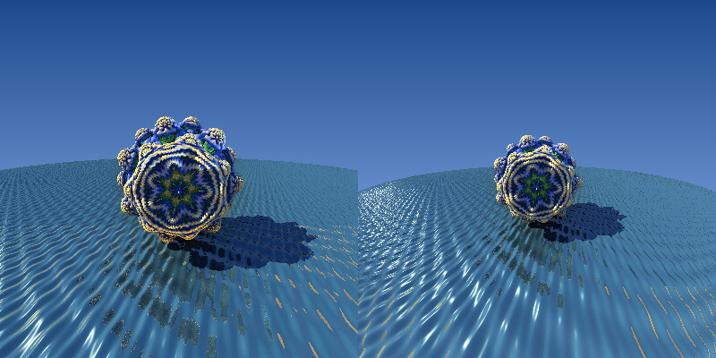</a>
  <a href="../img/vr_panorama.jpg">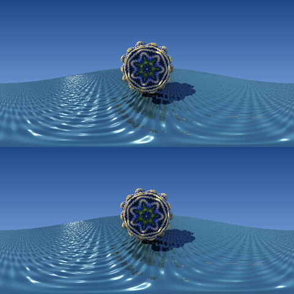</a>

  <details><summary>Más información</summary>

  Ventana principal, página *Cámara*: *Ojo de pez* (el campo de visión, FOVy,
  hasta 360°, abarca la altura de la imagen; una imagen cuadrada muestra una
  vista redonda). Un panorama de 360° en estéreo da a cada rayo su propia
  posición del ojo, girada con la dirección en que mira, así la profundidad es
  correcta en todo el contorno: `mb3d -s optic=2 --stereo-pair top-bottom`
  escribe ambos ojos, el izquierdo arriba, como esperan los reproductores de
  RV (una imagen 2:1 por ojo). Los ojos están a 6,5 cm, el punto mirado tan
  lejos como la distancia de visión estéreo (el segundo valor de
  `stereo_screen`, 2 m). Mandelbulb3D no tiene ojo de pez: el bloque mb3d-rs de
  los parámetros lo guarda.

  </details>
* **Nubes volumétricas** (una idea de Mandelbulber): una capa de nubes por
  encima, por debajo o alrededor del fractal, iluminada por la luz de la escena,
  delante y detrás del fractal.

  <a href="../img/clouds.jpg">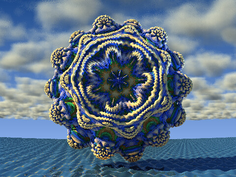</a>

  <details><summary>Más información</summary>

  Ventana *Posprocesado*, sección *Nubes*: marque *Pintar nubes*, ajuste la capa
  (un eje y dos alturas en él), la densidad, cuánto cielo cubren, el tamaño de
  sus formas y su color, y pulse *Pintar ahora*. Se pintan sobre la imagen
  terminada en una fracción de segundo, así que probar ajustes es rápido; cada
  píxel mira a través de la capa hasta la superficie que alcanzó. Una animación
  puede moverlas (`cloud_offset` entre fotogramas clave). Los reflejos las muestran, también en Monte Carlo; Mandelbulb3D no las tiene (el bloque mb3d-rs de los
  parámetros las guarda). Proyectan sus sombras sobre el fractal y el suelo, también desde fuera de la imagen.

  </details>
* **Materiales de superficie** (ideas de Mandelbulber) sobre la paleta: Fresnel
  (más reflejo en ángulos rasantes, como el vidrio y la laca), iridiscencia (los
  colores de una película fina) y brillo.

  <a href="../img/material.jpg">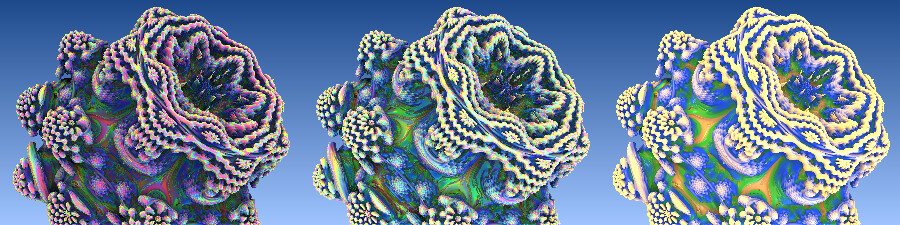</a>

  <details><summary>Más información</summary>

  Ventana *Posprocesado*, sección *Material*: marque *Material de superficie*,
  ajuste Fresnel (0 a 1), iridiscencia (0 a 1 y un desplazamiento de sus colores)
  y brillo, y pulse *Pintar ahora*. Fresnel se ve mejor con los reflejos
  calculados. Apagado, las imágenes son exactamente las de Mandelbulb3D; el plano
  de suelo conserva su color y reflejo. También en Monte Carlo.

  </details>
* **Dos fractales en una escena** (una idea de Mandelbulber): con una combinación
  DE, la segunda parte del híbrido puede estar aparte de la primera, movida,
  girada y escalada, combinada como unión, intersección o corte.

  <a href="../img/two_objects.jpg"></a>

  <details><summary>Más información</summary>

  Ventana *Fórmulas*, con una combinación DE elegida: *Parte 2 en* (su centro),
  *Tamaño* y *Girada* (grados sobre x, y y z). La unión (*Min*) pone los dos
  objetos uno junto al otro, la intersección (*Max*) deja solo lo común, el max
  invertido recorta el segundo del primero, la unión suave los funde. Se calcula
  en la tarjeta gráfica y en el procesador; el bloque mb3d-rs de los parámetros
  guarda la posición (Mandelbulb3D muestra las dos partes en un mismo lugar).

  </details>
* **Curvas de animación** (una idea de Mandelbulber): un valor de la escena en
  todos los fotogramas de una animación, con sus fotogramas clave como
  asideros para arrastrar.

  <a href="../img/curves.png"></a>

  <details><summary>Más información</summary>

  *Creador de animaciones* > *Curvas*: elija el zoom, una coordenada de la
  posición, un ángulo de giro, el campo de visión, Z inicial, la posición del
  suelo o la deriva de las nubes, y véalo en cada fotograma tal como lo
  interpola la animación. Los fotogramas clave son cuadrados en sus
  fotogramas: arrastre uno hacia arriba o abajo, o haga clic y escriba un
  valor. La interpolación bezier cuadrática pasa junto a los fotogramas clave,
  y la curva lo muestra antes de renderizar nada. Una tercera interpolación, *Catmull-Rom* (no está en MB3D), es suave y pasa por cada fotograma clave (`mb3d animate --catmull-rom`).

  </details>
* **Acabar la imagen**: exposición, un resplandor alrededor de la luz intensa,
  mapeo de tonos fílmico, contraste, saturación, calidez, una viñeta y los
  bordes de color de un objetivo, como última pasada sobre toda la imagen.

  <a href="../img/finishing.jpg"></a>

  <details><summary>Más información</summary>

  Ventana *Posprocesado*, sección *Acabado*: marque *Acabar la imagen*, ajuste
  la exposición en pasos, *Fílmico* (la luz intensa se suaviza en vez de
  volverse un blanco plano), el resplandor (intensidad, alcance como parte de
  la diagonal de la imagen y a partir de qué brillo resplandece), contraste,
  saturación, calidez, viñeta y bordes de color, y luego *Pintar ahora*. La
  pintura se hace entonces en coma flotante, así que la luz por encima del
  blanco se conserva hasta el mapeo de tonos. Se aplica a cada imagen, cada
  fotograma de animación y cada render Monte Carlo (después del filtro de
  ruido); desactivado, las imágenes son exactamente como antes. Claves de
  escena `finish_exposure`, `finish_tonemap = filmic`,
  `glow = strength, radius, threshold`, `finish_contrast`,
  `finish_saturation`, `finish_warmth`, `vignette`, `chromatic`. En un Render
  grande hecho de imágenes de teselas separadas, cada tesela resplandece por
  su cuenta.

  </details>
* **Un relieve fino en la superficie**: rugoso, piedra (crestas y grietas) o
  grano, más fino que el detalle del cálculo, con una variación de color.

  <a href="../img/relief.jpg"></a>

  <details><summary>Más información</summary>

  Ventana *Posprocesado*, sección *Material*: *Relieve* con su intensidad, el
  tamaño de sus formas (en las unidades del fractal, así que se queda en la
  superficie cuando la cámara se mueve) y su finura, y *Variación color*.
  Inclina la superficie donde se calcula la luz, así que el sombreado, los
  brillos, los reflejos y Monte Carlo lo ven; la forma en sí no cambia (el
  contorno sigue liso). No en el plano del suelo. Claves de escena
  `detail = stone, 1.5, 0.12, 0.5` (tipo, intensidad, tamaño, finura) y
  `detail_color`.

  </details>
* **Platos giratorios, vuelos grabados y desenfoque de movimiento** para las
  animaciones.

  <a href="../img/motion_blur.jpg"></a>

  <details><summary>Más información</summary>

  *Creador de animaciones* > *Plato giratorio*: ocho fotogramas clave de una
  vuelta entera alrededor del centro de la vista de la ventana principal, un
  bucle suave (`mb3d animate scene.m3p --orbit 8 --frames 25`). *Navegador* >
  *Grab*: mientras el botón está pulsado, cada nueva vista del vuelo (como
  mucho dos por segundo) se convierte en el siguiente fotograma clave; con
  Catmull-Rom la animación pasa por todos ellos. *Desenfoque mov.* en el
  Creador de animaciones: cada fotograma es la media de esa cantidad de
  imágenes dentro del tiempo de *Obturador* (una parte del tiempo hasta el
  siguiente fotograma), así que lo que se mueve se difumina; tarda esa
  cantidad de veces más (`mb3d animate --motion-blur 8,0.5`).

  *Creador de animaciones* > *Plantillas de animación...* crea fotogramas
  clave desde la vista de la ventana principal para una duración en segundos
  (a los fotogramas por segundo de la ventana): una *Órbita de 360°*
  alrededor del eje que elija (de izquierda a derecha, por encima, un
  alabeo, los tres a la vez o el eje X, Y o Z del fractal; `--orbit 8
  --duration 10 --orbit-axis pitch`) o un *Vuelo a través*, en el que la
  cámara sigue volando hacia el fractal, el zoom sigue la distancia a él,
  mantiene su rumbo y solo gira para esquivar aquello con lo que chocaría
  (`--fly --duration 20`; `--duration 0`: hasta que la vista muestre solo
  cielo o solo fractal). *RV 360°* en el Creador de animaciones (`--vr`)
  hace de cada fotograma un panorama esférico (2:1); con *Renderizar
  animación estéreo* el vídeo tiene los ojos uno encima del otro (el
  izquierdo arriba), y el comando de ffmpeg termina con `mb3d vr360
  video.mp4 --stereo tb`, que marca el MP4 como vídeo 360 para YouTube, Meta
  Quest y VLC. Un panorama esférico guardado como JPEG lleva el XMP de Photo
  Sphere, así que Facebook lo muestra como foto 360.

  </details>
* **Splats gaussianos** del fractal, para verlo por todos los lados en
  Blender (5.3 y posteriores), SuperSplat y otros visores de splats: *Bulb
  Tracer2* > *Splats gaussianos...*, o
  `mb3d splat scene.m3p -o fractal.ply`.

  <a href="../img/splats.jpg"></a>

  <details><summary>Más información</summary>

  La ventana exporta la escena de la ventana principal; sus ajustes son los
  de la línea de comandos. El fractal se calcula desde 16 direcciones
  (*Direcciones*, `--views`), cada una una imagen de 640 x 640 píxeles
  (*Tamaño de cada vista*, `--size`), con sus luces, sombras, oclusión y
  reflejos. Cada píxel del objeto se convierte en una gaussiana plana
  tendida sobre la superficie, con el color que tiene en la imagen. Donde
  las imágenes se solapan, cada trozo de la superficie viene de la que lo
  vio más de frente. Los colores cambian con la dirección desde la que se
  mira (armónicos esféricos, *Colores según la dirección*, `--sh`), así que
  los brillos se mueven como en las imágenes.

  Un objeto visto desde fuera se calcula desde todo alrededor del centro de
  la escena. Una escena vista desde dentro (una sala, una cueva, donde el
  fractal llena toda la imagen) se calcula desde la cámara de la escena,
  mirando en todas las direcciones (*Calcular desde*, `--around camera`;
  *Auto*, el valor por defecto, elige). Allí, un `--size` mayor conserva más
  detalle, ya que cada vista tiene 110 grados de ancho.

  Las luces que giran con la cámara, y los colores superior e inferior de la
  luz ambiental, quedan fijados al objeto tal como iluminan la vista propia
  de la escena, de modo que todos los lados se iluminan igual. Se omiten la
  profundidad de campo, las nubes, el resplandor, la viñeta y el plano de
  suelo. El archivo está en la vista de la escena (x a la derecha, y hacia
  dentro de la imagen, z hacia arriba: la vista frontal de Blender se ve
  como la escena), el centro o la cámara en 0 y el fractal escalado a un
  radio de 1. Ocupa unos 160 bytes por splat, normalmente de 100 a 300 MB;
  `--sh 0` lo reduce a un tercio, sin los brillos que se mueven.

  </details>

<a id="download"></a>

## Descarga

Programas listos para usar de la última versión, sin instalación:

| Sistema | Descarga |
|---|---|
| Windows (64 bits) | [mb3d-rs-windows-x64.zip](https://github.com/thr32423/mb3d-rs/releases/latest/download/mb3d-rs-windows-x64.zip) |
| Linux (64 bits) | [mb3d-rs-linux-x64.tar.gz](https://github.com/thr32423/mb3d-rs/releases/latest/download/mb3d-rs-linux-x64.tar.gz) |
| Debian, Ubuntu, Mint (se instala como otros programas) | [mb3d-rs-linux-x64.deb](https://github.com/thr32423/mb3d-rs/releases/latest/download/mb3d-rs-linux-x64.deb) |
| Fedora, RHEL, Rocky, openSUSE (se instala como otros programas) | [mb3d-rs-linux-x64.rpm](https://github.com/thr32423/mb3d-rs/releases/latest/download/mb3d-rs-linux-x64.rpm) |
| macOS, Apple silicon (M1 y posteriores) | [mb3d-rs-macos-arm64.tar.gz](https://github.com/thr32423/mb3d-rs/releases/latest/download/mb3d-rs-macos-arm64.tar.gz) |
| macOS, Intel | [mb3d-rs-macos-x64.tar.gz](https://github.com/thr32423/mb3d-rs/releases/latest/download/mb3d-rs-macos-x64.tar.gz) |

Descomprímalo e inicie **Mandelbulb3D** (`Mandelbulb3D.exe` en Windows) en
la carpeta descomprimida. La carpeta está organizada como una instalación
de MB3D, con las fórmulas y los mapas de MB3D y 80 archivos de parámetros
de ejemplo.

* Si Windows muestra "Windows protegió su PC", pulse *Más información* ▸
  *Ejecutar de todas formas*.
* macOS bloquea los programas descargados que no están firmados: ejecute
  `xattr -dr com.apple.quarantine .` una vez en la carpeta descomprimida.

**Alternativa para Linux y macOS:** en lugar de descargar a mano, esta
línea obtiene la última versión en `~/mb3d-rs` (vuelva a ejecutarla más
adelante para actualizar; el script [download.sh](../../download.sh) también
está en la carpeta del programa):

```sh
curl -fsSL https://raw.githubusercontent.com/thr32423/mb3d-rs/master/download.sh | sh
```

Comprueba la descarga antes de descomprimirla, pone **Mandelbulb3D** en
el menú de aplicaciones (Linux) y crea los comandos `Mandelbulb3D` y `mb3d`,
que puede escribir en cualquier carpeta. `sh ~/mb3d-rs/download.sh
--uninstall` vuelve a quitar la entrada del menú y los comandos; sus
archivos se quedan.

Los programas de Linux funcionan en distribuciones de aproximadamente 2018
en adelante (Ubuntu 18.04, Debian 10, Rocky/RHEL 8 y posteriores).

**Instalado como otros programas:** en Debian, Ubuntu y Mint, abra el
archivo `.deb` de arriba (o `sudo apt install ./mb3d-rs-linux-x64.deb`); en
Fedora, RHEL y Rocky, el archivo `.rpm` (`sudo dnf install
./mb3d-rs-linux-x64.rpm`, en openSUSE `sudo zypper install
./mb3d-rs-linux-x64.rpm`).
Mandelbulb3D queda entonces en el menú de aplicaciones y `mb3d` funciona en
cualquier carpeta; sus ajustes y el Historial se guardan en
`~/.config/mb3d-rs` y `~/.local/share/mb3d-rs`.

[Primeros pasos](../../GETTING_STARTED.md) le guía en los primeros pasos; las
versiones anteriores y las notas de cada versión están en la página de
[versiones](https://github.com/thr32423/mb3d-rs/releases).

<a id="guides-and-help"></a>

## Guías y ayuda

Hay guías paso a paso en la [wiki](https://github.com/thr32423/mb3d-rs/wiki/Home-es):

* [Instalación](https://github.com/thr32423/mb3d-rs/wiki/Installing-es): Windows, macOS y Linux, actualizar, dónde están sus archivos
* [Flujo de trabajo de iluminación](https://github.com/thr32423/mb3d-rs/wiki/Lighting-workflow-es): renderizar sin más y después probar luces, sombras y reflejos
* [Configurar el enjambre](https://github.com/thr32423/mb3d-rs/wiki/Swarm-setup-es): renderizar en varios equipos a través de una carpeta compartida
* [Solución de problemas y preguntas frecuentes](https://github.com/thr32423/mb3d-rs/wiki/Troubleshooting-and-FAQ-es): cuando algo no funciona como se esperaba

Todas las versiones con sus cambios: [la lista completa](../UPDATES.md).

<a id="rendering-on-several-computers-the-swarm"></a>

## Renderizar en varios equipos (el enjambre)

Los equipos que ven una misma carpeta compartida renderizan juntos: una
imagen en teselas, un Render grande, una imagen Monte Carlo, una animación o
un lote. Cada equipo toma las partes que nadie más tiene, así que uno
rápido toma más, y el equipo que inició el render junta los resultados. La
carpeta se encarga de compartir: el programa no abre ninguna conexión de
red y no habla con nadie, así que es tan seguro como su forma de compartir
archivos.

<a href="../img/swarm_window.png"></a>

<a id="setting-it-up"></a>

### Configuración

Paso a paso y con lo que conviene comprobar: [Configurar el enjambre](https://github.com/thr32423/mb3d-rs/wiki/Swarm-setup-es) en la wiki.

1. **Una carpeta en la que todos los equipos puedan escribir:** un recurso
   compartido en un NAS, un recurso compartido de Windows, Samba o NFS. En
   Linux, móntelo como carpeta, por ejemplo
   `sudo mount -t cifs //192.168.0.10/Public /mnt/share -o username=me,uid=$(id -u),gid=$(id -g)`;
   un recurso compartido abierto solo en el gestor de archivos (`smb://...`)
   no es una carpeta que el programa pueda usar.
2. **La misma versión de mb3d-rs en todos los equipos.** Un equipo con otra
   versión aparece en la lista pero no participa.
3. **En Mandelbulb3D:** el botón **Enjambre** de la pestaña Herramientas.
   Elija la carpeta compartida (el mismo recurso compartido en todos los
   equipos; su ruta puede ser distinta), dé al equipo un nombre para la
   lista y marque **Compartir este equipo**.

Eso es todo. La línea de estado dice lo que ocurre, por ejemplo
*Compartiendo con omarchy: los renders se reparten entre los 2 equipos*.
Solo en el enjambre, todo se renderiza en este equipo como siempre.

<a id="what-is-shared"></a>

### Qué se comparte

Mientras *Compartir este equipo* está marcado, el equipo renderiza las
partes que otros equipos ponen en la carpeta, y sus propios renders van al
enjambre siempre que haya otro equipo en él:

* **Calcular 3D** (y la ventana Procesamiento por lotes) — la imagen en
  N x M teselas (se ajusta en la ventana Enjambre), unida aquí con todo lo
  que da el cálculo habitual: cambios de iluminación, posprocesado, guardar
  como m3i (y su memoria, véase más abajo).
* **Render grande** — las teselas se guardan una a una a medida que llegan;
  la imagen completa nunca se mantiene en memoria, así que esta es la forma
  de hacer imágenes de 100000 x 100000 píxeles y más.
* **Monte Carlo** — como en un solo equipo: cada equipo añade pasadas a su
  propio bloque hasta que pulse Detener, la imagen se va limpiando con los
  rayos de todos, y Detener promedia los bloques. En el modo por lotes de
  la ventana, los bloques juntos se detienen en el número de rayos del lote.
* **El Creador de animaciones** — los fotogramas, uno a uno.

La ventana lista los equipos con sus núcleos, su tarjeta gráfica y lo que
hace cada uno, las tareas con su progreso, y una vista previa de la tarea
más reciente: las teselas renderizadas, las que están en curso con una
barra de progreso y las que aún faltan.

<a id="on-the-command-line"></a>

### En la línea de comandos

En cada equipo que deba ayudar, inicie un trabajador sobre la carpeta:

```sh
mb3d swarm worker /mnt/share/mb3d-swarm --name kitchen-pc
```

Después, en cualquier equipo, renderice con `--swarm` y la misma carpeta:

```sh
mb3d big.m3p --tiles 4x3 --swarm /mnt/share/mb3d-swarm
mb3d animate flight.m3a --swarm /mnt/share/mb3d-swarm
mb3d batch *.m3p -o pictures --swarm /mnt/share/mb3d-swarm
mb3d montecarlo scene.m3p --rays 256 --swarm /mnt/share/mb3d-swarm
```

`mb3d swarm list FOLDER` muestra quién está en el enjambre, qué hace cada
equipo y cuánto han avanzado las tareas. Una imagen Monte Carlo en la línea
de comandos se divide en bloques con sus propios rayos aleatorios: 4 bloques
de 64 rayos por píxel dan los 256 pedidos con `--rays 256`.

<a id="good-to-know"></a>

### Conviene saber

* **Si los demás equipos se quedan ociosos** y su lista de tareas está
  vacía mientras este equipo renderiza: el equipo que sirve la carpeta con
  Samba y la usa directamente hace que los demás conserven un listado
  antiguo de ella. Desactive esa caché en `/etc/samba/smb.conf`:
  `smb3 directory leases = no` en `[global]`, y `oplocks = no` y
  `level2 oplocks = no` en la sección del recurso compartido; después
  `sudo systemctl restart smb` y vuelva a montar el recurso compartido en
  los demás equipos.
* **Memoria:** una imagen ocupa unos 20 bytes por píxel en este programa
  (su búfer de imagen), 10 más en la ventana principal, y además la mayor
  de dos etapas: el cálculo principal con sus sombras y su oclusión (16 por
  píxel y 1,2 GB para la tarjeta), o el pintado (3 por píxel, 20 más con
  profundidad de campo, y una franja de los reflejos: 3,5 GB como máximo,
  menos cuando hay poca memoria libre, ya que la franja se dimensiona a la
  mitad de lo que está libre cuando empieza la pasada). Una imagen de
  12000 x 6000: 6 GB. Cuando una imagen necesita más que la memoria libre
  del equipo (consultada a Linux, Windows y macOS), Calcular 3D dice cuánta
  necesita y cuánta hay libre, y pregunta antes de empezar: el cálculo
  usaría la memoria de intercambio y el programa podría dejar de responder
  durante minutos. Render grande, solo o con el enjambre, es la salida: sus
  teselas se guardan una a una y la imagen completa nunca se mantiene en
  memoria. Calcular 3D con el enjambre mantiene la imagen aquí como hace el
  cálculo habitual (sin la etapa del cálculo principal, que los equipos de
  las teselas hacen con la memoria de cada tesela); un equipo del enjambre
  deja a los demás una tesela demasiado grande para su memoria.
* **Seguridad:** un equipo solo renderiza lo que pide una tarea y solo
  escribe en la carpeta de la tarea; el código de fórmulas de una tarea se
  ejecuta en el emulador de fórmulas, como todas las fórmulas.
* **Velocidad:** las teselas viajan como búferes de imagen completos, unos
  cientos de megabytes para una imagen muy grande, así que un recurso
  compartido rápido compensa. Un servicio de sincronización que copia con
  retraso también funciona, pero más despacio.
* **Equipos que desaparecen:** la parte que un equipo estaba renderizando
  la toma otro cuando no se sabe nada de él durante medio minuto. Una tarea
  cuyo propietario lleva media hora ausente la elimina quien la vea. Una
  tarea que falla en un equipo se anota en la ventana y se deja a los
  demás.
* **Detenerse:** desmarcar *Compartir este equipo* deja que la parte en
  curso termine primero; cerrar el programa la abandona, y otro equipo la
  toma.
* **Detener la tarea** (Detener en el equipo que la creó, o cerrarlo, o que
  falle): cada parte ya terminada se conserva en ese equipo, y cada equipo
  conserva la parte que estaba renderizando. Iniciar de nuevo el mismo
  render crea una tarea solo con las partes que faltan, y un equipo que
  recibe de nuevo una parte que había empezado la continúa. Lo mismo
  funciona en la línea de comandos: ejecute de nuevo el mismo comando. Un
  render Monte Carlo sin final fijo (el de la ventana) junta sus bloques
  cuando se detiene, como antes.

<a id="how-the-rendering-works"></a>

## Cómo funciona el renderizado

Una imagen fractal se calcula píxel a píxel: para cada píxel se sigue un
rayo dentro de la escena hasta que choca con la superficie del fractal, y
la fórmula se evalúa decenas de veces en cada paso. MB3D lo hace en el
procesador, usando todos sus núcleos. mb3d-rs puede hacer lo mismo, y
además puede pasar el trabajo a la **tarjeta gráfica**, que tiene miles de
pequeños procesadores y está hecha justo para este tipo de tarea.

El ajuste **"Calcular en"** (pestaña Interno de la ventana principal) elige:

| | |
|---|---|
| **Auto** (predeterminado) | La tarjeta y el procesador se reparten la imagen: la tarjeta toma filas desde arriba, los hilos del procesador desde abajo, hasta que se encuentran. Las sombras y la oclusión ambiental se reparten del mismo modo, o las hace solo la tarjeta cuando es claramente la más rápida. |
| **CPU** | Solo el procesador, como en MB3D. |
| **Tarjeta gráfica** | Solo la tarjeta (espera hasta que su programa esté listo). |

La primera vez que se usa una combinación de fórmulas, el controlador
gráfico tiene que preparar un programa para la tarjeta — el *shader* —, lo
que tarda de 10 a 15 segundos en el equipo medido más abajo. En modo Auto
el procesador simplemente empieza sin él y la tarjeta se une cuando está
lista, así que una imagen pequeña nunca espera. El shader preparado se
guarda para la próxima vez (lo hace el controlador gráfico; en Linux, en la
carpeta `ShaderCache` junto al programa), así que la siguiente imagen con
las mismas fórmulas empieza en la tarjeta de inmediato.

El **LED** a la derecha del título de la ventana indica dónde se calculó la
última imagen: verde en la tarjeta gráfica, naranja en parte, rojo en el
procesador. Al señalarlo con el ratón se ven los detalles.

[Cómo funciona el renderizado](../RENDERING.md) cuenta toda la historia con
imágenes: qué hace Auto la primera vez, por qué la tarjeta no siempre es la
opción más rápida y qué significan los colores del LED.

No todo puede ir a la tarjeta: unas pocas fórmulas no se pueden traducir
para ella, y las vistas con un zoom muy profundo se calculan en doble
precisión (que solo algunas tarjetas pueden hacer). El programa decide todo
esto por sí mismo; usted solo lo ve en el LED.

<a id="speed"></a>

## Velocidad

Todas las mediciones en un mismo equipo: un AMD Ryzen 9 3900X (12 núcleos,
24 hilos) con una NVIDIA GeForce RTX 2060, en Linux. El
**Mandelbulb3D 1.99sr37** original se ejecutó en la misma máquina con Wine
(su programa de Windows funciona ahí sin cambios, a toda velocidad, usando
todos los núcleos), y se cronometró desde el clic en *Calcular 3D* hasta la
imagen terminada. Cada archivo de parámetros se renderizó al mismo tamaño de
imagen con los tres: MB3D, mb3d-rs solo en el procesador (**CPU**) y mb3d-rs
en modo **Auto** (tarjeta gráfica y procesador juntos). Los tiempos de Auto
son los del segundo render de un archivo, con el shader de la tarjeta ya
preparado; el primer render de una nueva combinación de fórmulas añade los
10–15 s de preparación del shader en esta tarjeta.

<a id="mb3ds-80-example-parameter-files"></a>

### Los 80 archivos de parámetros de ejemplo de MB3D

Los archivos de ejemplo que vienen con MB3D (y en la carpeta `M3Parameter`
de este programa), cada uno a su propio tamaño de imagen.

MB3D no pudo calcular uno de los archivos (*Test8*: se detiene con un error "Division by zero"), así que las comparaciones cuentan 79 archivos.

* **mb3d-rs solo en el procesador es más rápido que MB3D** en 71 de los 79 archivos, con una mediana de **1,7 veces**; todos los archivos juntos le llevaron a MB3D 18 min 21 s y a mb3d-rs en el procesador 17 min 10 s.
* **El modo Auto** es más rápido que MB3D en 77 de 79 archivos (mediana de 2,1 veces); todos los archivos juntos, 8 min 17 s. En 30 de los archivos el procesador terminó solo, sobre todo porque necesita apenas unos segundos, antes de que le llegue el turno a la tarjeta — ahí Auto es simplemente el procesador más un instante de sobrecarga. La tarjeta participó en 49 archivos, los más lentos, donde hizo la imagen con una mediana de 1,6 veces más rápido que el procesador (hasta 13 veces: *Insect Menger*, 4,7 s en lugar de 63,0 s).
* En 4 archivos Auto fue notablemente más lento que el procesador solo (*Ellarien - Shrooms are coming*, *MengerTrees*, *toricaleggs*, *TreePlanet*): ahí la tarjeta es más lenta que los 24 hilos del procesador para esa escena.
* "Filas en la tarjeta" es la parte de la imagen que la tarjeta gráfica recorrió en modo Auto (– cuando el procesador terminó solo).

<details>
<summary>Los 80 archivos (pulse para abrir)</summary>

| Archivo de parámetros | MB3D (Wine) | mb3d-rs CPU | mb3d-rs Auto | filas en la tarjeta | Auto frente a MB3D |
|:--|--:|--:|--:|--:|--:|
| 0Encrypted0 - ABoxSOff4d example | 12.8 s | 7.4 s | 1.9 s | 80 % | 6.7× |
| 6 AM - Torii temple | 23.0 s | 20.4 s | 17.8 s | 60 % | 1.3× |
| Abominog-Ua - 12.06.2014 | 7.6 s | 8.0 s | 7.4 s | 50 % | 1.0× |
| ABoxPartlyJuliaRoff | 2.5 s | 1.4 s | 1.6 s | – | 1.6× |
| ABoxScale2Start | 1.0 s | 0.1 s | 0.3 s | – | 3.3× |
| ABoxScale3Start | 1.5 s | 0.1 s | 0.3 s | – | 5.0× |
| AboxShapes-Misty | 27.5 s | 25.6 s | 17.7 s | – | 1.6× |
| Aexion 10bulbs | 11.5 s | 9.8 s | 2.6 s | 73 % | 4.4× |
| AkuraPare - 463b | 4.0 s | 2.0 s | 0.7 s | 72 % | 5.7× |
| ApolloBalloons dIFS | 75.8 s | 73.2 s | 24.9 s | 57 % | 3.0× |
| AureliusCat - Bamboo | 2.0 s | 1.2 s | 0.7 s | 58 % | 2.9× |
| BatJorge - Pong 703 - Swirls | 4.0 s | 2.8 s | 3.1 s | – | 1.3× |
| Bill-Snowzell - Tweak - Canyon | 4.0 s | 1.6 s | 1.7 s | 44 % | 2.4× |
| Blood on the dancefloor | 7.6 s | 4.4 s | 3.2 s | – | 2.4× |
| BulboxCut | 4.0 s | 2.3 s | 2.3 s | – | 1.7× |
| Chrystal | 5.6 s | 5.2 s | 1.7 s | 79 % | 3.3× |
| cutted sphere over carpet | 7.1 s | 20.7 s | 4.5 s | 48 % | 1.6× |
| Dainbramage - Home of the Ancients | 3.0 s | 1.3 s | 1.2 s | 25 % | 2.5× |
| Dainbramage - Hydra | 3.5 s | 1.7 s | 1.6 s | 41 % | 2.2× |
| Dainbramage - Nothing left but bones | 4.0 s | 3.0 s | 2.4 s | 49 % | 1.7× |
| DEcomb1 | 83.9 s | 93.5 s | 80.3 s | 48 % | 1.0× |
| dIFS heart shrub | 2.5 s | 3.5 s | 3.0 s | – | 0.8× |
| dIFS heart shrub otrap | 5.1 s | 15.6 s | 3.6 s | 93 % | 1.4× |
| dIFS shrub | 4.0 s | 17.3 s | 3.6 s | 93 % | 1.1× |
| Dodeca Torus mix | 2.0 s | 0.5 s | 0.6 s | 14 % | 3.3× |
| DsyneGrafix - Getting Loopy | 2.0 s | 0.8 s | 0.8 s | 25 % | 2.5× |
| Ellarien - Embellished | 3.5 s | 1.1 s | 1.2 s | 49 % | 2.9× |
| Ellarien - Shrooms are coming | 8.1 s | 6.2 s | 6.8 s | – | 1.2× |
| ExcludeBulbMeng | 17.3 s | 12.9 s | 8.5 s | – | 2.0× |
| Fishbowl | 4.6 s | 3.5 s | 1.9 s | 49 % | 2.4× |
| Fractales75 - Kiosk | 3.0 s | 1.8 s | 1.9 s | 47 % | 1.6× |
| Genetic Menger | 1.5 s | 0.5 s | 0.6 s | 46 % | 2.5× |
| genQuat helix mix | 4.0 s | 3.3 s | 1.8 s | 61 % | 2.2× |
| HalTenny - Freak Of Nature | 2.5 s | 0.9 s | 1.2 s | – | 2.1× |
| Hal-Tenny-Resistance (slow) | 18.9 s | 20.3 s | 8.7 s | 78 % | 2.2× |
| Hyperben2 - Ozosphere tweak | 2.0 s | 0.8 s | 0.6 s | 56 % | 3.3× |
| ImpossibleWorld dIFS | 399.8 s | 367.5 s | 99.0 s | 71 % | 4.0× |
| InAndOutside box | 5.1 s | 2.7 s | 1.4 s | 68 % | 3.6× |
| Insect Menger | 4.0 s | 63.0 s | 4.7 s | 93 % | 0.9× |
| Jost1 - Tweak - New tiny temple | 3.5 s | 1.6 s | 1.0 s | 60 % | 3.5× |
| julia on box | 4.6 s | 4.0 s | 1.6 s | 73 % | 2.9× |
| JuliaSetSample | 3.0 s | 1.9 s | 2.2 s | – | 1.4× |
| KentPress - Parameter 3 tweak fogits | 4.0 s | 2.5 s | 3.0 s | – | 1.3× |
| KochSurf Sample 6 | 3.0 s | 1.4 s | 0.8 s | 75 % | 3.8× |
| Lenord - ASurf 2 | 5.1 s | 1.7 s | 1.9 s | 48 % | 2.7× |
| Lenord - Between Dark and Light | 5.6 s | 3.8 s | 2.1 s | 60 % | 2.7× |
| Lenord - The Beanstalk | 3.5 s | 1.8 s | 2.0 s | – | 1.8× |
| LightBulbMoon - A Fabulous Excuse | 3.5 s | 2.0 s | 1.6 s | – | 2.2× |
| LightBulbMoon - No, Never | 5.1 s | 4.0 s | 1.2 s | 82 % | 4.2× |
| Mandelwerk - Makin seashell | 12.0 s | 8.1 s | 8.1 s | 30 % | 1.5× |
| Mandelwerk - TgladTetra inner spirals | 8.6 s | 4.5 s | 1.1 s | 80 % | 7.8× |
| MarkJayBee - Curvichrome | 2.5 s | 1.3 s | 1.3 s | – | 1.9× |
| material colors | 3.0 s | 1.4 s | 1.9 s | – | 1.6× |
| Melting spot bloxx | 23.2 s | 20.4 s | 7.6 s | 73 % | 3.1× |
| Mengerplus for MC | 3.5 s | 2.2 s | 2.5 s | – | 1.4× |
| MengerTrees | 19.3 s | 15.4 s | 16.9 s | – | 1.1× |
| MutaGenD4B12E71C70D4FD00357_canary~ | 7.1 s | 3.7 s | 4.1 s | – | 1.7× |
| Oxnot - Flexing | 2.5 s | 0.7 s | 0.7 s | 59 % | 3.6× |
| Oxnot - Shells | 5.6 s | 3.3 s | 3.6 s | – | 1.6× |
| PaMonk - Ringlets | 5.1 s | 2.7 s | 2.8 s | – | 1.8× |
| QuatP4hybridJulia | 1.5 s | 0.2 s | 0.4 s | – | 3.8× |
| Rama - Elysium | 11.5 s | 10.6 s | 5.5 s | 74 % | 2.1× |
| Recycledrelatives - Fractal Fan | 2.0 s | 0.4 s | 0.6 s | 31 % | 3.3× |
| Recycledrelatives - Test for SurfMod | 4.6 s | 3.0 s | 3.1 s | – | 1.5× |
| Rowratty - Spirals | 4.0 s | 2.5 s | 1.0 s | 69 % | 4.0× |
| Sabine62 - Housing problem | 11.7 s | 10.5 s | 6.8 s | – | 1.7× |
| spineJulia | 91.9 s | 71.7 s | 50.7 s | 35 % | 1.8× |
| Surreal shell | 2.0 s | 0.6 s | 0.8 s | – | 2.5× |
| Test8 | error en MB3D | 0.1 s | 0.3 s |  | – |
| Theli-At - Black Mandelbulb | 1.0 s | 0.2 s | 0.5 s | 22 % | 2.0× |
| Theli-At - Bone Menger using MH | 2.0 s | 0.7 s | 1.1 s | – | 1.8× |
| Theli-At - MengerSpheres | 2.0 s | 0.6 s | 0.6 s | 50 % | 3.3× |
| ThePearl dIFS | 2.5 s | 1.4 s | 1.2 s | 25 % | 2.1× |
| TimeMachine | 1.0 s | 0.5 s | 0.7 s | – | 1.4× |
| toricaleggs | 8.6 s | 5.6 s | 6.6 s | 40 % | 1.3× |
| TreePlanet | 7.6 s | 6.6 s | 7.5 s | – | 1.0× |
| UndeadAcademy tweak - Peacock in blue | 7.6 s | 4.5 s | 1.2 s | 74 % | 6.3× |
| Virtual tubes world (UndeadAcademy style) | 9.1 s | 6.9 s | 4.3 s | 49 % | 2.1× |
| Wada basin - Reflect test | 6.6 s | 4.1 s | 4.6 s | 40 % | 1.4× |
| Waste-and-tragedy - Mandalex | 5.1 s | 3.4 s | 3.8 s | – | 1.3× |

</details>

Las imágenes son las mismas: mb3d-rs en el procesador produce la imagen de
MB3D salvo diferencias de redondeo, y las imágenes de Auto difieren de las
del procesador, de media, en una fracción de un uno por ciento del rango de
color (el detalle fino puede centellear en otros píxeles; las
[notas técnicas](../TECHNICAL.md) tienen las mediciones).

<a id="experimental-speed-ups"></a>

### Aceleraciones experimentales

Algunas formas más rápidas de calcular cambian un poco la imagen, así que
están desactivadas mientras no las active: pestaña **Interno** →
**Experimental...**, marque *Usar las aceleraciones experimentales* y luego
las que quiera. Se guardan con la escena (así también las usan la línea de
comandos, el enjambre y el asistente de IA); en la línea de comandos
`-s experimental=on` con `-s step_relax=1.3`, `-s secant_search=on`,
`-s free_steps=on`, `-s occlusion_half=on` o `-s cone_march=on`.
El programa conserva tu elección de un inicio al siguiente, también para los archivos que abras.

Medido con los 80 archivos de ejemplo en modo Auto (unos 0,4 megapíxeles, el
más rápido de dos renderizados de cada uno), frente a los mismos archivos sin
ellas:

| Aceleración | Renderizado completo | Imágenes (píxeles que difieren en más de 8 de 255) |
|---|---|---|
| **Paso alargado 1,3**: pasos de avance más largos, un paso que se pasa se repite | −5 % (mediana), hasta −20 %; 62 de 80 más rápidos | mediana 2,6 %; sombreado fino. *Las capas finas pueden mostrar agujeros* (BatJorge – Pong 703 – Swirls) |
| **Búsqueda de la superficie por secante** | −2 % (mediana), hasta −18 % | mediana 0,7 %; el detalle fino se desplaza ligeramente |
| **Sin límite de pasos sin niebla dinámica** | −1 % (mediana), hasta −30 % en escenas abiertas | casi siempre la misma imagen (mediana 0,03 %) |
| **Oclusión DE a media resolución** | −18 % en los 10 archivos con oclusión DE (DEcomb1 −24 %); esa etapa hasta 4 veces más rápida | 0–27 % de los píxeles, oclusión más suave en el detalle fino; se ve igual |
| **Marcha en cono**: un rayo grueso por bloque de píxeles, la marcha de cada píxel empieza donde se detuvo | la marcha −20 % (mediana −22 %) en el procesador, hasta −66 % en escenas abiertas (68 de 69 más rápidos); en la tarjeta renderizados completos de escenas abiertas hasta −47 % | mediana 1,0 %, tanto como cambia por sí solo el primer paso aleatorio de la marcha; *0.2.92 podía perder partes finas donde la estimación de distancia es demasiado grande; corregido en 0.2.93* |

Compare con un renderizado sin ellas antes de confiar en una para una imagen.

<a id="the-command-line"></a>

## La línea de comandos

`mb3d` renderiza sin ventana. Abra un terminal en la carpeta del programa
(en Windows, un símbolo del sistema en la carpeta descomprimida, y escriba
`mb3d` en lugar de `./mb3d`). Tras la instalación de una línea en Linux o
macOS, `mb3d` funciona en cualquier carpeta, `man mb3d` muestra su manual y
la tecla Tab completa sus opciones en bash, zsh y fish:

```sh
./mb3d "M3Parameter/6 AM - Torii temple.m3p" -o torii.png      # full size
./mb3d "M3Parameter/6 AM - Torii temple.m3p" --scale 0.25 -o small.png
./mb3d pasted.txt -o pasted.png        # parameters copied from a forum post
./mb3d City.m3p --tiles 4x4 -o city.png    # a big picture in tiles
./mb3d resume                              # stopped renders: the same command continues
./mb3d --cpu City.m3p -o city.png          # processor only
./mb3d --card City.m3p -o city.png         # graphics card only
./mb3d City.m3p --bits 16 -o city16.png    # 16 bit colour
./mb3d City.m3p --denoise 4 -o city.png    # with the noise filter
./mb3d City.m3p --aa 2 --transparent -o city.png   # transparent background
./mb3d City.m3p -o - | display -          # the picture into another program
./mb3d --help                              # all options
```

Todo lo demás tiene un subcomando con su propio `--help`:

```sh
./mb3d batch M3Parameter --scale 0.2 -o previews        # a whole folder
./mb3d animate start.m3p middle.m3p end.m3p --frames 60 -o frames
./mb3d animate project.m3a -o frames                     # MB3D animations
./mb3d animate project.m3a -o frames --transparent      # ... see-through
./mb3d animate project.m3a -o frames --video flight.avi  # ... and a video
./mb3d montecarlo scene.m3p --rays 64 -o mc.png
./mb3d montecarlo scene.m3p --rays 8 --denoise -o mc.png # ... with the noise filter
./mb3d voxel scene.m3p -o voxels --slices 256            # for 3D printing
./mb3d mesh scene.m3p -o object.stl                      # Bulb Tracer 2
./mb3d splat scene.m3p -o fractal.ply                    # Gaussian splats
./mb3d mutagen scene.m3p -o muta                         # 15 variations
```

Las fórmulas y los mapas se buscan junto al programa; los de otra
instalación de MB3D se pueden indicar con `--formulas` y `--maps`.
Las animaciones son las de MB3D: fotogramas clave con la interpolación de
MB3D, proyectos `.m3a` que se abren y se guardan, y fotogramas escritos como
en MB3D, de modo que una animación interrumpida continúa y varios equipos
pueden compartir una.

<a id="good-to-know-1"></a>

## Conviene saber

* **Las mismas imágenes, no idénticas bit a bit.** MB3D calculaba con la
  precisión de 80 bits de la antigua aritmética x87; este programa usa la de
  64 bits actual. Las imágenes coinciden en todas las estructuras, pero
  píxeles sueltos pueden diferir en el último dígito de su color. Los renders
  Monte Carlo y MutaGen usan sus propios números aleatorios, así que sus
  resultados no son los de MB3D.
* **Las imágenes de la tarjeta gráfica** difieren ligeramente de las del
  procesador (precisión simple); en el detalle muy fino el centelleo puede
  caer en otros píxeles. Los zooms profundos pasan solos a doble precisión.
* **La velocidad en el procesador** es cercana a la de MB3D: el código
  máquina de las fórmulas de los archivos `.m3f` de MB3D se tradujo para que
  funcione en cualquier procesador (también Apple Silicon), con un pequeño
  coste; el avance del rayo en sí es más rápido. Véanse las tablas de
  arriba. En Linux y Windows, las fórmulas del híbrido de una escena también
  se compilan juntas en una sola función cuando empieza una imagen (en unos
  milisegundos, con Cranelift), para que se pasen sus valores en los
  registros del procesador. Junto con un bucle más rápido sobre las
  fórmulas (en todos los sistemas), los renders en CPU de los 80 archivos de
  ejemplo tardan un 20 % menos que en la v0.2.74 (hasta un 60 % en algunos),
  con imágenes idénticas bit a bit. Una escena conserva el híbrido compilado
  solo si resulta más rápido; `MB3D_NO_JIT=1` lo desactiva. En macOS también
  está activado, pero allí aún está en pruebas: `./jit_check.sh` en la
  carpeta descomprimida lo comprueba (compara las fórmulas compiladas con
  las traducidas y renderiza los archivos de ejemplo con y sin él; las
  imágenes deben ser las mismas).
* **Las imágenes grandes** se pueden renderizar de una sola pieza (una imagen
  de 15000 x 20000 necesita unos 15 GB de memoria; con profundidad de campo
  tarda horas) o en teselas, también en varios equipos (`--tiles` y la
  ventana Renders grandes), lo que necesita menos memoria. Calcular 3D no
  empieza una imagen que no cabe en la memoria libre (en Linux, donde se
  puede saber la memoria libre) y lo dice, y un equipo del enjambre deja a
  los demás una tesela demasiado grande para su memoria.
* **Los renders sin terminar** se guardan en la carpeta de caché
  (`~/.cache/mb3d-rs/resume`, en Windows `%LOCALAPPDATA%\mb3d-rs\resume`, o
  junto al programa): 18 bytes por píxel para una imagen (una imagen de
  15360 x 15360 ocupa 4,2 GB), 64 para un render Monte Carlo. Lo calculado
  se escribe al instante y se vuelca al disco cada 5 minutos. Un render
  detenido en sus primeros 10 segundos no conserva nada; los renders sin
  terminar de más de 30 días se eliminan, y los más antiguos cuando entre
  todos ocupan más de 50 GB. Un render solo continúa con los mismos
  parámetros y la misma versión del programa (y la misma elección de
  tarjeta o procesador; la exposición y la saturación de un render Monte
  Carlo pueden cambiar). Un render Monte Carlo sigue sin terminar hasta que
  alcanza sus rayos (un lote, `--rays`, `--passes`) o se borra en la lista
  de Reanudar.
* **Las fórmulas, mapas, temas e idiomas más nuevos o propios** van en
  `~/.local/share/mb3d-rs/M3Formulas`, `.../M3Maps`, `.../Themes` y
  `.../Languages` (sea cual sea la forma de instalación; en Windows
  `%APPDATA%\mb3d-rs\...`). Se usan además de los que vienen con el
  programa, y sustituyen a un archivo incluido del mismo nombre, así que una
  fórmula actualizada de los foros surte efecto sin tocar la carpeta del
  programa.

<a id="updates"></a>

## Actualizaciones

Todas las versiones con sus cambios están en [UPDATES.md](../UPDATES.md) (en inglés).

<a id="for-developers"></a>

## Para desarrolladores

Las [notas técnicas](../TECHNICAL.md) describen cómo se usa la tarjeta
gráfica, qué se portó de las fuentes en Delphi de MB3D y cómo, las tres
formas en que se ejecuta el código máquina de las fórmulas de MB3D, el
formato de archivo de escena y sus claves, las comprobaciones frente a MB3D
y cómo compilar desde el código fuente:

```sh
git clone https://github.com/thr32423/mb3d-rs
cd mb3d-rs
cargo build --release      # target/release/Mandelbulb3D and target/release/mb3d
```

<a id="license"></a>

## Licencia

MB3D está publicado bajo la LGPL 2.1. Esta adaptación es una obra derivada
y usa la misma licencia.

<a id="credits"></a>

## Créditos

Las personas y los proyectos en los que se basa mb3d-rs se nombran en el [README en inglés](../../README.md#credits).
