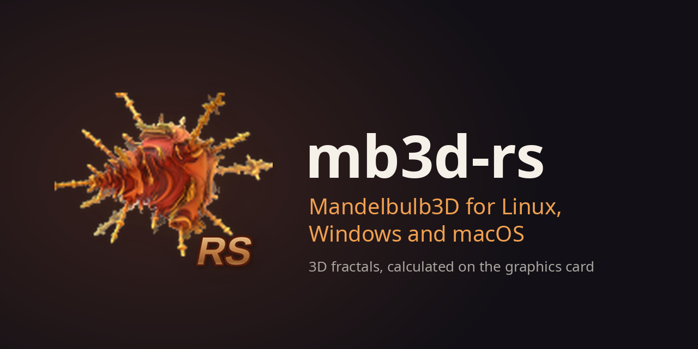

# mb3d-rs — Mandelbulb3D pour Linux, Windows et macOS
<!-- languages:start -->
[English](../../README.md) · [Deutsch](README.de.md) · [Español](README.es.md) · **Français** · [Bahasa Indonesia](README.id.md) · [Italiano](README.it.md) · [Nederlands](README.nl.md) · [Polski](README.pl.md) · [Português](README.pt.md) · [Kaszëbsczi](README.csb.md) · [العربية](README.ar.md) · [اردو](README.ur.md) · [हिन्दी](README.hi.md) · [日本語](README.ja.md) · [한국어](README.ko.md) · [简体中文](README.zh-CN.md) · [繁體中文](README.zh-TW.md)
<!-- languages:end -->
*Traduit du README anglais (version 0.2.84). Là où les deux diffèrent, c'est le [README anglais](../../README.md) qui fait foi.*

**Téléchargements : [la dernière version](https://github.com/thr32423/mb3d-rs/releases/latest)** · [Téléchargement](#download) · [Nouveautés](../UPDATES.md)

mb3d-rs, c'est [Mandelbulb3D](https://github.com/thargor6/mb3d) (MB3D), le
programme de fractales 3D, réécrit pour fonctionner sur les ordinateurs
d'aujourd'hui : sous **Linux, Windows et macOS**, avec l'image calculée sur la
**carte graphique** là où MB3D ne pouvait utiliser que le processeur. Il ouvre
les fichiers de paramètres de MB3D (`.m3p`, `.m3i`, paramètres texte copiés
des forums), utilise les formules et les cartes de MB3D, et produit les mêmes
images.

<a href="../img/main_window.jpg">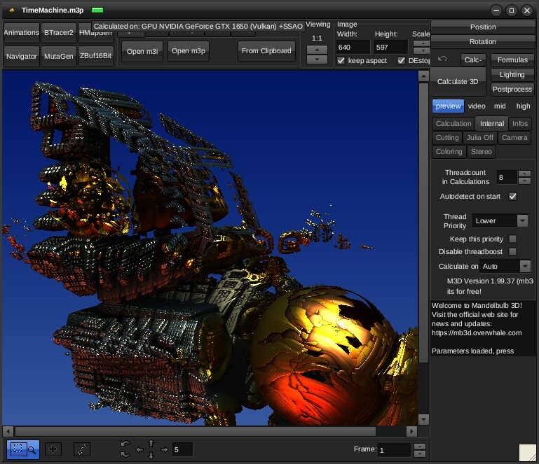</a>

Il se compose de deux programmes :

* **Mandelbulb3D** — le programme de bureau, avec les fenêtres de MB3D : la
  fenêtre principale, Formules, Éclairage, Post-traitement, Navigateur,
  Animations, Traitement par lots, Grands rendus, Monte-Carlo, Export voxel,
  Bulb Tracer 2, MutaGen et les autres. Si vous connaissez MB3D, vous
  connaissez ce programme ; les tutoriels de MB3D s'appliquent.

  <details><summary>En savoir plus</summary>

  Les fenêtres sont celles de MB3D — construites à partir des définitions de
  fenêtres d'origine de MB3D, si bien que chaque bouton, curseur et info-bulle
  se trouve là où il est dans MB3D :
  
  * **Fenêtre principale :** ouvrir et enregistrer des paramètres (`.m3p`,
    `.m3i`, texte, presse-papiers), enregistrer des images (PNG, JPEG, BMP,
    Z-buffer 16 bits), les modes de la souris, les boutons de rotation, la
    taille d'image, les préréglages de qualité, l'annulation, *Calculer 3D*
    avec l'image qui se construit et les statistiques, et toutes les pages
    (Calcul, Interne, Infos, Coupe, Julia, Caméra, Coloration, Stéréo).
  * **Formules :** les six emplacements de formules, les listes et options de
    formules de MB3D, les types d'hybrides, les favoris et l'éditeur de
    formules JIT.
  * **Éclairage :** les lumières 1 à 6, les préréglages, la palette, les pages
    Objet, Ambiant, Br. dyn. et Image fond ; les modifications redessinent
    l'image aussitôt, sans nouveau calcul.
  * **Post-traitement :** normales sur le z-buffer, ombres franches et
    ambiantes, réflexions et transparence, profondeur de champ.
  * **Navigateur :** se déplacer et regarder autour de soi au clavier et à la
    souris, puis *Vue vers principal*.
  * **Créateur d'animation, Traitement par lots, Grands rendus, Monte-Carlo,
    Export voxel, Bulb Tracer 2** (maillages) avec l'aperçu du maillage, le
    **Générateur de carte de hauteur, MutaGen, ZBuf16Bit, Séquences de
    cartes, Dossiers Ini** — tous comme dans MB3D.
  * **Essaim** (nouveau, dans l'onglet Outils) : vos ordinateurs calculent
    ensemble, voir [Rendu sur plusieurs ordinateurs](#rendering-on-several-computers-the-swarm).

  </details>
* **mb3d** — un moteur de rendu en ligne de commande pour les scripts et les
  traitements par lots : images, animations, listes de lots, rendus
  Monte-Carlo, exports voxel et maillages, splats gaussiens, le tout sans
  fenêtre.

<a id="is-it-safe-to-run-check-it-yourself"></a>

## Peut-on l'exécuter sans risque ? Vérifiez par vous-même

Vous n'avez pas à nous croire sur parole. [scanrepo.dev](https://www.scanrepo.dev)
est un service indépendant qui examine un dépôt GitHub à la recherche des
signes d'un logiciel malveillant : du code qui lance d'autres programmes, se
connecte à Internet, cache ce qu'il fait ou contourne les protections du
langage de programmation. Tout le monde peut le lancer sur ce dépôt, à tout
moment :

**[▶ Analyser mb3d-rs sur scanrepo.dev](https://www.scanrepo.dev/scan/github/thr32423/mb3d-rs)**
(cliquez sur *Rescan* pour obtenir un résultat à jour du code actuel)

La version 0.2.85 a été jugée **sûre : 5 sur 100** (analysée le 30 octobre 2026,
règles du moteur 10 de l'analyseur). Son unique avertissement porte sur la ligne qui
lance les formules que le programme compile à l'exécution pour gagner en vitesse :
exécuter du code machine fraîchement produit ne peut pas s'écrire sous la forme
vérifiée de Rust, et cette ligne ainsi que la passerelle vers le filtre anti-bruit
d'Intel sont les seuls endroits où le programme le permet ; le reste est une simple
note d'information. (Auparavant : la 0.2.66 avait obtenu 0 sur 100 avec un moteur
plus ancien, voir aussi [le résultat de la 0.2.44](../img/scan_0.2.44.png).) Une version
antérieure avait été signalée, et nous avons modifié le code en conséquence
([issue #4](https://github.com/thr32423/mb3d-rs/issues/4)) ; il est désormais
écrit pour le rester. Les programmes ne contiennent aucun code qui se connecte
à Internet ; le seul autre programme qu'ils demandent à votre système
d'ouvrir est votre gestionnaire de fichiers, quand vous cliquez sur un bouton
pour ouvrir un dossier.

Une analyse recherche des signes d'alerte connus ; ce n'est pas une garantie.
Voici de quoi vérifier plus loin par vous-même :

* **Tout le code source est ici.** Les téléchargements sont construits à
  partir de lui par les serveurs de compilation de GitHub, selon les étapes
  que vous pouvez lire dans [le workflow de publication](.github/workflows/release.yml),
  et non sur l'ordinateur personnel de quelqu'un.
* **Chaque version liste des sommes de contrôle** (`SHA256SUMS`), pour que
  vous puissiez confirmer que le fichier téléchargé est exactement celui qui
  a été publié ; l'installation en une ligne ci-dessous le fait pour vous.
  Les versions à partir de la 0.2.45 portent aussi les attestations de
  compilation de GitHub : `gh attestation verify
  FILE --repo thr32423/mb3d-rs` indique à partir de quel commit un
  téléchargement a été construit.

<a id="what-is-new-compared-with-mandelbulb3d"></a>

## Les nouveautés par rapport à Mandelbulb3D

* **La carte graphique calcule l'image** — l'image elle-même, les ombres,
  l'occlusion ambiante, les réflexions et les rendus Monte-Carlo. Sur un
  ordinateur courant, c'est plusieurs fois plus rapide que le processeur
  seul ; voir [Vitesse](#speed) plus bas.
* **Mode Auto** : la carte graphique et le processeur travaillent ensemble
  sur chaque image, et rien n'attend jamais — si la carte n'est pas prête, le
  processeur commence quand même et la carte le rejoint.
* **Une LED dans la barre de titre** indique où la dernière image a été
  calculée.
* **Taille de l'interface** de 75 à 200 % pour les écrans haute résolution.

  <a href="../img/themes_150.png"></a>

  <details><summary>En savoir plus</summary>

  **Préfs ▸ Thèmes ▸ Taille de l'interface** agrandit ou réduit toutes les
  fenêtres et leur texte (de 75 à 200 %), pour les écrans haute résolution ;
  la disposition reste exactement celle de MB3D.
  
  | 100 % | 150 % |
  |---|---|
  | 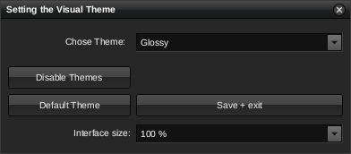 |  |

  </details>
* **Huit apparences** pour les fenêtres, toutes sous forme de fichiers de
  thème que vous pouvez copier et modifier : deux reproduisent les
  apparences de MB3D, six sont nouvelles.

  <a href="../img/themes/Midnight.jpg">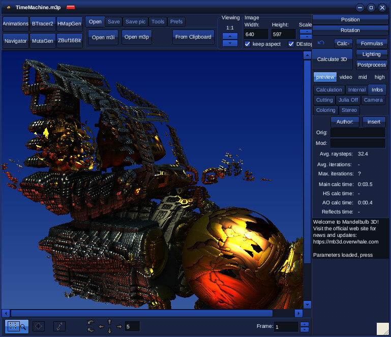</a>

  <details><summary>En savoir plus</summary>

  **Préfs ▸ Thèmes** propose huit apparences, chacune un fichier du dossier
  `Themes` : *Glossy* (le thème sombre par défaut) et *Windows* reproduisent
  les deux apparences de MB3D, les six autres sont nouvelles. Cliquez sur une
  image pour la voir en grand.
  
  | | |
  |---|---|
  | <a href="../img/themes/Glossy.jpg"></a> | <a href="../img/themes/Windows.jpg">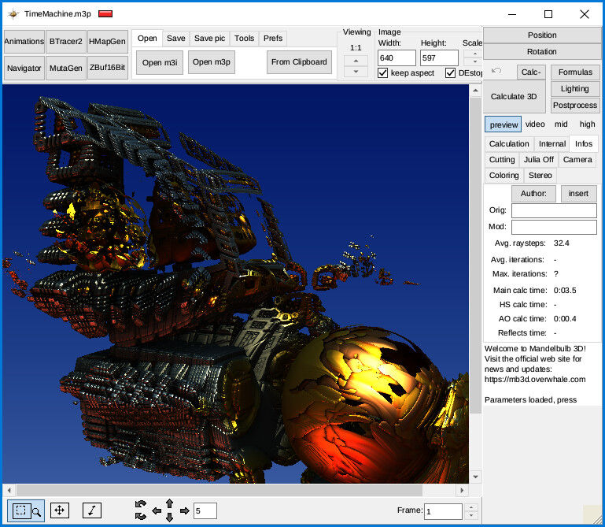</a> |
  | **Glossy** : le thème par défaut de MB3D | **Windows** : le « Themes off » de MB3D |
  | <a href="../img/themes/Graphite.jpg">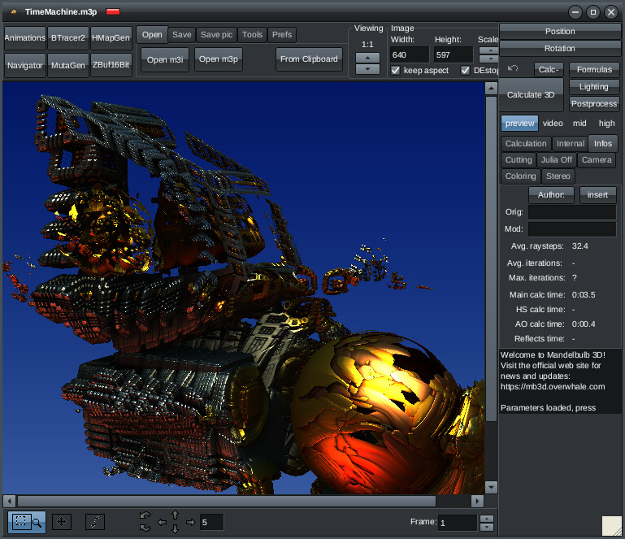</a> | <a href="../img/themes/Daylight.jpg">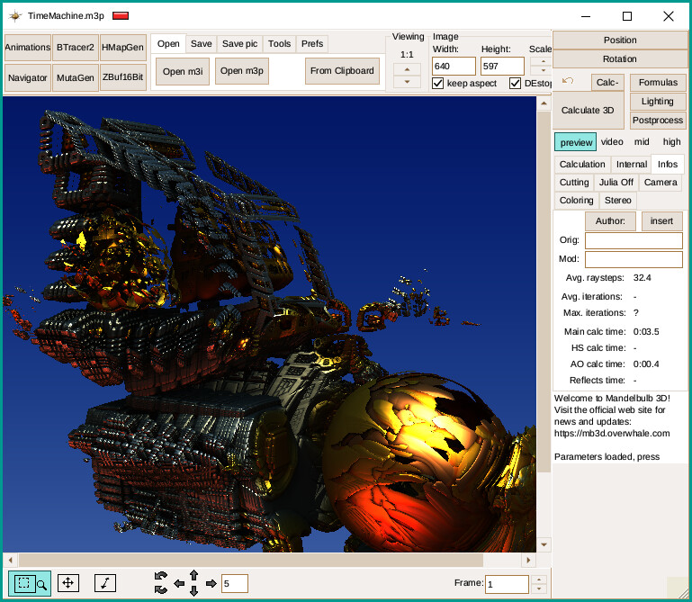</a> |
  | **Graphite** : gris neutre plus clair, accents bleu acier | **Daylight** : gris clair chaud, accents bleu canard |
  | <a href="../img/themes/Midnight.jpg"></a> | <a href="../img/themes/Ember.jpg">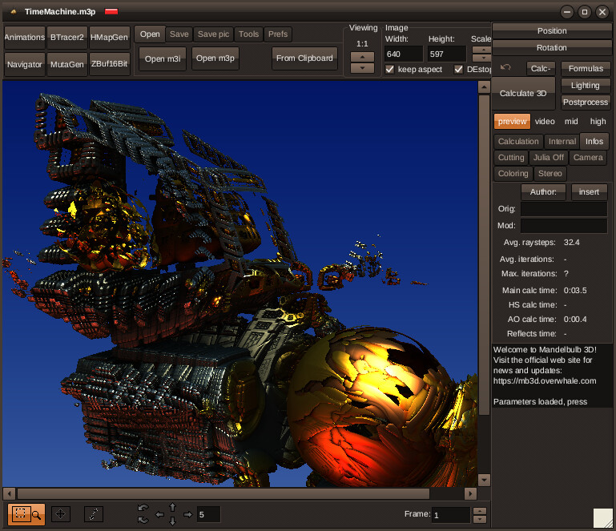</a> |
  | **Midnight** : bleu marine profond, accents bleus | **Ember** : anthracite chaud, accents orange |
  | <a href="../img/themes/Forest.jpg">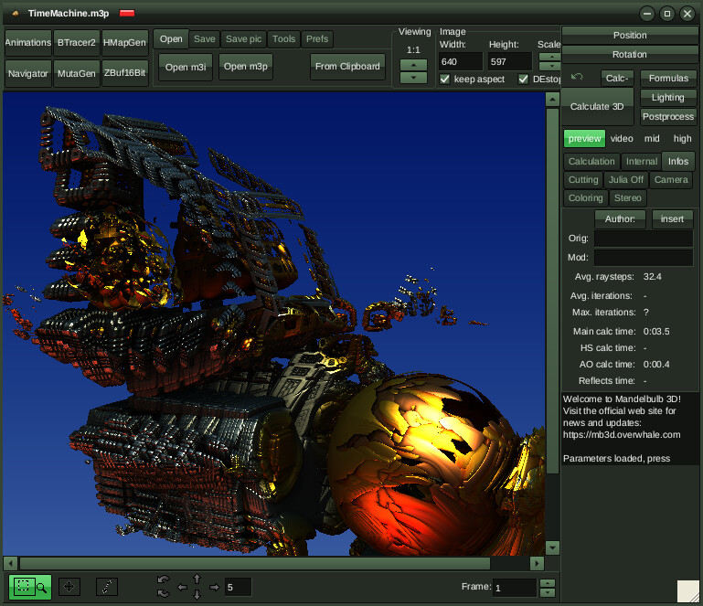</a> | <a href="../img/themes/Highcontrast.jpg">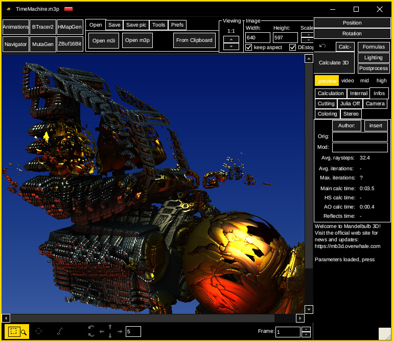</a> |
  | **Forest** : gris-vert sombre, accents verts | **High contrast** : noir, texte blanc, surlignages jaunes |
  
  Un thème est un petit fichier texte dans le dossier `Themes`, à côté du
  programme ; copiez-en un, changez ses couleurs, et il apparaît dans la
  liste au démarrage suivant.

  </details>
* **Un plantage laisse une note sur tous les systèmes** : une panique du
  programme (ou l'erreur sur laquelle il se termine) est ajoutée à
  `mb3d_crash.txt`, à côté du programme ou dans son dossier de données
  (auparavant seulement sous Windows). Joignez ce fichier à un rapport de
  bogue.
* **Toutes les cartes graphiques de l'ordinateur calculent**, sans rien à
  régler : chaque carte trouvée prend des bandes de lignes de l'image dans la
  même réserve que la première carte et le processeur, si bien qu'une carte
  plus rapide en prend simplement davantage ; les ombres, l'occlusion, les
  rayons Monte-Carlo et les réflexions sont partagés de la même façon, et une
  animation calcule une image par carte en même temps. Une carte lente (une
  puce graphique intégrée à côté d'une carte dédiée) fait ce qu'elle peut et
  ne retarde jamais une image : une fois les lignes libres épuisées, les
  cartes inactives et le processeur reprennent les lignes qu'elle n'a pas
  livrées. Une carte qui échoue est mise de côté, les autres continuent.
  `mb3d --list-cards` montre ce qui a été trouvé. (Testé avec une carte
  ouverte deux fois et avec un pilote Vulkan logiciel comme seconde carte ;
  pas encore sur un ordinateur doté de deux vraies cartes.)
* **Une image inachevée est un fichier `.m3i`.** Ce qu'un rendu arrêté,
  planté ou tué a calculé est conservé dans le cache (la fenêtre Rendus
  inachevés, `mb3d resume`) ; pour une image, ce fichier est désormais à
  tout moment un fichier image `.m3i`, `image.m3i` dans le dossier du rendu,
  avec les lignes pas encore calculées en arrière-plan. Copiez-le quand vous
  voulez, ou appuyez sur *Save m3i* dans la fenêtre Rendus inachevés (`mb3d
  resume --m3i KEY file.m3i` en ligne de commande ; les deux écrivent aussi
  le `data.bin` d'une version antérieure sous forme de `.m3i`), et ouvrez-le
  ici ou dans Mandelbulb3D, sans conversion. (Les rendus Monte-Carlo gardent
  leurs propres enregistrements ; le `.m3c` d'une passe s'écrit avec
  `--m3c`.)
* **Raccourcis clavier pour les fenêtres** : une combinaison de touches
  amène au premier plan la fenêtre principale, le Navigateur, la fenêtre
  d'animation, Formules, Éclairage, Post-traitement ou Monte-Carlo depuis
  n'importe quelle fenêtre (Ctrl+1 à Ctrl+7), et Ctrl+W ferme la fenêtre où
  vous êtes (sur macOS, Cmd). Définissez les vôtres dans *Préfs > Raccourcis* : cliquez sur un champ et
  appuyez sur les touches ; Retour arrière supprime un raccourci.
* **L'interface dans votre langue** : chaque texte des fenêtres vient d'un
  fichier de langue ; douze langues sont fournies, et le programme écrit pour
  vous le fichier d'une nouvelle langue à traduire.

  <details><summary>En savoir plus</summary>

  Le badge de langue, à l'extrémité droite de la barre de titre de la
  fenêtre principale, indique la langue de l'interface (`EN`) ; un clic ouvre
  la fenêtre des langues. Une langue est un fichier texte dans le dossier
  `Languages`, à côté du programme. Fournies : English, Deutsch, Français,
  Italiano, Nederlands, Polski, Kaszëbsczi, हिन्दी, 日本語, 한국어, 简体中文 et
  繁體中文 (chacune avec son drapeau ; les langues d'Asie de l'Est apportent
  un sous-ensemble de Noto Sans CJK pour leurs caractères, le hindi apporte
  Noto Sans Devanagari, dont les lettres liées et les signes de voyelles sont
  composés par le moteur de mise en forme de texte rustybuzz).
  Les traductions ont été faites par machine et vérifiées pour leur
  structure, pas par des locuteurs natifs : les corrections sont les
  bienvenues, chacune tient sur une ligne du fichier. Pour traduire : tapez le nom de votre langue
  et appuyez sur *Créer le fichier de langue* ; le programme écrit
  `Languages/<name>.lng` avec tous les textes en anglais, un par ligne
  (`Button2.Caption = Calculate 3D`). Traduisez les textes à droite du `=`
  avec un éditeur de texte et appuyez sur *Recharger* : les fenêtres suivent
  aussitôt, sans redémarrage. Une ligne omise garde le texte anglais.
  *Enregistrer + quitter* garde la langue pour le démarrage suivant.

  </details>
* **Linux, Windows et macOS** (Intel et Apple Silicon).
* **Un programme en ligne de commande** pour tout ce qui n'a pas besoin de
  fenêtre.
* **De très grandes images d'un seul tenant** : 15000 x 20000 pixels et plus
  sans manquer de mémoire, et la profondeur de champ utilise tous les cœurs
  du processeur (11 fois plus rapide sur 24 threads qu'avant la 0.2.45, avec
  la même image).
* **Images 16 bits :** des fichiers PNG avec 65 536 niveaux par couleur au
  lieu de 256, pour une retouche sans effet d'escalier.

  <a href="../img/png16_compare.png">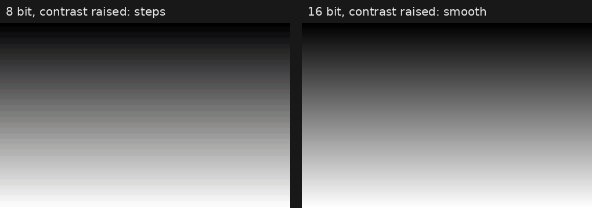</a>

  <details><summary>En savoir plus</summary>

  MB3D enregistre des images 8 bits : 256 niveaux par couleur. C'est
  largement assez pour regarder, mais quand une image est retouchée ensuite
  — luminosité, contraste, courbes — les zones lisses comme l'arrière-plan ou
  le brouillard se cassent en bandes visibles. **Enreg. image ▸ PNG** propose
  un second type de fichier, **PNG couleur 16 bits** : les couleurs telles que
  le programme les a calculées, avant leur arrondi à 256 niveaux, avec toutes
  les ombres, réflexions et la profondeur de champ. Le fichier a le même
  aspect, et reste lisse quand on le retouche.
  
  <a href="../img/png16_compare.png"></a>
  
  <a href="../img/save_png16.png">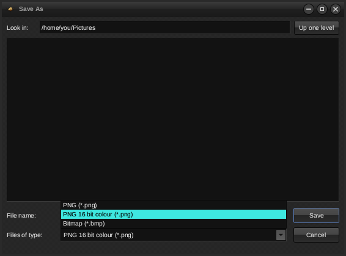</a>

  </details>
* **Un filtre de bruit** pour les images Monte-Carlo et toutes les autres, le
  débruitage DCT connu de GIMP, et pour les rendus Monte-Carlo aussi un
  filtre neuronal, Intel Open Image Denoise.

  <a href="../img/mc_noise.png">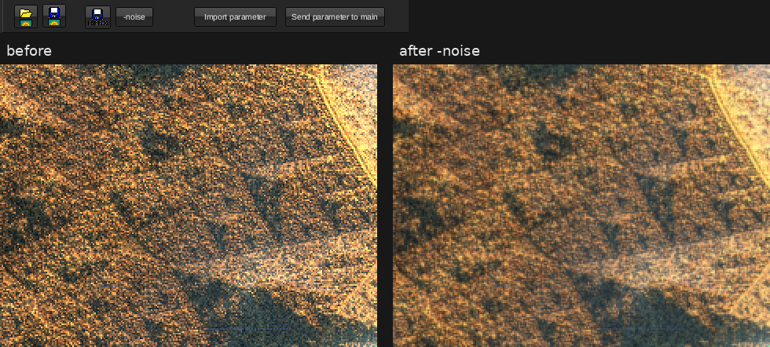</a>

  <details><summary>En savoir plus</summary>

  Un **filtre de bruit** retire le grain des images : le **débruitage DCT**
  de GIMP (*Filters ▸ Enhance ▸ Noise Reduction ▸ Denoise DCT*), celui
  des filtres de GIMP qui convenait le mieux à ces images (voir les
  remerciements plus bas).
  
  * **Fenêtre Monte-Carlo ▸ -bruit** (un bouton que MB3D avait caché) :
    filtre l'image affichée, et celle qui est enregistrée, avec une force qui
    suit le nombre de rayons par pixel. Le rendu lui-même continue sans
    filtre, et sa prochaine mise à jour l'affiche de nouveau non filtré.
  * **Post-traitement ▸ Filtre de bruit** : *Filtrer maintenant* filtre
    l'image de la fenêtre principale ; *Filtrer automatiquement les nouvelles
    images* filtre chaque nouvelle image. *Force* est la force du bruit à
    retirer (4 est léger ; plus haut retire davantage de grain et davantage
    de détails fins).
  
  Les images Monte-Carlo ont le plus de grain. Comparées à des images rendues
  avec 512 rayons par pixel, les images filtrées étaient plus proches que les
  images non filtrées dans les 13 tests (quatre scènes, de 4 à 32 rayons) :
  jusqu'à 23 % de mieux à 4 rayons, 5 à 10 % à 8 rayons, 1 à 3 % à 32 rayons,
  où il reste peu de grain.
  
  <a href="../img/mc_noise.png"></a>
  
  <a href="../img/postpro_noise.png">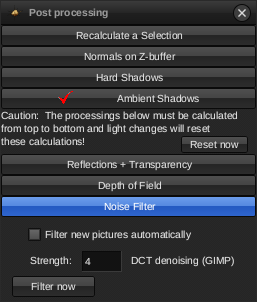</a>

  Le **filtre de bruit neuronal** est
  [Intel Open Image Denoise](https://www.openimagedenoise.org), le filtre de
  Cycles de Blender et de nombreux autres moteurs de lancer de chemins
  (path tracers), entraîné sur des images de synthèse. Il filtre les moyennes
  des rayons du rendu (avant l'exposition et la saturation), si bien que
  l'image garde sa luminosité. La bibliothèque d'Intel est fournie avec le
  programme (le dossier `oidn` ; dans les paquets .deb et .rpm,
  `/usr/lib/mb3d-rs/oidn`) ; `MB3D_OIDN` peut en désigner une autre.

  * **Fenêtre Monte-Carlo ▸ -bruit IA** : filtre l'image affichée, et celle
    qui est enregistrée, comme *-bruit* ; le rendu continue sans filtre.
  * **Ligne de commande** : `mb3d montecarlo scene.m3p --rays 8 --denoise-ai`.
  * Il faut de 0,2 à 0,6 seconde pour une image de 640 x 480 sur le
    processeur.

  L'écart par rapport à l'image à 512 rayons (moyenne sur tous les pixels,
  plus bas est meilleur) :

  | Scène | 4 rayons | filtre DCT | filtre neuronal | 8 rayons | filtre DCT | filtre neuronal |
  |---|---|---|---|---|---|---|
  | TreePlanet | 1.89 % | 1.52 % | **1.23 %** | 0.88 % | 0.82 % | **0.79 %** |
  | Cutted sphere over carpet | 5.30 % | 3.87 % | **2.34 %** | 2.80 % | 2.37 % | **1.66 %** |
  | Julia on box | 1.61 % | **1.01 %** | 1.08 % | 0.98 % | **0.81 %** | 0.84 % |
  | MengerTrees | 1.95 % | 1.54 % | **1.26 %** | 1.15 % | 1.05 % | **0.94 %** |

  Le filtre neuronal est le plus proche dans trois des quatre scènes ; sur le
  grain fin de l'ensemble de Julia, le filtre DCT est un peu plus proche. Il
  se remarque surtout sur le verre et les miroirs, où peu de rayons laissent
  le plus de grain :

  <a href="../img/mc_noise_ai.jpg">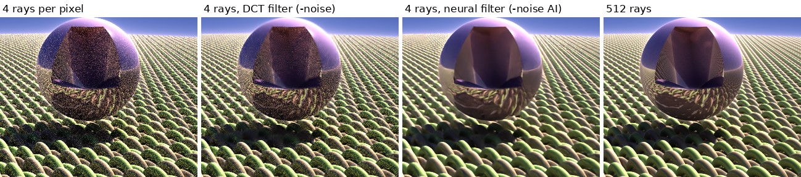</a>

  </details>
* **Arrière-plans transparents** pour les images et les animations.

  <a href="../img/transparent.png">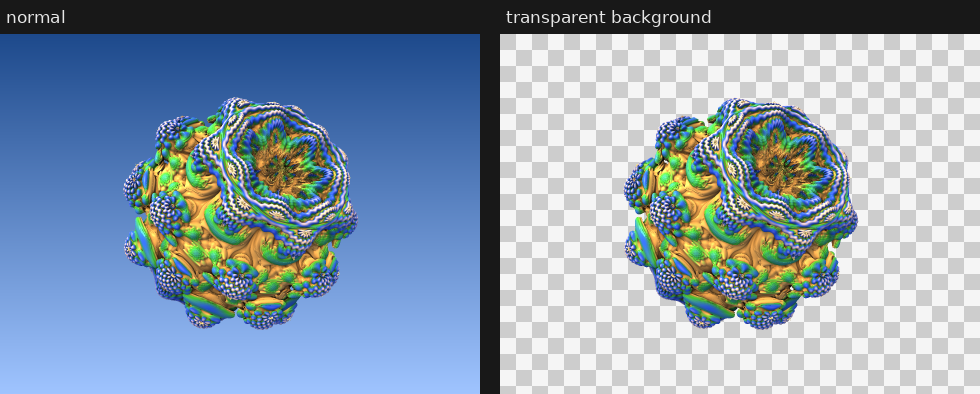</a>

  <details><summary>En savoir plus</summary>

  Les images et les images d'animation peuvent être enregistrées avec un
  **arrière-plan transparent**, pour poser la fractale sur une autre image ou
  la placer dans un logiciel de montage vidéo : **Enreg. image ▸ PNG ▸ PNG
  arrière-plan transparent**, et dans le Créateur d'animation **Fond
  transparent** (images PNG). Avec l'anticrénelage (une échelle d'affichage
  de 1:2 ou plus, ou `--aa`), les bords sont doux, et ils ne gardent aucune
  frange de l'ancienne couleur d'arrière-plan. Les images de profondeur pour
  la composition existaient déjà (*Enregistrer aussi le Z-buffer*,
  `--depth`).
  
  <a href="../img/transparent.png"></a>

  </details>
* **Vidéos des animations :** un fichier AVI directement depuis le
  programme, ou la commande ffmpeg pour un petit MP4.

  <a href="../img/anim_video.png">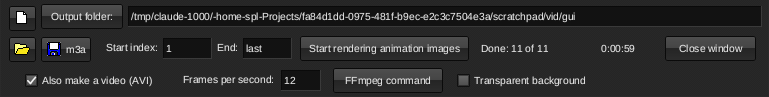</a>

  <details><summary>En savoir plus</summary>

  Dans le Créateur d'animation, **Créer aussi une vidéo (AVI)** assemble les
  images en une vidéo au fur et à mesure de leur rendu, au nombre d'**Images
  par seconde** que vous avez choisi : `<project name>.avi` dans le dossier
  de sortie, à côté des images, qui sont conservées. Elle se lit dans VLC et
  mpv et s'ouvre dans les logiciels de montage (Kdenlive, Shotcut, DaVinci
  Resolve). Chaque image y est stockée entière, si bien que les fichiers sont
  gros : bien pour le montage et l'archivage, moins pour le partage.
  
  Pour une petite vidéo à partager, **Commande FFmpeg** place la commande
  pour un MP4 (ou, avec un arrière-plan transparent, un WebM) dans le
  presse-papiers et dans les messages. Installez [ffmpeg](https://ffmpeg.org),
  collez la commande dans un terminal une fois les images terminées, et elle
  produit la vidéo ; ce programme ne lance lui-même aucun autre programme.
  
  <a href="../img/anim_video.png"></a>

  </details>
* **Un aperçu des fichiers de paramètres** dans la boîte de dialogue
  d'ouverture.

  <a href="../img/open_preview.png">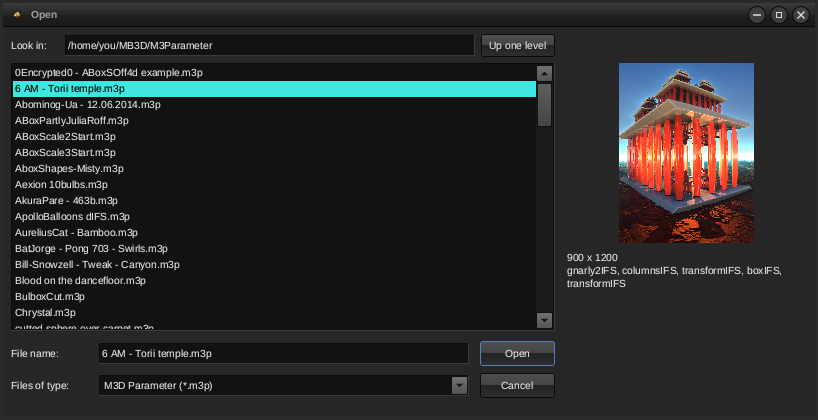</a>

  <details><summary>En savoir plus</summary>

  **Ouvrir ▸ Ouvrir m3p** et **Ouvrir m3i** montrent une petite image du
  fichier de paramètres cliqué, avec sa taille et ses formules, avant qu'il
  soit ouvert ; les touches fléchées parcourent la liste avec l'aperçu.
  L'image est calculée en arrière-plan sur le processeur, si bien que la
  boîte de dialogue reste réactive, et l'aperçu de chaque fichier est
  conservé tant que le programme tourne.
  
  <a href="../img/open_preview.png"></a>

  </details>
* **Navigateur : valeurs exactes et Réinit. vue.** Cliquez sur une valeur et
  tapez-la ; revenez à la vue de départ du Navigateur.

  <a href="../img/navigator_values.png">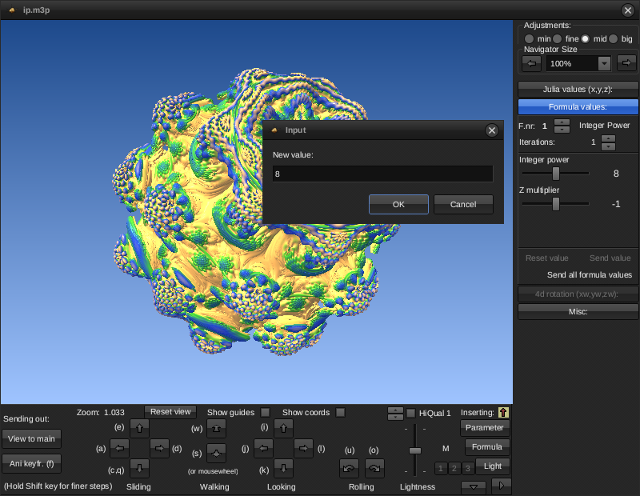</a>

  <details><summary>En savoir plus</summary>

  * **Cliquez sur une valeur** dans les panneaux du Navigateur — valeurs
    Julia, valeurs de formule, rotation 4D, valeurs Divers — et tapez le
    nombre exact, comme dans MB3D (angles en degrés). Le curseur repart
    ensuite de cette valeur.
  * **Cliquez sur le zoom** et tapez-le, quand les pas de zoom sont trop
    grossiers (un souhait de la liste des problèmes de MB3D) ; un zoom tapé
    reste (*zoom fixe*).
  * **Réinit. vue** revient à la position, à la direction et au zoom que le
    Navigateur a pris dans la fenêtre principale ; les valeurs ajustées
    restent.
  
  <a href="../img/navigator_values.png"></a>

  </details>
* **Une nouvelle formule, SphereTree :** un arbre de sphères qui se touchent
  et se ramifient en sphères de plus en plus petites, de Tom Lowe.

  <a href="../img/spheretree_ball.jpg">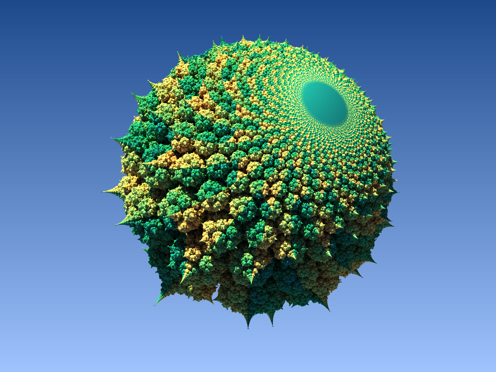</a>

  <details><summary>En savoir plus</summary>

  **SphereTree** est une formule que Mandelbulb3D n'a pas : un arbre de
  sphères qui se touchent et se ramifient en sphères de plus en plus petites,
  comme de l'écume ou du corail. Tom Lowe, l'inventeur de la Mandelbox, l'a
  publiée en 2020 (voir les remerciements plus bas). Elle se trouve dans la
  liste des formules avec les formules dIFS et a quatre réglages :
  
  * **PackRatio** (0 à 1,22) : la taille des sphères ; à 1 elles se touchent
    tout juste, au-dessus de 1 les sphères extérieures se détachent.
  * **Levels** : la profondeur de l'arbre (6 suffit pour la plupart des
    images).
  * **Rotated** : 1 tourne chaque niveau d'un douzième de tour, et l'arbre
    devient une boule ronde de grappes de sphères.
  * **Colour scale** : chaque branche de l'arbre a sa propre couleur.
    Choisissez *2nd choice* (l'orbit trap) dans les réglages de couleur de
    l'Éclairage pour les voir ; ce réglage les répartit sur le dégradé de
    couleurs.
  
  Elle fonctionne seule et après des transformations dIFS (la troisième
  image la répète avec *tilingbrickIFS*), et elle est calculée sur la carte
  graphique comme sur le processeur. Réglez les itérations sur 1 : la formule
  calcule tout l'arbre d'un coup. Les paramètres contenant SphereTree ne
  s'ouvrent que dans ce programme, pas dans Mandelbulb3D.
  
  <a href="../img/spheretree_ball.jpg"></a>
  
  | <a href="../img/spheretree_close.jpg">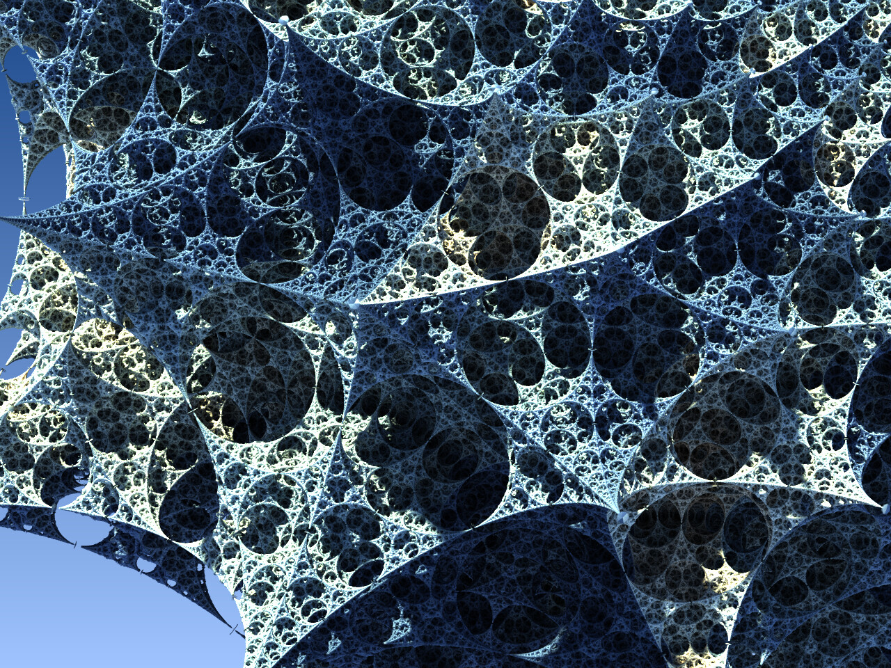</a> | <a href="../img/spheretree_swarm.jpg">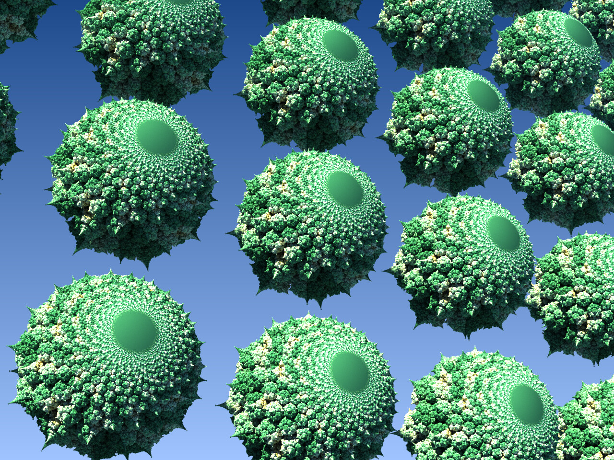</a> |
  |:---:|:---:|

  </details>
* **Une nouvelle formule, DomeTree :** un dôme d'où pousse un anneau de dômes
  plus petits, chacun avec son propre anneau, de Tom Lowe.

  <a href="../img/dometree_mc.jpg">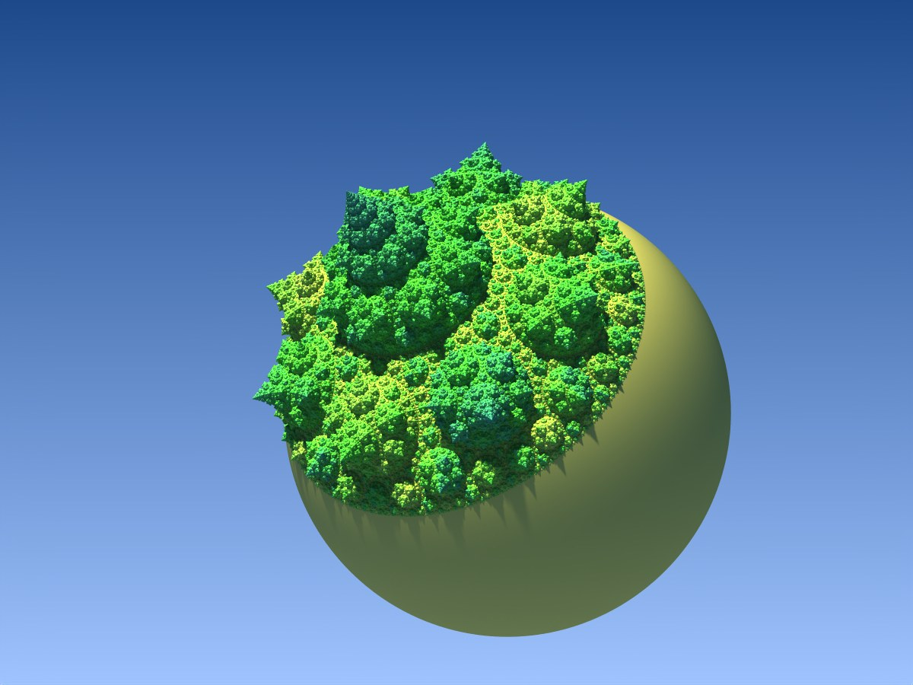</a>

  <details><summary>En savoir plus</summary>

  **DomeTree** est le deuxième arbre de Tom Lowe après SphereTree (voir les
  remerciements) : une boule dont un côté fait pousser un anneau de dômes,
  chaque dôme son propre anneau plus petit, niveau après niveau, fait
  d'inversions par rapport à des cercles. Elle se trouve dans la liste des
  formules avec les formules dIFS et a cinq réglages :

  * **Levels** : la profondeur de l'arbre (16 suffit largement).
  * **Children** : le nombre de dômes dans chaque anneau, de 4 à 10.
  * **Bend angle** (0,3 à 1,3 donnent les meilleurs résultats) : à quel point
    les dômes se bombent ; les valeurs basses donnent des disques plats, les
    hautes des dômes ronds. Au-delà d'environ 1,3, la surface devient
    granuleuse.
  * **Colour scale** : chaque dôme a sa propre couleur. Choisissez *2nd
    choice* (l'orbit trap) dans les réglages de couleur de l'Éclairage et une
    large plage de couleurs (par exemple 0 à 100) pour les voir.
  * **Start curved** : 1 (la valeur par défaut) part de la boule, 0 d'un sol
    plat qui fait pousser le premier anneau.

  Utilisez un petit *Raystep* (0,2 ; 0,05 avec 9 ou 10 enfants) :
  l'estimation de distance de la forme est approximative, comme dans le
  fichier Fragmentarium de TGlad lui-même. Comme SphereTree, elle tourne sur
  la carte graphique et le processeur, n'a besoin que d'une itération, et les
  paramètres qui la contiennent ne s'ouvrent que dans ce programme.

  <a href="../img/dometree_mc.jpg"></a>

  | <a href="../img/dometree_5.jpg">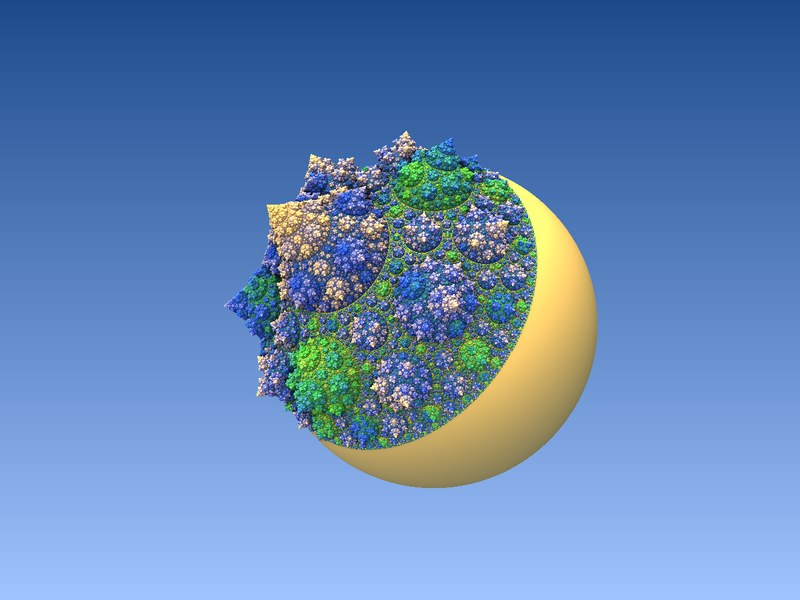</a> | <a href="../img/dometree_flat.jpg">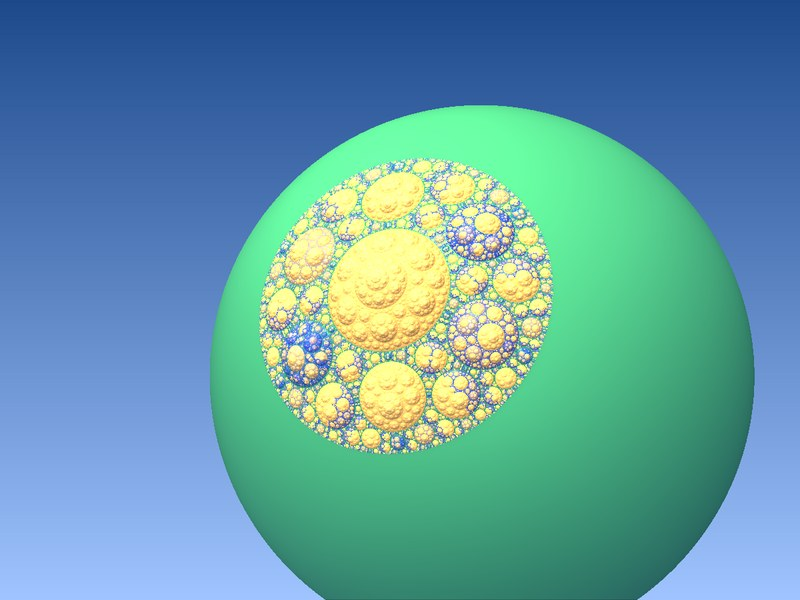</a> | <a href="../img/dometree_10.jpg">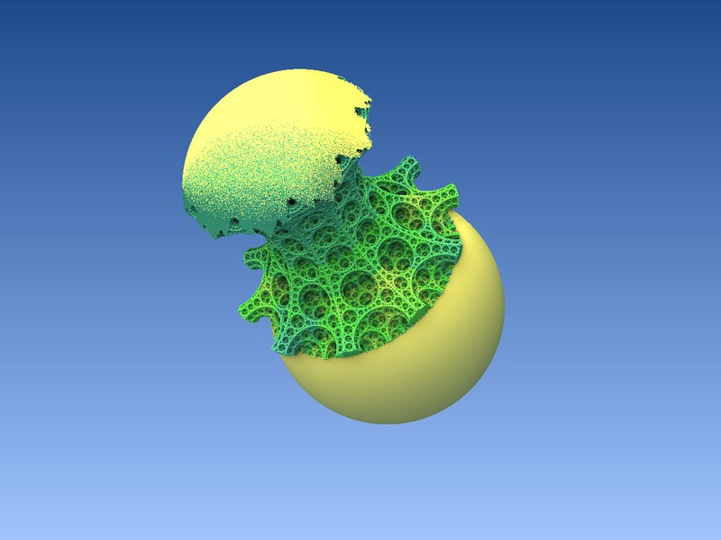</a> |
  |:---:|:---:|:---:|

  </details>
* **Une nouvelle formule, UlamSpiral :** la spirale des nombres premiers
  d'Ulam en 3D, sous forme de ville, de silhouette urbaine, de sphères ou de
  bloc.

  <a href="../img/ulam_2d.png">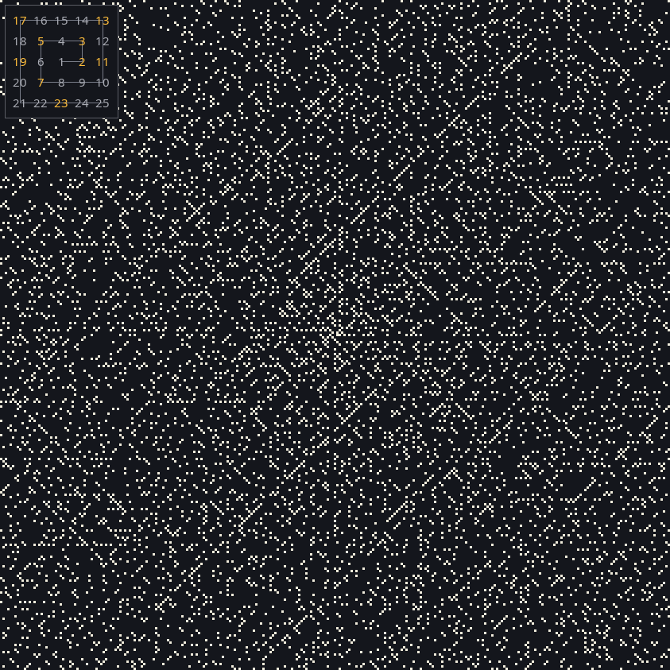</a>

  <details><summary>En savoir plus</summary>

  En 1963, le mathématicien Stanisław Ulam assistait à une conférence où
  l'on présentait « un exposé long et très ennuyeux », et griffonnait sur
  une feuille de papier quadrillé. Sa première idée était de composer des
  problèmes d'échecs ; au lieu de cela, il numérota les cases 1, 2, 3, … en
  spirale, 1 au milieu, et entoura les nombres premiers. Les nombres premiers
  s'alignaient sur des diagonales, comme s'ils suivaient un motif, et c'est
  encore le cas quand un ordinateur en dessine des millions (Ulam en essaya
  100 000 sur le MANIAC II de Los Alamos ; Martin Gardner mit l'image en
  couverture de Scientific American en 1964). Personne ne l'a entièrement
  expliqué à ce jour.
  
  <a href="../img/ulam_2d.png"></a>
  
  **UlamSpiral** construit cette spirale en 3D, une forme par nombre, sous
  quatre formes (*Mode*) :
  
  * **0, tours de nombres premiers** : une plaque pour chaque nombre et une
    tour sur chaque nombre premier. Les diagonales de nombres premiers
    deviennent des rangées de tours.
  * **1, silhouette des diviseurs** : une colonne pour chaque nombre,
    d'autant plus haute qu'il a de diviseurs ; les nombres premiers sont les
    rues basses entre elles.
  * **2, sphères des diviseurs** : une sphère pour chaque nombre, d'autant
    plus grande qu'il a de diviseurs (les nombres premiers sont les petites).
  * **3, un bloc de nombres premiers** : les nombres enroulés sur des
    coquilles cubiques au lieu d'un carré, un cube sur chaque nombre premier.
  
  *Rings* règle la taille de la spirale (60 anneaux correspondent aux nombres
  jusqu'à 14 641), *Height* la hauteur des tours ou des colonnes, *Gap*
  l'espace entre elles. Avec *2nd choice* (l'orbit trap) dans les réglages de
  couleur, la couleur suit le nombre de diviseurs, si bien que les nombres
  premiers ont une couleur à eux. Comme SphereTree, elle tourne sur la carte
  graphique et le processeur, fonctionne après des transformations dIFS, n'a
  besoin que d'une itération, et les paramètres qui la contiennent ne
  s'ouvrent que dans ce programme.
  
  <a href="../img/ulam_city.jpg">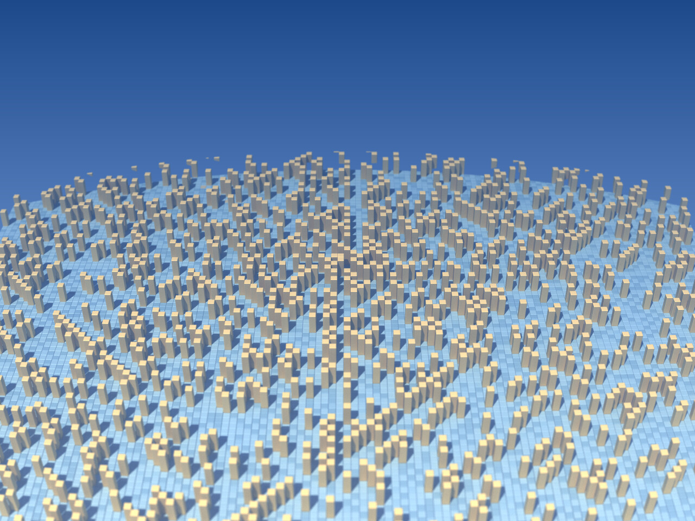</a>
  
  | <a href="../img/ulam_skyline.jpg">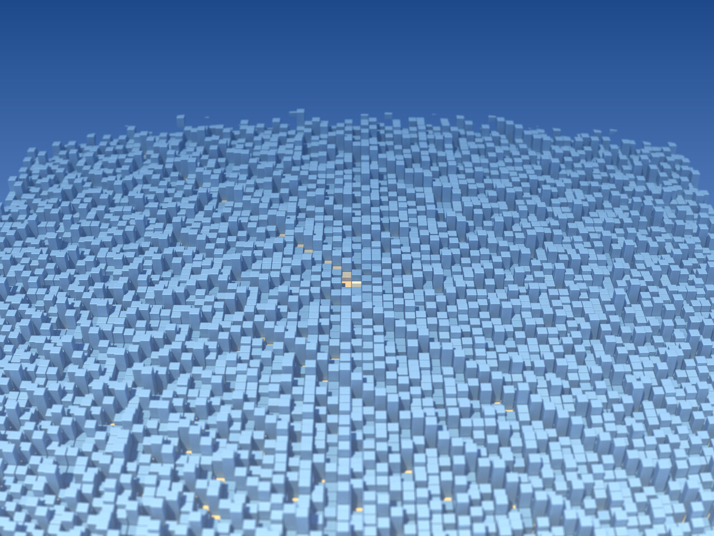</a> | <a href="../img/ulam_spheres.jpg">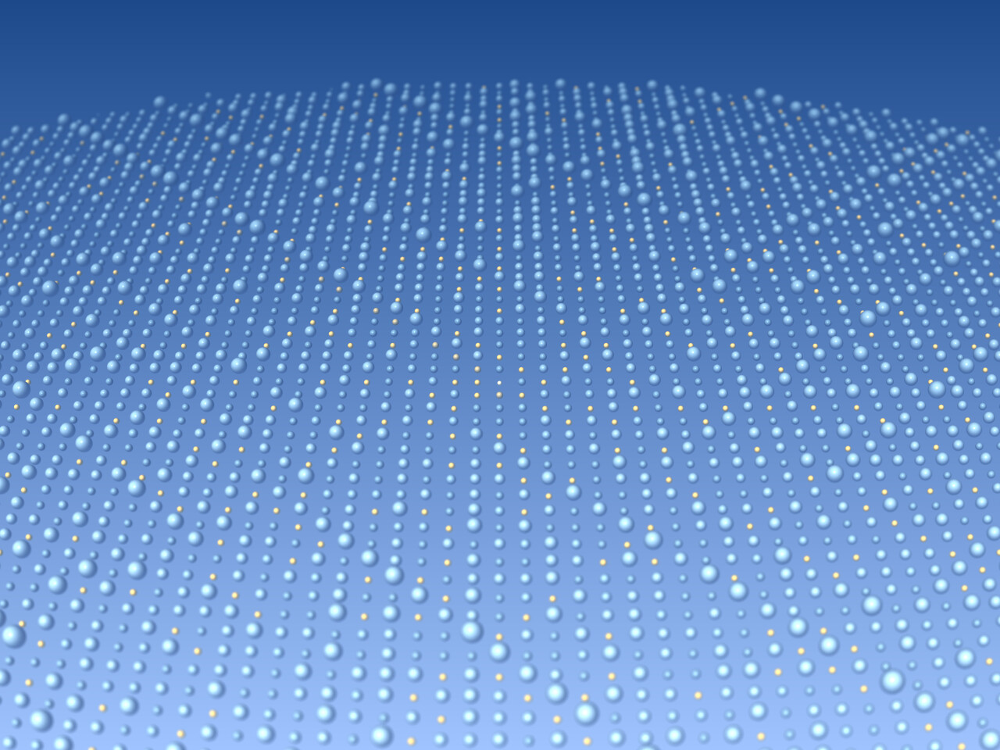</a> | <a href="../img/ulam_block.jpg">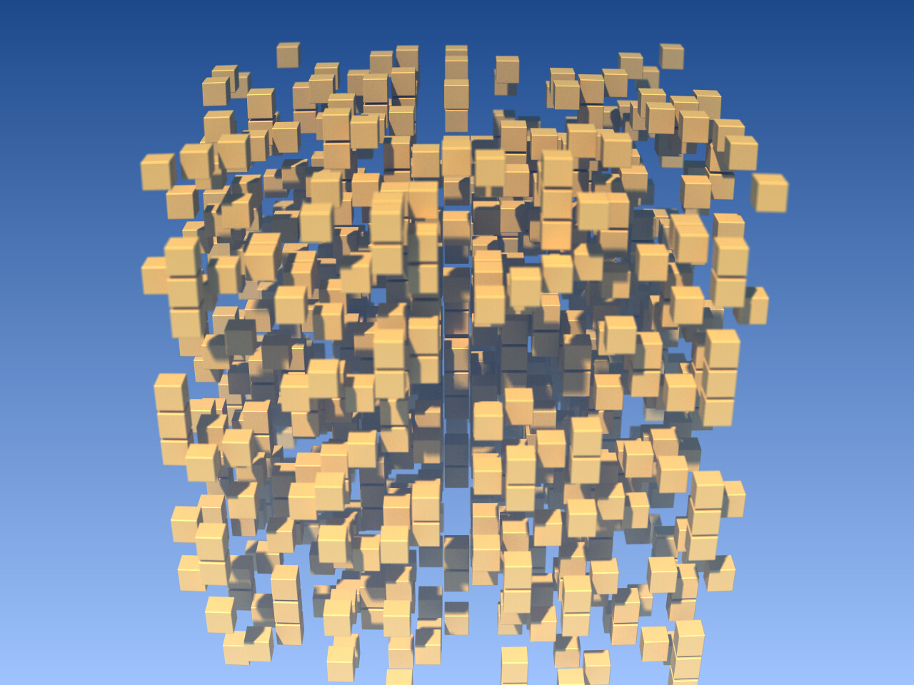</a> |
  |:---:|:---:|:---:|

  </details>
* **Un rendu arrêté reprend là où il en était.** Ce qu'un rendu a calculé
  est conservé quand il est arrêté, et aussi quand le programme est fermé ou
  plante, ou que l'ordinateur s'éteint (c'est enregistré sur le disque
  toutes les 5 minutes) : Calculer 3D, Monte-Carlo (aussi au milieu d'une
  passe), l'image d'une animation ou celle d'un lot en cours, un export
  voxel, un maillage Bulb Tracer, les tuiles d'un Grand rendu, et un rendu en
  essaim (Arrêter sur l'ordinateur qui a créé la tâche conserve chaque partie
  terminée, et chaque ordinateur conserve la partie où il en était). Calculer
  3D et Monte-Carlo avec les mêmes paramètres demandent s'il faut continuer,
  les autres continuent d'eux-mêmes ; le bouton **Reprendre** (onglet
  Ouvrir) liste les rendus inachevés, pour les continuer ou les supprimer. En
  ligne de commande, la même commande continue d'elle-même (aussi une image
  en `--tiles`, `montecarlo`, `animate`, `batch`, `voxel` et `mesh`) ;
  `--fresh` recommence, `mb3d resume` les liste. Un rendu continué est
  identique à un rendu calculé d'une traite.
* **Le rendu partagé entre vos ordinateurs**, un « essaim » : des
  ordinateurs qui voient un même dossier partagé calculent ensemble une
  image, un Grand rendu, une image Monte-Carlo ou une animation. Voir
  [Rendu sur plusieurs ordinateurs](#rendering-on-several-computers-the-swarm).
* **Formules et cartes de la communauté** : 129 formules et 154 cartes absentes du dépôt officiel, issues du paquet Mandelbulb3D 1.99.37 que Machina Infinitum propose en téléchargement gratuit. Les formules sont de Edgar Malinovsky, gnj, DarkBeam (Luca GN), bugman, Aexion, Buddhi, pupukuusikko, Jos Leys, Knighty, trafassel, Nrx, Eiffie, Quasihedron, Inigo Quilez, Yannis Picart, Jotero et d'autres dont les fichiers ne nomment aucun auteur ; `M3Formulas/CREDITS-community.md` nomme l'auteur de chacune (`teapot.m3f` de DarkBeam est sous CC BY-SA 3.0). Les cartes viennent de la collection de DarkBeam, selon ses conditions (libres d'usage, à ne pas vendre telles quelles), avec des images partagées sur DeviantArt par CmdrChaos, Fractales75, Nic022 et UndeadAcademy ; les cartes 3046–3048 sont de Kronpano (`M3Maps/CREDITS-community.md`). Les 608 réglages de lumière de `M3Lights` viennent du même paquet ; leurs fichiers ne nomment pas d’auteur (`M3Lights/CREDITS-community.md`).
* **Idées venues de Mandelbulb3D SE** : Mandelbulb3D SE de Glenn Olander, une app macOS bâtie sur mb3d-rs, a apporté deux idées : vérifier dans les tests chaque shader de la carte graphique sans carte graphique, et que Arrêter termine aussitôt la peinture d’une image.
* **Une nouvelle formule, PseudoKleinian :** l'« architecture kleinienne »
  de halls, d'arches et de sphères en une seule formule avec sa propre
  distance exacte.

  <a href="../img/kleinian_hall.jpg">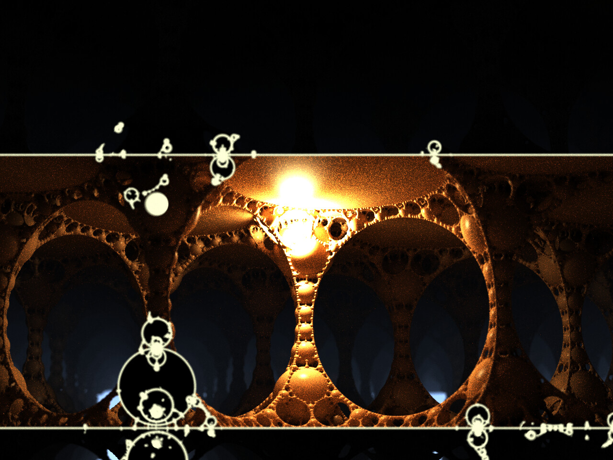</a>

  <details><summary>En savoir plus</summary>

  Les halls, arches, piliers et sphères imbriquées connus sous le nom
  d'« architecture kleinienne » comptent parmi les images de fractales 3D les
  plus appréciées. Dans MB3D, on ne peut les obtenir que comme hybride de
  plusieurs formules aux réglages soigneusement accordés, la recette que
  Theli-at a trouvée en 2011 ; knighty a ensuite écrit la même chose en une
  seule formule avec sa propre estimation de distance, et c'est
  **PseudoKleinian**. Chaque niveau replie le point dans une boîte,
  l'inverse dans une sphère et ajoute un décalage, et la distance est
  mesurée exactement jusqu'à un plan de sol après les repliements, si bien
  que les murs sortent nets et que l'image se calcule vite. Les réglages sont
  ceux de knighty : *Levels* (8), *Size* (la sphère d'inversion), *CSize
  X/Y/Z* (la boîte ; ses valeurs 0.924, 0.908, 0.924 donnent les halls
  classiques, et de petites modifications donnent de nouveaux bâtiments),
  *Julia X/Y/Z* (un décalage par niveau), *Shape* (0 le plan de sol, 1 un
  plan-cylindre d'épaisseur *Thickness* passant par *Offset*, 2 une boîte
  arrondie), *DE offset* (creuse la surface) et *Colour scale* (avec *2nd
  choice*, l'orbit trap : le plus petit rayon d'orbite, les bandes
  kleiniennes classiques).
  
  La structure remplit tout l'espace, si bien qu'on la regarde de
  l'intérieur : commencez avec le centre de la vue près de l'origine et la
  caméra une ou deux unités en arrière, et déplacez-vous dans les halls avec
  le Navigateur. Dans le moteur Monte-Carlo, un intérieur ne reçoit presque
  pas de lumière du ciel : placez donc une lumière positionnelle dans le hall
  (la première image) ou ouvrez la structure avec un plan de coupe et
  regardez dedans depuis le dessus (la seconde). Elle tourne sur la carte
  graphique et le processeur, n'a besoin que d'une itération, fonctionne
  après des transformations dIFS et dans les combinaisons de DE comme les
  autres formules dIFS (même si, dans une structure qui remplit l'espace,
  celles-ci changent peu de chose), et les paramètres qui la contiennent ne
  s'ouvrent que dans ce programme.
  
  <a href="../img/kleinian_hall.jpg"></a>
  
  <a href="../img/kleinian_top.jpg">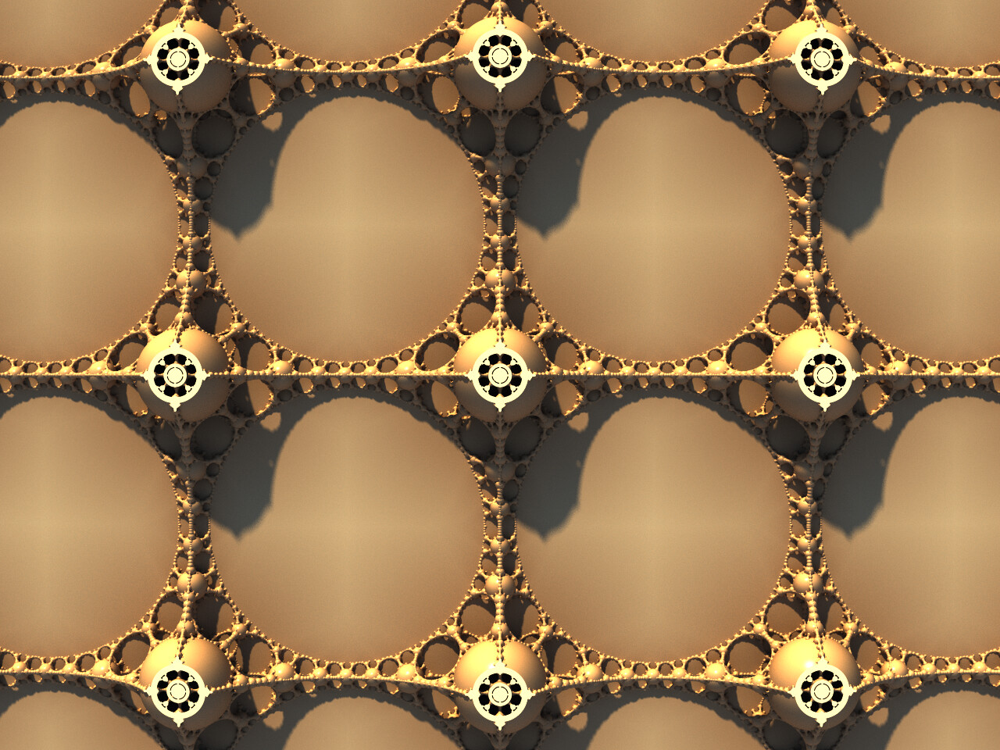</a>

  </details>
* **Des paires stéréo en une étape** : les images des deux yeux rendues et
  affichées côte à côte, pour la vision parallèle ou croisée. Contribution de
  Rathinagiri S ([SRathinaGiri](https://github.com/SRathinaGiri)).

  <a href="../img/stereo_pair.jpg">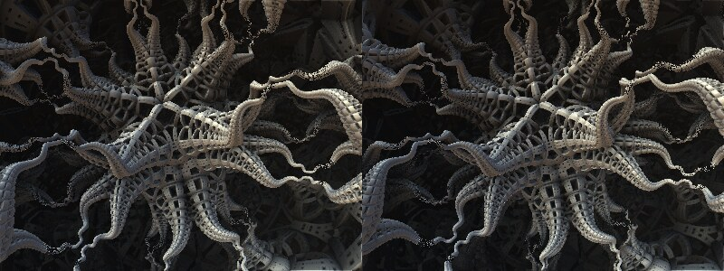</a>

  <details><summary>En savoir plus</summary>

  **Stéréo ▸ Rendre la paire stéréo** rend l'image de l'œil gauche puis celle
  de l'œil droit avec les réglages stéréo de l'onglet et les affiche côte à
  côte dans la fenêtre principale. Elles sont placées pour la vision
  parallèle (image gauche à gauche) ; **Aperçu en vision croisée** les
  intervertit pour la vision croisée. C'est un aperçu : l'éclairage et les
  couleurs
  ne peuvent pas être modifiés ensuite sans refaire le rendu, et cela ne
  fonctionne pas avec les tuiles. Les boutons pour les images d'un seul œil
  sont toujours là.
  
  <a href="../img/stereo_pair.jpg"></a>

  </details>
* **Temps restant pour toute l'image** : la barre sous l'image se remplit une
  seule fois sur l'ensemble du calcul, et à côté s'affiche le temps restant
  jusqu'à ce que l'image soit terminée, ombres, occlusion et réflexions
  comprises.

  <a href="../img/time_left.png">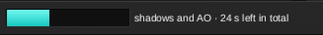</a>

  <details><summary>En savoir plus</summary>

  La barre de MB3D repart de zéro à chaque étape. Ici, elle montre le calcul
  entier : le rendu principal, puis les ombres franches et l'occlusion
  ambiante, les réflexions et la profondeur de champ. La durée des étapes
  qui suivent le rendu principal est estimée d'après ce que demande la scène
  et la façon dont le rendu principal s'est déroulé ; l'estimation a été
  ajustée sur environ 1400 rendus de 366 scènes. Une image calculée à
  nouveau s'attend aux durées de la fois précédente.
  
  La première image avec de nouvelles formules sur la carte graphique attend
  la compilation de ses shaders : la ligne indique alors *compilation des
  shaders* avec le temps restant, qui tient compte du rythme du processeur
  et, si les shaders sont prêts à temps, de l'arrivée de la carte. Détails
  dans [TECHNICAL.md](../TECHNICAL.md#time-left-and-the-progress-bar).
  
  <a href="../img/time_left.png">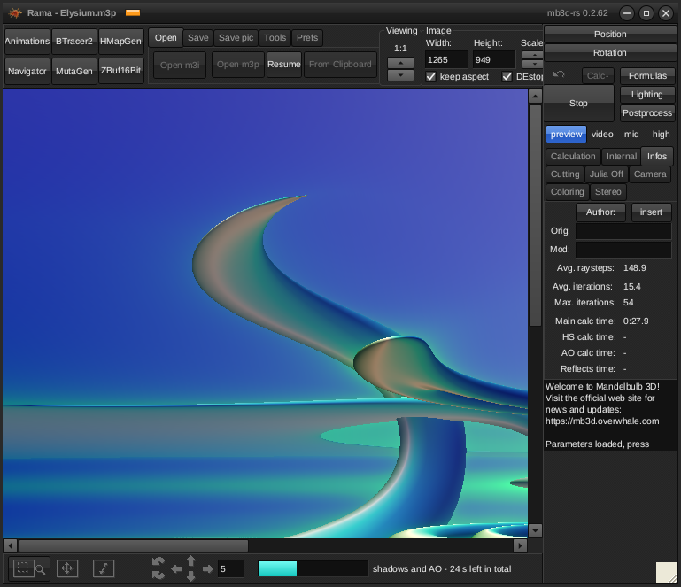</a>

  </details>
* **L'historique** derrière l'icône d'horloge de la barre de titre (fenêtre
  *History*) : chaque image que vous avez calculée avec sa vignette, chaque
  fichier que vous avez ouvert ou enregistré, sous forme de liste, de lignes
  ou de vignettes de toute taille, groupé par jour ou d'un seul tenant ;
  cherchez-y, triez-le, n'affichez que les images qui diffèrent, et chargez
  n'importe quelle entrée d'un double clic. Un historique de centaines de
  milliers d'entrées s'ouvre aussitôt.
* **L'éclairage reste réactif** après les ombres franches et les
  réflexions : déplacez une lumière ou changez sa couleur, et l'image change
  aussitôt, comme dans Mandelbulb3D.

  <a href="../img/lighting_live.png">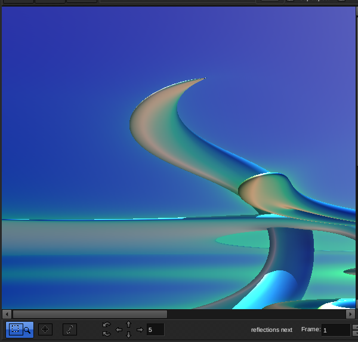</a>

  <details><summary>En savoir plus</summary>

  Faites un rendu simple, puis essayez des positions et des couleurs de
  lumière : chaque modification dans la fenêtre Éclairage redessine aussitôt
  l'image avec les ombres telles qu'elles ont été calculées, comme dans
  Mandelbulb3D. Changer la couleur ou l'intensité d'une lumière ne recalcule
  jamais les ombres. Les ombres d'une lumière que vous avez déplacée, les
  réflexions et la profondeur de champ reviennent avec les boutons de la
  fenêtre Post-traitement, comme dans Mandelbulb3D.
  
  Un calcul que vous avez arrêté peut encore être continué après que vous
  avez modifié l'éclairage. Une façon de travailler avec : [Méthode de travail pour l'éclairage](https://github.com/thr32423/mb3d-rs/wiki/Lighting-workflow-fr)
  dans le wiki. Détails dans
  [TECHNICAL.md](../TECHNICAL.md#lights-volumetric-light-cutting-planes-depth-of-field).
  
  <a href="../img/lighting_live.png">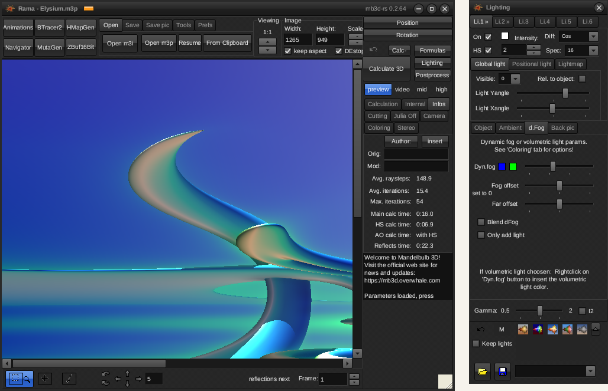</a>

  </details>
* **Un plan de sol ou de l'eau** sous (ou derrière) la fractale, une idée de
  Mandelbulber : un plan perpendiculaire à l'axe X, Y ou Z, calculé avec la
  fractale, avec ses ombres, son occlusion ambiante, ses reflets et la lumière
  Monte Carlo, dans sa propre couleur, plat ou avec des vagues.

  <a href="../img/ground_water.jpg">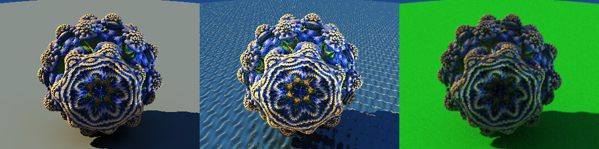</a>

  <details><summary>En savoir plus</summary>

  Fenêtre principale, page *Coupe* : cochez *Plan de sol*, choisissez l'axe et
  la position, la couleur, combien il réfléchit (0 à 1 : un miroir quand les
  reflets sont calculés) et la hauteur et la longueur des vagues. Le côté plein
  est toujours celui opposé à la caméra. Il est calculé sur la carte graphique
  et sur le processeur, et absent des exports voxel et maillage. Mandelbulb3D
  n'a pas de place pour lui dans ses paramètres : mb3d-rs le garde dans un
  petit bloc après eux (dans les fichiers .m3p et .m3i, et sous la forme
  `{mb3d-rs: ...}` après le titre des paramètres texte), que Mandelbulb3D ne
  lit pas. Clés de scène `ground`, `ground_color`, `ground_reflect`,
  `ground_waves` ; détails dans [TECHNICAL.md](../TECHNICAL.md#lights-volumetric-light-cutting-planes-depth-of-field).

  **Eau transparente** : avec *Eau* au-dessus de 0 (combien de lumière
  elle laisse passer), une fractale à moitié immergée se voit sous la
  surface, déviée par la réfraction (*Réfraction* : 1,33 pour l'eau) et
  prenant avec la profondeur la couleur de l'eau profonde (le bouton de
  couleur) : l'*Absorption* dit à quel point elle est trouble (0 claire, 3 trouble), et dans une eau bleu-vert le rouge s'éteint d'abord, si bien
  que ce qui est immergé devient turquoise. Les reflets des lumières sur
  les vagues restent sur la surface. Le rendu normal la montre avec les
  reflets activés (Post-traitement), Monte Carlo toujours ; sans les
  reflets l'eau reste opaque. Clés de scène `ground_transparency`,
  `ground_absorption`, `ground_water_color`, `ground_ior` ; un exemple
  dans [CLOUDS_WATER.md](../CLOUDS_WATER.md#transparent-water).

  **Diffusion** (la ligne sous *Réfraction*) : l'eau diffuse la lumière
  comme une vraie eau. Elle luit turquoise vers le soleil, les crêtes
  des vagues sont translucides, la lumière du soleil y tombe en rayons
  coupés par les ombres de la fractale et ce qui est sous l'eau luit
  doucement de sa couleur ; Monte Carlo suit la lumière qui se diffuse
  dans l'eau. Le second champ est sa direction (0,8 : surtout vers
  l'avant). 0 est l'aspect sans elle. Clés de scène `ground_scattering`,
  `ground_scatter_dir` ; voir
  [CLOUDS_WATER.md](../CLOUDS_WATER.md#transparent-water).

  **Essayez** : sur la page *Coupe*, cochez *Plan de sol* et faites passer
  sa hauteur à travers la fractale, mettez *Eau* à 1, *Absorption* à 1 et
  *Diffusion* à 0,5, et activez les réflexions (*Post-traitement*,
  *Réflexions + Transparence*, *Calculer R. (+ T.) automatiquement*), puis
  *Calculer 3D*.

  Trois scènes prêtes à coller, avec leurs réglages : [WATER_EXAMPLES.md](../WATER_EXAMPLES.md)

  *Eau* (transparence) 0, 0,5 et 1 :

  <a href="../img/water_transparency.jpg">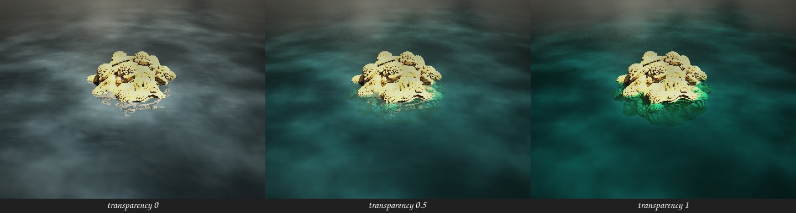</a>

  *Absorption* 0,3, 1 et 3, de claire à trouble :

  <a href="../img/water_absorption.jpg">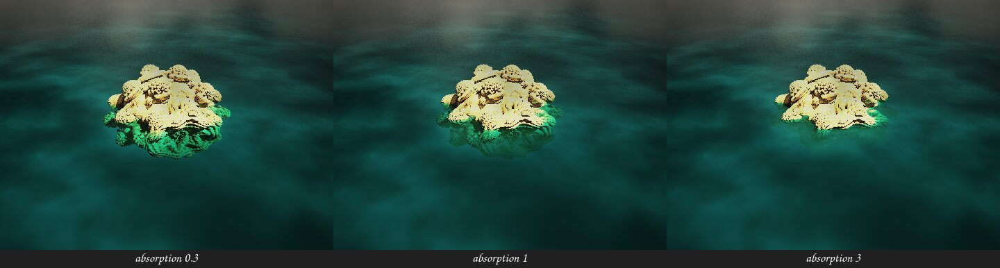</a>

  *Diffusion* 0, 0,5 et 1 en regardant vers le soleil, et les rayons de
  lumière avec un soleil bas devant :

  <a href="../img/water_scattering.jpg">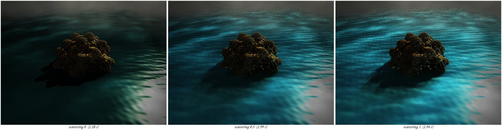</a>

  <a href="../img/water_shafts.jpg">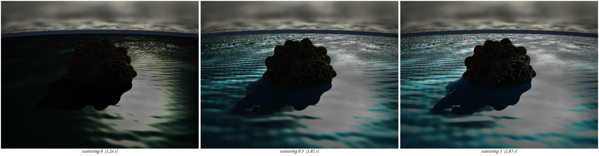</a>

  **Les vagues** sont une mer irrégulière de seize vagues le long d'une
  direction du vent (avant 0.2.98, trois vagues régulières faisaient un
  damier ; les scènes avec des vagues ont un autre aspect depuis).
  Anciennes (à gauche de chaque paire) et nouvelles, petites et grandes
  vagues, le soleil devant et derrière :

  <a href="../img/water_waves.jpg">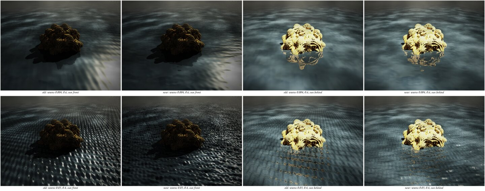</a>

  </details>
* **La lumière d'une image HDR** : une image Radiance à 360° (`.hdr`) en fond
  éclaire un rendu Monte Carlo avec toute sa luminosité, et son soleil devient
  une lumière aux ombres douces (une idée de Mandelbulber).

  <a href="../img/hdr_sun.jpg">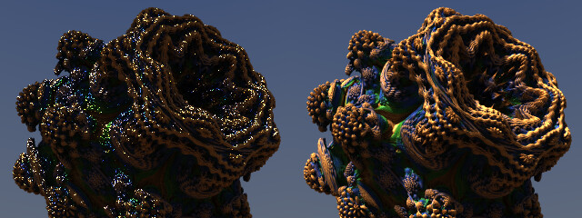</a>

  <details><summary>En savoir plus</summary>

  Choisissez le fichier `.hdr` comme image de fond dans la fenêtre *Éclairage*
  (pas « directe »). Monte Carlo éclaire alors la scène avec le ciel, et le
  point le plus lumineux de l'image, son soleil, en est retiré et ajouté comme
  une lumière avec des ombres de la taille du soleil : trouvé seulement par
  hasard, le soleil laisserait des points brillants (à gauche). Les images de
  fond en 8 ou 16 bits restent telles qu'elles étaient.

  </details>
* **Des images OpenEXR** pour le compositing (Blender, Nuke, DaVinci Resolve) :
  les couleurs en virgule flottante, non écrêtées au-dessus du blanc, avec les
  calques opacité, profondeur et normales. *Enreg. image* > *OpenEXR*, ou
  `mb3d -o image.exr` (aussi avec des tuiles et l'essaim).

  <a href="../img/exr_layers.jpg">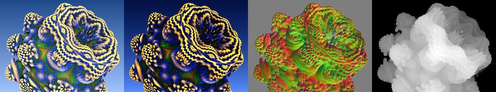</a>

  <details><summary>En savoir plus</summary>

  Les couleurs sont linéaires, comme l'attend OpenEXR : affichées avec la
  courbe d'écran habituelle, elles ressemblent au PNG, et les reflets gardent
  leur luminosité au-dessus du blanc. Les calques : `A` (opacité, comme pour un
  PNG transparent), `Z` (la distance à la caméra en unités de la fractale) et
  `N.X`, `N.Y`, `N.Z` (les normales de la surface). Détails dans [TECHNICAL.md](../TECHNICAL.md).

  </details>
* **Une caméra fisheye et la stéréo 360° pour la VR** (idées de Mandelbulber) :
  un fisheye jusqu'à 360° et des panoramas pour casques de VR, avec de la
  profondeur dans toutes les directions.

  <a href="../img/fisheye_water.jpg">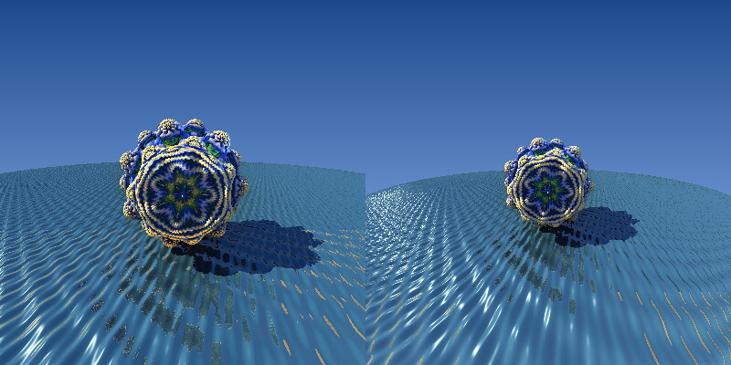</a>
  <a href="../img/vr_panorama.jpg">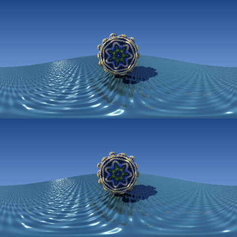</a>

  <details><summary>En savoir plus</summary>

  Fenêtre principale, page *Caméra* : *Fisheye* (le champ de vision, FOVy,
  jusqu'à 360°, couvre la hauteur de l'image ; une image carrée montre une vue
  ronde). Un panorama à 360° en stéréo donne à chaque rayon sa propre position
  d'œil, tournée avec la direction qu'il regarde, si bien que la profondeur est
  juste tout autour : `mb3d -s optic=2 --stereo-pair top-bottom` écrit les deux
  yeux, le gauche en haut, comme l'attendent les lecteurs VR (une image 2:1 par
  œil). Les yeux sont à 6,5 cm l'un de l'autre, le point regardé aussi loin que
  la distance de vision stéréo (la deuxième valeur de `stereo_screen`, 2 m).
  Mandelbulb3D n'a pas de fisheye : le bloc mb3d-rs des paramètres le garde.

  </details>
* **Des nuages volumétriques** (une idée de Mandelbulber) : une couche de nuages
  au-dessus, en dessous ou autour de la fractale, éclairée par la lumière de la
  scène, devant et derrière la fractale.

  <a href="../img/clouds.jpg">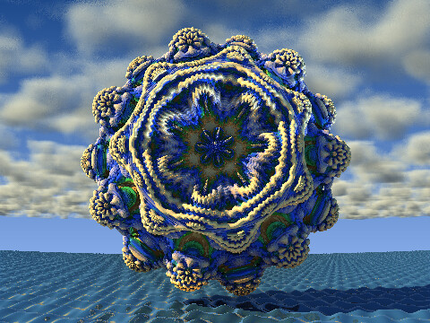</a>

  <details><summary>En savoir plus</summary>

  Fenêtre *Post-traitement*, section *Nuages* : cochez *Peindre les nuages*,
  réglez la couche (un axe et deux hauteurs), la densité, la part du ciel
  couverte, la taille des formes et la couleur, puis *Peindre*. Ils sont peints
  sur l'image terminée en une fraction de seconde, on essaie donc vite des
  réglages ; chaque pixel regarde à travers la couche jusqu'à la surface touchée.
  Une animation peut les déplacer (`cloud_offset` entre images clés). Les reflets les montrent, aussi dans Monte Carlo ; Mandelbulb3D ne les a pas (le bloc mb3d-rs
  des paramètres les garde). Ils projettent leurs ombres sur la fractale et le sol, aussi depuis l'extérieur de l'image.

  </details>
* **Des matériaux de surface** (idées de Mandelbulber) par-dessus la palette :
  Fresnel (plus de reflet aux angles rasants, comme le verre et la laque),
  irisation (les couleurs d'un film mince) et lueur.

  <a href="../img/material.jpg">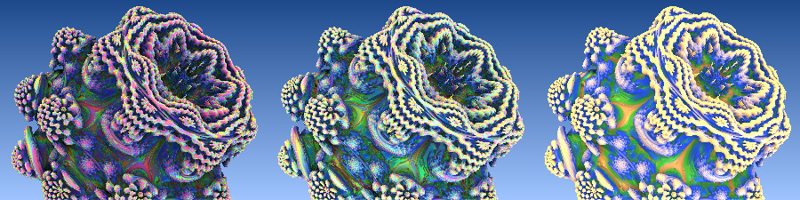</a>

  <details><summary>En savoir plus</summary>

  Fenêtre *Post-traitement*, section *Matériau* : cochez *Matériau de surface*,
  réglez Fresnel (0 à 1), l'irisation (0 à 1 et un décalage de ses couleurs) et
  la lueur, puis *Peindre*. Fresnel se voit le mieux avec les reflets calculés.
  Désactivées, les images sont exactement celles de Mandelbulb3D ; le plan de sol
  garde sa couleur et son reflet. Aussi dans Monte Carlo.

  </details>
* **Deux fractales dans une scène** (une idée de Mandelbulber) : avec une
  combinaison DE, la deuxième partie de l'hybride peut se tenir à l'écart de la
  première, déplacée, tournée et mise à l'échelle, réunies, intersectées ou
  découpées.

  <a href="../img/two_objects.jpg"></a>

  <details><summary>En savoir plus</summary>

  Fenêtre *Formules*, avec une combinaison DE choisie : *Partie 2 à* (son
  centre), *Taille* et *Tournée* (degrés autour de x, y et z). L'union (*Min*)
  place les deux objets côte à côte, l'intersection (*Max*) ne garde que le
  commun, le max inversé découpe le second dans le premier, l'union douce les
  fond ensemble. Calculé sur la carte graphique et le processeur ; le bloc
  mb3d-rs des paramètres garde la position (Mandelbulb3D montre les deux parties
  au même endroit).

  </details>
* **Courbes d'animation** (une idée de Mandelbulber) : une valeur de la scène
  sur toutes les images d'une animation, ses images clés comme poignées à
  faire glisser.

  <a href="../img/curves.png"></a>

  <details><summary>En savoir plus</summary>

  *Créateur d'animation* > *Courbes* : choisissez le zoom, une coordonnée de la
  position, un angle de rotation, le champ de vision, le Z de départ, la
  position du sol ou la dérive des nuages, et voyez-le sur chaque image tel que
  l'animation l'interpole. Les images clés sont des carrés sur leurs images :
  faites-en glisser un vers le haut ou le bas, ou cliquez dessus et tapez une
  valeur. L'interpolation de Bézier quadratique passe à côté des images clés,
  et la courbe le montre avant tout rendu. Une troisième interpolation, *Catmull-Rom* (pas dans MB3D), est douce et passe par chaque image clé (`mb3d animate --catmull-rom`).

  </details>
* **Finaliser l'image** : exposition, une lueur autour de la lumière vive, un
  tone mapping filmique, contraste, saturation, chaleur, un vignetage et les
  franges colorées d'un objectif, comme dernière passe sur toute l'image.

  <a href="../img/finishing.jpg"></a>

  <details><summary>En savoir plus</summary>

  Fenêtre *Post-traitement*, section *Finition* : cochez *Finaliser l'image*,
  réglez l'exposition en diaphragmes, *Filmique* (la lumière vive s'atténue
  doucement au lieu de devenir d'un blanc plat), la lueur (intensité, portée
  en part de la diagonale de l'image, et à partir de quelle luminosité elle
  brille), le contraste, la saturation, la chaleur, le vignetage et les franges
  colorées, puis *Peindre*. La peinture se fait alors en virgule flottante, la
  lumière au-dessus du blanc est donc gardée jusqu'au tone mapping. Cela
  s'applique à chaque image, chaque image d'animation et chaque rendu
  Monte-Carlo (après le filtre de bruit) ; désactivé, les images sont
  exactement comme avant. Clés de scène `finish_exposure`,
  `finish_tonemap = filmic`, `glow = strength, radius, threshold`,
  `finish_contrast`, `finish_saturation`, `finish_warmth`, `vignette`,
  `chromatic`. Dans un Grand rendu fait d'images de tuiles séparées, chaque
  tuile brille pour elle-même.

  </details>
* **Un relief fin sur la surface** : rugueux, pierre (arêtes et fissures) ou
  grain, plus fin que le détail du calcul, avec une variation de couleur.

  <a href="../img/relief.jpg"></a>

  <details><summary>En savoir plus</summary>

  Fenêtre *Post-traitement*, section *Matériau* : *Relief* avec son intensité,
  la taille de ses formes (dans les unités de la fractale, il reste donc sur la
  surface quand la caméra bouge) et sa finesse, et *Var. couleur*. Il incline
  la surface là où la lumière est calculée, si bien que l'ombrage, les
  reflets spéculaires, les reflets et Monte-Carlo le voient tous ; la forme
  elle-même ne change pas (le contour reste lisse). Pas sur le sol. Clés de
  scène `detail = stone, 1.5, 0.12, 0.5` (type, intensité, taille, finesse) et
  `detail_color`.

  </details>
* **Plateaux tournants, vols enregistrés et flou de bougé** pour les
  animations.

  <a href="../img/motion_blur.jpg"></a>

  <details><summary>En savoir plus</summary>

  *Créateur d'animation* > *Plateau tournant* : huit images clés d'un tour
  complet autour du centre de la vue de la fenêtre principale, une boucle
  douce (`mb3d animate scene.m3p --orbit 8 --frames 25`). *Navigateur* >
  *Enr* : tant que le bouton est enfoncé, chaque nouvelle vue du vol (au plus
  deux par seconde) devient l'image clé suivante ; avec Catmull-Rom,
  l'animation passe par toutes. *Flou de bougé* dans le Créateur d'animation :
  chaque image est la moyenne d'autant d'images prises pendant le temps
  d'*Obturateur* (une part du temps jusqu'à l'image suivante), ce qui bouge
  est donc étalé ; cela prend autant de fois plus de temps
  (`mb3d animate --motion-blur 8,0.5`).

  *Créateur d'animation* > *Modèles d'animation...* crée des images-clés à
  partir de la vue de la fenêtre principale pour une durée en secondes (aux
  images par seconde de la fenêtre) : une *Orbite à 360°* autour de l'axe de
  votre choix (de gauche à droite, par-dessus, un roulis, les trois à la
  fois, ou l'axe X, Y ou Z de la fractale ; `--orbit 8 --duration 10
  --orbit-axis pitch`) ou un *Survol*, où la caméra continue de voler dans
  la fractale, le zoom suivant la distance à celle-ci, en gardant son cap et
  en ne tournant que pour contourner ce qu'elle heurterait (`--fly
  --duration 20` ; `--duration 0` : jusqu'à ce que la vue ne montre que le
  ciel ou que la fractale). *RV 360°* dans le Créateur d'animation (`--vr`)
  fait de chaque image un panorama sphérique (2:1) ; avec *Rendre une
  animation stéréo*, la vidéo a les yeux l'un au-dessus de l'autre (le
  gauche en haut), et la commande ffmpeg se termine par `mb3d vr360
  video.mp4 --stereo tb`, qui marque le MP4 comme vidéo 360 pour YouTube, le
  Meta Quest et VLC. Un panorama sphérique enregistré en JPEG porte le XMP
  Photo Sphere, si bien que Facebook l'affiche comme photo 360.

  <a href="../img/orbit_template.jpg"></a>

  <a href="../img/fly_through.jpg"></a>

  Les modèles d'animation, les photos à 360° et les vidéos RV 360° ont été
  apportés par Rathinagiri S
  ([SRathinaGiri](https://github.com/SRathinaGiri),
  [#30](https://github.com/thr32423/mb3d-rs/pull/30)). L'orbite garde la
  caméra à la même distance de son pivot à chaque image, aussi entre les
  images-clés : le centre de la vue est d'abord placé sur le pivot, si bien
  que les images-clés ne diffèrent que par leur rotation. Ajoutée après
  d'autres images-clés, elle se termine de nouveau par sa première
  image-clé, pour que le tour soit complet ; *Commencer à* prend la vue de
  la fenêtre principale ou la dernière image-clé. Le survol est calculé en
  arrière-plan avec une barre de progression, et *Arrêter* garde ce qui a
  déjà été parcouru. Vidéos (jointes à la version v0.2.100, rendues avec la
  version suivante) : [une orbite à 4 images-clés, la première version et
  l'exacte côte à
  côte](https://github.com/thr32423/mb3d-rs/releases/download/v0.2.100/anim-templates-orbit-compare.mp4),
  [une
  culbute](https://github.com/thr32423/mb3d-rs/releases/download/v0.2.100/anim-templates-tumble.mp4),
  [un
  survol](https://github.com/thr32423/mb3d-rs/releases/download/v0.2.100/anim-templates-fly-through.mp4),
  [une orbite RV
  360°](https://github.com/thr32423/mb3d-rs/releases/download/v0.2.100/anim-templates-vr360-orbit.mp4).

  </details>
* **Splats gaussiens** de la fractale, à regarder de tous les côtés dans
  Blender (5.3 et suivants), SuperSplat et d'autres visionneuses de splats :
  *Bulb Tracer2* > *Splats gaussiens...*, ou
  `mb3d splat scene.m3p -o fractal.ply`.

  <a href="../img/splats.jpg"></a>

  <details><summary>En savoir plus</summary>

  La fenêtre exporte la scène de la fenêtre principale ; ses réglages sont
  ceux de la ligne de commande. La fractale est calculée depuis 16
  directions (*Directions*, `--views`), chacune une image de 640 x 640
  pixels (*Taille de chaque vue*, `--size`), avec ses lumières, ses ombres,
  son occlusion et ses reflets. Chaque pixel de l'objet devient une
  gaussienne plate posée sur la surface, avec la couleur qu'il a dans
  l'image. Là où les images se recouvrent, chaque morceau de la surface
  vient de celle qui l'a vu le plus de face. Les couleurs changent selon la
  direction d'où l'on regarde (harmoniques sphériques, *Couleurs selon la
  direction*, `--sh`), si bien que les reflets brillants se déplacent comme
  dans les images.

  Un objet vu de l'extérieur est calculé tout autour du milieu de la scène.
  Une scène vue de l'intérieur (une salle, une grotte, où la fractale
  remplit toute l'image) est calculée depuis la caméra de la scène, en
  regardant dans toutes les directions (*Calculer depuis*,
  `--around camera` ; *Auto*, la valeur par défaut, choisit). Là, un
  `--size` plus grand garde plus de détails, car chaque vue fait 110 degrés
  de large.

  Les lumières qui tournent avec la caméra, ainsi que les couleurs du haut
  et du bas de la lumière ambiante, sont fixées à l'objet telles qu'elles
  éclairent la vue propre de la scène, de sorte que tous les côtés sont
  éclairés de la même façon. La profondeur de champ, les nuages, la lueur,
  le vignetage et le plan de sol sont laissés de côté. Le fichier est dans
  la vue de la scène (x vers la droite, y dans l'image, z vers le haut : la
  vue de face de Blender ressemble à la scène), le milieu ou la caméra en 0
  et la fractale mise à l'échelle d'un rayon de 1. Il prend environ 160
  octets par splat, en général 100 à 300 Mo ; `--sh 0` le réduit à un tiers,
  sans les reflets qui se déplacent.

  </details>

<a id="download"></a>

## Téléchargement

Des programmes prêts à l'emploi pour la dernière version, sans installation :

| Système | Téléchargement |
|---|---|
| Windows (64 bits) | [mb3d-rs-windows-x64.zip](https://github.com/thr32423/mb3d-rs/releases/latest/download/mb3d-rs-windows-x64.zip) |
| Linux (64 bits) | [mb3d-rs-linux-x64.tar.gz](https://github.com/thr32423/mb3d-rs/releases/latest/download/mb3d-rs-linux-x64.tar.gz) |
| Debian, Ubuntu, Mint (s'installe comme les autres programmes) | [mb3d-rs-linux-x64.deb](https://github.com/thr32423/mb3d-rs/releases/latest/download/mb3d-rs-linux-x64.deb) |
| Fedora, RHEL, Rocky, openSUSE (s'installe comme les autres programmes) | [mb3d-rs-linux-x64.rpm](https://github.com/thr32423/mb3d-rs/releases/latest/download/mb3d-rs-linux-x64.rpm) |
| macOS, Apple silicon (M1 et suivants) | [mb3d-rs-macos-arm64.tar.gz](https://github.com/thr32423/mb3d-rs/releases/latest/download/mb3d-rs-macos-arm64.tar.gz) |
| macOS, Intel | [mb3d-rs-macos-x64.tar.gz](https://github.com/thr32423/mb3d-rs/releases/latest/download/mb3d-rs-macos-x64.tar.gz) |

Décompressez l'archive et lancez **Mandelbulb3D** (`Mandelbulb3D.exe` sous
Windows) dans le dossier décompressé. Le dossier est organisé comme une
installation de MB3D, avec les formules et les cartes de MB3D et 80 fichiers
de paramètres d'exemple.

* Si Windows affiche « Windows a protégé votre ordinateur », cliquez sur
  *Informations complémentaires* ▸ *Exécuter quand même*.
* macOS bloque les programmes téléchargés qui ne sont pas signés : lancez
  une fois `xattr -dr com.apple.quarantine .` dans le dossier décompressé.

**Autre possibilité pour Linux et macOS :** au lieu de télécharger à la main,
cette ligne unique récupère la dernière version dans `~/mb3d-rs` (relancez-la
plus tard pour mettre à jour ; le script [download.sh](../../download.sh) se
trouve aussi dans le dossier du programme) :

```sh
curl -fsSL https://raw.githubusercontent.com/thr32423/mb3d-rs/master/download.sh | sh
```

Elle vérifie le téléchargement avant de le décompresser, place
**Mandelbulb3D** dans votre menu d'applications (Linux) et crée les commandes
`Mandelbulb3D` et `mb3d`, utilisables dans n'importe quel dossier. `sh
~/mb3d-rs/download.sh --uninstall` retire à nouveau l'entrée de menu et les
commandes ; vos fichiers restent.

Les programmes Linux fonctionnent sur les distributions à partir de 2018
environ (Ubuntu 18.04, Debian 10, Rocky/RHEL 8 et plus récentes).

**Installé comme les autres programmes :** sous Debian, Ubuntu et Mint,
ouvrez le fichier `.deb` ci-dessus (ou `sudo apt install
./mb3d-rs-linux-x64.deb`) ; sous Fedora, RHEL et Rocky, le fichier `.rpm`
(`sudo dnf install ./mb3d-rs-linux-x64.rpm`, sous openSUSE `sudo zypper
install ./mb3d-rs-linux-x64.rpm`).
Mandelbulb3D se trouve alors dans le menu d'applications et `mb3d` fonctionne
dans n'importe quel dossier ; vos réglages et votre historique sont conservés
dans `~/.config/mb3d-rs` et `~/.local/share/mb3d-rs`.

[Premiers pas](../../GETTING_STARTED.md) présente les premières étapes ; les
versions plus anciennes et les notes de version se trouvent sur la page des
[versions](https://github.com/thr32423/mb3d-rs/releases).

<a id="guides-and-help"></a>

## Guides et aide

Des guides pas à pas se trouvent dans le [wiki](https://github.com/thr32423/mb3d-rs/wiki/Home-fr) :

* [Installation](https://github.com/thr32423/mb3d-rs/wiki/Installing-fr) : Windows, macOS et Linux, mise à jour, où se trouvent vos fichiers
* [Méthode de travail pour l'éclairage](https://github.com/thr32423/mb3d-rs/wiki/Lighting-workflow-fr) : faire un rendu simple, puis essayer lumières, ombres et réflexions
* [Mise en place de l'essaim](https://github.com/thr32423/mb3d-rs/wiki/Swarm-setup-fr) : le rendu sur plusieurs ordinateurs via un dossier partagé
* [Dépannage et FAQ](https://github.com/thr32423/mb3d-rs/wiki/Troubleshooting-and-FAQ-fr) : quand quelque chose ne fonctionne pas comme prévu

Toutes les versions avec leurs changements : [la liste complète](../UPDATES.md).

<a id="rendering-on-several-computers-the-swarm"></a>

## Rendu sur plusieurs ordinateurs (l'essaim)

Des ordinateurs qui voient un même dossier partagé calculent ensemble : une
image en tuiles, un Grand rendu, une image Monte-Carlo, une animation ou un
lot. Chaque ordinateur prend les parties que personne d'autre n'a prises, si
bien qu'un ordinateur rapide en prend davantage, et l'ordinateur qui a lancé
le rendu assemble les résultats. C'est le dossier qui assure le partage : le
programme n'ouvre aucune connexion réseau et ne parle à personne ; il est donc
aussi sûr que votre partage de fichiers.

<a href="../img/swarm_window.png"></a>

<a id="setting-it-up"></a>

### Mise en place

Pas à pas, avec ce qu'il faut vérifier : [Mise en place de l'essaim](https://github.com/thr32423/mb3d-rs/wiki/Swarm-setup-fr) dans le wiki.

1. **Un dossier dans lequel chaque ordinateur peut écrire :** un partage sur
   un NAS, un partage Windows, un partage Samba ou NFS. Sous Linux, montez-le
   comme un dossier, par exemple
   `sudo mount -t cifs //192.168.0.10/Public /mnt/share -o username=me,uid=$(id -u),gid=$(id -g)` ;
   un partage seulement ouvert dans le gestionnaire de fichiers (`smb://...`)
   n'est pas un dossier que le programme peut utiliser.
2. **La même version de mb3d-rs sur chaque ordinateur.** Un ordinateur avec
   une autre version est listé mais ne participe pas.
3. **Dans Mandelbulb3D :** le bouton **Essaim** de l'onglet Outils. Choisissez
   le dossier partagé (le même partage sur chaque ordinateur ; son chemin peut
   différer), donnez à l'ordinateur un nom pour la liste, et cochez
   **Partager cet ordinateur**.

C'est tout. La ligne d'état indique ce qui se passe, par exemple *Partage avec
omarchy : les rendus sont répartis entre les 2 ordinateurs*. Seul dans
l'essaim, tout se calcule sur cet ordinateur, comme d'habitude.

<a id="what-is-shared"></a>

### Ce qui est partagé

Tant que *Partager cet ordinateur* est coché, l'ordinateur calcule les parties
que d'autres ordinateurs déposent dans le dossier, et ses propres rendus vont
à l'essaim dès qu'un autre ordinateur en fait partie :

* **Calculer 3D** (et la fenêtre Traitement par lots) — l'image en N x M
  tuiles (réglé dans la fenêtre Essaim), assemblée ici avec tout ce que donne
  le calcul habituel : modifications de l'éclairage, post-traitement,
  enregistrement en m3i (et sa mémoire, voir plus bas).
* **Grand rendu** — les tuiles sont enregistrées une à une à leur arrivée ;
  l'image entière n'est jamais gardée en mémoire, c'est donc la solution pour
  des images de 100000 x 100000 pixels et plus.
* **Monte-Carlo** — comme sur un seul ordinateur : chaque ordinateur ajoute
  des passes à son propre bloc jusqu'à ce que vous appuyiez sur Arrêter,
  l'image s'éclaircit avec les rayons de tout le monde, et Arrêter fait la
  moyenne des blocs. Dans le mode par lot de la fenêtre, les blocs s'arrêtent
  ensemble au nombre de rayons du lot.
* **Le Créateur d'animation** — les images, une à une.

La fenêtre liste les ordinateurs avec leurs cœurs, leur carte graphique et ce
que chacun fait, les tâches avec leur progression, et un aperçu de la tâche la
plus récente : les tuiles calculées, celles en cours avec une barre de
progression, et celles qui manquent encore.

<a id="on-the-command-line"></a>

### En ligne de commande

Sur chaque ordinateur qui doit aider, lancez un worker sur le dossier :

```sh
mb3d swarm worker /mnt/share/mb3d-swarm --name kitchen-pc
```

Puis, sur n'importe quel ordinateur, lancez le rendu avec `--swarm` et le
même dossier :

```sh
mb3d big.m3p --tiles 4x3 --swarm /mnt/share/mb3d-swarm
mb3d animate flight.m3a --swarm /mnt/share/mb3d-swarm
mb3d batch *.m3p -o pictures --swarm /mnt/share/mb3d-swarm
mb3d montecarlo scene.m3p --rays 256 --swarm /mnt/share/mb3d-swarm
```

`mb3d swarm list FOLDER` montre qui fait partie de l'essaim, ce que fait
chaque ordinateur et où en sont les tâches. Une image Monte-Carlo en ligne de
commande est découpée en blocs avec leurs propres rayons aléatoires : 4 blocs
de 64 rayons par pixel donnent les 256 demandés avec `--rays 256`.

<a id="good-to-know"></a>

### Bon à savoir

* **Si les autres ordinateurs restent inactifs** et que leur liste de tâches
  est vide pendant que cet ordinateur calcule : l'ordinateur qui sert le
  dossier avec Samba et l'utilise directement laisse les autres garder une
  ancienne liste de son contenu. Désactivez ce cache dans
  `/etc/samba/smb.conf` : `smb3 directory leases = no` dans `[global]`, et
  `oplocks = no` et `level2 oplocks = no` dans la section du partage, puis
  `sudo systemctl restart smb`, et remontez le partage sur les autres
  ordinateurs.
* **Mémoire :** une image prend environ 20 octets par pixel dans ce programme
  (son tampon d'image), 10 de plus dans la fenêtre principale, puis la plus
  grande de deux étapes : le calcul principal avec ses ombres et son
  occlusion (16 par pixel et 1,2 Go pour la carte), ou la peinture (3 par
  pixel, 20 de plus avec la profondeur de champ, et une bande des
  réflexions : 3,5 Go au plus, moins quand peu de mémoire est libre, car la
  bande est dimensionnée à la moitié de ce qui est libre au début de la
  passe). Une image de 12000 x 6000 : 6 Go. Quand une image demande plus que
  la mémoire libre de l'ordinateur (demandée à Linux, Windows et macOS),
  Calculer 3D indique combien il lui faut et combien est libre, et demande
  avant de commencer : le calcul utiliserait le swap et le programme pourrait
  cesser de répondre pendant plusieurs minutes d'affilée. Le Grand rendu,
  seul ou avec l'essaim, est la solution : ses tuiles sont enregistrées une à
  une, l'image entière n'est jamais gardée. Calculer 3D avec l'essaim garde
  l'image ici comme le fait le calcul habituel (sans l'étape du calcul
  principal, que les ordinateurs des tuiles font avec la mémoire de chaque
  tuile) ; un ordinateur de l'essaim laisse aux autres une tuile trop grande
  pour sa mémoire.
* **Sécurité :** un ordinateur ne calcule que ce qu'une tâche demande et
  n'écrit que dans le dossier de la tâche ; le code de formule d'une tâche
  s'exécute dans l'émulateur de formules comme toute formule.
* **Vitesse :** les tuiles voyagent sous forme de tampons d'image complets,
  quelques centaines de mégaoctets pour une très grande image ; un partage
  rapide est donc rentable. Un service de synchronisation qui copie avec un
  délai fonctionne aussi, mais plus lentement.
* **Ordinateurs qui s'en vont :** la partie qu'un ordinateur calculait est
  reprise par un autre dès qu'on n'a plus de nouvelles de lui depuis une
  demi-minute. Une tâche dont le propriétaire est parti depuis une
  demi-heure est supprimée par le premier qui la voit. Une tâche qui échoue
  sur un ordinateur est signalée dans la fenêtre et laissée aux autres.
* **Arrêter :** décocher *Partager cet ordinateur* laisse d'abord se terminer
  la partie en cours ; fermer le programme l'abandonne, et un autre
  ordinateur la reprend.
* **Arrêter la tâche** (Arrêter sur l'ordinateur qui l'a créée, ou sa
  fermeture, ou son plantage) : chaque partie déjà terminée est conservée sur
  cet ordinateur, et chaque ordinateur conserve la partie qu'il calculait.
  Relancer le même rendu crée une tâche ne contenant que les parties
  manquantes, et un ordinateur qui récupère une partie qu'il avait commencée
  la continue. Cela fonctionne aussi en ligne de commande : relancez la même
  commande. Un rendu Monte-Carlo sans fin fixée (celui de la fenêtre)
  assemble ses blocs quand il est arrêté, comme avant.

<a id="how-the-rendering-works"></a>

## Comment fonctionne le rendu

Une image fractale se calcule pixel par pixel : pour chaque pixel, un rayon
est suivi dans la scène jusqu'à ce qu'il touche la surface de la fractale, la
formule étant évaluée des dizaines de fois à chaque pas. MB3D fait cela sur le
processeur, en utilisant tous ses cœurs. mb3d-rs peut faire de même, et peut
aussi confier le travail à la **carte graphique**, qui possède des milliers de
petits processeurs et est faite exactement pour ce genre de tâche.

Le réglage **« Calculer sur »** (onglet Interne de la fenêtre principale)
permet de choisir :

| | |
|---|---|
| **Auto** (par défaut) | La carte et le processeur se partagent l'image : la carte prend les lignes par le haut, les threads du processeur par le bas, jusqu'à ce qu'ils se rejoignent. Les ombres et l'occlusion ambiante sont partagées de la même façon, ou faites par la carte seule quand elle est nettement la plus rapide. |
| **CPU** | Le processeur seul, comme dans MB3D. |
| **Carte graphique** | La carte seule (elle attend que son programme soit prêt). |

La première fois qu'une combinaison de formules est utilisée, le pilote
graphique doit préparer un programme pour la carte — le *shader* — ce qui
prend 10 à 15 secondes sur l'ordinateur mesuré plus bas. En mode Auto, le
processeur commence simplement sans lui et la carte le rejoint quand elle est
prête, si bien qu'une petite image n'attend jamais. Le shader préparé est
conservé pour la fois suivante (par le pilote graphique ; sous Linux, dans le
dossier `ShaderCache` à côté du programme), si bien que l'image suivante avec
les mêmes formules démarre aussitôt sur la carte.

La **LED** à droite du titre de la fenêtre indique où la dernière image a été
calculée : verte sur la carte graphique, orange en partie, rouge sur le
processeur. En la survolant, on obtient les détails.

[Comment fonctionne le rendu](../RENDERING.md) raconte toute l'histoire en
images : ce que fait Auto la première fois, pourquoi la carte n'est pas
toujours le choix le plus rapide, et ce que signifient les couleurs de la LED.

Tout ne peut pas aller sur la carte : quelques formules ne peuvent pas être
traduites pour elle, et les vues très profondément zoomées sont calculées en
double précision (ce que seules certaines cartes savent faire). Le programme
décide de tout cela tout seul ; vous ne le voyez qu'à la
LED.

<a id="speed"></a>

## Vitesse

Toutes les mesures sur un seul ordinateur : un AMD Ryzen 9 3900X (12 cœurs,
24 threads) avec une NVIDIA GeForce RTX 2060, sous Linux. Le
**Mandelbulb3D 1.99sr37** original a été exécuté sur la même machine sous
Wine (son programme Windows y tourne sans modification, à pleine vitesse, sur
tous les cœurs), et chronométré du clic sur *Calculer 3D* jusqu'à l'image
terminée. Chaque fichier de paramètres a été rendu à la même taille d'image
par les trois : MB3D, mb3d-rs sur le processeur seul (**CPU**) et mb3d-rs en
mode **Auto** (carte graphique et processeur ensemble). Les temps Auto sont
ceux du second rendu d'un fichier, avec le shader de la carte déjà préparé ;
le premier rendu d'une nouvelle combinaison de formules ajoute les 10 à 15 s
de préparation du shader sur cette carte.

<a id="mb3ds-80-example-parameter-files"></a>

### Les 80 fichiers de paramètres d'exemple de MB3D

Les fichiers d'exemple fournis avec MB3D (et dans le dossier `M3Parameter` de
ce programme), chacun à sa propre taille d'image.

MB3D n'a pas pu calculer l'un des fichiers (*Test8* : il s'arrête sur une erreur « Division by zero »), si bien que les comparaisons portent sur 79 fichiers.

* **mb3d-rs sur le processeur seul est plus rapide que MB3D** pour 71 des 79 fichiers, d'un facteur médian de **1,7** ; l'ensemble des fichiers a pris 18 min 21 s à MB3D et 17 min 10 s à mb3d-rs sur le processeur.
* **Le mode Auto** est plus rapide que MB3D pour 77 des 79 fichiers (facteur médian 2,1) ; l'ensemble des fichiers en 8 min 17 s. Pour 30 des fichiers, le processeur a fini seul, surtout parce qu'il n'a besoin que de quelques secondes, avant que la carte ait son tour — là, Auto, c'est simplement le processeur plus un bref surcoût. La carte a participé pour 49 fichiers, les plus lents, où elle a rendu l'image 1,6 fois plus vite que le processeur en médiane (jusqu'à 13 fois : *Insect Menger*, 4,7 s au lieu de 63,0 s).
* Pour 4 fichiers, Auto a été nettement plus lent que le processeur seul (*Ellarien - Shrooms are coming*, *MengerTrees*, *toricaleggs*, *TreePlanet*) : là, la carte est plus lente que les 24 threads du processeur pour cette scène.
* « lignes sur la carte » est la part de l'image que la carte graphique a calculée en mode Auto (– quand le processeur a fini seul).

<details>
<summary>Les 80 fichiers (cliquez pour ouvrir)</summary>

| Fichier de paramètres | MB3D (Wine) | mb3d-rs CPU | mb3d-rs Auto | lignes sur la carte | Auto / MB3D |
|:--|--:|--:|--:|--:|--:|
| 0Encrypted0 - ABoxSOff4d example | 12.8 s | 7.4 s | 1.9 s | 80 % | 6.7× |
| 6 AM - Torii temple | 23.0 s | 20.4 s | 17.8 s | 60 % | 1.3× |
| Abominog-Ua - 12.06.2014 | 7.6 s | 8.0 s | 7.4 s | 50 % | 1.0× |
| ABoxPartlyJuliaRoff | 2.5 s | 1.4 s | 1.6 s | – | 1.6× |
| ABoxScale2Start | 1.0 s | 0.1 s | 0.3 s | – | 3.3× |
| ABoxScale3Start | 1.5 s | 0.1 s | 0.3 s | – | 5.0× |
| AboxShapes-Misty | 27.5 s | 25.6 s | 17.7 s | – | 1.6× |
| Aexion 10bulbs | 11.5 s | 9.8 s | 2.6 s | 73 % | 4.4× |
| AkuraPare - 463b | 4.0 s | 2.0 s | 0.7 s | 72 % | 5.7× |
| ApolloBalloons dIFS | 75.8 s | 73.2 s | 24.9 s | 57 % | 3.0× |
| AureliusCat - Bamboo | 2.0 s | 1.2 s | 0.7 s | 58 % | 2.9× |
| BatJorge - Pong 703 - Swirls | 4.0 s | 2.8 s | 3.1 s | – | 1.3× |
| Bill-Snowzell - Tweak - Canyon | 4.0 s | 1.6 s | 1.7 s | 44 % | 2.4× |
| Blood on the dancefloor | 7.6 s | 4.4 s | 3.2 s | – | 2.4× |
| BulboxCut | 4.0 s | 2.3 s | 2.3 s | – | 1.7× |
| Chrystal | 5.6 s | 5.2 s | 1.7 s | 79 % | 3.3× |
| cutted sphere over carpet | 7.1 s | 20.7 s | 4.5 s | 48 % | 1.6× |
| Dainbramage - Home of the Ancients | 3.0 s | 1.3 s | 1.2 s | 25 % | 2.5× |
| Dainbramage - Hydra | 3.5 s | 1.7 s | 1.6 s | 41 % | 2.2× |
| Dainbramage - Nothing left but bones | 4.0 s | 3.0 s | 2.4 s | 49 % | 1.7× |
| DEcomb1 | 83.9 s | 93.5 s | 80.3 s | 48 % | 1.0× |
| dIFS heart shrub | 2.5 s | 3.5 s | 3.0 s | – | 0.8× |
| dIFS heart shrub otrap | 5.1 s | 15.6 s | 3.6 s | 93 % | 1.4× |
| dIFS shrub | 4.0 s | 17.3 s | 3.6 s | 93 % | 1.1× |
| Dodeca Torus mix | 2.0 s | 0.5 s | 0.6 s | 14 % | 3.3× |
| DsyneGrafix - Getting Loopy | 2.0 s | 0.8 s | 0.8 s | 25 % | 2.5× |
| Ellarien - Embellished | 3.5 s | 1.1 s | 1.2 s | 49 % | 2.9× |
| Ellarien - Shrooms are coming | 8.1 s | 6.2 s | 6.8 s | – | 1.2× |
| ExcludeBulbMeng | 17.3 s | 12.9 s | 8.5 s | – | 2.0× |
| Fishbowl | 4.6 s | 3.5 s | 1.9 s | 49 % | 2.4× |
| Fractales75 - Kiosk | 3.0 s | 1.8 s | 1.9 s | 47 % | 1.6× |
| Genetic Menger | 1.5 s | 0.5 s | 0.6 s | 46 % | 2.5× |
| genQuat helix mix | 4.0 s | 3.3 s | 1.8 s | 61 % | 2.2× |
| HalTenny - Freak Of Nature | 2.5 s | 0.9 s | 1.2 s | – | 2.1× |
| Hal-Tenny-Resistance (slow) | 18.9 s | 20.3 s | 8.7 s | 78 % | 2.2× |
| Hyperben2 - Ozosphere tweak | 2.0 s | 0.8 s | 0.6 s | 56 % | 3.3× |
| ImpossibleWorld dIFS | 399.8 s | 367.5 s | 99.0 s | 71 % | 4.0× |
| InAndOutside box | 5.1 s | 2.7 s | 1.4 s | 68 % | 3.6× |
| Insect Menger | 4.0 s | 63.0 s | 4.7 s | 93 % | 0.9× |
| Jost1 - Tweak - New tiny temple | 3.5 s | 1.6 s | 1.0 s | 60 % | 3.5× |
| julia on box | 4.6 s | 4.0 s | 1.6 s | 73 % | 2.9× |
| JuliaSetSample | 3.0 s | 1.9 s | 2.2 s | – | 1.4× |
| KentPress - Parameter 3 tweak fogits | 4.0 s | 2.5 s | 3.0 s | – | 1.3× |
| KochSurf Sample 6 | 3.0 s | 1.4 s | 0.8 s | 75 % | 3.8× |
| Lenord - ASurf 2 | 5.1 s | 1.7 s | 1.9 s | 48 % | 2.7× |
| Lenord - Between Dark and Light | 5.6 s | 3.8 s | 2.1 s | 60 % | 2.7× |
| Lenord - The Beanstalk | 3.5 s | 1.8 s | 2.0 s | – | 1.8× |
| LightBulbMoon - A Fabulous Excuse | 3.5 s | 2.0 s | 1.6 s | – | 2.2× |
| LightBulbMoon - No, Never | 5.1 s | 4.0 s | 1.2 s | 82 % | 4.2× |
| Mandelwerk - Makin seashell | 12.0 s | 8.1 s | 8.1 s | 30 % | 1.5× |
| Mandelwerk - TgladTetra inner spirals | 8.6 s | 4.5 s | 1.1 s | 80 % | 7.8× |
| MarkJayBee - Curvichrome | 2.5 s | 1.3 s | 1.3 s | – | 1.9× |
| material colors | 3.0 s | 1.4 s | 1.9 s | – | 1.6× |
| Melting spot bloxx | 23.2 s | 20.4 s | 7.6 s | 73 % | 3.1× |
| Mengerplus for MC | 3.5 s | 2.2 s | 2.5 s | – | 1.4× |
| MengerTrees | 19.3 s | 15.4 s | 16.9 s | – | 1.1× |
| MutaGenD4B12E71C70D4FD00357_canary~ | 7.1 s | 3.7 s | 4.1 s | – | 1.7× |
| Oxnot - Flexing | 2.5 s | 0.7 s | 0.7 s | 59 % | 3.6× |
| Oxnot - Shells | 5.6 s | 3.3 s | 3.6 s | – | 1.6× |
| PaMonk - Ringlets | 5.1 s | 2.7 s | 2.8 s | – | 1.8× |
| QuatP4hybridJulia | 1.5 s | 0.2 s | 0.4 s | – | 3.8× |
| Rama - Elysium | 11.5 s | 10.6 s | 5.5 s | 74 % | 2.1× |
| Recycledrelatives - Fractal Fan | 2.0 s | 0.4 s | 0.6 s | 31 % | 3.3× |
| Recycledrelatives - Test for SurfMod | 4.6 s | 3.0 s | 3.1 s | – | 1.5× |
| Rowratty - Spirals | 4.0 s | 2.5 s | 1.0 s | 69 % | 4.0× |
| Sabine62 - Housing problem | 11.7 s | 10.5 s | 6.8 s | – | 1.7× |
| spineJulia | 91.9 s | 71.7 s | 50.7 s | 35 % | 1.8× |
| Surreal shell | 2.0 s | 0.6 s | 0.8 s | – | 2.5× |
| Test8 | erreur dans MB3D | 0.1 s | 0.3 s |  | – |
| Theli-At - Black Mandelbulb | 1.0 s | 0.2 s | 0.5 s | 22 % | 2.0× |
| Theli-At - Bone Menger using MH | 2.0 s | 0.7 s | 1.1 s | – | 1.8× |
| Theli-At - MengerSpheres | 2.0 s | 0.6 s | 0.6 s | 50 % | 3.3× |
| ThePearl dIFS | 2.5 s | 1.4 s | 1.2 s | 25 % | 2.1× |
| TimeMachine | 1.0 s | 0.5 s | 0.7 s | – | 1.4× |
| toricaleggs | 8.6 s | 5.6 s | 6.6 s | 40 % | 1.3× |
| TreePlanet | 7.6 s | 6.6 s | 7.5 s | – | 1.0× |
| UndeadAcademy tweak - Peacock in blue | 7.6 s | 4.5 s | 1.2 s | 74 % | 6.3× |
| Virtual tubes world (UndeadAcademy style) | 9.1 s | 6.9 s | 4.3 s | 49 % | 2.1× |
| Wada basin - Reflect test | 6.6 s | 4.1 s | 4.6 s | 40 % | 1.4× |
| Waste-and-tragedy - Mandalex | 5.1 s | 3.4 s | 3.8 s | – | 1.3× |

</details>

Les images sont les mêmes : mb3d-rs sur le processeur produit l'image de MB3D
aux arrondis près, et les images Auto diffèrent de celles du processeur d'une
fraction de pour cent de la plage de couleurs en moyenne (les détails fins
peuvent scintiller sur d'autres pixels ; les [notes techniques](../TECHNICAL.md)
donnent les mesures).

<a id="experimental-speed-ups"></a>

### Accélérations expérimentales

Quelques façons plus rapides de calculer modifient un peu l'image ; elles
restent donc désactivées tant que vous ne les activez pas : onglet
**Interne** → **Expérimental...**, cochez *Utiliser les accélérations
expérimentales*, puis celles que vous voulez. Elles sont enregistrées avec la
scène (la ligne de commande, l'essaim et l'assistant IA les utilisent donc
aussi) ; en ligne de commande `-s experimental=on` avec `-s step_relax=1.3`,
`-s secant_search=on`, `-s free_steps=on`, `-s occlusion_half=on` ou `-s cone_march=on`.
Le programme garde ton choix d'un démarrage à l'autre, aussi pour les fichiers que tu ouvres.

Mesuré sur les 80 fichiers d'exemple en mode Auto (environ 0,4 mégapixel, le
plus rapide de deux rendus pour chacun), par rapport aux mêmes fichiers sans
elles :

| Accélération | Rendu complet | Images (pixels écartés de plus de 8 sur 255) |
|---|---|---|
| **Allongement du pas 1,3** : pas de marche plus longs, un pas trop long est repris | −5 % (médiane), jusqu'à −20 % ; 62 sur 80 plus rapides | médiane 2,6 % ; ombrage fin. *Les coques minces peuvent montrer des trous* (BatJorge – Pong 703 – Swirls) |
| **Recherche de la surface par sécante** | −2 % (médiane), jusqu'à −18 % | médiane 0,7 % ; le détail fin se déplace légèrement |
| **Pas de limite de pas sans brouillard dynamique** | −1 % (médiane), jusqu'à −30 % dans les scènes ouvertes | le plus souvent la même image (médiane 0,03 %) |
| **Occlusion DE en demi-résolution** | −18 % sur les 10 fichiers avec occlusion DE (DEcomb1 −24 %) ; cette étape jusqu'à 4 fois plus rapide | 0–27 % des pixels, occlusion plus douce dans le détail fin ; l'aspect est le même |
| **Marche en cône** : un rayon grossier par bloc de pixels, la marche de chaque pixel part de là où il s'est arrêté | la marche −20 % (médiane −22 %) sur le processeur, jusqu'à −66 % dans les scènes ouvertes (68 sur 69 plus rapides) ; sur la carte, rendus complets de scènes ouvertes jusqu'à −47 % | médiane 1,0 %, autant que le premier pas aléatoire de la marche change à lui seul ; *la 0.2.92 pouvait perdre des parties fines là où l'estimation de distance est bien trop grande ; corrigé dans la 0.2.93* |

Comparez avec un rendu sans elles avant de vous fier à l'une d'elles pour une
image.

<a id="the-command-line"></a>

## La ligne de commande

`mb3d` calcule sans fenêtre. Ouvrez un terminal dans le dossier du programme
(sous Windows, une invite de commandes dans le dossier décompressé, et tapez
`mb3d` au lieu de `./mb3d`). Après l'installation en une ligne sous Linux ou
macOS, `mb3d` fonctionne dans n'importe quel dossier, `man mb3d` affiche son
manuel, et la touche Tab complète ses options dans bash, zsh et fish :

```sh
./mb3d "M3Parameter/6 AM - Torii temple.m3p" -o torii.png      # full size
./mb3d "M3Parameter/6 AM - Torii temple.m3p" --scale 0.25 -o small.png
./mb3d pasted.txt -o pasted.png        # parameters copied from a forum post
./mb3d City.m3p --tiles 4x4 -o city.png    # a big picture in tiles
./mb3d resume                              # stopped renders: the same command continues
./mb3d --cpu City.m3p -o city.png          # processor only
./mb3d --card City.m3p -o city.png         # graphics card only
./mb3d City.m3p --bits 16 -o city16.png    # 16 bit colour
./mb3d City.m3p --denoise 4 -o city.png    # with the noise filter
./mb3d City.m3p --aa 2 --transparent -o city.png   # transparent background
./mb3d City.m3p -o - | display -          # the picture into another program
./mb3d --help                              # all options
```

Tout le reste a une sous-commande avec son propre `--help` :

```sh
./mb3d batch M3Parameter --scale 0.2 -o previews        # a whole folder
./mb3d animate start.m3p middle.m3p end.m3p --frames 60 -o frames
./mb3d animate project.m3a -o frames                     # MB3D animations
./mb3d animate project.m3a -o frames --transparent      # ... see-through
./mb3d animate project.m3a -o frames --video flight.avi  # ... and a video
./mb3d montecarlo scene.m3p --rays 64 -o mc.png
./mb3d montecarlo scene.m3p --rays 8 --denoise -o mc.png # ... with the noise filter
./mb3d voxel scene.m3p -o voxels --slices 256            # for 3D printing
./mb3d mesh scene.m3p -o object.stl                      # Bulb Tracer 2
./mb3d splat scene.m3p -o fractal.ply                    # Gaussian splats
./mb3d mutagen scene.m3p -o muta                         # 15 variations
```

Les formules et les cartes sont cherchées à côté du programme ; celles d'une
autre installation de MB3D peuvent être indiquées avec `--formulas` et
`--maps`. Les animations sont celles de MB3D : images-clés avec
l'interpolation de MB3D, projets `.m3a` ouverts et enregistrés, images
écrites comme le fait MB3D, si bien qu'une animation interrompue continue et
que plusieurs ordinateurs peuvent se partager la même.

<a id="good-to-know-1"></a>

## Bon à savoir

* **Mêmes images, mais pas identiques au bit près.** MB3D calculait avec la
  précision de 80 bits de l'ancienne arithmétique x87 ; ce programme utilise
  les 64 bits d'aujourd'hui. Les images concordent dans toutes leurs
  structures, mais des pixels isolés peuvent différer sur le dernier chiffre
  de leur couleur. Les rendus Monte-Carlo et MutaGen utilisent leurs propres
  nombres aléatoires, si bien que leurs résultats ne sont pas ceux de MB3D.
* **Les images de la carte graphique** diffèrent légèrement de celles du
  processeur (simple précision) ; dans les détails très fins, le
  scintillement peut tomber sur d'autres pixels. Les zooms profonds passent
  d'eux-mêmes en double précision.
* **La vitesse sur le processeur** est proche de celle de MB3D : le code
  machine des formules, tiré des fichiers `.m3f` de MB3D, a été traduit pour
  fonctionner sur n'importe quel processeur (Apple Silicon compris), pour un
  petit coût ; la marche des rayons elle-même est plus rapide. Voir les
  tableaux ci-dessus. Sous Linux et Windows, les formules de l'hybride d'une
  scène sont aussi compilées ensemble en une seule fonction au début d'une
  image (en quelques millisecondes, avec Cranelift), afin qu'elles se passent
  leurs valeurs dans les registres du processeur.
  Avec une boucle plus rapide sur les formules (sur tous les systèmes), les
  rendus CPU des 80 fichiers d'exemple prennent 20 % de temps en moins qu'en
  v0.2.74 (jusqu'à 60 % pour certains), avec des images identiques au bit
  près. Une scène ne garde l'hybride compilé que s'il
  se mesure plus rapide ; `MB3D_NO_JIT=1` le désactive. Sous macOS, il est
  activé aussi, mais encore en test : `./jit_check.sh` dans le dossier
  décompressé le vérifie (il compare
  les formules compilées aux formules traduites et rend les fichiers
  d'exemple avec et sans lui ; les images doivent être les mêmes).
* **Les grandes images** peuvent être rendues d'un seul tenant (une image de
  15000 x 20000 demande environ 15 Go de mémoire ; avec la profondeur de
  champ, cela prend des heures) ou en tuiles, aussi sur plusieurs ordinateurs
  (`--tiles`, et la fenêtre Grands rendus), ce qui demande moins de mémoire.
  Calculer 3D ne lance pas une image qui ne tient pas dans la mémoire libre
  (sous Linux, où la mémoire libre peut être connue) et le signale, et un
  ordinateur de l'essaim laisse aux autres une tuile trop grande pour sa
  mémoire.
* **Les rendus inachevés** sont conservés dans le dossier de cache
  (`~/.cache/mb3d-rs/resume`, sous Windows `%LOCALAPPDATA%\mb3d-rs\resume`,
  ou à côté du programme) : 18 octets par pixel pour une image (une image de
  15360 x 15360 prend 4,2 Go), 64 pour un rendu Monte-Carlo. Ce qui a été
  calculé est écrit aussitôt et vidé sur le disque toutes les 5 minutes. Un
  rendu arrêté dans ses 10 premières secondes ne conserve rien ; les rendus
  inachevés de plus de 30 jours disparaissent, ainsi que les plus anciens
  quand l'ensemble dépasse 50 Go. Un rendu ne continue qu'avec les mêmes
  paramètres et la même version du programme (et le même choix de carte ou
  de processeur ; l'exposition et la saturation d'un rendu Monte-Carlo
  peuvent changer). Un rendu Monte-Carlo reste inachevé jusqu'à ce qu'il
  atteigne son nombre de rayons (un lot, `--rays`, `--passes`) ou qu'il soit
  supprimé dans la liste Reprendre.
* **Les formules, cartes, thèmes et langues plus récents ou les vôtres** vont
  dans `~/.local/share/mb3d-rs/M3Formulas`, `.../M3Maps`, `.../Themes` et
  `.../Languages` (quel que soit le mode d'installation ; sous Windows
  `%APPDATA%\mb3d-rs\...`). Ils sont utilisés en plus de ceux qui
  sont fournis avec le programme, et remplacent un fichier fourni de même
  nom, si bien qu'une formule mise à jour venue des forums prend effet sans
  toucher au dossier du programme.

<a id="updates"></a>

## Mises à jour

Toutes les versions avec leurs changements sont listées dans [UPDATES.md](../UPDATES.md) (en anglais).

<a id="for-developers"></a>

## Pour les développeurs

Les [notes techniques](../TECHNICAL.md) décrivent comment la carte graphique
est utilisée, ce qui a été porté depuis les sources Delphi de MB3D et
comment, les trois façons d'exécuter le code machine des formules de MB3D,
le format des fichiers de scène et ses clés, les vérifications par rapport à
MB3D, et la compilation depuis les sources :

```sh
git clone https://github.com/thr32423/mb3d-rs
cd mb3d-rs
cargo build --release      # target/release/Mandelbulb3D and target/release/mb3d
```

<a id="license"></a>

## Licence

MB3D est distribué sous la licence LGPL 2.1. Ce portage est une œuvre dérivée
et utilise la même licence.

<a id="credits"></a>

## Remerciements

Les personnes et les projets sur lesquels mb3d-rs s'appuie sont cités dans le [README anglais](../../README.md#credits).
