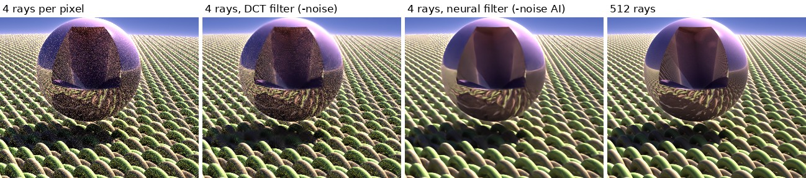
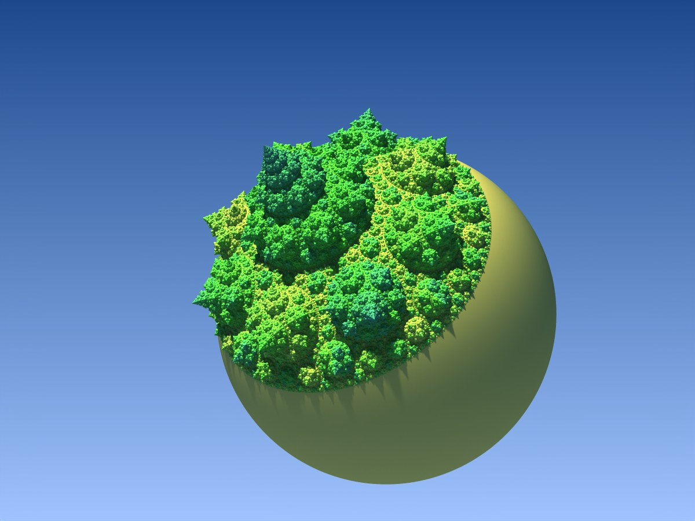
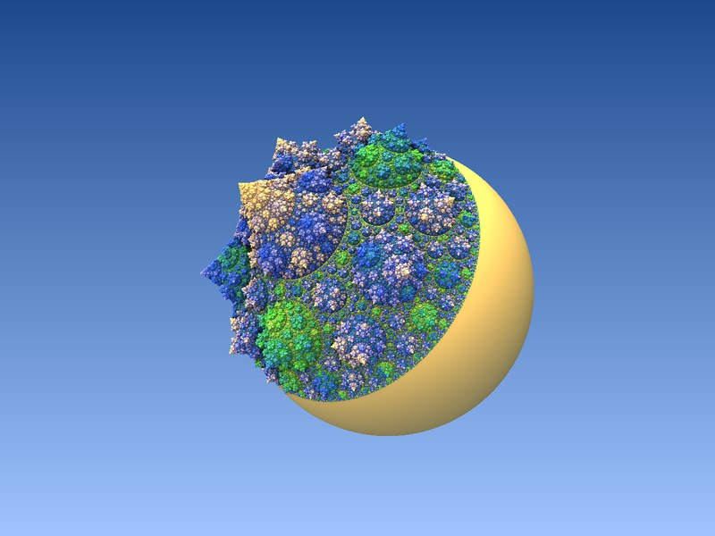
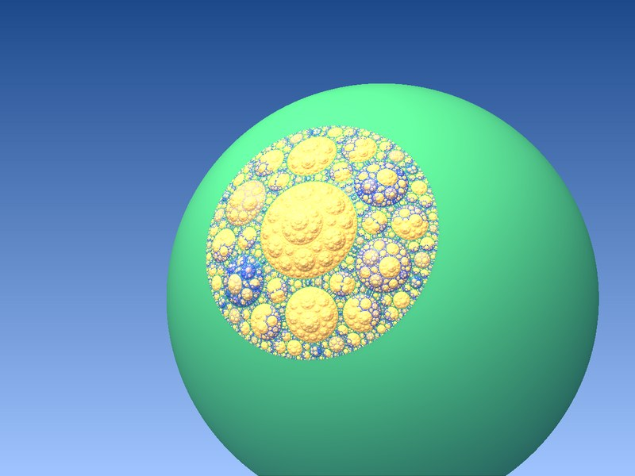
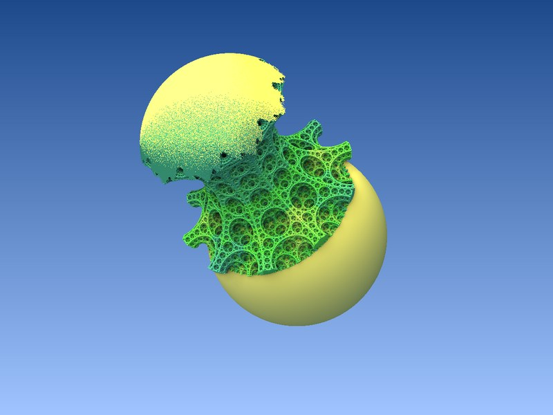

# mb3d-rs — Linux, Windows और macOS के लिए Mandelbulb3D
<!-- languages:start -->
[English](../../README.md) · [Deutsch](README.de.md) · [Français](README.fr.md) · [Italiano](README.it.md) · [Nederlands](README.nl.md) · [Polski](README.pl.md) · [Kaszëbsczi](README.csb.md) · **हिन्दी** · [日本語](README.ja.md) · [한국어](README.ko.md) · [简体中文](README.zh-CN.md) · [繁體中文](README.zh-TW.md)
<!-- languages:end -->

*अंग्रेज़ी README (संस्करण 0.2.84) से अनूदित। जहाँ दोनों में अंतर हो, वहाँ [अंग्रेज़ी README](../../README.md) सही है।*

**डाउनलोड: [नवीनतम रिलीज़](https://github.com/thr32423/mb3d-rs/releases/latest)** · [डाउनलोड](#download) · [नया क्या है](../UPDATES.md)

mb3d-rs [Mandelbulb3D](https://github.com/thargor6/mb3d) (MB3D) है, वही
3D फ्रैक्टल प्रोग्राम, जिसे इस तरह फिर से लिखा गया है कि वह आज के
कंप्यूटरों पर चले: **Linux, Windows और macOS** पर, और चित्र की गणना
**ग्राफ़िक्स कार्ड** पर होती है, जबकि MB3D केवल प्रोसेसर का उपयोग कर पाता
था। यह MB3D की पैरामीटर फ़ाइलें (`.m3p`, `.m3i`, फ़ोरम से लिए गए टेक्स्ट
पैरामीटर) खोलता है, MB3D के फ़ॉर्मूले और मैप इस्तेमाल करता है, और वही
चित्र बनाता है।

<a href="../img/main_window.jpg"></a>

यह दो प्रोग्रामों के रूप में आता है:

* **Mandelbulb3D** — डेस्कटॉप प्रोग्राम, MB3D की अपनी विंडो के साथ:
  मुख्य विंडो, फ़ॉर्मूले, प्रकाश व्यवस्था, पोस्ट प्रोसेसिंग, नेविगेटर, एनिमेशन,
  बैच, बड़े रेंडर, Monte Carlo, वॉक्सेल निर्यात, Bulb Tracer 2, MutaGen
  और बाकी सब। अगर आप MB3D जानते हैं, तो आप यह प्रोग्राम जानते हैं; MB3D के
  ट्यूटोरियल यहाँ भी लागू होते हैं।

  <details><summary>और पढ़ें</summary>

  विंडो MB3D की अपनी हैं — MB3D की मूल विंडो परिभाषाओं से बनी, इसलिए हर
  बटन, स्लाइडर और संकेत वहीं है जहाँ वह MB3D में है:
  
  * **मुख्य विंडो:** पैरामीटर खोलना और सहेजना (`.m3p`, `.m3i`, टेक्स्ट,
    क्लिपबोर्ड), चित्र सहेजना (PNG, JPEG, BMP, 16 बिट Z-बफ़र), माउस
    मोड, घुमाव के बटन, छवि का आकार, गुणवत्ता प्रीसेट, पूर्ववत (undo),
    बढ़ते चित्र और आँकड़ों के साथ *3D गणना करें*, और सभी पेज
    (गणना, आंतरिक, जानकारी, कटिंग, Julia, कैमरा, रंगाई, स्टीरियो)।
  * **फ़ॉर्मूले:** छह फ़ॉर्मूला स्लॉट, MB3D की फ़ॉर्मूला सूचियाँ और विकल्प,
    हाइब्रिड प्रकार, पसंदीदा, और JIT फ़ॉर्मूला एडिटर।
  * **प्रकाश व्यवस्था:** लाइट 1–6, प्रीसेट, पैलेट, वस्तु, परिवेश,
    d.कोहरा और पृष्ठ चित्र पेज; बदलाव चित्र को तुरंत फिर से रंगते हैं, नई
    गणना के बिना।
  * **पोस्ट प्रोसेसिंग:** z-बफ़र पर नॉर्मल, कठोर और परिवेश छायाएँ,
    परावर्तन और पारदर्शिता, फ़ील्ड की गहराई।
  * **नेविगेटर:** कुंजियों और माउस से घूमें और चारों ओर देखें, फिर *दृश्य मुख्य
    में*।
  * **एनिमेशन मेकर, बैच प्रोसेसिंग, बड़े रेंडर, Monte Carlo, वॉक्सेल
    निर्यात, Bulb Tracer 2** (मेश) मेश पूर्वावलोकन के साथ, **हाइटमैप
    जनरेटर, MutaGen, ZBuf16Bit, मैप अनुक्रम, Ini फ़ोल्डर** — सब
    MB3D की तरह।
  * **स्वार्म** (नया, टूल टैब पर): आपके कंप्यूटर मिलकर रेंडर करते हैं,
    देखें [कई कंप्यूटरों पर रेंडरिंग](#rendering-on-several-computers-the-swarm)।

  </details>
* **mb3d** — स्क्रिप्ट और बैच जॉब के लिए कमांड लाइन रेंडरर: चित्र,
  एनिमेशन, बैच सूचियाँ, Monte Carlo रेंडर, वॉक्सेल और मेश निर्यात,
  सब कुछ बिना किसी विंडो के।

<a id="is-it-safe-to-run-check-it-yourself"></a>

## क्या इसे चलाना सुरक्षित है? खुद जाँचें

आपको हमारी बात पर भरोसा करने की ज़रूरत नहीं है। [scanrepo.dev](https://www.scanrepo.dev)
एक स्वतंत्र सेवा है जो किसी GitHub रिपॉज़िटरी में हानिकारक सॉफ़्टवेयर के
संकेत खोजती है: ऐसा कोड जो दूसरे प्रोग्राम शुरू करता है, इंटरनेट से
जुड़ता है, जो करता है उसे छिपाता है, या प्रोग्रामिंग भाषा की सुरक्षा
जाँचों को दरकिनार करता है। कोई भी इसे कभी भी इस रिपॉज़िटरी पर चला सकता है:

**[▶ scanrepo.dev पर mb3d-rs स्कैन करें](https://www.scanrepo.dev/scan/github/thr32423/mb3d-rs)**
(मौजूदा कोड का ताज़ा परिणाम पाने के लिए *Rescan* पर क्लिक करें)

संस्करण 0.2.66 को **सुरक्षित: 100 में से 0, कोई निष्कर्ष नहीं** रेटिंग मिली (पहले:
[0.2.44 का परिणाम](../img/scan_0.2.44.png))। एक पुराने संस्करण को चिह्नित किया गया था,
और हमने उसके जवाब में कोड बदला ([issue #4](https://github.com/thr32423/mb3d-rs/issues/4));
अब इसे इसी तरह बने रहने के लिए लिखा गया है। प्रोग्रामों में ऐसा कोई कोड नहीं है
जो इंटरनेट से जुड़ता हो; केवल एक दूसरा प्रोग्राम जिसे वे आपके सिस्टम से
खोलने को कहते हैं, वह है आपका फ़ाइल मैनेजर, जब आप कोई फ़ोल्डर खोलने के
लिए बटन पर क्लिक करते हैं।

स्कैन जाने-पहचाने चेतावनी संकेतों को खोजता है; यह कोई गारंटी नहीं है। इनसे
आप खुद आगे जाँच कर सकते हैं:

* **पूरा सोर्स कोड यहीं है।** डाउनलोड इसी से GitHub के अपने बिल्ड
  सर्वरों पर बनाए जाते हैं, उन चरणों से जिन्हें आप
  [रिलीज़ वर्कफ़्लो](.github/workflows/release.yml) में पढ़ सकते हैं, किसी के
  निजी कंप्यूटर पर नहीं।
* **हर रिलीज़ चेकसम सूचीबद्ध करती है** (`SHA256SUMS`), ताकि आप पुष्टि कर सकें
  कि आपने जो फ़ाइल डाउनलोड की है वह ठीक वही है जो प्रकाशित हुई थी;
  नीचे दिया गया एक-पंक्ति इंस्टॉल यह आपके लिए करता है। 0.2.45 से आगे की
  रिलीज़ में GitHub के बिल्ड अटेस्टेशन भी होते हैं: `gh attestation verify
  FILE --repo thr32423/mb3d-rs` दिखाता है कि कोई डाउनलोड किस कमिट से बना
  था।

<a id="what-is-new-compared-with-mandelbulb3d"></a>

## Mandelbulb3D की तुलना में नया क्या है

* **चित्र की गणना ग्राफ़िक्स कार्ड करता है** — स्वयं छवि, छायाएँ,
  एम्बिएंट ऑक्लूज़न, परावर्तन और Monte Carlo रेंडर। एक सामान्य कंप्यूटर पर
  यह अकेले प्रोसेसर से कई गुना तेज़ है; नीचे [गति](#speed) देखें।
* **ऑटो मोड**: ग्राफ़िक्स कार्ड और प्रोसेसर हर चित्र पर साथ मिलकर काम करते
  हैं, और कोई कभी इंतज़ार नहीं करता — अगर कार्ड तैयार नहीं है, तो प्रोसेसर
  फिर भी शुरू कर देता है और कार्ड बाद में जुड़ जाता है।
* **टाइटल बार में एक LED** दिखाती है कि पिछले चित्र की गणना कहाँ हुई।
* **इंटरफ़ेस आकार** 75 से 200 % तक, उच्च रिज़ॉल्यूशन स्क्रीन के लिए।

  <a href="../img/themes_150.png"></a>

  <details><summary>और पढ़ें</summary>

  **वरीयताएँ ▸ थीम ▸ इंटरफ़ेस आकार** सभी विंडो और उनके
  टेक्स्ट को बड़ा या छोटा करता है (75 से 200 %), उच्च रिज़ॉल्यूशन स्क्रीन के
  लिए; लेआउट ठीक MB3D जैसे ही रहते हैं।
  
  | 100 % | 150 % |
  |---|---|
  |  |  |

  </details>
* विंडो के लिए **आठ रूप**, सब थीम फ़ाइलें जिन्हें आप कॉपी करके
  बदल सकते हैं: दो MB3D के रूपों को दोहराते हैं, छह नए हैं।

  <a href="../img/themes/Midnight.jpg"></a>

  <details><summary>और पढ़ें</summary>

  **वरीयताएँ ▸ थीम** आठ रूप देता है, हर एक `Themes`
  फ़ोल्डर में एक फ़ाइल: *Glossy* (गहरा डिफ़ॉल्ट) और *Windows* MB3D के अपने
  दो रूपों को दोहराते हैं, बाकी छह नए हैं। पूरे आकार के लिए किसी चित्र पर क्लिक करें।
  
  | | |
  |---|---|
  | <a href="../img/themes/Glossy.jpg"></a> | <a href="../img/themes/Windows.jpg"></a> |
  | **Glossy**: MB3D का डिफ़ॉल्ट | **Windows**: MB3D का "Themes off" |
  | <a href="../img/themes/Graphite.jpg"></a> | <a href="../img/themes/Daylight.jpg"></a> |
  | **Graphite**: हल्का तटस्थ स्लेटी, स्टील-नीले उभार | **Daylight**: गर्म हल्का स्लेटी, टील उभार |
  | <a href="../img/themes/Midnight.jpg"></a> | <a href="../img/themes/Ember.jpg"></a> |
  | **Midnight**: गहरा नेवी, नीले उभार | **Ember**: गर्म चारकोल, नारंगी उभार |
  | <a href="../img/themes/Forest.jpg"></a> | <a href="../img/themes/Highcontrast.jpg"></a> |
  | **Forest**: गहरा हरा-स्लेटी, हरे उभार | **High contrast**: काला, सफ़ेद टेक्स्ट, पीली हाइलाइट |
  
  थीम प्रोग्राम के पास `Themes` फ़ोल्डर में एक छोटी टेक्स्ट फ़ाइल है;
  किसी एक को कॉपी करें, उसके रंग बदलें, और वह अगली बार शुरू होने पर
  सूची में दिखाई देगी।

  </details>
* **क्रैश हर सिस्टम पर एक नोट छोड़ता है**: प्रोग्राम का पैनिक (या वह
  त्रुटि जिस पर वह बंद होता है) `mb3d_crash.txt` में जोड़ा जाता है, जो
  प्रोग्राम के पास या उसके डेटा फ़ोल्डर में होती है (पहले केवल Windows पर)।
  बग रिपोर्ट के साथ वह फ़ाइल भेजें।
* **कंप्यूटर के सभी ग्राफ़िक्स कार्ड गणना करते हैं**, कुछ भी सेट किए बिना:
  मिला हर कार्ड चित्र की पंक्तियों की पट्टियाँ उसी पूल से लेता है जिससे
  पहला कार्ड और प्रोसेसर लेते हैं, इसलिए तेज़ कार्ड बस ज़्यादा ले लेता है;
  छायाएँ, ऑक्लूज़न, Monte Carlo किरणें और परावर्तन भी इसी तरह बाँटे
  जाते हैं, और एनिमेशन एक साथ हर कार्ड पर एक फ़्रेम रेंडर करता है। धीमा
  कार्ड (समर्पित कार्ड के साथ इंटीग्रेटेड ग्राफ़िक्स) जितना कर सकता है करता
  है और किसी चित्र को कभी नहीं रोकता: खाली पंक्तियाँ खत्म होते ही, बेकार
  बैठे कार्ड और प्रोसेसर वे पंक्तियाँ ले लेते हैं जो उसने अब तक नहीं दीं।
  जो कार्ड विफल होता है उसे छोड़ दिया जाता है, बाकी काम जारी रखते हैं।
  `mb3d --list-cards` दिखाता है कि क्या मिला। (एक कार्ड को दो बार खोलकर
  और दूसरे कार्ड के रूप में एक सॉफ़्टवेयर Vulkan ड्राइवर के साथ परखा गया;
  दो असली कार्डों वाले कंप्यूटर पर अभी नहीं।)
* **अधूरा चित्र एक `.m3i` फ़ाइल है।** रोके गए, क्रैश हुए या बंद किए गए
  रेंडर ने जो गणना की है वह कैश में रखी जाती है (अधूरे रेंडर
  विंडो, `mb3d resume`); किसी चित्र के लिए वह फ़ाइल अब हर पल एक
  `.m3i` छवि फ़ाइल है, रेंडर के फ़ोल्डर में `image.m3i`, जिसमें अभी तक
  गणना न हुई पंक्तियाँ पृष्ठभूमि के रूप में होती हैं। जब चाहें उसे बाहर कॉपी
  करें, या अधूरे रेंडर विंडो में *Save m3i* दबाएँ (कमांड लाइन पर `mb3d
  resume --m3i KEY file.m3i`; दोनों किसी पुराने संस्करण के `data.bin` को
  भी `.m3i` के रूप में लिखते हैं), और उसे यहाँ या
  Mandelbulb3D में खोलें, किसी रूपांतरण की ज़रूरत नहीं। (Monte Carlo रेंडर अपने
  रिकॉर्ड अलग रखते हैं, किसी पास का `.m3c` `--m3c` से लिखा जाता है।)
* **विंडो के लिए हॉटकी**: एक कुंजी संयोजन मुख्य विंडो,
  नेविगेटर, एनिमेशन, फ़ॉर्मूले, प्रकाश व्यवस्था, पोस्ट प्रोसेसिंग या
  Monte Carlo विंडो को किसी भी विंडो से सामने ले आता है (Ctrl+1 से Ctrl+7), और
  Ctrl+W उस विंडो को बंद करता है जिसमें आप हैं (macOS पर Cmd)। अपनी हॉटकी *वरीयताएँ > हॉटकी* में सेट करें: किसी फ़ील्ड पर क्लिक करें और
  कुंजियाँ दबाएँ, Backspace हॉटकी हटा देता है।
* **आपकी भाषा में इंटरफ़ेस**: विंडो का हर टेक्स्ट एक भाषा फ़ाइल से
  आता है; बारह भाषाएँ साथ आती हैं, और प्रोग्राम किसी नई भाषा की फ़ाइल
  आपके अनुवाद के लिए लिख देता है।

  <details><summary>और पढ़ें</summary>

  मुख्य विंडो के टाइटल बार के दाएँ सिरे पर भाषा बैज इंटरफ़ेस भाषा
  दिखाता है (`EN`); उस पर क्लिक करने से भाषा विंडो खुलती है।
  भाषा प्रोग्राम के पास `Languages` फ़ोल्डर में एक टेक्स्ट फ़ाइल है।
  साथ आने वाली: English, Deutsch, Français, Italiano, Nederlands, Polski,
  Kaszëbsczi, हिन्दी, 日本語, 한국어, 简体中文 और 繁體中文 (हर एक अपने झंडे के साथ;
  पूर्वी एशियाई भाषाएँ अपने अक्षरों के लिए Noto Sans CJK का एक हिस्सा लाती हैं,
  हिन्दी Noto Sans Devanagari लाती है, जिसके संयुक्ताक्षर और मात्राएँ
  rustybuzz टेक्स्ट शेपर से जमाए जाते हैं)।
  अनुवाद मशीन से बने हैं और उनकी संरचना जाँची गई है, मूल भाषियों ने उन्हें
  नहीं जाँचा: सुधारों का स्वागत है, हर सुधार फ़ाइल की एक पंक्ति है। अनुवाद करने के लिए: अपनी भाषा का नाम लिखें और
  *भाषा फ़ाइल बनाएँ* दबाएँ; प्रोग्राम `Languages/<name>.lng` लिखता है
  जिसमें हर टेक्स्ट अंग्रेज़ी में, हर पंक्ति में एक होता है (`Button2.Caption = Calculate
  3D`)। `=` के दाईं ओर के टेक्स्ट का किसी टेक्स्ट एडिटर में अनुवाद करें और
  *फिर से लोड करें* दबाएँ: विंडो तुरंत बदल जाती हैं, बिना दोबारा शुरू किए। छोड़ी गई
  पंक्ति अंग्रेज़ी टेक्स्ट रखती है। *सहेजें + बाहर* भाषा को अगली बार शुरू
  होने के लिए रखता है।

  </details>
* **Linux, Windows और macOS** (Intel और Apple Silicon)।
* **एक कमांड लाइन प्रोग्राम** हर उस काम के लिए जिसे विंडो की ज़रूरत नहीं।
* **बहुत बड़े चित्र एक टुकड़े में**: 15000 x 20000 पिक्सेल और उससे अधिक,
  मेमोरी खत्म हुए बिना, और फ़ील्ड की गहराई सभी प्रोसेसर कोर का उपयोग
  करती है (24 थ्रेड पर 0.2.45 से पहले की तुलना में 11 गुना तेज़,
  उसी चित्र के साथ)।
* **16 बिट चित्र:** PNG फ़ाइलें जिनमें हर रंग के 256 की जगह 65,536 स्तर
  होते हैं, बिना बैंडिंग के संपादन के लिए।

  <a href="../img/png16_compare.png"></a>

  <details><summary>और पढ़ें</summary>

  MB3D 8 बिट चित्र सहेजता है: हर रंग के 256 स्तर। देखने के लिए यह
  काफ़ी है, लेकिन जब चित्र को बाद में संपादित किया जाता है — चमक, कंट्रास्ट,
  कर्व — तो पृष्ठभूमि या कोहरे जैसे चिकने हिस्से दिखाई देने वाली
  पट्टियों में टूट जाते हैं। **चित्र सहेजें ▸ PNG** एक दूसरा फ़ाइल प्रकार देता है, **PNG 16 बिट
  रंग**: रंग वैसे ही जैसे प्रोग्राम ने उनकी गणना की, 256 स्तरों में
  गोल किए जाने से पहले, सभी छायाओं, परावर्तनों और फ़ील्ड की गहराई के साथ।
  फ़ाइल वैसी ही दिखती है, और संपादित करने पर चिकनी बनी रहती है।
  
  <a href="../img/png16_compare.png"></a>
  
  <a href="../img/save_png16.png"></a>

  </details>
* Monte Carlo और बाकी सभी चित्रों के लिए **एक शोर फ़िल्टर**, GIMP से
  जाना-पहचाना DCT डीनॉइज़िंग, और Monte Carlo रेंडर के लिए एक न्यूरल
  फ़िल्टर भी, Intel Open Image Denoise।

  <a href="../img/mc_noise.png"></a>

  <details><summary>और पढ़ें</summary>

  **शोर फ़िल्टर** चित्रों से दानेदारपन हटाता है: GIMP के
  *Filters ▸ Enhance ▸ Noise Reduction ▸ Denoise DCT* का **DCT डीनॉइज़िंग**,
  जो GIMP के फ़िल्टरों में से इन चित्रों के लिए सबसे उपयुक्त रहा (नीचे श्रेय देखें)।
  
  * **Monte Carlo विंडो ▸ -शोर** (एक बटन जिसे MB3D ने छिपा रखा था): दिखाए गए
    चित्र को, और सहेजे गए चित्र को, ऐसी प्रबलता से फ़िल्टर करता है जो प्रति
    पिक्सेल किरणों के अनुसार चलती है। रेंडरिंग स्वयं बिना फ़िल्टर के जारी रहती है,
    और उसका अगला अपडेट उसे फिर से बिना फ़िल्टर के दिखाता है।
  * **पोस्ट प्रोसेसिंग ▸ शोर फ़िल्टर**: *अभी फ़िल्टर करें* मुख्य विंडो के चित्र
    को फ़िल्टर करता है; *नए चित्र स्वतः फ़िल्टर करें* हर नए चित्र को
    फ़िल्टर करता है। *प्रबलता* हटाए जाने वाले शोर की प्रबलता है (4 हल्का है;
    अधिक मान ज़्यादा दाने और ज़्यादा बारीक विवरण हटाता है)।
  
  Monte Carlo चित्रों में सबसे ज़्यादा दाने होते हैं। 512 किरण प्रति पिक्सेल से
  रेंडर किए गए चित्रों की तुलना में, सभी 13 परीक्षणों (चार दृश्य, 4 से 32 किरणें)
  में फ़िल्टर किए गए चित्र बिना फ़िल्टर वालों से ज़्यादा क़रीब थे: 4 किरणों पर 23 %
  तक, 8 किरणों पर 5 से 10 %, 32 किरणों पर 1 से 3 %, जहाँ थोड़े ही दाने बचते हैं।
  
  <a href="../img/mc_noise.png"></a>
  
  <a href="../img/postpro_noise.png"></a>

  **न्यूरल शोर फ़िल्टर**
  [Intel Open Image Denoise](https://www.openimagedenoise.org) है, जो
  Blender के Cycles और कई दूसरे पाथ ट्रेसरों का फ़िल्टर है, रेंडर किए गए
  चित्रों पर प्रशिक्षित। यह रेंडरिंग की किरणों के औसत को फ़िल्टर करता है
  (एक्सपोज़र और सैचुरेशन से पहले), इसलिए चित्र की चमक बनी रहती है।
  Intel की लाइब्रेरी प्रोग्राम के साथ आती है (`oidn` फ़ोल्डर; .deb
  और .rpm में, `/usr/lib/mb3d-rs/oidn`); `MB3D_OIDN` कोई दूसरी बता सकता है।

  * **Monte Carlo विंडो ▸ -शोर AI**: दिखाए गए चित्र को, और सहेजे गए को,
    *-शोर* की तरह फ़िल्टर करता है; रेंडरिंग बिना फ़िल्टर के जारी रहती है।
  * **कमांड लाइन**: `mb3d montecarlo scene.m3p --rays 8 --denoise-ai`।
  * प्रोसेसर पर 640 x 480 के चित्र के लिए इसमें 0.2 से 0.6 सेकंड लगते हैं।

  512-किरण वाले चित्र से अंतर (सभी पिक्सेल पर औसत, कम होना
  बेहतर है):

  | दृश्य | 4 किरणें | DCT फ़िल्टर | न्यूरल फ़िल्टर | 8 किरणें | DCT फ़िल्टर | न्यूरल फ़िल्टर |
  |---|---|---|---|---|---|---|
  | TreePlanet | 1.89 % | 1.52 % | **1.23 %** | 0.88 % | 0.82 % | **0.79 %** |
  | Cutted sphere over carpet | 5.30 % | 3.87 % | **2.34 %** | 2.80 % | 2.37 % | **1.66 %** |
  | Julia on box | 1.61 % | **1.01 %** | 1.08 % | 0.98 % | **0.81 %** | 0.84 % |
  | MengerTrees | 1.95 % | 1.54 % | **1.26 %** | 1.15 % | 1.05 % | **0.94 %** |

  न्यूरल फ़िल्टर चार में से तीन दृश्यों में सबसे क़रीब है; Julia सेट के
  बारीक दानों पर DCT फ़िल्टर थोड़ा ज़्यादा क़रीब है। इसका असर सबसे ज़्यादा
  काँच और दर्पणों पर दिखता है, जहाँ कम किरणें सबसे ज़्यादा दाने छोड़ती हैं:

  <a href="../img/mc_noise_ai.jpg"></a>

  </details>
* चित्रों और एनिमेशन के लिए **पारदर्शी पृष्ठभूमि**।

  <a href="../img/transparent.png"></a>

  <details><summary>और पढ़ें</summary>

  चित्र और एनिमेशन फ़्रेम **पारदर्शी पृष्ठभूमि** के साथ सहेजे जा सकते हैं,
  ताकि फ़्रैक्टल को किसी दूसरे चित्र पर या वीडियो एडिटर में रखा जा सके:
  **चित्र सहेजें ▸ PNG ▸ PNG पारदर्शी पृष्ठभूमि**, और
  एनिमेशन मेकर में **पारदर्शी पृष्ठभूमि** (PNG फ़्रेम)। एंटी-एलियासिंग के साथ (1:2
  या उससे अधिक का व्यूइंग स्केल, या `--aa`) किनारे मुलायम होते हैं, और उन पर
  पुराने पृष्ठभूमि रंग की कोई झालर नहीं होती। कंपोज़िटिंग के लिए गहराई वाले
  चित्र पहले से थे (*Z बफ़र भी सहेजें*, `--depth`)।
  
  <a href="../img/transparent.png"></a>

  </details>
* **एनिमेशन के वीडियो:** सीधे प्रोग्राम से एक AVI फ़ाइल, या
  छोटी MP4 के लिए ffmpeg कमांड।

  <a href="../img/anim_video.png"></a>

  <details><summary>और पढ़ें</summary>

  एनिमेशन मेकर में, **वीडियो भी बनाएँ (AVI)** फ़्रेम रेंडर होते ही उन्हें
  जोड़कर एक वीडियो बनाता है, आपके सेट किए गए **फ़्रेम प्रति सेकंड** पर:
  आउटपुट फ़ोल्डर में `<project name>.avi`, फ़्रेमों के पास, जो
  रखे जाते हैं। यह VLC और mpv में चलता है और वीडियो एडिटरों (Kdenlive,
  Shotcut, DaVinci Resolve) में खुलता है। हर फ़्रेम पूरे चित्र के रूप में रखा जाता है, इसलिए
  फ़ाइलें बड़ी होती हैं: संपादन और सहेजकर रखने के लिए अच्छी, साझा करने के लिए कम।
  
  साझा करने लायक़ छोटे वीडियो के लिए, **FFmpeg कमांड** MP4 के लिए कमांड
  (या, पारदर्शी पृष्ठभूमि के साथ, WebM के लिए) क्लिपबोर्ड पर और
  संदेशों में रख देता है। [ffmpeg](https://ffmpeg.org) इंस्टॉल करें, फ़्रेम पूरे होने पर
  कमांड को टर्मिनल में चिपकाएँ, और वह वीडियो बना देता है; यह प्रोग्राम
  खुद कोई दूसरा प्रोग्राम शुरू नहीं करता।
  
  <a href="../img/anim_video.png"></a>

  </details>
* खोलें डायलॉग में **पैरामीटर फ़ाइलों का पूर्वावलोकन**।

  <a href="../img/open_preview.png"></a>

  <details><summary>और पढ़ें</summary>

  **खोलें ▸ m3p खोलें** और **m3i खोलें** क्लिक की गई पैरामीटर फ़ाइल को
  खोलने से पहले उसका एक छोटा चित्र दिखाते हैं, उसके आकार और फ़ॉर्मूलों के साथ;
  तीर कुंजियाँ पूर्वावलोकन के साथ सूची में आगे-पीछे जाती हैं। चित्र की
  गणना पृष्ठभूमि में प्रोसेसर पर होती है, इसलिए डायलॉग तुरंत प्रतिक्रिया
  देता रहता है, और प्रोग्राम चलने तक हर फ़ाइल का पूर्वावलोकन रखा
  जाता है।
  
  <a href="../img/open_preview.png"></a>

  </details>
* **नेविगेटर: सटीक मान और दृश्य रीसेट करें।** किसी मान पर क्लिक करें और उसे टाइप करें;
  उस दृश्य पर लौटें जिससे नेविगेटर शुरू हुआ था।

  <a href="../img/navigator_values.png"></a>

  <details><summary>और पढ़ें</summary>

  * नेविगेटर के पैनलों में **किसी मान पर क्लिक करें** — Julia मान, फ़ॉर्मूला
    मान, 4D घुमाव, विविध मान — और सटीक संख्या टाइप करें, जैसे
    MB3D में (कोण डिग्री में)। इसके बाद स्लाइडर उसी मान से आगे चलता है।
  * जब ज़ूम के कदम बहुत मोटे हों तो **ज़ूम पर क्लिक करें** और उसे टाइप करें (MB3D
    की इश्यू सूची की एक इच्छा); टाइप किया गया ज़ूम बना रहता है (*निश्चित ज़ूम और कदम*)।
  * **दृश्य रीसेट करें** उस स्थिति, दिशा और ज़ूम पर लौटता है जो
    नेविगेटर ने मुख्य विंडो से लिए थे; समायोजित मान बने रहते हैं।
  
  <a href="../img/navigator_values.png"></a>

  </details>
* **एक नया फ़ॉर्मूला, SphereTree:** एक-दूसरे को छूते गोलों का पेड़ जो
  छोटे से छोटे होते हुए शाखाओं में बँटते हैं, Tom Lowe का।

  <a href="../img/spheretree_ball.jpg"></a>

  <details><summary>और पढ़ें</summary>

  **SphereTree** ऐसा फ़ॉर्मूला है जो Mandelbulb3D में नहीं है: गोलों का एक पेड़
  जो एक-दूसरे को छूते हैं और छोटे से छोटे गोलों में बँटते जाते हैं, झाग या
  मूँगे की तरह। Mandelbox के आविष्कारक Tom Lowe ने इसे 2020 में प्रकाशित किया
  (नीचे श्रेय देखें)। यह फ़ॉर्मूला सूची में dIFS फ़ॉर्मूलों के साथ है
  और इसकी चार सेटिंग हैं:
  
  * **PackRatio** (0 से 1.22): गोलों का आकार; 1 पर वे बस
    छूते हैं, 1 से ऊपर बाहरी गोले अलग होकर टूट जाते हैं।
  * **Levels**: पेड़ कितना गहरा जाता है (ज़्यादातर चित्रों के लिए 6 काफ़ी है)।
  * **Rotated**: 1 हर स्तर को एक चक्कर का बारहवाँ हिस्सा घुमाता है, और पेड़
    गोलों के गुच्छों की एक गोल गेंद बन जाता है।
  * **Colour scale**: पेड़ की हर शाखा का अपना रंग होता है। उन्हें देखने के लिए
    प्रकाश व्यवस्था की रंग सेटिंग में *2. विकल्प* (ऑर्बिट ट्रैप) चुनें;
    यह सेटिंग उन्हें रंग ग्रेडिएंट पर फैलाती है।
  
  यह अकेले और dIFS ट्रांसफ़ॉर्म के बाद भी काम करता है (तीसरा चित्र इसे
  *tilingbrickIFS* से दोहराता है), और इसकी गणना ग्राफ़िक्स कार्ड पर भी होती है
  और प्रोसेसर पर भी। इटरेशन 1 पर सेट करें: फ़ॉर्मूला पूरे पेड़ की गणना
  एक बार में करता है। SphereTree वाले पैरामीटर केवल इसी प्रोग्राम में खुलते हैं,
  Mandelbulb3D में नहीं।
  
  <a href="../img/spheretree_ball.jpg"></a>
  
  | <a href="../img/spheretree_close.jpg"></a> | <a href="../img/spheretree_swarm.jpg"></a> |
  |:---:|:---:|

  </details>
* **एक नया फ़ॉर्मूला, DomeTree:** एक गुंबद जिससे छोटे गुंबदों का एक
  छल्ला निकलता है, हर एक का अपना छल्ला, Tom Lowe का।

  <a href="../img/dometree_mc.jpg"></a>

  <details><summary>और पढ़ें</summary>

  **DomeTree** SphereTree के बाद Tom Lowe का दूसरा पेड़ है (श्रेय
  देखें): एक गेंद जिसकी एक तरफ़ गुंबदों का छल्ला उगता है, हर गुंबद पर उसका
  अपना छोटा छल्ला, स्तर दर स्तर, वृत्त-व्युत्क्रमों (circle inversions) से बना।
  यह फ़ॉर्मूला सूची में dIFS फ़ॉर्मूलों के साथ है और इसकी पाँच सेटिंग हैं:

  * **Levels**: पेड़ कितना गहरा जाता है (16 काफ़ी है)।
  * **Children**: हर छल्ले में गुंबद, 4 से 10।
  * **Bend angle** (0.3 से 1.3 सबसे अच्छे): गुंबद कितने उभरते हैं; कम
    मान चपटी तश्तरियाँ देते हैं, ऊँचे मान गोल गुंबद। लगभग 1.3 से ऊपर
    सतह दानेदार हो जाती है।
  * **Colour scale**: हर गुंबद का अपना रंग होता है। उन्हें देखने के लिए
    प्रकाश व्यवस्था की रंग सेटिंग में *2. विकल्प* (ऑर्बिट ट्रैप) और चौड़ी
    रंग सीमा (उदाहरण के लिए 0 से 100) चुनें।
  * **Start curved**: 1 (डिफ़ॉल्ट) गेंद से शुरू करता है, 0 एक सपाट
    फ़र्श से जिससे पहला छल्ला उगता है।

  छोटा *Raystep* (0.2; 9 या 10 children के साथ 0.05) इस्तेमाल करें: आकृति का
  दूरी अनुमान मोटा है, जैसा TGlad की अपनी Fragmentarium फ़ाइल में है।
  SphereTree की तरह यह ग्राफ़िक्स कार्ड और प्रोसेसर पर चलता है, इसे केवल
  1 इटरेशन चाहिए, और इसके साथ वाले पैरामीटर केवल इसी प्रोग्राम में खुलते हैं।

  <a href="../img/dometree_mc.jpg"></a>

  | <a href="../img/dometree_5.jpg"></a> | <a href="../img/dometree_flat.jpg"></a> | <a href="../img/dometree_10.jpg"></a> |
  |:---:|:---:|:---:|

  </details>
* **एक नया फ़ॉर्मूला, UlamSpiral:** अभाज्य संख्याओं का Ulam सर्पिल 3D में,
  एक शहर, एक स्काइलाइन, गोलों या एक खंड के रूप में।

  <a href="../img/ulam_2d.png"></a>

  <details><summary>और पढ़ें</summary>

  1963 में गणितज्ञ Stanisław Ulam एक बैठक में "एक लंबे और बहुत
  उबाऊ शोधपत्र" के दौरान बैठे रहे और ख़ानेदार काग़ज़ पर आड़ी-तिरछी रेखाएँ
  बनाने लगे। उनका पहला विचार शतरंज की पहेलियाँ बनाने का था; इसके बजाय उन्होंने
  ख़ानों पर 1, 2, 3, … सर्पिल में नंबर लिखे, बीच में 1, और अभाज्य संख्याओं
  पर गोला बनाया। अभाज्य संख्याएँ तिरछी रेखाओं पर पंक्तिबद्ध हो गईं, मानो
  किसी पैटर्न का पालन कर रही हों, और कंप्यूटर जब उनमें से लाखों बनाता है
  तब भी ऐसा ही होता है (Ulam ने Los Alamos में MANIAC II पर 100,000 आज़माईं;
  Martin Gardner ने 1964 में यह चित्र Scientific American के मुखपृष्ठ पर
  छापा)। आज तक कोई इसे पूरी तरह समझा नहीं पाया है।
  
  <a href="../img/ulam_2d.png"></a>
  
  **UlamSpiral** उस सर्पिल को 3D में बनाता है, हर संख्या के लिए एक आकृति, चार
  रूपों में (*Mode*):
  
  * **0, अभाज्य मीनारें**: हर संख्या के लिए एक प्लेट और हर अभाज्य
    पर एक मीनार। अभाज्य संख्याओं की तिरछी रेखाएँ मीनारों की पंक्तियाँ बन जाती हैं।
  * **1, भाजक स्काइलाइन**: हर संख्या के लिए एक स्तंभ, जितने ज़्यादा
    भाजक उतना ऊँचा; अभाज्य संख्याएँ उनके बीच की नीची गलियाँ हैं।
  * **2, भाजक गोले**: हर संख्या के लिए एक गोला, जितने ज़्यादा भाजक उतना
    बड़ा (अभाज्य संख्याएँ छोटे गोले हैं)।
  * **3, अभाज्यों का एक खंड**: संख्याएँ वर्ग के बजाय घन-कोशों के चारों ओर
    लपेटी जाती हैं, हर अभाज्य पर एक घन।
  
  *Rings* सर्पिल का आकार तय करता है (60 छल्ले यानी 14,641 तक की संख्याएँ),
  *Height* मीनारों या स्तंभों की ऊँचाई, *Gap* उनके बीच की
  जगह। रंग सेटिंग में *2. विकल्प* (ऑर्बिट ट्रैप) के साथ
  रंग भाजकों की संख्या के अनुसार चलता है, इसलिए अभाज्य संख्याओं का अपना
  एक रंग होता है। SphereTree की तरह यह ग्राफ़िक्स कार्ड और
  प्रोसेसर पर चलता है, dIFS ट्रांसफ़ॉर्म के बाद काम करता है, इसे केवल 1 इटरेशन चाहिए, और
  इसके साथ वाले पैरामीटर केवल इसी प्रोग्राम में खुलते हैं।
  
  <a href="../img/ulam_city.jpg"></a>
  
  | <a href="../img/ulam_skyline.jpg"></a> | <a href="../img/ulam_spheres.jpg"></a> | <a href="../img/ulam_block.jpg"></a> |
  |:---:|:---:|:---:|

  </details>
* **रोका गया रेंडर वहीं से जारी रहता है जहाँ वह था।** रेंडर ने जो गणना की
  वह रोकने पर रखी जाती है, और तब भी जब प्रोग्राम बंद हो जाए या
  क्रैश हो जाए, या कंप्यूटर बंद हो जाए (यह हर 5 मिनट में डिस्क पर सहेजी
  जाती है): 3D गणना करें, Monte Carlo (किसी पास के बीच में भी),
  एनिमेशन का फ़्रेम या चल रहे बैच का चित्र, वॉक्सेल
  निर्यात, Bulb Tracer मेश, बड़े रेंडर की टाइलें, और स्वार्म रेंडर (जॉब बनाने वाले
  कंप्यूटर पर रोकें हर पूरा हुआ हिस्सा रखता है, और हर
  कंप्यूटर वह हिस्सा रखता है जिस पर वह था)। एक ही पैरामीटर के 3D गणना करें
  और Monte Carlo पूछते हैं कि जारी रखें या नहीं, बाकी अपने आप जारी रहते
  हैं; **फिर शुरू करें** बटन (खोलें टैब) अधूरे रेंडर
  सूचीबद्ध करता है, उन्हें जारी रखने या हटाने के लिए। कमांड लाइन पर वही
  कमांड अपने आप जारी रहती है (`--tiles` में चित्र भी, `montecarlo`,
  `animate`, `batch`, `voxel` और `mesh`); `--fresh` फिर से शुरू करता है, `mb3d
  resume` उन्हें सूचीबद्ध करता है। जारी रखा गया रेंडर वैसा ही होता है जैसा
  एक बार में गणना किया गया।
* **आपके कंप्यूटरों के बीच साझा रेंडरिंग**, एक "स्वार्म": जो कंप्यूटर
  एक साझा फ़ोल्डर देखते हैं वे मिलकर एक चित्र, एक बड़ा रेंडर, एक Monte Carlo
  चित्र या एक एनिमेशन रेंडर करते हैं। देखें
  [कई कंप्यूटरों पर रेंडरिंग](#rendering-on-several-computers-the-swarm)।
* **एक नया फ़ॉर्मूला, PseudoKleinian:** हॉल, मेहराबों और गोलों का
  "Kleinian वास्तुकला" एक फ़ॉर्मूले के रूप में, अपनी सटीक दूरी के साथ।

  <a href="../img/kleinian_hall.jpg"></a>

  <details><summary>और पढ़ें</summary>

  "Kleinian वास्तुकला" के नाम से जाने जाने वाले हॉल, मेहराब, खंभे और एक-दूसरे
  के भीतर बने गोले सबसे पसंद किए जाने वाले 3D फ्रैक्टल चित्रों में हैं। MB3D में
  इन्हें केवल कई फ़ॉर्मूलों के हाइब्रिड के रूप में, ध्यान से मिलाई गई
  सेटिंग के साथ बनाया जा सकता है, वह नुस्ख़ा जो Theli-at ने 2011 में खोजा; फिर knighty ने वही
  चीज़ एक फ़ॉर्मूले के रूप में अपने दूरी अनुमान के साथ लिखी, और वही है
  **PseudoKleinian**। हर स्तर बिंदु को एक बॉक्स में मोड़ता है, उसे एक गोले में
  उलटता (invert) है और एक ऑफ़सेट जोड़ता है, और दूरी मोड़ों के बाद एक फ़र्श-तल तक
  सटीक मापी जाती है, इसलिए दीवारें साफ़ निकलती हैं और चित्र तेज़ी से
  रेंडर होता है। सेटिंग knighty की हैं: *Levels* (8), *Size* (व्युत्क्रम
  गोला), *CSize X/Y/Z* (बॉक्स; उसके 0.924, 0.908, 0.924 क्लासिक हॉल देते
  हैं, और छोटे बदलाव नई इमारतें देते हैं), *Julia X/Y/Z*
  (हर स्तर पर एक ऑफ़सेट), *Shape* (0 फ़र्श-तल, 1 *Offset* से होकर जाता
  *Thickness* का एक सिलिंडर-तल, 2 एक गोल किनारों वाला बॉक्स), *DE offset* (सतह को
  खोखला करता है) और *Colour scale* (*2. विकल्प* के साथ, ऑर्बिट ट्रैप: सबसे
  छोटी ऑर्बिट त्रिज्या, क्लासिक Kleinian पट्टियाँ)।
  
  यह संरचना पूरे स्थान को भर देती है, इसलिए आप इसे भीतर से देखते हैं: व्यू
  केंद्र को मूल बिंदु के पास और कैमरे को एक-दो इकाई पीछे रखकर शुरू करें,
  और नेविगेटर से हॉल के बीच घूमें। Monte Carlo
  रेंडरर में भीतरी हिस्से को आसमान की रोशनी लगभग नहीं मिलती, इसलिए हॉल में
  एक पोज़िशनल लाइट रखें (पहला चित्र) या संरचना को
  कटिंग प्लेन से काटकर खोलें और ऊपर से भीतर देखें (दूसरा)। यह ग्राफ़िक्स
  कार्ड और प्रोसेसर पर चलता है, इसे 1 इटरेशन चाहिए, यह dIFS ट्रांसफ़ॉर्म के बाद
  और दूसरे dIFS फ़ॉर्मूलों की तरह DE संयोजनों में काम करता है (हालाँकि
  स्थान भरने वाली संरचना के भीतर वे कम ही बदलते हैं), और इसके साथ वाले पैरामीटर
  केवल इसी प्रोग्राम में खुलते हैं।
  
  <a href="../img/kleinian_hall.jpg"></a>
  
  <a href="../img/kleinian_top.jpg"></a>

  </details>
* **एक कदम में स्टीरियो जोड़ी**: दोनों आँखों की छवियाँ रेंडर होकर अगल-बगल
  दिखाई जाती हैं, समानांतर या क्रॉस-आई देखने के लिए। Rathinagiri S
  ([SRathinaGiri](https://github.com/SRathinaGiri)) का योगदान।

  <a href="../img/stereo_pair.jpg"></a>

  <details><summary>और पढ़ें</summary>

  **स्टीरियो ▸ स्टीरियो जोड़ी रेंडर करें** टैब की स्टीरियो सेटिंग से पहले बाईं और
  फिर दाईं आँख की छवि रेंडर करता है और उन्हें मुख्य विंडो में अगल-बगल
  दिखाता है। वे समानांतर देखने के लिए रखी जाती हैं (बाईं छवि
  बाईं ओर); **क्रॉस-आई पूर्वावलोकन** उन्हें क्रॉस-आई देखने के लिए अदल-बदल देता है। यह एक
  पूर्वावलोकन है: प्रकाश और रंग
  बाद में दोबारा रेंडर किए बिना नहीं बदले जा सकते, और यह टाइलों के साथ
  काम नहीं करता। एक-एक आँख की छवियों के बटन अब भी मौजूद हैं।
  
  <a href="../img/stereo_pair.jpg"></a>

  </details>
* **पूरे चित्र के लिए बचा समय**: चित्र के नीचे की पट्टी पूरी गणना के दौरान
  एक बार भरती है, और उसके बगल में चित्र पूरा होने तक बचा समय दिखता है,
  छायाएँ, ऑक्लूज़न और परावर्तन मिलाकर।

  <a href="../img/time_left.png"></a>

  <details><summary>और पढ़ें</summary>

  MB3D की पट्टी हर चरण पर फिर से शुरू होती है। यहाँ यह पूरी
  गणना दिखाती है: मुख्य रेंडरिंग, फिर कठोर छायाएँ और एम्बिएंट
  ऑक्लूज़न, परावर्तन और फ़ील्ड की गहराई। मुख्य रेंडरिंग के बाद के चरणों में
  कितना समय लगेगा, इसका अनुमान इस बात से लगाया जाता है कि दृश्य क्या माँगता है
  और मुख्य रेंडरिंग कैसी रही; यह अनुमान 366 दृश्यों के लगभग 1400
  रेंडर पर फ़िट किया गया। जिस चित्र की फिर से गणना होती है, वह उतने ही समय की
  अपेक्षा करता है जितना पिछली बार लगा था।
  
  ग्राफ़िक्स कार्ड पर नए फ़ॉर्मूलों वाला पहला चित्र अपने शेडर कंपाइल होने
  का इंतज़ार करता है: तब पंक्ति में बचे समय के साथ *शेडर कंपाइल हो रहे हैं* लिखा
  होता है, जो प्रोसेसर की गति को और, अगर शेडर समय पर तैयार हो जाएँगे, तो
  कार्ड के जुड़ने को ध्यान में रखता है। विवरण
  [TECHNICAL.md](../TECHNICAL.md#time-left-and-the-progress-bar) में।
  
  <a href="../img/time_left.png"></a>

  </details>
* टाइटल बार के घड़ी आइकन के पीछे **इतिहास**: आपके द्वारा गणना किया गया हर
  चित्र उसके थंबनेल के साथ, आपकी खोली या सहेजी गई हर फ़ाइल, सूची के रूप में,
  पंक्तियों के रूप में या किसी भी आकार की टाइलों के रूप में, दिन के अनुसार समूहित या
  एक ही क्रम में; इसमें खोजें, इसे क्रमबद्ध करें, केवल अलग-अलग चित्र दिखाएँ, और
  किसी भी प्रविष्टि को डबल क्लिक से लोड करें। लाखों प्रविष्टियों
  वाला इतिहास भी तुरंत खुलता है।
* कठोर छायाओं और परावर्तनों के बाद भी **प्रकाश व्यवस्था लाइव रहती है**: किसी लाइट को हिलाएँ
  या उसका रंग बदलें और चित्र तुरंत बदल जाता है, जैसे Mandelbulb3D में।

  <a href="../img/lighting_live.png"></a>

  <details><summary>और पढ़ें</summary>

  पहले सादा रेंडर करें, फिर लाइट की स्थितियाँ और रंग आज़माएँ: प्रकाश व्यवस्था
  विंडो में हर बदलाव चित्र को तुरंत फिर से रंगता है, छायाएँ वैसी ही रहती हैं जैसी
  उनकी गणना हुई थी, जैसे Mandelbulb3D में। किसी लाइट का रंग या तीव्रता बदलने से
  छायाओं की गणना फिर कभी नहीं होती। जिस लाइट को आपने हिलाया उसकी छायाएँ,
  परावर्तन और फ़ील्ड की गहराई पोस्ट प्रोसेसिंग विंडो के बटनों से
  वापस आते हैं, जैसे Mandelbulb3D में।
  
  आपकी रोकी हुई गणना प्रकाश व्यवस्था बदलने के बाद भी जारी रखी जा सकती है।
  इसके साथ काम करने का एक तरीक़ा: विकी में [प्रकाश व्यवस्था का कार्यप्रवाह](https://github.com/thr32423/mb3d-rs/wiki/Lighting-workflow-hi)।
  विवरण
  [TECHNICAL.md](../TECHNICAL.md#lights-volumetric-light-cutting-planes-depth-of-field) में।
  
  <a href="../img/lighting_live.png"></a>

  </details>

<a id="download"></a>

## डाउनलोड

नवीनतम रिलीज़ के तुरंत चलने वाले प्रोग्राम, किसी इंस्टॉलेशन की ज़रूरत नहीं:

| सिस्टम | डाउनलोड |
|---|---|
| Windows (64 बिट) | [mb3d-rs-windows-x64.zip](https://github.com/thr32423/mb3d-rs/releases/latest/download/mb3d-rs-windows-x64.zip) |
| Linux (64 बिट) | [mb3d-rs-linux-x64.tar.gz](https://github.com/thr32423/mb3d-rs/releases/latest/download/mb3d-rs-linux-x64.tar.gz) |
| Debian, Ubuntu, Mint (दूसरे प्रोग्रामों की तरह इंस्टॉल होता है) | [mb3d-rs-linux-x64.deb](https://github.com/thr32423/mb3d-rs/releases/latest/download/mb3d-rs-linux-x64.deb) |
| Fedora, RHEL, Rocky, openSUSE (दूसरे प्रोग्रामों की तरह इंस्टॉल होता है) | [mb3d-rs-linux-x64.rpm](https://github.com/thr32423/mb3d-rs/releases/latest/download/mb3d-rs-linux-x64.rpm) |
| macOS, Apple silicon (M1 और बाद के) | [mb3d-rs-macos-arm64.tar.gz](https://github.com/thr32423/mb3d-rs/releases/latest/download/mb3d-rs-macos-arm64.tar.gz) |
| macOS, Intel | [mb3d-rs-macos-x64.tar.gz](https://github.com/thr32423/mb3d-rs/releases/latest/download/mb3d-rs-macos-x64.tar.gz) |

इसे अनपैक करें और अनपैक किए गए फ़ोल्डर में **Mandelbulb3D** (Windows पर `Mandelbulb3D.exe`)
शुरू करें। फ़ोल्डर की बनावट MB3D इंस्टॉलेशन जैसी है,
MB3D के फ़ॉर्मूलों, मैप और 80 उदाहरण पैरामीटर फ़ाइलों के साथ।

* अगर Windows "Windows protected your PC" दिखाए, तो *More info* ▸
  *Run anyway* पर क्लिक करें।
* macOS बिना हस्ताक्षर वाले डाउनलोड किए गए प्रोग्रामों को रोकता है: अनपैक किए गए
  फ़ोल्डर में एक बार `xattr -dr com.apple.quarantine .` चलाएँ।

**Linux और macOS के लिए विकल्प:** हाथ से डाउनलोड करने के बजाय, यह
एक पंक्ति नवीनतम रिलीज़ को `~/mb3d-rs` में ले आती है (अपडेट करने के लिए इसे बाद में
फिर चलाएँ; स्क्रिप्ट [download.sh](../../download.sh) प्रोग्राम के
फ़ोल्डर में भी है):

```sh
curl -fsSL https://raw.githubusercontent.com/thr32423/mb3d-rs/master/download.sh | sh
```

यह डाउनलोड को अनपैक करने से पहले जाँचती है, **Mandelbulb3D** को
आपके एप्लिकेशन मेनू (Linux) में रखती है और `Mandelbulb3D` और `mb3d`
कमांड बनाती है जिन्हें आप किसी भी फ़ोल्डर में टाइप कर सकते हैं। `sh ~/mb3d-rs/download.sh
--uninstall` मेनू प्रविष्टि और कमांड फिर से हटा देता है; आपकी फ़ाइलें
बनी रहती हैं।

Linux प्रोग्राम लगभग 2018 और उसके बाद के डिस्ट्रीब्यूशन पर चलते हैं (Ubuntu 18.04,
Debian 10, Rocky/RHEL 8 और नए)।

**दूसरे प्रोग्रामों की तरह इंस्टॉल:** Debian, Ubuntu और Mint पर, ऊपर दी गई
`.deb` फ़ाइल खोलें (या `sudo apt install ./mb3d-rs-linux-x64.deb`);
Fedora, RHEL और Rocky पर `.rpm` फ़ाइल (`sudo dnf install
./mb3d-rs-linux-x64.rpm`, openSUSE पर `sudo zypper install
./mb3d-rs-linux-x64.rpm`)।
इसके बाद Mandelbulb3D एप्लिकेशन मेनू में होता है और `mb3d` किसी भी
फ़ोल्डर में काम करता है; आपकी सेटिंग और इतिहास `~/.config/mb3d-rs` और
`~/.local/share/mb3d-rs` में रखे जाते हैं।

[शुरुआत करें](../../GETTING_STARTED.md) पहले कदमों से होकर ले जाता है; पुराने
संस्करण और रिलीज़ नोट्स
[रिलीज़](https://github.com/thr32423/mb3d-rs/releases) पेज पर हैं।

<a id="guides-and-help"></a>

## गाइड और मदद

क़दम-दर-क़दम गाइड [विकी](https://github.com/thr32423/mb3d-rs/wiki/Home-hi) में हैं:

* [इंस्टॉल करना](https://github.com/thr32423/mb3d-rs/wiki/Installing-hi): Windows, macOS और Linux, अपडेट करना, आपकी फ़ाइलें कहाँ हैं
* [प्रकाश व्यवस्था का कार्यप्रवाह](https://github.com/thr32423/mb3d-rs/wiki/Lighting-workflow-hi): पहले सादा रेंडर करें, फिर लाइट, छायाएँ और परावर्तन आज़माएँ
* [स्वार्म सेटअप](https://github.com/thr32423/mb3d-rs/wiki/Swarm-setup-hi): साझा फ़ोल्डर के ज़रिए कई कंप्यूटरों पर रेंडरिंग
* [समस्या निवारण और FAQ](https://github.com/thr32423/mb3d-rs/wiki/Troubleshooting-and-FAQ-hi): जब कुछ अपेक्षा के अनुसार काम न करे

हर रिलीज़ अपने बदलावों के साथ: [पूरी सूची](../UPDATES.md)।

<a id="rendering-on-several-computers-the-swarm"></a>

## कई कंप्यूटरों पर रेंडरिंग (स्वार्म)

जो कंप्यूटर एक साझा फ़ोल्डर देखते हैं वे मिलकर रेंडर करते हैं: टाइलों में एक चित्र,
एक बड़ा रेंडर, एक Monte Carlo चित्र, एक एनिमेशन या एक बैच। हर
कंप्यूटर वे हिस्से लेता है जो किसी और के पास नहीं हैं, इसलिए तेज़ कंप्यूटर उनमें से
ज़्यादा लेता है, और जिस कंप्यूटर ने रेंडर शुरू किया वह परिणामों को
जोड़ता है। साझा करने का काम फ़ोल्डर करता है: प्रोग्राम कोई नेटवर्क
कनेक्शन नहीं खोलता और किसी से बात नहीं करता, इसलिए यह उतना ही सुरक्षित है जितनी आपकी फ़ाइल शेयरिंग।

<a href="../img/swarm_window.png"></a>

<a id="setting-it-up"></a>

### इसे सेट करना

जाँचने लायक़ बातों के साथ क़दम-दर-क़दम: विकी में [स्वार्म सेटअप](https://github.com/thr32423/mb3d-rs/wiki/Swarm-setup-hi)।

1. **एक फ़ोल्डर जिसमें हर कंप्यूटर लिख सके:** NAS पर एक शेयर, Windows
   शेयर, Samba शेयर या NFS। Linux पर, इसे फ़ोल्डर के रूप में माउंट करें, उदाहरण
   के लिए
   `sudo mount -t cifs //192.168.0.10/Public /mnt/share -o username=me,uid=$(id -u),gid=$(id -g)`;
   केवल फ़ाइल मैनेजर में खोला गया शेयर (`smb://...`) ऐसा फ़ोल्डर नहीं है
   जिसे प्रोग्राम इस्तेमाल कर सके।
2. **हर कंप्यूटर पर mb3d-rs का एक ही संस्करण।** दूसरे संस्करण वाला कंप्यूटर
   सूची में दिखता है लेकिन हिस्सा नहीं लेता।
3. **Mandelbulb3D में:** टूल टैब पर **स्वार्म** बटन। साझा
   फ़ोल्डर चुनें (हर कंप्यूटर पर वही शेयर; उसका पथ अलग हो सकता है),
   सूची के लिए कंप्यूटर को एक नाम दें, और **यह कंप्यूटर
   साझा करें** पर टिक करें।

बस इतना ही। स्थिति पंक्ति बताती है कि क्या हो रहा है, उदाहरण के लिए *omarchy के साथ
साझा: रेंडर 2 कंप्यूटरों में बाँटे जाते हैं*। स्वार्म में अकेले होने पर,
सब कुछ हमेशा की तरह इसी कंप्यूटर पर रेंडर होता है।

<a id="what-is-shared"></a>

### क्या साझा होता है

जब तक *यह कंप्यूटर साझा करें* पर टिक है, कंप्यूटर वे हिस्से रेंडर करता है जो
दूसरे कंप्यूटर फ़ोल्डर में रखते हैं, और जब भी कोई दूसरा कंप्यूटर स्वार्म में हो,
इसके अपने रेंडर स्वार्म को जाते हैं:

* **3D गणना करें** (और बैच विंडो) — N x M टाइलों में चित्र
  (स्वार्म विंडो में सेट), यहाँ उस सब के साथ जोड़ा जाता है जो सामान्य
  गणना देती है: प्रकाश के बदलाव, पोस्ट प्रोसेसिंग, m3i के रूप में सहेजना (और
  उसकी मेमोरी, नीचे देखें)।
* **बड़ा रेंडर** — टाइलें आते ही एक-एक करके सहेजी जाती हैं; पूरा
  चित्र कभी मेमोरी में नहीं रखा जाता, इसलिए 100000 x 100000 पिक्सेल
  और उससे बड़े चित्रों के लिए यही तरीक़ा है।
* **Monte Carlo** — एक कंप्यूटर की तरह: हर कंप्यूटर अपने
  खंड में पास जोड़ता है जब तक आप रोकें न दबाएँ, चित्र सबकी किरणों से
  साफ़ होता जाता है, और रोकें खंडों का औसत निकालता है। विंडो के बैच मोड में
  सारे खंड मिलकर बैच की किरण संख्या पर रुकते हैं।
* **एनिमेशन मेकर** — फ़्रेम, एक-एक करके।

विंडो कंप्यूटरों को उनके कोर, ग्राफ़िक्स कार्ड और हर एक क्या कर रहा है
उसके साथ सूचीबद्ध करती है, जॉब को उनकी प्रगति के साथ, और सबसे नए
जॉब का पूर्वावलोकन: रेंडर हो चुकी टाइलें, चल रही टाइलें प्रगति पट्टी के साथ, और
अभी बची हुई टाइलें।

<a id="on-the-command-line"></a>

### कमांड लाइन पर

हर उस कंप्यूटर पर जिसे मदद करनी चाहिए, फ़ोल्डर पर एक वर्कर शुरू करें:

```sh
mb3d swarm worker /mnt/share/mb3d-swarm --name kitchen-pc
```

फिर, किसी भी कंप्यूटर पर, `--swarm` और उसी फ़ोल्डर के साथ रेंडर करें:

```sh
mb3d big.m3p --tiles 4x3 --swarm /mnt/share/mb3d-swarm
mb3d animate flight.m3a --swarm /mnt/share/mb3d-swarm
mb3d batch *.m3p -o pictures --swarm /mnt/share/mb3d-swarm
mb3d montecarlo scene.m3p --rays 256 --swarm /mnt/share/mb3d-swarm
```

`mb3d swarm list FOLDER` दिखाता है कि स्वार्म में कौन है, हर कंप्यूटर क्या
कर रहा है और जॉब कितने आगे हैं। कमांड लाइन पर Monte Carlo चित्र
अपनी-अपनी यादृच्छिक किरणों वाले खंडों में बाँटा जाता है: 64 किरण प्रति
पिक्सेल के 4 खंड `--rays 256` से माँगी गई 256 देते हैं।

<a id="good-to-know"></a>

### जानने योग्य बातें

* **अगर दूसरे कंप्यूटर बेकार बैठे रहें** और उनकी जॉब सूची खाली हो जबकि
  यह कंप्यूटर रेंडर कर रहा हो: जो कंप्यूटर Samba से फ़ोल्डर उपलब्ध कराता है
  और उसे सीधे इस्तेमाल भी करता है, वह दूसरों को उसकी पुरानी सूची रखे रहने देता है।
  उस कैशिंग को `/etc/samba/smb.conf` में बंद करें: `[global]` में `smb3 directory leases = no`,
  और शेयर के अनुभाग में `oplocks = no` और `level2 oplocks = no`,
  फिर `sudo systemctl restart smb` चलाएँ और दूसरे कंप्यूटरों पर शेयर को फिर से
  माउंट करें।
* **मेमोरी:** इस प्रोग्राम में एक चित्र लगभग 20 बाइट प्रति पिक्सेल लेता है
  (उसका इमेज बफ़र), मुख्य विंडो में 10 और, और फिर दो चरणों में से
  जो बड़ा हो: छायाओं और ऑक्लूज़न के साथ मुख्य गणना (16 प्रति
  पिक्सेल और कार्ड के लिए 1.2 GB), या पेंटिंग (3 प्रति पिक्सेल, फ़ील्ड की
  गहराई के साथ 20 और, और परावर्तनों की एक पट्टी: अधिकतम 3.5 GB,
  कम खाली मेमोरी होने पर कम, क्योंकि पट्टी का आकार पास शुरू होते समय
  खाली मेमोरी का आधा रखा जाता है)। 12000 x 6000 का चित्र: 6 GB। जब किसी
  चित्र को कंप्यूटर की खाली मेमोरी से ज़्यादा चाहिए (Linux,
  Windows और macOS से पूछकर), तो 3D गणना करें बताता है कि उसे कितनी चाहिए और कितनी
  खाली है, और शुरू करने से पहले पूछता है: गणना स्वैप करेगी और
  प्रोग्राम एक बार में कई मिनट तक प्रतिक्रिया देना बंद कर सकता है। बड़ा रेंडर, अकेले
  या स्वार्म के साथ, इसका रास्ता है: उसकी टाइलें एक-एक करके सहेजी जाती हैं,
  पूरा चित्र कभी नहीं रखा जाता। स्वार्म के साथ 3D गणना करें
  चित्र को यहाँ वैसे ही रखता है जैसे सामान्य गणना (मुख्य
  गणना के चरण के बिना, जिसे टाइलों के कंप्यूटर हर टाइल की
  मेमोरी से करते हैं); स्वार्म का कोई कंप्यूटर अपनी मेमोरी के लिए बहुत बड़ी टाइल
  दूसरों पर छोड़ देता है।
* **सुरक्षा:** कोई कंप्यूटर केवल वही रेंडर करता है जो जॉब माँगता है और केवल
  जॉब के फ़ोल्डर में लिखता है; जॉब से आया फ़ॉर्मूला कोड हर फ़ॉर्मूले की तरह
  फ़ॉर्मूला एमुलेटर में चलता है।
* **गति:** टाइलें पूरे इमेज बफ़र के रूप में जाती हैं, बहुत बड़े चित्र के लिए
  कुछ सौ मेगाबाइट, इसलिए तेज़ शेयर फ़ायदेमंद है। देरी से कॉपी करने वाली
  सिंक सेवा भी काम करती है, लेकिन धीमी।
* **कंप्यूटर जो चले जाते हैं:** कोई कंप्यूटर जो हिस्सा रेंडर कर रहा था, उसे
  आधे मिनट तक उसकी कोई ख़बर न मिलने पर कोई दूसरा ले लेता है। जिस जॉब का
  मालिक आधे घंटे से गायब हो, उसे जो भी देखे वह हटा देता है। किसी कंप्यूटर पर
  विफल होने वाला जॉब विंडो में दर्ज होता है और दूसरों के लिए
  छोड़ दिया जाता है।
* **रोकना:** *यह कंप्यूटर साझा करें* से टिक हटाने पर चल रहा हिस्सा
  पहले पूरा होता है; प्रोग्राम बंद करने पर वह छोड़ दिया जाता है, और कोई दूसरा कंप्यूटर
  उसे ले लेता है।
* **जॉब रोकना** (उसे बनाने वाले कंप्यूटर पर रोकें, या उसे बंद करना,
  या उसका क्रैश होना): पहले से पूरा हुआ हर हिस्सा उस
  कंप्यूटर पर रखा जाता है, और हर कंप्यूटर वह हिस्सा रखता है जिसे वह रेंडर कर रहा था। वही
  रेंडर फिर से शुरू करने पर केवल बचे हुए हिस्सों का जॉब बनता है, और जिस
  कंप्यूटर को उसका शुरू किया हुआ हिस्सा वापस मिलता है वह उसे जारी रखता है। कमांड
  लाइन पर भी यही काम करता है: वही कमांड फिर से चलाएँ। बिना तय अंत वाला
  Monte Carlo रेंडर (विंडो वाला) रोके जाने पर अपने खंडों को जोड़ता है,
  पहले की तरह।

<a id="how-the-rendering-works"></a>

## रेंडरिंग कैसे काम करती है

फ्रैक्टल चित्र की गणना पिक्सेल दर पिक्सेल होती है: हर पिक्सेल के लिए एक किरण
को दृश्य में तब तक आगे ले जाया जाता है जब तक वह फ्रैक्टल की सतह से न टकराए,
और हर कदम पर फ़ॉर्मूले का दर्जनों बार मूल्यांकन होता है। MB3D यह
प्रोसेसर पर करता है, उसके सभी कोर का उपयोग करके। mb3d-rs भी ऐसा कर सकता है, और यह
काम **ग्राफ़िक्स कार्ड** को भी सौंप सकता है, जिसमें हज़ारों छोटे
प्रोसेसर होते हैं और जो ठीक इसी तरह के काम के लिए बना है।

**"गणना करें"** सेटिंग (मुख्य विंडो का आंतरिक टैब) चुनती है:

| | |
|---|---|
| **ऑटो** (डिफ़ॉल्ट) | कार्ड और प्रोसेसर चित्र को बाँटते हैं: कार्ड ऊपर से पंक्तियाँ लेता है, प्रोसेसर के थ्रेड नीचे से, जब तक वे मिल न जाएँ। छायाएँ और एम्बिएंट ऑक्लूज़न भी इसी तरह बाँटे जाते हैं, या जब कार्ड साफ़ तौर पर तेज़ हो तो अकेला कार्ड उन्हें करता है। |
| **CPU** | केवल प्रोसेसर, जैसे MB3D में। |
| **ग्राफ़िक्स कार्ड** | केवल कार्ड (यह अपने प्रोग्राम के तैयार होने तक इंतज़ार करता है)। |

जब पहली बार फ़ॉर्मूलों का कोई संयोजन इस्तेमाल होता है, तो ग्राफ़िक्स ड्राइवर
को कार्ड के लिए एक प्रोग्राम तैयार करना पड़ता है — *शेडर* — जिसमें नीचे मापे गए
कंप्यूटर पर 10 से 15 सेकंड लगते हैं। ऑटो मोड में प्रोसेसर उसके बिना ही
शुरू कर देता है और कार्ड तैयार होने पर जुड़ जाता है, इसलिए छोटा
चित्र कभी इंतज़ार नहीं करता। तैयार शेडर अगली बार के लिए रखा जाता है (ग्राफ़िक्स
ड्राइवर द्वारा, Linux पर प्रोग्राम के पास `ShaderCache` फ़ोल्डर में),
इसलिए उन्हीं फ़ॉर्मूलों वाला अगला चित्र तुरंत कार्ड पर शुरू
होता है।

विंडो के शीर्षक के दाईं ओर की **LED** बताती है कि पिछले चित्र की गणना कहाँ
हुई: ग्राफ़िक्स कार्ड पर हरी, आंशिक रूप से नारंगी, प्रोसेसर पर लाल।
उस पर माउस ले जाने से विवरण दिखता है।

[रेंडरिंग कैसे काम करती है](../RENDERING.md) पूरी कहानी चित्रों के साथ
बताता है: पहली बार ऑटो क्या करता है, कार्ड हमेशा तेज़ विकल्प क्यों
नहीं होता, और LED के रंगों का क्या अर्थ है।

सब कुछ कार्ड पर नहीं जा सकता: कुछ फ़ॉर्मूलों का उसके लिए अनुवाद नहीं
हो सकता, और बहुत गहराई तक ज़ूम किए गए दृश्यों की गणना डबल प्रिसिज़न में होती है
(जो केवल कुछ कार्ड कर सकते हैं)। प्रोग्राम यह सब खुद तय करता है; आप इसे केवल
LED में देखते हैं।

<a id="speed"></a>

## गति

सभी माप एक ही कंप्यूटर पर: NVIDIA GeForce RTX 2060 के साथ एक AMD Ryzen 9 3900X (12 कोर, 24
थ्रेड), Linux पर। मूल
**Mandelbulb3D 1.99sr37** को उसी मशीन पर Wine के अंतर्गत चलाया गया (उसका
Windows प्रोग्राम वहाँ बिना बदलाव के, पूरी गति से, सभी कोर का उपयोग करते हुए चलता है),
और *3D गणना करें* पर क्लिक से लेकर पूरे चित्र तक का समय मापा गया।
हर पैरामीटर फ़ाइल तीनों से एक ही छवि आकार पर रेंडर की गई:
MB3D, केवल प्रोसेसर पर mb3d-rs (**CPU**) और **ऑटो**
मोड में mb3d-rs (ग्राफ़िक्स कार्ड और प्रोसेसर साथ में)। ऑटो के समय किसी फ़ाइल के
दूसरे रेंडर के हैं, जब कार्ड का शेडर पहले से तैयार था; नए फ़ॉर्मूला संयोजन
का पहला रेंडर इस कार्ड पर शेडर तैयारी के 10–15 s और जोड़ता है।

<a id="mb3ds-80-example-parameter-files"></a>

### MB3D की 80 उदाहरण पैरामीटर फ़ाइलें

MB3D के साथ आने वाली उदाहरण फ़ाइलें (जो इस प्रोग्राम के
`M3Parameter` फ़ोल्डर में भी हैं), हर एक अपने छवि आकार पर।

MB3D एक फ़ाइल की गणना नहीं कर सका (*Test8*: यह "Division by zero" त्रुटि के साथ रुक जाता है), इसलिए तुलनाओं में 79 फ़ाइलें गिनी गई हैं।

* **अकेले प्रोसेसर पर mb3d-rs MB3D से तेज़ है** 79 में से 71 फ़ाइलों में, माध्यिका **1.7 गुना**; सभी फ़ाइलें मिलाकर MB3D को 18 min 21 s लगे और प्रोसेसर पर mb3d-rs को 17 min 10 s।
* **ऑटो मोड** 79 में से 77 फ़ाइलों में MB3D से तेज़ है (माध्यिका 2.1 गुना); सभी फ़ाइलें मिलाकर 8 min 17 s। 30 फ़ाइलों में प्रोसेसर ने अकेले ही काम पूरा कर लिया, ज़्यादातर इसलिए कि उसे केवल कुछ सेकंड चाहिए, इससे पहले कि कार्ड की बारी आए — वहाँ ऑटो बस प्रोसेसर और एक पल का अतिरिक्त ख़र्च है। कार्ड 49 फ़ाइलों में जुड़ा, जो धीमी थीं, जहाँ उसने चित्र को प्रोसेसर से माध्यिका 1.6 गुना तेज़ बनाया (13 गुना तक: *Insect Menger*, 63.0 s की जगह 4.7 s)।
* 4 फ़ाइलों में ऑटो अकेले प्रोसेसर से स्पष्ट रूप से धीमा था (*Ellarien - Shrooms are coming*, *MengerTrees*, *toricaleggs*, *TreePlanet*): वहाँ उस दृश्य के लिए कार्ड प्रोसेसर के 24 थ्रेड से धीमा है।
* "कार्ड पर पंक्तियाँ" चित्र का वह हिस्सा है जिसे ग्राफ़िक्स कार्ड ने ऑटो मोड में मार्च किया (– जब प्रोसेसर ने अकेले पूरा किया)।

<details>
<summary>सभी 80 फ़ाइलें (खोलने के लिए क्लिक करें)</summary>

| पैरामीटर फ़ाइल | MB3D (Wine) | mb3d-rs CPU | mb3d-rs ऑटो | कार्ड पर पंक्तियाँ | ऑटो बनाम MB3D |
|:--|--:|--:|--:|--:|--:|
| 0Encrypted0 - ABoxSOff4d example | 12.8 s | 7.4 s | 1.9 s | 80 % | 6.7× |
| 6 AM - Torii temple | 23.0 s | 20.4 s | 17.8 s | 60 % | 1.3× |
| Abominog-Ua - 12.06.2014 | 7.6 s | 8.0 s | 7.4 s | 50 % | 1.0× |
| ABoxPartlyJuliaRoff | 2.5 s | 1.4 s | 1.6 s | – | 1.6× |
| ABoxScale2Start | 1.0 s | 0.1 s | 0.3 s | – | 3.3× |
| ABoxScale3Start | 1.5 s | 0.1 s | 0.3 s | – | 5.0× |
| AboxShapes-Misty | 27.5 s | 25.6 s | 17.7 s | – | 1.6× |
| Aexion 10bulbs | 11.5 s | 9.8 s | 2.6 s | 73 % | 4.4× |
| AkuraPare - 463b | 4.0 s | 2.0 s | 0.7 s | 72 % | 5.7× |
| ApolloBalloons dIFS | 75.8 s | 73.2 s | 24.9 s | 57 % | 3.0× |
| AureliusCat - Bamboo | 2.0 s | 1.2 s | 0.7 s | 58 % | 2.9× |
| BatJorge - Pong 703 - Swirls | 4.0 s | 2.8 s | 3.1 s | – | 1.3× |
| Bill-Snowzell - Tweak - Canyon | 4.0 s | 1.6 s | 1.7 s | 44 % | 2.4× |
| Blood on the dancefloor | 7.6 s | 4.4 s | 3.2 s | – | 2.4× |
| BulboxCut | 4.0 s | 2.3 s | 2.3 s | – | 1.7× |
| Chrystal | 5.6 s | 5.2 s | 1.7 s | 79 % | 3.3× |
| cutted sphere over carpet | 7.1 s | 20.7 s | 4.5 s | 48 % | 1.6× |
| Dainbramage - Home of the Ancients | 3.0 s | 1.3 s | 1.2 s | 25 % | 2.5× |
| Dainbramage - Hydra | 3.5 s | 1.7 s | 1.6 s | 41 % | 2.2× |
| Dainbramage - Nothing left but bones | 4.0 s | 3.0 s | 2.4 s | 49 % | 1.7× |
| DEcomb1 | 83.9 s | 93.5 s | 80.3 s | 48 % | 1.0× |
| dIFS heart shrub | 2.5 s | 3.5 s | 3.0 s | – | 0.8× |
| dIFS heart shrub otrap | 5.1 s | 15.6 s | 3.6 s | 93 % | 1.4× |
| dIFS shrub | 4.0 s | 17.3 s | 3.6 s | 93 % | 1.1× |
| Dodeca Torus mix | 2.0 s | 0.5 s | 0.6 s | 14 % | 3.3× |
| DsyneGrafix - Getting Loopy | 2.0 s | 0.8 s | 0.8 s | 25 % | 2.5× |
| Ellarien - Embellished | 3.5 s | 1.1 s | 1.2 s | 49 % | 2.9× |
| Ellarien - Shrooms are coming | 8.1 s | 6.2 s | 6.8 s | – | 1.2× |
| ExcludeBulbMeng | 17.3 s | 12.9 s | 8.5 s | – | 2.0× |
| Fishbowl | 4.6 s | 3.5 s | 1.9 s | 49 % | 2.4× |
| Fractales75 - Kiosk | 3.0 s | 1.8 s | 1.9 s | 47 % | 1.6× |
| Genetic Menger | 1.5 s | 0.5 s | 0.6 s | 46 % | 2.5× |
| genQuat helix mix | 4.0 s | 3.3 s | 1.8 s | 61 % | 2.2× |
| HalTenny - Freak Of Nature | 2.5 s | 0.9 s | 1.2 s | – | 2.1× |
| Hal-Tenny-Resistance (slow) | 18.9 s | 20.3 s | 8.7 s | 78 % | 2.2× |
| Hyperben2 - Ozosphere tweak | 2.0 s | 0.8 s | 0.6 s | 56 % | 3.3× |
| ImpossibleWorld dIFS | 399.8 s | 367.5 s | 99.0 s | 71 % | 4.0× |
| InAndOutside box | 5.1 s | 2.7 s | 1.4 s | 68 % | 3.6× |
| Insect Menger | 4.0 s | 63.0 s | 4.7 s | 93 % | 0.9× |
| Jost1 - Tweak - New tiny temple | 3.5 s | 1.6 s | 1.0 s | 60 % | 3.5× |
| julia on box | 4.6 s | 4.0 s | 1.6 s | 73 % | 2.9× |
| JuliaSetSample | 3.0 s | 1.9 s | 2.2 s | – | 1.4× |
| KentPress - Parameter 3 tweak fogits | 4.0 s | 2.5 s | 3.0 s | – | 1.3× |
| KochSurf Sample 6 | 3.0 s | 1.4 s | 0.8 s | 75 % | 3.8× |
| Lenord - ASurf 2 | 5.1 s | 1.7 s | 1.9 s | 48 % | 2.7× |
| Lenord - Between Dark and Light | 5.6 s | 3.8 s | 2.1 s | 60 % | 2.7× |
| Lenord - The Beanstalk | 3.5 s | 1.8 s | 2.0 s | – | 1.8× |
| LightBulbMoon - A Fabulous Excuse | 3.5 s | 2.0 s | 1.6 s | – | 2.2× |
| LightBulbMoon - No, Never | 5.1 s | 4.0 s | 1.2 s | 82 % | 4.2× |
| Mandelwerk - Makin seashell | 12.0 s | 8.1 s | 8.1 s | 30 % | 1.5× |
| Mandelwerk - TgladTetra inner spirals | 8.6 s | 4.5 s | 1.1 s | 80 % | 7.8× |
| MarkJayBee - Curvichrome | 2.5 s | 1.3 s | 1.3 s | – | 1.9× |
| material colors | 3.0 s | 1.4 s | 1.9 s | – | 1.6× |
| Melting spot bloxx | 23.2 s | 20.4 s | 7.6 s | 73 % | 3.1× |
| Mengerplus for MC | 3.5 s | 2.2 s | 2.5 s | – | 1.4× |
| MengerTrees | 19.3 s | 15.4 s | 16.9 s | – | 1.1× |
| MutaGenD4B12E71C70D4FD00357_canary~ | 7.1 s | 3.7 s | 4.1 s | – | 1.7× |
| Oxnot - Flexing | 2.5 s | 0.7 s | 0.7 s | 59 % | 3.6× |
| Oxnot - Shells | 5.6 s | 3.3 s | 3.6 s | – | 1.6× |
| PaMonk - Ringlets | 5.1 s | 2.7 s | 2.8 s | – | 1.8× |
| QuatP4hybridJulia | 1.5 s | 0.2 s | 0.4 s | – | 3.8× |
| Rama - Elysium | 11.5 s | 10.6 s | 5.5 s | 74 % | 2.1× |
| Recycledrelatives - Fractal Fan | 2.0 s | 0.4 s | 0.6 s | 31 % | 3.3× |
| Recycledrelatives - Test for SurfMod | 4.6 s | 3.0 s | 3.1 s | – | 1.5× |
| Rowratty - Spirals | 4.0 s | 2.5 s | 1.0 s | 69 % | 4.0× |
| Sabine62 - Housing problem | 11.7 s | 10.5 s | 6.8 s | – | 1.7× |
| spineJulia | 91.9 s | 71.7 s | 50.7 s | 35 % | 1.8× |
| Surreal shell | 2.0 s | 0.6 s | 0.8 s | – | 2.5× |
| Test8 | MB3D में त्रुटि | 0.1 s | 0.3 s |  | – |
| Theli-At - Black Mandelbulb | 1.0 s | 0.2 s | 0.5 s | 22 % | 2.0× |
| Theli-At - Bone Menger using MH | 2.0 s | 0.7 s | 1.1 s | – | 1.8× |
| Theli-At - MengerSpheres | 2.0 s | 0.6 s | 0.6 s | 50 % | 3.3× |
| ThePearl dIFS | 2.5 s | 1.4 s | 1.2 s | 25 % | 2.1× |
| TimeMachine | 1.0 s | 0.5 s | 0.7 s | – | 1.4× |
| toricaleggs | 8.6 s | 5.6 s | 6.6 s | 40 % | 1.3× |
| TreePlanet | 7.6 s | 6.6 s | 7.5 s | – | 1.0× |
| UndeadAcademy tweak - Peacock in blue | 7.6 s | 4.5 s | 1.2 s | 74 % | 6.3× |
| Virtual tubes world (UndeadAcademy style) | 9.1 s | 6.9 s | 4.3 s | 49 % | 2.1× |
| Wada basin - Reflect test | 6.6 s | 4.1 s | 4.6 s | 40 % | 1.4× |
| Waste-and-tragedy - Mandalex | 5.1 s | 3.4 s | 3.8 s | – | 1.3× |

</details>

चित्र एक जैसे हैं: प्रोसेसर पर mb3d-rs MB3D का चित्र राउंडिंग के
भीतर बनाता है, और ऑटो चित्र प्रोसेसर वाले चित्रों से औसतन रंग सीमा के
एक प्रतिशत के अंश भर अलग होते हैं (बारीक विवरण अलग-अलग पिक्सेल में
चमक सकता है; माप [तकनीकी नोट्स](../TECHNICAL.md)
में हैं)।

<a id="the-command-line"></a>

## कमांड लाइन

`mb3d` बिना विंडो के रेंडर करता है। प्रोग्राम के फ़ोल्डर में एक टर्मिनल खोलें
(Windows पर अनपैक किए गए फ़ोल्डर में कमांड प्रॉम्प्ट, और `./mb3d` की जगह
`mb3d` टाइप करें)। Linux या macOS पर एक-पंक्ति इंस्टॉल के बाद, `mb3d`
किसी भी फ़ोल्डर में काम करता है, `man mb3d` उसका मैनुअल दिखाता है, और Tab कुंजी
bash, zsh और fish में उसके विकल्प पूरे करती है:

```sh
./mb3d "M3Parameter/6 AM - Torii temple.m3p" -o torii.png      # full size
./mb3d "M3Parameter/6 AM - Torii temple.m3p" --scale 0.25 -o small.png
./mb3d pasted.txt -o pasted.png        # parameters copied from a forum post
./mb3d City.m3p --tiles 4x4 -o city.png    # a big picture in tiles
./mb3d resume                              # stopped renders: the same command continues
./mb3d --cpu City.m3p -o city.png          # processor only
./mb3d --card City.m3p -o city.png         # graphics card only
./mb3d City.m3p --bits 16 -o city16.png    # 16 bit colour
./mb3d City.m3p --denoise 4 -o city.png    # with the noise filter
./mb3d City.m3p --aa 2 --transparent -o city.png   # transparent background
./mb3d City.m3p -o - | display -          # the picture into another program
./mb3d --help                              # all options
```

बाकी सब के लिए एक सब-कमांड है, जिसका अपना `--help` है:

```sh
./mb3d batch M3Parameter --scale 0.2 -o previews        # a whole folder
./mb3d animate start.m3p middle.m3p end.m3p --frames 60 -o frames
./mb3d animate project.m3a -o frames                     # MB3D animations
./mb3d animate project.m3a -o frames --transparent      # ... see-through
./mb3d animate project.m3a -o frames --video flight.avi  # ... and a video
./mb3d montecarlo scene.m3p --rays 64 -o mc.png
./mb3d montecarlo scene.m3p --rays 8 --denoise -o mc.png # ... with the noise filter
./mb3d voxel scene.m3p -o voxels --slices 256            # for 3D printing
./mb3d mesh scene.m3p -o object.stl                      # Bulb Tracer 2
./mb3d mutagen scene.m3p -o muta                         # 15 variations
```

फ़ॉर्मूले और मैप प्रोग्राम के पास ढूँढे जाते हैं; किसी दूसरे
MB3D इंस्टॉलेशन के फ़ॉर्मूले और मैप `--formulas` और `--maps` से दिए जा सकते हैं।
एनिमेशन MB3D के ही हैं: MB3D के इंटरपोलेशन वाले कीफ़्रेम, `.m3a`
प्रोजेक्ट खोले और सहेजे जाते हैं, फ़्रेम MB3D की तरह लिखे जाते हैं ताकि
बीच में रुका एनिमेशन जारी रहे और कई कंप्यूटर एक एनिमेशन बाँट सकें।

<a id="good-to-know-1"></a>

## जानने योग्य बातें

* **एक जैसे चित्र, बिट-दर-बिट समान नहीं।** MB3D पुराने x87 अंकगणित की 80-बिट
  प्रिसिज़न में गणना करता था; यह प्रोग्राम आज की 64-बिट का उपयोग करता है।
  चित्र हर संरचना में मेल खाते हैं, लेकिन अकेले पिक्सेल अपने रंग के अंतिम अंक में
  अलग हो सकते हैं। Monte Carlo रेंडर और MutaGen अपनी
  यादृच्छिक संख्याएँ इस्तेमाल करते हैं, इसलिए उनके परिणाम MB3D वाले नहीं होते।
* **ग्राफ़िक्स कार्ड के चित्र** प्रोसेसर वालों से थोड़े अलग होते हैं
  (सिंगल प्रिसिज़न); बहुत बारीक विवरण में चमक दूसरे
  पिक्सेल पर पड़ सकती है। गहरे ज़ूम अपने आप डबल प्रिसिज़न पर चले जाते हैं।
* **प्रोसेसर पर गति** MB3D के क़रीब है: MB3D की `.m3f` फ़ाइलों से फ़ॉर्मूलों का
  मशीन कोड इस तरह अनूदित किया गया कि वह किसी भी
  प्रोसेसर (Apple Silicon भी) पर चले, थोड़ी क़ीमत पर; रे मार्चिंग
  स्वयं तेज़ है। ऊपर की तालिकाएँ देखें। Linux और Windows पर किसी दृश्य के
  हाइब्रिड के फ़ॉर्मूले चित्र शुरू होते समय एक फ़ंक्शन में साथ कंपाइल भी
  किए जाते हैं (कुछ मिलीसेकंड में, Cranelift से),
  ताकि वे अपने मान प्रोसेसर के रजिस्टरों में आगे बढ़ा सकें।
  फ़ॉर्मूलों पर एक तेज़ लूप (हर सिस्टम पर) के साथ मिलकर, 80 उदाहरण फ़ाइलों के CPU
  रेंडर में v0.2.74 की तुलना में 20 % कम समय लगता है
  (कुछ में 60 % तक), और चित्र बिट तक एक जैसे रहते हैं। कोई दृश्य कंपाइल किया गया हाइब्रिड तभी रखता है जब वह
  तेज़ मापा जाए; `MB3D_NO_JIT=1` इसे बंद करता है। macOS पर भी यह चालू
  है, लेकिन वहाँ अभी परखा जा रहा है: अनपैक किए गए फ़ोल्डर में `./jit_check.sh`
  इसकी जाँच करता है (यह कंपाइल किए गए फ़ॉर्मूलों की तुलना अनूदित फ़ॉर्मूलों से करता है
  और उदाहरण फ़ाइलों को इसके साथ और इसके बिना रेंडर करता है; चित्र एक जैसे होने चाहिए)।
* **बड़े चित्र** एक टुकड़े में रेंडर किए जा सकते हैं (15000 x 20000 के चित्र को
  लगभग 15 GB मेमोरी चाहिए; फ़ील्ड की गहराई के साथ इसमें घंटों लगते हैं) या
  टाइलों में, कई कंप्यूटरों पर भी (`--tiles`, और बड़े रेंडर
  विंडो), जिसमें कम मेमोरी लगती है। 3D गणना करें ऐसा
  चित्र शुरू नहीं करता जो खाली मेमोरी में न समाए (Linux पर, जहाँ
  खाली मेमोरी बताई जा सकती है) और यह बता देता है, और स्वार्म का कोई कंप्यूटर
  अपनी मेमोरी के लिए बहुत बड़ी टाइल दूसरों पर छोड़ देता है।
* **अधूरे रेंडर** कैश फ़ोल्डर में रखे जाते हैं (`~/.cache/mb3d-rs/resume`,
  Windows पर `%LOCALAPPDATA%\mb3d-rs\resume`, या प्रोग्राम के पास):
  किसी चित्र के लिए 18 बाइट प्रति पिक्सेल (15360 x 15360 का चित्र 4.2 GB लेता है),
  Monte Carlo रेंडर के लिए 64। जो गणना हुई वह तुरंत लिखी जाती है और
  हर 5 मिनट में डिस्क पर फ़्लश की जाती है। अपने पहले 10 सेकंड के भीतर
  रोका गया रेंडर कुछ नहीं रखता; 30 दिन से पुराने अधूरे रेंडर हटा दिए जाते हैं, और
  जब सब मिलकर 50 GB से ज़्यादा लें तो सबसे पुराने। रेंडर केवल
  उन्हीं पैरामीटर और प्रोग्राम संस्करण के साथ जारी रहता है (और कार्ड या प्रोसेसर के
  उसी चुनाव के साथ; Monte Carlo रेंडर का एक्सपोज़र और सैचुरेशन
  बदल सकता है)। Monte Carlo रेंडर तब तक अधूरा रहता है जब तक वह अपनी
  किरणों तक न पहुँच जाए (बैच, `--rays`, `--passes`) या फिर शुरू करें सूची में हटाया न जाए।
* **नए या आपके अपने फ़ॉर्मूले, मैप, थीम और भाषाएँ**
  `~/.local/share/mb3d-rs/M3Formulas`, `.../M3Maps`, `.../Themes` और `.../Languages` में जाते हैं
  (इंस्टॉल का कोई भी तरीक़ा हो; Windows पर `%APPDATA%\mb3d-rs\...`)। ये
  प्रोग्राम के साथ आने वालों के अतिरिक्त इस्तेमाल होते हैं, और
  उसी नाम की साथ आई फ़ाइल की जगह लेते हैं, इसलिए
  फ़ोरम से आया अपडेटेड फ़ॉर्मूला प्रोग्राम के फ़ोल्डर को छुए बिना लागू हो
  जाता है।

<a id="updates"></a>

## अपडेट

हर रिलीज़ अपने बदलावों के साथ [UPDATES.md](../UPDATES.md) (अंग्रेज़ी में) में सूचीबद्ध है।

<a id="for-developers"></a>

## डेवलपरों के लिए

[तकनीकी नोट्स](../TECHNICAL.md) बताते हैं कि ग्राफ़िक्स कार्ड का उपयोग
कैसे होता है, MB3D के Delphi सोर्स से क्या और कैसे पोर्ट किया गया, MB3D के फ़ॉर्मूला
मशीन कोड को चलाने के तीन तरीक़े, दृश्य फ़ाइल का फ़ॉर्मेट और उसकी
कुंजियाँ, MB3D से की गई जाँचें, और सोर्स से बिल्ड करना:

```sh
git clone https://github.com/thr32423/mb3d-rs
cd mb3d-rs
cargo build --release      # target/release/Mandelbulb3D and target/release/mb3d
```

<a id="license"></a>

## लाइसेंस

MB3D LGPL 2.1 के अंतर्गत लाइसेंस प्राप्त है। यह पोर्ट एक व्युत्पन्न कृति है और
वही लाइसेंस इस्तेमाल करता है।

<a id="credits"></a>

## श्रेय

जिन लोगों और परियोजनाओं पर mb3d-rs आधारित है, उनके नाम [अंग्रेज़ी README](../../README.md#credits) में दिए गए हैं।
